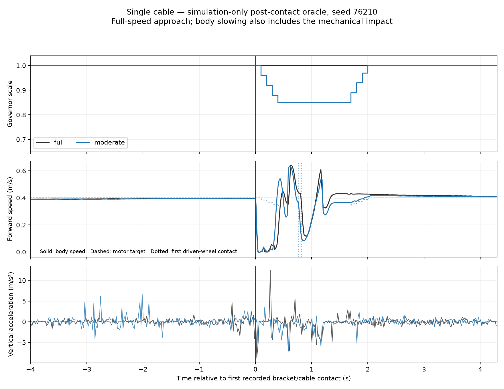

# H2 trên capsule — tín hiệu authority trong một điều kiện hẹp

Đây là vòng refinement đã khai báo sau đối chứng cylinder/capsule. Giữ
Moderate target 0.85, ramp 0.4/s và hold/release cũ. Full capsule tham chiếu
là ba lượt đã lưu, seeds 76210–76212. Không restore cùng snapshot.

## Kết quả

Tất cả sáu lượt có arrival vật lý và stop 2 s, cùng world/URDF/governor core.
Không có scale <1 trước contact. Không ghi điểm contact ngoài disk 0.75 m
ở ba lượt Moderate. Oracle chỉ ở research evaluator; không triển khai lên Pi.

Post-contact: first+0.05 s đến clearance body x=3.40 m; RMS/peak m/s²,
slip²/m s/m.

| Seed | Controller | Thời gian (s) | Post RMS | Post peak | Post slip²/m |
|---|---|---:|---:|---:|---:|
| 76210 | Full PI | 16.7 | 2.182 | 12.396 | 0.14993 |
| 76210 | Moderate oracle | 16.9 | 1.596 | 6.915 | 0.08295 |
| 76211 | Full PI | 16.7 | 1.858 | 10.753 | 0.13911 |
| 76211 | Moderate oracle | 16.9 | 1.531 | 6.954 | 0.07481 |
| 76212 | Full PI | 16.6 | 2.398 | 11.566 | 0.07401 |
| 76212 | Moderate oracle | 17.0 | 1.701 | 6.970 | 0.07017 |

Trung bình: RMS giảm **25.0%**, peak giảm **40.0%**, slip²/m giảm **37.2%**,
time tăng **0.267 s**. Ba cặp đều giảm cả ba local quality metrics. Đây là
bằng chứng thuận lợi hơn vòng cylinder, nhưng số lặp nhỏ và không kiểm soát
toàn bộ caster/contact state. Không gọi đây là causal proof hay generalization.

## Quyết định

**Có tín hiệu H2 local đủ để thử detector cảm biến trên cùng điều kiện**.
Chưa hoàn tất ma trận H2 bốn họ vật cản/hai tốc độ/năm lặp của Deep Research;
chưa có H1 hoặc H3. Tác động đầu tiên không được tuyên bố tránh/giảm trước
khi robot nhận thông tin. Mức lợi ích trên robot thật và operating envelope
chưa biết.

Tiếp theo đã chạy một ablation trigger có căn cứ, xem
[governor gyro/wheel-error](MOTION_TRIGGER_GOVERNOR_2026-10-16.md). Kết quả
oracle không được thay cho kết quả sensor-only hoặc dùng để tuyên bố governor
deployable đã đạt quality gate.

## Dữ liệu

- [Native outcomes, timing, provenance và paired differences](governor_capsule_oracle_refine_2026-10-16/result.json).
- [Contact geometry](governor_capsule_oracle_refine_2026-10-16/contact_geometry.json).
- Raw: `rl_runs/governor_capsule_oracle_refine_2026-10-16/`.
- Original core snapshot đã tái lập và khớp chính xác SHA256 ghi trong logs.

