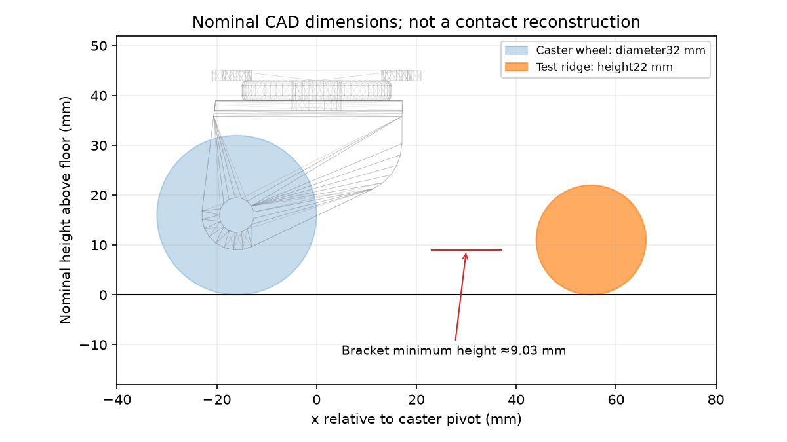

# Đối chiếu cơ khí caster trước correction tiếp theo — 16/10/2026

## Kết quả của bước này

Đã trích xuất geometry và khối lượng từ **expanded URDF thực sự dùng trong
bốn lượt repeatability**, kiểm tra với STL nguồn và lập phiếu đo phần cứng.
Đây là audit offline. Chưa có số đo caster thật; chưa chọn correction vật lý
hoặc controller và chưa chạy thêm simulation/tuning/PPO/predictor.

[Bốn lượt trước](GOVERNOR_FROZEN_REPEATS_2026-10-16.md) đều đạt arrival/dừng
2 giây và reporting. Governor cải thiện crossing RMS ở hai cặp, nhưng whole
RMS đổi chiều; impact biến thiên ở cả PI và governor. Không đủ bằng chứng
để chọn tăng HOLD hoặc sửa RECOVER. Deep Research yêu cầu kiểm tra ràng buộc
vật lý và quyền điều khiển trước khi xây predictor; audit này phục vụ đúng
quyết định đó, không yêu cầu mô phỏng hoàn hảo.

## 1. Giá trị danh nghĩa có thể tái tạo

Hệ tọa độ: `base_footprint` nằm trên sàn z=0, thân ngang, mọi joint ở góc 0.
Đây **không phải tư thế đã settle dưới tải** hoặc reconstruction lúc va chạm.

| Đại lượng | Mô hình hiện dùng | Tình trạng phần cứng |
|---|---:|---|
| Khoảng hở bracket nhỏ nhất, mỗi bên | 9.032 mm | Chưa đo |
| Đường kính bánh caster | 32 mm | Chưa đo |
| Bề rộng cylinder caster | 21 mm | Chưa xác nhận; chưa cần đo để quyết định đầu tiên |
| Tâm caster wheel (x, y, z) | (227.62, ±88, 16) mm | Từ transform URDF |
| Tâm swivel (x, y, z) | (243.62, ±88, 41) mm | Từ transform URDF |
| Đáy caster wheel danh nghĩa | 0 mm | Chỉ kiểm tra nhất quán hình học |
| Gờ capsule trong screen | Cao 22 mm | Vật thể cứng mô phỏng, không phải dây mềm |
| Tổng khối lượng các link có inertial | 5.590581 kg | Chưa cân robot thật |
| COM tổng ở tư thế danh nghĩa | (81.196, 0, 137.831) mm | Chưa đo COM thật |

Công thức khoảng hở bracket: **62.5 − 21.5 − 31.967647 ≈ 9.032353 mm**.
Giá trị cuối lấy từ vertex thấp nhất của STL, không phải số suy ra từ ảnh.
Bracket visual/collision có cùng mesh và transform; điều đó không chứng minh
physics engine giữ đúng mọi chi tiết lõm/hở hoặc contact thực tế.

**Phát hiện tài liệu:** `HARDWARE_REFERENCE.md` còn ghi tổng khối lượng
4.688867 kg và nói toàn bộ CAD mass/inertia được giữ nguyên. URDF hiện dùng
chassis 2.5 kg, LiDAR 1.3 kg, hai drive wheel tổng 1.6 kg, hai assembly caster
tổng 0.190581 kg. Đã sửa tài liệu theo dữ liệu hiện tại, không thay mô hình.
Không quy sai số tài liệu này thành nguyên nhân đã chứng minh của impact.

Nguồn máy đọc được: [nominal_reference.json](caster_mechanical_reference_2026-10-16/nominal_reference.json),
bao gồm hash URDF/STL, khối lượng từng link và giới hạn kết luận.



## 2. Hai phép đo thật cần làm

Không cần ROS, Pi hay lệnh motor cho bước này. Đặt robot đứng yên trên mặt
phẳng, với pin/phụ kiện và tải sử dụng được ghi rõ.

1. **Khoảng hở bracket–sàn bên trái và phải:** đo khoảng cách thẳng đứng
   từ sàn đến điểm thấp nhất của phần bracket/fork cứng, không phải đến
   đáy bánh. Ghi hướng caster lúc đo và chụp ngang có thước trong cùng mặt
   phẳng. Nếu caster đang nhấc khỏi sàn, ghi rõ và không ép nó xuống để lấy
   một số đo “khớp”.
2. **Đường kính bánh caster trái/phải:** đo qua tâm bánh hoặc bằng thước kẹp,
   không tính bracket. Ghi độ chia thước và sai số ước lượng; không cần báo
   nhiều chữ số hơn dụng cụ cho phép.

Có thể điền [phiếu JSON](caster_mechanical_reference_2026-10-16/hardware_measurements.json)
hoặc gửi dạng: `trái: gap … mm, Ø … mm; phải: gap … mm, Ø … mm; tải …;
sai số khoảng … mm`, kèm ảnh nếu có. Các trường hiện là `null`, không được
thay bằng giá trị CAD để xem như đã xác nhận. Khối lượng tổng là phép đo bổ
sung hữu ích sau đó, không mở thêm một danh sách bắt buộc ở bước này.

## 3. Quyết định sau khi có số đo

| Bằng chứng | Hành động phù hợp |
|---|---|
| Kích thước thật khác mô hình vượt sai số đo | Đối chiếu datum/lắp ráp, chọn một sai lệch đã xác nhận để sửa; tạo contract mới trước một screen nhỏ |
| Kích thước phù hợp | Giữ geometry; bracket-first contact vẫn cần xét hình học/tư thế thực, không tự kết luận numerics sai |
| Chưa đo được hoặc ảnh không phân biệt bánh/bracket | Giữ trạng thái chưa xác nhận; không tự nâng bracket, giảm gờ hoặc tune damping để làm đẹp kết quả |

Khoảng hở 9 mm **không tự cho giới hạn vượt gờ 9 mm**: còn hình dạng fork,
thứ tự contact, nghiêng thân, tải và đáp ứng bánh. Tương tự, gờ cao 22 mm
không tự chứng minh robot bị kẹt, vì bốn lượt đã vượt được. Chưa được tuyên
bố đó là envelope vận hành an toàn hoặc đại diện mọi cáp/rãnh/hõm nhà máy.

First named manifold và sample có lực đầu tiên tiếp tục là hai mốc khác nhau.
Audit trước ghi bracket trái trước trong 4/4 lượt, lực ban đầu bằng 0 và
sample có lực xuất hiện sau 11–13 ms ở contact sampling 100 Hz. Không đổi
crossing window/score cũ, không lấy contact force/caster state làm đầu vào
governor triển khai.

## 4. Verification và cách chạy lại offline

Tool chỉ đọc URDF đã expand và binary STL; viết output mới bằng exclusive
create, không sửa run cũ và không gọi ROS/Gazebo. Nó tính transform joint,
bounds vertex bracket, extent cylinder theo hướng và COM theo khối lượng.

```bash
cd ~/ninorobot
python3 src/nino_rl/scripts/audit_caster_mechanical_reference.py \
  --urdf rl_runs/governor_frozen_repeats_2026-10-16/attempt_01/confirmation/repeat/screen/seed_77200_reactive/contact/20261016T070643-606677Z/robot_description.urdf \
  --description-package src/nino_description \
  --output /tmp/nino_caster_reference.json
```

Nếu output đã tồn tại, chọn tên mới để giữ bản trước. Kết quả verification
được ghi tại [verification.json](caster_mechanical_reference_2026-10-16/verification.json).
Kiểm tra hình học độc lập, mass/COM, bốn URDF đồng nhất và các hash runtime/
config cũ; không lấy số lượng test làm bằng chứng contact vật lý đã đúng.

13/13 kiểm tra arithmetic/provenance đạt; 1.093 protected files và 165 input
files trong manifest cũ không đổi. Tool compile được. Lần verification đầu
so tuple trong Python với list đọc từ JSON nên báo khác representation;
đã chuẩn hóa representation trong verifier, không sửa số đo/tính toán.
Bản verification đầu được giữ riêng để truy vết.

**Điểm dừng:** phần chuẩn bị offline đã xong. Hai kích thước thật là dữ liệu
còn thiếu để chọn correction cơ khí có căn cứ. Khi có dữ liệu đó mới chốt
một thay đổi và ngân sách kiểm chứng; không tự mở rộng batch chỉ vì chưa
chọn được correction.
