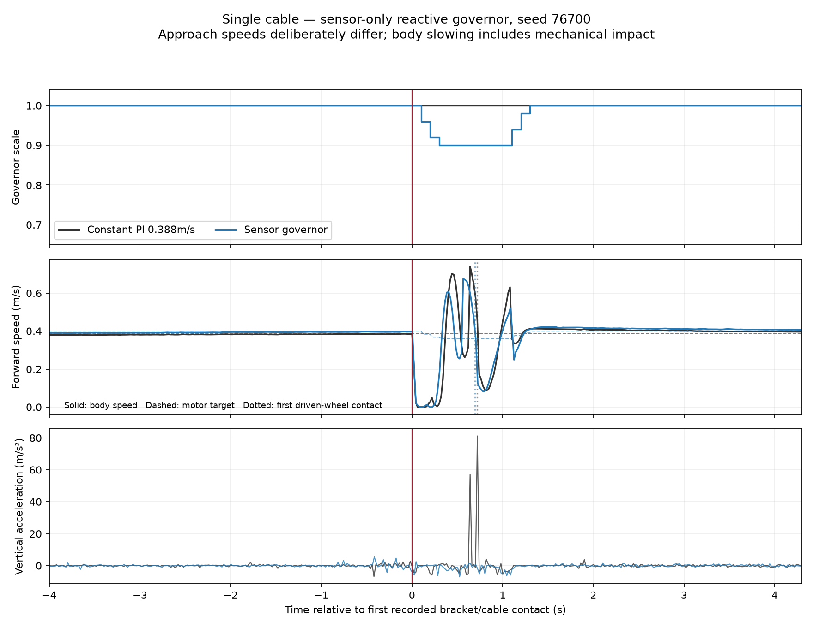

# Tuning governor cổ điển — contract mới, phạm vi crossing

## Quyết định sau audit offline

Trace đầy đủ và PI timing ổn định. Lượt 76500 cho thấy wheel/body gần đứng
lại trong nhiều đoạn khi reference vẫn yêu cầu tiến, contact bracket kéo dài
và phục hồi sau đó. Đây là failure mode có ích để khảo sát mức giảm tốc và
hold, không phải lý do đổi PI hoặc đoán lại collision.

RMS/peak impact **chưa đủ tin cậy để làm objective tuning**: ba spike đơn lẻ
chiếm 97–99% tích phân bình phương. Hai pha decimation 50→25 Hz thay đổi lớn
RMS/peak. Đó chỉ là diagnostic sampling sensitivity; không chứng minh aliasing
tại 50 Hz và không cho phép xóa outlier hay coi impact giả.

Theo yêu cầu mới, cho phép một **screen governor cổ điển về thời gian/slip
trong mô phỏng**, không mở predictor/PPO hoặc gọi đây là impact optimization.
Tất cả RMS/peak/P95 vẫn được báo và chặn mọi tuyên bố triển khai thật.
Đây là contract mới, không sửa kết quả hoặc objective của batch cũ.

## Protocol trước simulation — tối đa 18 episodes

Ba candidate cố định, Optuna quản lý trial/SQLite và chọn best observed:

| Trial | Target scale | Maximum hold (s) |
|---|---:|---:|
| 0 — cấu hình hiện tại | 0.85 | 2.5 |
| 1 — giảm ít hơn, phục hồi sớm hơn | 0.90 | 1.0 |
| 2 — giảm nhẹ, hold ngắn | 0.95 | 0.8 |

Không gọi ba điểm enqueue là tìm được optimum toàn search space hoặc một
nghiên cứu Bayesian lớn. Không có trial bổ sung tự động, retry hoặc pruning.

- Development seeds **76600–76601**, mỗi trial 2 seeds × 2 controllers:
  **12 episodes**. Mỗi trial có PI 0.388 m/s riêng, thứ tự PI/candidate ngẫu
  nhiên trong từng block với RNG 76650+trial index. Không identical snapshot.
- Freeze best params trước mở validation **76700–76702**. Chỉ validate nếu
  feasible và development objective <1. Validation 3×2 = **6 episodes**.
  Nếu không có ứng viên tốt hơn PI trên dev, dừng ở 12, không dùng test để chọn.
- Giữ physics/world/robot/PI/reset, detector/observations/quiet/minimum hold
  0.8/ramp 0.4/s, cruise governor 0.400 và physical arrival/stop scoring.
  Chỉ thay `target_scale` và `maximum_hold_seconds`.
- Profile `moderate` hardcode target 0.85, nên tuner dùng `reactive` để target
  có hiệu lực. Regression replay xác nhận reactive 0.85 thực thi giống
  moderate 0.85; không sửa governor core hay action mapping.

### Objective cố định

Cho mỗi seed cùng trial, PI reference là mẫu đối chứng riêng của block:

`cost = 0.5*(T_governor/T_PI + S_governor/S_PI)`
`       + max(0, RMSE_governor/RMSE_PI - 1.05)`

`J = mean(cost)`; minimize. `S` là slip²/m trong cửa sổ event đã có
(first+0.05 → body qua x=3.40 m). J của chính reference là 1.0.

- Arrival/stop failure: `100 + 10*n_failures`, không thể thắng trial feasible.
- Missing/aborted data hoặc PI reference fail: trial FAIL/unavailable, không
  gán thành slip/impact=0 hoặc xóa native physical failure đã ghi.
- Đơn vị cost là dimensionless ratios. Hai weight 0.5 cân bằng thời gian và
  slip như một lựa chọn exploratory đã chốt trước; không phải chuẩn ngành.
- Native peak/RMS/P95 được báo toàn bộ, **không bị bỏ khỏi báo cáo vì không
  nằm trong objective này**. Chưa có impact benefit hay safety guarantee.
- Không retune PI cruise để ép time matching; báo thời gian thật và trade-off.

Validation pass cho **crossing screen**: tất cả arrival/stop, J<1 và mean
path RMSE≤1.05×PI validation. Dù pass, chưa promote hoặc gọi giảm impact;
vẫn cần measurement fidelity và feasibility ngoài một cáp cố định.
Nếu fail, không chọn lại candidate bằng validation, không thêm trial/penalty.

## Phương pháp và nguồn

Optuna lưu study SQLite, enqueue candidate cố định, ask/tell cho lifecycle.
Không import lịch sử PPO hoặc score của contract khác.
[Study API chính thức](https://optuna.readthedocs.io/en/stable/reference/generated/optuna.study.Study.html),
[Persistent storage](https://optuna.readthedocs.io/en/stable/reference/generated/optuna.create_study.html).

Code: `src/nino_rl/scripts/tune_classical_governor.py`.
Raw output mới: `rl_runs/classical_governor_crossing_tune_2026-10-16/`.

## Trạng thái

**Hoàn tất 16/10/2026:** audit offline, 3 Optuna trials development và 6
validation episodes đã xong, đúng ngân sách **18/18 arrival/stop**. Không
thêm trial, không retune bằng validation, không train PPO/predictor. Các
simulator của study đã đóng.

## Kết quả development và selection

| Trial | Target | Max hold (s) | J development | Candidate arrival/stop |
|---|---:|---:|---:|---:|
| 0 — cấu hình hiện tại | 0.85 | 2.5 | 1.299772 | 2/2 |
| 1 — được chọn | **0.90** | **1.0** | **0.998873** | 2/2 |
| 2 | 0.95 | 0.8 | 1.399766 | 2/2 |

Mốc PI là 1.000. Dev chỉ có hai blocks; trial 1 gần ngang PI, không được coi
chênh 0.001127 là bằng chứng chắc chắn. Tham số được ghi vào
`selection_before_validation.json` **trước** mở bank 76700–76702, sau đó giữ
nguyên. Không chọn lại trial bằng validation.

Không suy ra ảnh hưởng độc lập của target và hold từ ba cặp tham số này.
Đây là best observed trong một screen nhỏ, không phải optimum toàn miền.

## Validation riêng — 76700–76702

| Chỉ số trung bình, mỗi controller 3 lượt | Constant PI 0.388 | Governor 0.90 / max hold 1.0 | So với PI |
|---|---:|---:|---:|
| Arrival / stop 2 s | 3/3 / 3/3 | 3/3 / 3/3 | Đạt native gate |
| Completion time (s) | 17.200 | **16.700** | −2.91% |
| Physical path RMSE (mm) | 5.178 | **4.658** | −10.05%; qua gate mean≤1.05×PI |
| Post-contact slip²/m (s/m) | 0.13356 | **0.08592** | −35.67% |
| Whole-route slip RMS đã lưu | **0.09037** | 0.09699 | **+7.32%** |
| Post-contact vertical RMS đã đo (m/s²) | 12.706 | 1.724 | Native sampled metric, chưa chứng minh true-impact benefit |
| Post-contact sampled peak (m/s²) | 120.504 | 6.719 | PI có outliers; giữ nguyên mọi mẫu |

J validation = **0.821492**, từng block **0.850628 / 0.746990 / 0.866858**.
Theo contract mới, crossing-feasibility screen **PASS**: physical gates,
J<1, tracking guard đều đạt. Thời gian và local slip tốt hơn ở cả ba cặp;
đây là bằng chứng cục bộ trong simulation trên một cáp cố định.

Không gọi đây là time-matched H3: approach speed và mean completion time khác
nhau có chủ ý, baseline không được quét lại. Trong ba cặp này local slip
giảm mà không tăng tổng thời gian, nhưng không đủ để kết luận cơ chế có lợi
trên mọi contact state, góc cáp, vật lý hay môi trường mới.

### Từng validation block

| Seed | Time PI → governor | Post slip²/m PI → governor | Path RMSE PI → governor (mm) | J |
|---|---:|---:|---:|---:|
| 76700 | 17.1 → 16.7 | 0.09134 → 0.06619 | 5.664 → 4.140 | 0.85063 |
| 76701 | 17.3 → 16.7 | 0.18961 → 0.10024 | 4.751 → 4.977 | 0.74699 |
| 76702 | 17.2 → 16.7 | 0.11972 → 0.09132 | 5.120 → 4.856 | 0.86686 |

## Điều chưa đạt và quyết định áp dụng

**Giữ cấu hình 0.90/1.0 làm candidate nghiên cứu đã qua crossing screen;
chưa đổi default triển khai.** Whole-route slip RMS tăng 7.32%, nên chưa đạt
mục tiêu cải thiện toàn tuyến mà không đánh đổi metric khác. Không gộp pass
crossing với pass chất lượng tổng thể hoặc deployment.

Whole-route RMS trong `ros_env.py` là tổng bình phương slip tại các control
steps; local slip²/m dùng raw joint/GT alignment và tích phân theo thời gian/
quãng đường. Chúng khác sampling, cửa sổ và normalization. Không suy ra ngay
rằng slip chắc chắn tăng ở recovery/cruise chỉ từ hai aggregate; cần audit
cùng cách lấy mẫu trước khi chọn correction tiếp theo.

RMS/peak trong validation được giữ đầy đủ, dù nhìn tốt hơn PI. Các outlier
PI và phép đo 50 Hz khiến chưa được tuyên bố giảm impulse/true peak, cũng
không dùng chúng để khẳng định governor đã an toàn cho robot thật.

Bước tiếp theo có giá trị: **audit offline whole-route slip ở các trace
validation**, phân vùng braking/holding/recovery/cruise với cùng estimator/
sampling, giữ tham số đã khóa. Validation bank này từ đó là diagnostic,
không dùng lại để chọn cấu hình rồi gọi là test độc lập. Chưa mở rộng Optuna,
PPO, predictor hoặc mixed-map curriculum từ kết quả này.

## Artifact, source và verification

- [Audit offline trước tuning](governor_tuning_readiness_2026-10-16/REPORT.md).
- [Study results: mọi stage, native outcomes và cost components](classical_governor_crossing_tune_2026-10-16/study_results.json).
- [Contract đã chốt](classical_governor_crossing_tune_2026-10-16/contract.json).
- [Selection ghi trước validation](classical_governor_crossing_tune_2026-10-16/selection_before_validation.json).
- [Decision](classical_governor_crossing_tune_2026-10-16/decision.json).
- [Config candidate đã kiểm tra, chỉ dành nghiên cứu](classical_governor_crossing_tune_2026-10-16/selected_candidate.yaml).
- SQLite study và source/config/raw hashes nằm cùng artifact; raw streams giữ
  nguyên dưới `rl_runs/classical_governor_crossing_tune_2026-10-16/`.

Metadata cả 18 case xác nhận logger đóng; world/URDF/core/PI có cùng SHA.
6 focused tests pass cho profile-equivalence, objective/failure/missing và
sampling diagnostic; 18 native runs kiểm tra execution thực trong sim.
Không thay PI, vật lý, detector, ramp hoặc native scoring. Lỗi shutdown
Gazebo sau khi ghi xong vẫn lưu trong log, không đổi thành crossing failure.
