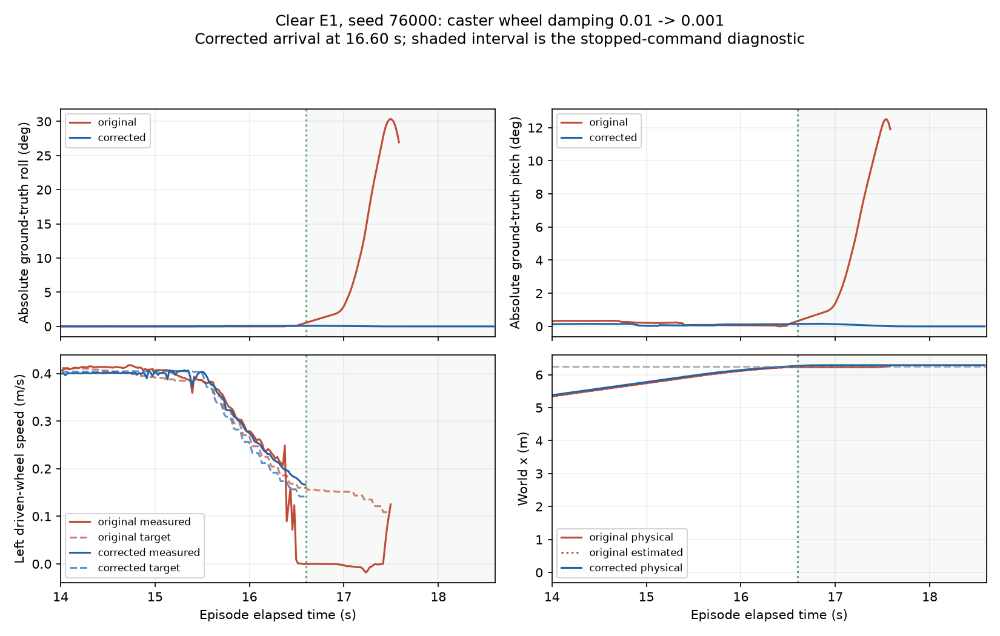

# Ổn định Nino trên sàn sạch — 15/10/2026

**Kết quả tiếp theo:** [ba cold start và audit contact/IMU](GOVERNOR_CLEAR_REPEAT_AND_CABLE_2026-10-15.md).
Ba seed đều đến đích/dừng, nhưng quality measurement còn chưa sẵn sàng;
giữ nguyên giới hạn của correction ban đầu dưới đây.

## Phạm vi sửa

Dùng trace E1 seed 76000 bị gián đoạn để chọn correction vật lý, rồi chạy lại
cùng tuyến/seed với PI toàn tốc. Không thay reward, governor threshold, ramp,
PI gains, tiêu chí physical arrival hoặc kiểm tra sensor/clock.

Audit có thể chạy lại bằng:

```bash
cd ~/ninorobot
source /opt/ros/jazzy/setup.bash
source .venv/bin/activate
source install/setup.bash
python src/nino_rl/scripts/audit_clear_floor_stability.py \
  --evaluation rl_runs/governor_foundations_2026-10-15/clear_arrival \
  --logger rl_runs/governor_foundations_2026-10-15/clear_arrival_contact \
  --output docs/governor_stability_2026-10-15/baseline_audit.json
```

## Chuỗi sự kiện đã xác nhận từ trace gốc

| Sự kiện | Thời gian tương đối |
|---|---:|
| Hai bánh caster cùng có tốc độ dưới 1 rad/s liên tục ≥0.1 s | 16.491 s |
| Ground truth vượt tilt 5° | 17.083 s |
| Ground truth vượt roll 15° | 17.243 s |
| Chassis contact floor được ghi đầu tiên | 17.466 s |
| Control trace cuối được lưu | 17.500 s |
| Ground truth cuối trước measurement abort | 17.583 s |

Bánh chủ động trái có vận tốc gần 0/âm trong khi target vẫn dương; PI tăng
mô-men tới khoảng 1.14 N·m. Bánh phải còn quay nhưng contact phía phải không
còn được ghi ở cuối khoảng đo. Contact plugin chỉ phát message không rỗng:
không dùng khoảng im lặng để khẳng định thời điểm lift-off chính xác.

Không có residual torque học được. Mô-men đo được chưa chạm trần 4 N·m, nên
không có căn cứ chọn tăng giới hạn torque hoặc đổi reward làm sửa đầu tiên.
Định vị mất wall scan khi thân đã nghiêng; bỏ freshness check không sửa được
trạng thái support/contact vật lý trước đó.

Đây là thứ tự theo thời gian, chưa tự chứng minh caster damping là nguyên
nhân duy nhất. Candidate được chọn vì vừa có chỉ báo rolling bất thường,
vừa có magnitude lực cản đáng kiểm tra.

## Correction được kiểm tra

Giảm **damping trục bánh caster 0.01 → 0.001 N·m·s/rad**, giữ swivel dynamics,
inertia, ma sát, collision geometry và cấu hình PI. Thử nghiệm dùng config
`factory_floor_governor_caster_candidate.yaml` và launch argument khớp.
Logger xác nhận URDF thực tế chứa damping 0.001 ở cả hai bánh caster.

Theo ý nghĩa viscous damping, `tau=b*omega`; nếu lăn với bán kính 0.016 m thì
`F_drag=b*v/r²`. Ở 0.25 m/s, magnitude tương đương là khoảng **9.77 N mỗi
caster** với b=0.01, và **0.977 N** với b=0.001. Đây là phép tính từ mô hình,
không là force đã đo trên phần cứng hoặc chứng minh một lỗi tích phân DART.
Định nghĩa/đơn vị damping tham khảo [tài liệu URDF của Gazebo](https://classic.gazebosim.org/tutorials?tut=ros_urdf#Joints);
các ghi chú ODE trong tài liệu đó không được mặc định áp dụng cho DART.

Raw dữ liệu A/B lưu trong `rl_runs/governor_stability_2026-10-15/`; baseline
bị gián đoạn vẫn giữ riêng, không ghi đè hoặc biến thành completed failure.

## Kết quả chạy lại

| Chỉ số | Gốc b=0.01 | Sửa b=0.001 |
|---|---:|---:|
| Attempt E1 clear, seed 76000 | Measurement aborted | Physical arrival |
| Thời gian | Trace tới 17.50 s; chưa có completed episode | 16.60 s |
| Sai số đích vật lý | ≈0.215 m ở control step cuối | 0.18408 m |
| Physical path RMSE toàn episode | Không khả dụng | 0.005285 m |
| Max trị tuyệt đối roll từ GT trong khoảng audit | 30.335° | 0.250° |
| Max trị tuyệt đối pitch từ GT trong khoảng audit | 12.516° | 0.399° |
| Hai caster gần dừng liên tục khi approach | Bắt đầu 16.491 s | Không phát hiện theo cùng tiêu chí |
| Định vị/episode hoàn tất | Không | Có |

Chỉ có **một** matched seed, không phải chứng minh repeatability hoặc tỷ lệ
thành công tổng quát. Các số baseline chỉ mô tả trace quan sát trước abort;
không gán missing whole-route metric bằng 0. Cùng seed không là exact snapshot.

Clock error lớn nhất ở lượt sửa ≈4.09e-14 s, motion sensor lag lớn nhất≈0.018 s.
PI gains, torque limits, estimator và physical scoring giữ nguyên. Profile
full không có governor intervention hoặc residual torque.



### Kiểm tra sau khi đến đích

Episode kết thúc khi còn vận tốc≈0.165 m/s theo arrival rule hiện có, nên
chưa đủ để kết luận robot dừng ổn định. Logger tiếp tục ghi khi evaluator gửi
lệnh 0 và trả world về chạy. Cửa sổ 2 s sau arrival có 100 pose/100 drive samples,
coverage pose 1.98 s, lệnh linear/yaw đều 0:

- Max |roll|≈0.0884°, max |pitch|≈0.1627°.
- Vận tốc cuối≈0.000648 m/s.
- Physical x cuối≈6.28987 m; không ghi nhận chassis contact trong cửa sổ này.
- Diagnostic `settled=true`: coverage hợp lệ, command stop, tilt<5° và
  tốc độ cuối<0.01 m/s. Đây là ngưỡng diagnostic khai báo riêng, **không thay
  arrival scoring hoặc giới hạn an toàn phần cứng**.

`audit_clear_floor_stability.py` tự tính cửa sổ này cho một evaluation thành
công; thiếu dữ liệu/feedback/gap dài phải trả unavailable, không coi đã settle.

## Profile sửa được cung cấp

- Config: `src/nino_rl/config/factory_floor_stability_pi_check.yaml`.
- Launch: `factory_floor_stability.launch.py`, ghép cố định đúng config và
  model damping 0.001; mặc định world clear, PI toàn tốc, instrumentation 7 component.
- Config mới có contract vật lý riêng; test xác nhận mọi phần còn lại của
  config controller/estimator/reward/arrival/clock giống baseline cũ.
- Native replay dùng config candidate ghi đúng damping 0.001. Profile sửa
  mới đóng gói cùng tham số vật lý/controller đó, với metadata xác nhận giới
  hạn kiểm chứng; không diễn giải metadata mới là một lượt native bổ sung.
- Không sửa model gốc 0.01 để vẫn tái hiện các thí nghiệm lịch sử. Dùng entry
  mới dưới đây cho baseline đã sửa; không mặc định model cũ đã đổi damping.

Trong cả hai terminal:

```bash
cd ~/ninorobot
source /opt/ros/jazzy/setup.bash
source .venv/bin/activate
source install/setup.bash
export ROS_DOMAIN_ID=189
export NINO_ROS_DOMAIN_ID=189
export ROS_AUTOMATIC_DISCOVERY_RANGE=LOCALHOST
export GZ_PARTITION=nino_stability_189
```

Terminal A:

```bash
ros2 launch nino_rl factory_floor_stability.launch.py \
  headless:=false output_directory:=rl_runs/stable_pi_repeat/contact
```

Terminal B, sau khi controller sẵn sàng:

```bash
ros2 run nino_rl evaluate_baseline \
  --config src/nino_rl/config/factory_floor_stability_pi_check.yaml \
  --route E1 --episodes 1 --seed 76000 --control-trace \
  --output rl_runs/stable_pi_repeat/evaluation
```

Sau evaluation, để logger ghi thêm ít nhất 2 s **simulation time** khi robot
đã nhận lệnh dừng rồi đóng launch bằng Ctrl+C. Phân tích offline:

```bash
python src/nino_rl/scripts/audit_clear_floor_stability.py \
  --evaluation rl_runs/stable_pi_repeat/evaluation \
  --logger rl_runs/stable_pi_repeat/contact \
  --output rl_runs/stable_pi_repeat/stability_audit.json
```

## Giới hạn và bước tiếp theo

Correction đã xử lý trường hợp E1 clear vừa lỗi và giữ ổn định khi dừng trong
cửa sổ quan sát. Chưa xác nhận mọi seed/tuyến hoặc robot thật. Damping cần đo
trên phần cứng trước sim-to-real, không xem 0.001 là tham số bearing đã hiệu chuẩn.

Rung nền, slip và detector false trigger chưa được giải quyết bởi kết quả
arrival này. Bước tiếp theo là xác nhận lặp lại profile sàn sạch và đo một
vật cản riêng với cùng model, rồi kiểm tra control authority. Predictor và
Optuna tiếp tục giữ lại theo yêu cầu; chưa có PPO run nào được khởi động.

Build package thành công; entry launch mới đã được kiểm tra bằng `--show-args`;
**69 tests passed**, gồm kiểm tra không đổi physical scoring/PI và không gán
settled khi dữ liệu sau dừng bị thiếu. Các simulator do phép thử mở đã đóng.
