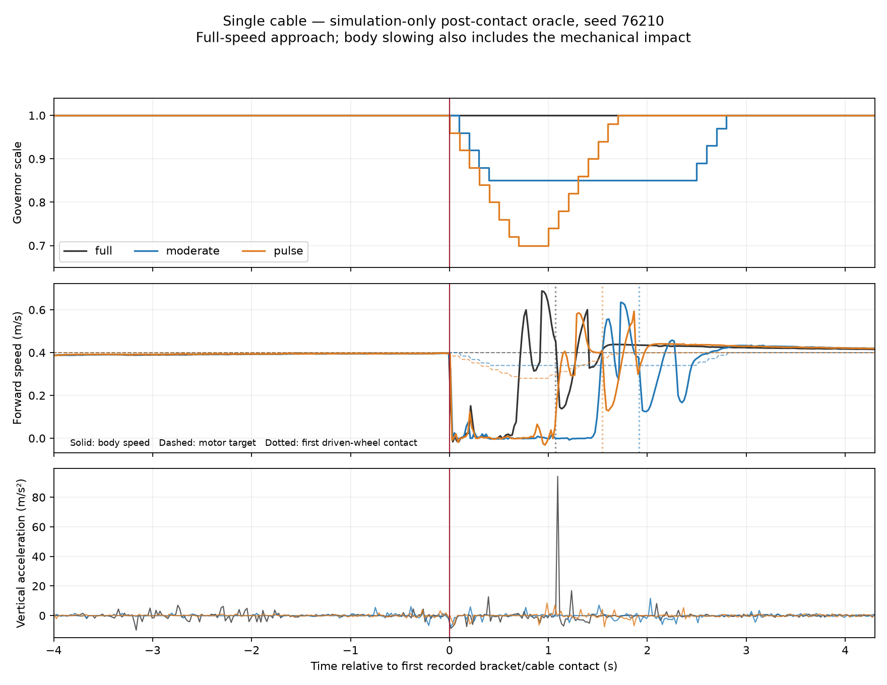

# H2 — can thiệp sau contact, một cáp trên nền box

## Protocol trước khi chạy

Đối chiếu báo cáo Deep Research: ưu tiên H2 trước H1/H3. Đây là screen
thu hẹp ở một cáp cứng và một tốc độ tiếp cận, chưa thay thế ma trận bốn
họ vật cản/hai dải tốc độ trong báo cáo.

- Cáp C1 x=2.90 m, bán kính 11 mm, góc 0°; world `cable_box`.
- E1, wheel PI và caster damping 0.001; physics 1 ms, điều khiển 100 ms.
- Ba cold start độc lập/profile, seeds 76210–76212; thứ tự full/moderate/pulse.
  Seed không tự tạo biến thiên vật lý khi randomization đang tắt. Đây là
  phép đo lặp và matched scenario, không phải khôi phục cùng snapshot.
- Tiếp cận toàn tốc, không có trigger từ IMU/encoder trước hoặc sau contact.
  Oracle chỉ cung cấp contact đầu tiên với cáp qua topic contact mô phỏng.
  Quyết định bắt đầu tại control boundary kế tiếp sau khi nhận message.
- Full: không can thiệp. Moderate: target 0.85, release theo quiet/min hold
  0.8 s/max hold 2.5 s hiện có. Pulse: target 0.70, duration 1 s hiện có.
- Giữ ramp 0.4/s, bounds 0.55–1, feedback/timing/failsafe, scoring vật lý
  và kiểm tra dừng 2 s. Không sửa robot, PI, geometry, estimator hay reward.
- Oracle ở module nghiên cứu riêng, không nối vào ROS governor triển khai.
  Metadata phải ghi rõ oracle và không gọi nó là detector deployable.

## Phân tích và quyết định đã định trước

1. Kiểm tra scale trước contact = 1, tốc độ tiếp cận và first-impact giữa
   các lần chạy. Nếu khác biệt đáng kể, báo confound trước khi so outcome.
2. Đo contact → nhận message → control decision → motor target/response;
   không gán giảm tốc thụ động do va chạm thành đáp ứng điều khiển.
3. Giữ cửa sổ first 50 ms làm negative control; đánh giá phần còn lại tới
   clearance x=3.40 m, cùng với metric toàn hành trình. Clearance chỉ dùng
   offline, không phải input governor. Slip energy/m có đơn vị s/m, không J.
4. Báo từng arrival/failure/unavailable, tracking, thời gian, impact, slip
   và repeatability. So với full ở matching approach, không tuyên bố H3
   hoặc thắng time-matched/tuned reactive PI từ screen này.
5. H2 chỉ có tín hiệu tích cực nếu một profile tạo lợi ích lặp lại lớn hơn
   biến thiên baseline, vẫn vượt được và không chỉ chuyển chi phí sang slip,
   tracking hoặc thời gian quá lớn. Chưa có ngưỡng ứng dụng phần cứng được
   hiệu chuẩn; không thay bằng ngưỡng phần trăm tùy tiện.
6. Nếu không có lợi ích, chỉ chọn tối đa một correction nếu trace chứng minh
   một lỗi cụ thể. Nếu thiếu bằng chứng, dừng mở rộng predictor/PPO/Optuna
   và ghi rõ giới hạn kết luận. Không quét vô hạn profile/reward.

## Trạng thái

Protocol được ghi trước simulation. Batch đã hoàn tất, không có measurement
abort: **9/9 physical arrival, 9/9 dừng ổn định 2 s**. World/URDF/core hash
giống nhau giữa các lượt; scale trước contact bằng 1. Vận tốc tiếp cận nằm
trong 0.3957–0.3966 m/s. Đây vẫn là cold-start repeats, không cùng snapshot.

## Kết quả

Trung bình ba lượt/profile; post-contact từ first+0.05 s tới body x=3.40 m.
RMS/peak là gia tốc đứng m/s², slip² tích phân/quãng đường có đơn vị s/m.

| Profile oracle | Arrival/stop | Toàn tuyến (s) | Post RMS | Post peak | Post slip²/m |
|---|---|---:|---:|---:|---:|
| Full | 3/3 | 16.867 | 5.780 | 64.942 | 0.26690 |
| Moderate | 3/3 | 17.433 | 3.632 | 36.645 | 0.18603 |
| Pulse | 3/3 | 17.100 | 10.949 | 112.543 | 0.15246 |

Moderate so với Full: trung bình RMS giảm 37.2%, slip²/m giảm 30.3%, thời
gian tăng 0.567 s. Tuy nhiên RMS giảm ở seed 76210 và **tăng ở hai seed còn
lại**; peak của Full cũng biến thiên 13.70–94.17 m/s². Không dùng mean này
để tuyên bố cải thiện lặp lại hoặc chọn model tốt nhất.

Pulse giảm slip²/m ở cả ba paired runs nhưng RMS cao hơn Full ở hai seed,
đặc biệt seed 76211 có peak **267.37 m/s²**. Giữ nguyên kết quả bất lợi.

### Timing và giới hạn causal inference

- Moderate: motor target giảm ≥10% sau first khoảng 0.217–0.319 s.
- Pulse: khoảng 0.213–0.222 s. Đây là target sau limiter, **chưa phải latency
  đáp ứng vận tốc thân**; thân có thể giảm tốc do chính va chạm.
- Oracle quyết định sau stamped contact từ gần 0 tới 0.098 s tùy alignment
  của control boundary. Không cộng receipt clock lag với decision delay.
- Khoảng first→caster ngắn hơn nhiều phần ramp; tác động khả thi chủ yếu ở
  phần sau chuỗi/contact bánh chủ động. Chưa đo latency motor thật.
- 50 ms đầu chỉ hoàn toàn trước can thiệp ở một số lượt. JSON đánh dấu
  `first_50ms_uncontrolled`; **không gọi mọi first-50ms peak là negative
  control**. Same seed/cùng approach speed không bảo đảm contact state giống nhau.

## Audit detector từ dữ liệu đã lưu

Trên ba Full clear-box cũ, vertical vượt ngưỡng ở 34/23/34 trong 156 frame
đủ điều kiện/lượt, tất cả khi command gần ổn định. Gyro/wheel-error không
vượt ở frame nào; gyro max khoảng 0.031–0.034 rad/s so với threshold 0.35.
Ở Full cable seed 76200, nhánh nonvertical vượt sau first khoảng 0.099 s.

Đây là **feature exceedances**, không phải số false-event closed-loop. RMS
tái dựng từ IMU có phần chồng lấn giữa sàn sạch và contact; đổi peak→RMS
không tự giải quyết detector. Một ablation bỏ trigger chỉ từ vertical có
căn cứ để cân nhắc, nhưng **chưa áp dụng/chưa xác nhận**. Expected response
conditioned on acceleration/deceleration/yaw vẫn cần kiểm tra nếu tiếp tục.

## Quyết định theo Deep Research

**Có authority về lệnh, chưa đủ bằng chứng H2 về quality lặp lại.** Contact
audit còn ghi điểm bracket–cáp xa robot và lực điểm lớn có triệt tiêu. Không
gán nguyên nhân engine khi chưa đối chứng. Chỉ thực hiện **một đối chứng
primitive cylinder/capsule** với PI không đổi; xem
[protocol fidelity](CABLE_COLLISION_FIDELITY_2026-10-16.md).

Giữ predictor/PPO/Optuna và randomization/curriculum chưa chạy. Không tăng
penalty, nối dài training cũ hoặc thay scoring từ kết quả này.

## Dữ liệu và tái lập

- Raw: `rl_runs/governor_contact_oracle_h2_2026-10-16/`.
- [Kết quả/provenance từng episode](governor_contact_oracle_h2_2026-10-16/result.json).
- [CSV so sánh](governor_contact_oracle_h2_2026-10-16/episodes.csv).
- [Audit detector](governor_contact_oracle_h2_2026-10-16/detector_negative_controls.json).
- [Audit contact positions](governor_contact_oracle_h2_2026-10-16/contact_geometry.json).



Batch runner lưu source snapshot và hash. Để chạy lại, build/source workspace,
chọn domain/partition riêng và output mới, rồi:

```bash
python src/nino_rl/scripts/run_clear_floor_repeat.py \
  --variant cable_box --oracle-contact --profiles full moderate pulse \
  --seeds 76210 76211 76212 --output rl_runs/contact_oracle_repeat_NEW
```

Oracle chỉ ở research module/factory riêng. Evaluator bình thường và ROS
governor triển khai không tự nhận contact/pose/GT. Logger metadata oracle
đã ghi `governor_has_no_oracle_input=false`; không giả là sensor-only.
