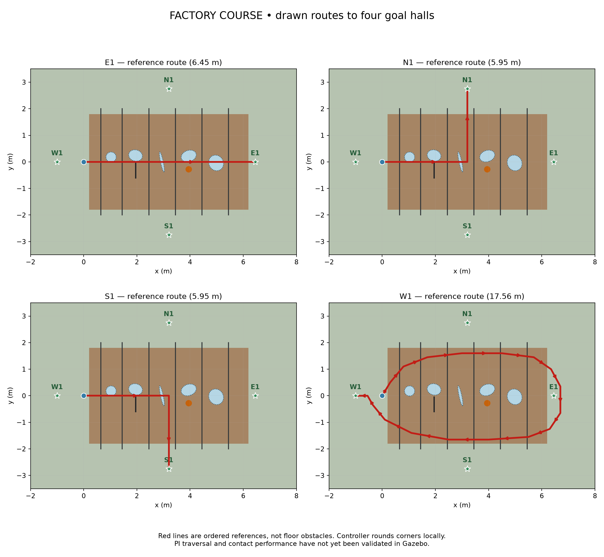
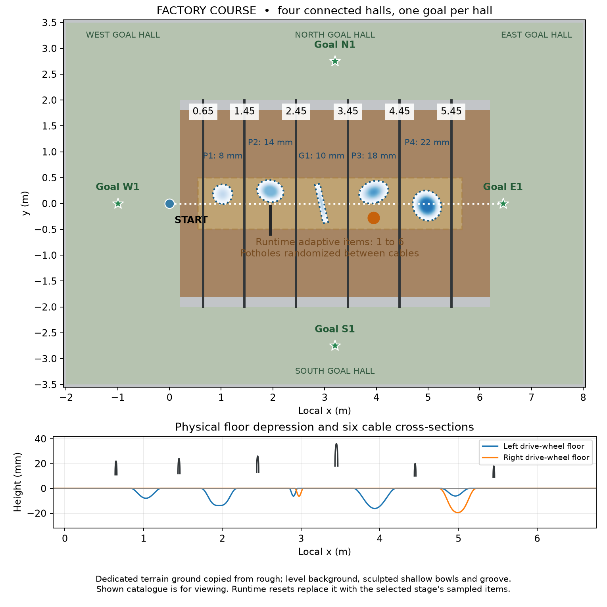

# Bản đồ nghiên cứu tiếp xúc trên sàn nhà máy — 13/10/2026

## 1. Quyết định thiết kế

**Cập nhật v6 — 14/10/2026:** thêm bốn goal hall phẳng, mở thông nhau,
mỗi hall đúng một goal như bố cục rough. Sàn vật lý mở rộng thành
x=-2..8 m, y=-3.5..3.5 m; corridor cáp gốc vẫn rộng 4 m (y=-2..2).
Các goal marker chỉ là visual, không phải collision. Các hall cùng nằm trên
mesh liên tục z=0; không có box sàn chồng lên mesh hoặc tường ngăn nội bộ.

| Hall | Goal | Pose (x, y, yaw rad) |
|---|---|---|
| Tây | W1 | (-1.00, 0.00, π) |
| Đông | E1 | (6.45, 0.00, 0) |
| Bắc | N1 | (3.20, 2.75, π/2) |
| Nam | S1 | (3.20, -2.75, -π/2) |

Giữ start (0,0), sáu cáp, catalogue hõm/rãnh và vùng spawn adaptive cũ.
Bounds định vị và floor runtime đã mở rộng cùng world; hall còn có ground
support và visual sau reset. Config smoke hiện vẫn chạy thẳng tới E1;
actor `speed_yaw_reference` hiện yêu cầu straight course. Profile mới
`factory_floor_routes_pi_check.yaml` bật cả bốn route cho **đánh giá PI**:
E1 chạy thẳng; N1/S1 đi thẳng đến (3.20,0) rồi rẽ 90°; W1 đi vòng qua
cáp ở phía trên, quay phía đông rồi về phía dưới và kết thúc tại W1.
Ordered spatial gates chống bỏ qua vòng W1 dù goal nằm gần start.
`action_mode: wheel_torque` chỉ là giao diện route có sẵn; lệnh baseline
không có learned torque residual. Đây không phải khởi động lại PPO torque.
Reward progress dùng chiều dài path để không phạt W1 lúc đi xa goal.
Chưa bật route curriculum/training hoặc xác nhận traversal bằng Gazebo.



Định nghĩa chuẩn nằm trong `src/nino_rl/config/factory_floor_routes_pi_check.yaml`.
Generator kiểm tra endpoint/yaw với các hall và xuất route vào JSON của mỗi
world. Sau khi factory Gazebo đang chạy, kiểm tra một route bằng PI:

```bash
ros2 run nino_rl evaluate_baseline \
  --config src/nino_rl/config/factory_floor_routes_pi_check.yaml \
  --route N1 --seeds 75000 75001 75002 --control-trace \
  --output rl_runs/factory_floor_route_N1_pi
```

Đổi `--route` thành E1/S1/W1 để chọn tuyến. Bỏ `--route`, dùng
`--episodes 4` để kiểm tra mỗi tuyến một lần theo round-robin. Đây là screen
tracking/traversal; chưa phải bằng chứng adaptive control hoặc sim-to-real.

**Cập nhật v5 — 14/10/2026:** world factory lấy trực tiếp model
`rough_approach_ground` từ `combined_rough_section.sdf`, giữ ground material
màu nâu và dùng `feature_relief`/`write_mesh` của rough để tạo terrain mới.
Nền level; chỉ carve hõm/rãnh âm. Sáu cáp và adaptive items nằm trên terrain.
Các apron màu xám chỉ là visual, không thêm collision sàn dưới pothole.

World `mixed` để xem có bốn hõm tròn/đáy phẳng/oval xoay (8, 14, 18, 22 mm),
một groove 10 mm — mỗi gap cáp có một depression — cùng short cable và local
bump theo geometry flat cũ. Đây là catalogue hiển thị, **không phải stage 1**.
Reset bằng curriculum thay toàn bộ catalogue bằng số item được chọn 1→6,
giữ sampling pothole giữa cáp và nguyên tắc physical scoring.

Để tạo hình mới, sửa `depressions`/`grooves` trong
`src/nino_description/config/factory_floor_lab.yaml`: `depth_m`, bán kính
x/y, `angle_deg`, tọa độ và `kind` (`round_bowl`, `flat_bottom_bowl`,
`angled_trough`, `groove`). Generate lại rồi restart Gazebo. Đối với episode
randomized, config RL có `pothole_depth_m`, `pothole_radius_m` và
`pothole_shape` (`round_bowl` hoặc `flat_bottom_bowl`); actor không nhận
tọa độ/shape ground truth từ những trường geometry này.

**Revision v4: toàn bộ sàn là một terrain mesh liên tục như rough course.**
Nền bằng phẳng z=0, pothole/groove được khắc xuống mesh; sáu cáp đặt trên
sàn. Collision và visual dùng cùng STL. Không chia nền thành các box phẳng
và patch hõm riêng nữa. Vị trí pothole vẫn random giữa cáp khi reset.

**Revision v2 sửa lại bố cục theo hình flat course của bạn.** Phiên bản v1
đã mở hall quá rộng và đặt vật cản rải rác; đó không phải bố cục bạn yêu cầu.
Map hiện giữ corridor rộng 4 m, start (0,0), goal (6.45,0), và sáu cáp chắn
toàn chiều ngang tại x=0.65, 1.45, 2.45, 3.45, 4.45, 5.45 m.

**Revision runtime v3:** khi adaptive item được chọn là pothole, mỗi reset
chọn ngẫu nhiên một trong năm khoảng giữa cáp và vị trí x/y trong khoảng đó.
Toàn bộ footprint của pothole cách bề mặt cáp ít nhất 3 cm, tính theo góc
cáp thực tế của episode, không chỉ theo tọa độ x danh nghĩa; sampler còn
chừa thêm một đường chéo ô mesh để bảo vệ clearance ở mép nội suy. Khoảng không
đủ chỗ được loại và sample lại; không tự thu nhỏ pothole hay bỏ cáp để ép fit.

Vùng adaptive giữ đúng x=0.55..5.65 m, y=-0.5..0.5 m. Ban đầu một item;
curriculum tăng dần lên sáu. Các item nằm quanh tuyến chạy thẳng, không đặt
ở những vùng bên ngoài robot không đi qua. Vẫn dùng mesh carving của rough
map để tạo hõm thật; bỏ nền đồi lượn sóng và broad mounds.

Tên world: `factory_floor_lab`. Sàn có thêm vùng xuất phát/đỗ ngoài tuyến
và bốn goal hall: x=-2..8 m, y=-3.5..3.5 m. Những tuyến rough cũ không
được chuyển sang đây.

**Trạng thái:** geometry mới được tạo; chưa có kết quả xác nhận robot vượt
được từng loại, chưa huấn luyện predictor/PPO, chưa mở Optuna. Map/config cũ
được giữ làm dữ liệu lịch sử; không tiếp tục optimizer của checkpoint cũ.



## 2. Geometry và các biến thể

| Biến thể | Nội dung | Mục đích |
|---|---|---|
| `clear` | Sàn mesh phẳng không vật cản | Kiểm tra lăn, caster và PI |
| `cable` | Một cylinder cứng, cao 22 mm, x=2.9 m | Screen cơ chế riêng |
| `pothole` | Một hõm thật sâu 18 mm, x=2.9 m, y=0.17 m | Một bên bánh đi vào/ra hõm |
| `groove` | Một rãnh thật sâu 10 mm, x=2.9 m | Chuỗi tiếp xúc khi vượt rãnh |
| `threshold` | Một gờ tròn thấp cao 8 mm, x=2.9 m | Screen riêng gờ/bump thấp |
| `mixed` | Ground model từ rough, 6 cáp, 4 hõm + groove, short cable và local bump | Catalogue xem terrain và items; curriculum thay bằng stage được chọn |

Sáu cáp dùng đúng các bán kính cũ: 11, 12, 13, 18, 10 và 9 mm. World xem
mặc định có cáp vuông góc quỹ đạo như sơ đồ. Config curriculum dùng cơ chế
đổi góc cũ trong [-30°,30°] và giữ nguyên sáu vị trí x. Các kích thước này là
geometry, chưa phải giới hạn vượt đã xác nhận cho caster 16 mm.

### Pothole thật thay cho surrogate

- Chỉ có height âm so với sàn z=0; không có gờ nâng quanh pothole.
- Collision và visual dùng đúng cùng STL và pose.
- Một mesh phủ toàn bộ sàn, không có collision box nằm dưới hõm làm bánh
  bị giữ lại ở z=0. Không có đường ghép giữa floor box và patch hõm.
- Một grid chung có spacing tối đa 5 mm tại hõm/rãnh và 40 mm ở vùng bằng
  phẳng. Vùng không có hõm vẫn có z=0 chính xác; các tam giác chia sẻ đỉnh.
  World hoàn toàn phẳng chỉ cần hai tam giác phủ cả sàn.
- Hàm `feature_relief`/`write_mesh` được tái sử dụng từ rough generator; không
  gọi nền rolling terrain. Pothole vẫn là hình học lý tưởng hóa với thành dốc
  trơn, không phải mô hình mọi kiểu lỗ vỡ hoặc cạnh sắc ngoài thực tế.

Vẫn cần chạy `clear` và kiểm tra rolling/contact trước khi đánh giá controller;
một mesh liên tục không tự chứng minh mô hình caster hay va chạm đã chính xác.
Cylinder là rigid cable-like obstacle; chưa mô phỏng dây mềm, biến dạng, kéo
dây hoặc quấn vào caster.

## 3. Cơ chế được giữ từ flat course

Launch mới tái sử dụng `training_sim.launch.py`: robot, bridge IMU/encoder/
horizontal LiDAR, world-control/reset services và effort-drive wheel PI.
Config PI kế thừa profile bám đường flat có conditional integrator. Bounds
định vị theo tường được đổi thành [-2,8,-3.5,3.5], khớp hall v6. Bộ định vị này
vẫn có giả thiết biết hình học tường, chưa phải định vị nhà máy bất kỳ.

Physics là 1 ms với DART/Bullet như screen flat gần đây; control vẫn 0.1 s.
Mô hình chính của robot và caster damping không được thay đổi trong lần sửa
map này. Config không yêu cầu terrain preview; robot URDF lịch sử vẫn chứa
cảm biến ảo đó, nên phải dùng runtime hardware-only riêng trước thí nghiệm
sensor-only chính thức.

Có hai config riêng:

- `factory_floor_pi_check.yaml`: giữ geometry cố định của world đang xem,
  để kiểm tra PI và từng vật cản. Không đổi geometry mỗi episode.
- `factory_floor_curriculum.yaml`: giữ sáu cáp và cơ chế adaptive 1→6 của
  flat. Mỗi reset thực sự sample x/y/type mới, đổi góc cáp, bỏ model floor cũ
  rồi tạo **toàn bộ sàn mới** với pothole/groove carved ở vị trí được sample.
  Walls và cáp nằm trong model riêng. Không có sàn phẳng còn nằm dưới hõm.

Trong config curriculum, `pothole_placement: cable_gaps` bật quy tắc này và
`pothole_cable_clearance_m: 0.03` giữ clearance. Vị trí không cố định ở tâm
khoảng; cả x và y đều ngẫu nhiên trong phần còn đủ chỗ. Các loại adaptive
item và số lượng 1→6 giữ nguyên: stage một item không bắt buộc item đó là
pothole. Hình xem Gazebo ban đầu là catalogue cố định; layout được
randomize khi evaluator/environment reset bằng config curriculum. Config
PI cố định không randomize. Đây là contract bố trí mới, không phải kết quả
huấn luyện hoặc xác nhận khả năng vượt vật cản.

Config mới dùng `continuous_floor_mesh_v1`; nhánh `carved_floor_v2` vẫn giữ
cho contract lịch sử. `carved_floor.py` tạo toàn bộ sàn trong một STL,
bao gồm pothole/groove âm; local
bump/short cable giữ geometry hiện có. Local bump là một adaptive item nhỏ,
không phải nền rolling terrain hay broad mound. Pothole/groove overlap
được khắc vào cùng mesh, không chồng nhiều floor collision; depth không cộng dồn.
Reset không có item vẫn tạo đầy đủ sàn, không để robot rơi qua floor.

**Sửa lỗi reset được xác nhận trên Gazebo:** thay toàn bộ floor phải dừng
lệnh và pause physics trước remove/create. Spawn floor dùng quaternion
identity hợp lệ (`w=1`), không để quaternion ROS mặc định bằng zero. Sau
create, world vẫn paused; refresh bằng các bước physics có giới hạn tạo dữ
liệu IMU/encoder/scan mới rồi mới yêu cầu assisted odometry sẵn sàng.
Không tắt estimator hay nới timing/physical gates. Simulator đã bị rơi xuyên
floor hoặc mất ổn định từ phiên lỗi cần Ctrl+C và launch lại trước khi thử.

Mesh toàn sàn lớn hơn patch cũ: DART có thể mất khoảng 13–15 giây để nạp
collision mới ở bước physics đầu tiên sau thay floor. Config v4 đặt
`floor_initialization_wall_timeout_seconds: 30` chỉ cho refresh lúc reset.
Deadline của action vẫn giữ nguyên; phải hoàn thành đúng số bước và có
sensor/assisted odometry mới. Không chấp nhận partial stepping, không retry
request physics đã timeout, không ghi thời gian khởi tạo thành thời gian episode.

Curriculum giữ gate flat: window 30 episode, success rate ≥75%, replay stage
trước 20%. Sáu stage tương ứng 1..6 adaptive items, đều giữ sáu cáp. Evaluation
đóng băng stage được chọn, không tự nâng độ khó. Success dùng physical pose
cho scoring (`reward_pose_source: ground_truth`), tách khỏi pose điều khiển.

`factory_floor_pi_check.yaml` chỉ là config kiểm tra PI/geometry. Trường
`research_map.training_allowed: false` ghi trạng thái nghiên cứu; đây không
phải một sandbox có thể ngăn mọi CLI train cũ. Không dùng config này để train.
Nó chưa định nghĩa actor hardware-only, predictor, reactive teacher đã tuning
hoặc governor theo contact. Cơ chế first-contact detector, event-aligned
scoring và khôi phục snapshot đầy đủ vẫn là công việc kế tiếp.

Arrival vật lý, endpoint error, physical path RMSE, IMU, wheel response và
timing checks được giữ. Config cố định có thể ghi challenges=0/0 vì không
sample region; config curriculum có region theo layout được spawn. Region
count không thay contact trace và không phải bằng chứng robot có preview.

Tuyến lại là 6.45 m; target/deadline là 22/30 s như profile flat kế thừa.
Quality target 18.5 s của nghiên cứu cũ không tự trở thành kết quả đã đạt.

## 4. Tạo lại và mở Gazebo

Trong terminal từ workspace:

```bash
cd ~/ninorobot
source /opt/ros/jazzy/setup.bash
source .venv/bin/activate

python src/nino_description/scripts/generate_factory_floor_lab.py
python src/nino_description/scripts/preview_factory_floor_lab.py
python -m colcon build --symlink-install --packages-select nino_description nino_rl
source install/setup.bash

export ROS_DOMAIN_ID=80
export NINO_ROS_DOMAIN_ID=80
export ROS_AUTOMATIC_DISCOVERY_RANGE=LOCALHOST
export GZ_PARTITION=nino_factory_80

ros2 launch nino_rl factory_floor_training.launch.py \
  variant:=mixed headless:=false
```

Đổi `variant:=clear`, `cable`, `pothole`, `groove` hoặc `threshold` để xem/thử
một loại. Chỉ chạy một biến thể trong partition này mỗi lần. Launch mở world,
spawn robot và khởi động PI; không tự chạy hành trình hoặc huấn luyện.

Sau khi xem map, ưu tiên `clear` rồi `cable` trước. Trong terminal thứ hai,
khi simulator tương ứng đang chạy và ổn định:

```bash
cd ~/ninorobot
source /opt/ros/jazzy/setup.bash
source .venv/bin/activate
source install/setup.bash
export ROS_DOMAIN_ID=80
export NINO_ROS_DOMAIN_ID=80
export ROS_AUTOMATIC_DISCOVERY_RANGE=LOCALHOST
export GZ_PARTITION=nino_factory_80

ros2 run nino_rl evaluate_baseline \
  --config src/nino_rl/config/factory_floor_pi_check.yaml \
  --seeds 75000 75001 --control-trace \
  --output rl_runs/factory_floor_clear_pi
```

Tên output phải đổi theo biến thể đang chạy. Config cố định chỉ kiểm tra PI,
không phải sweep sau first contact; seed evaluator không đổi world cố định.

Để kiểm tra cơ chế adaptive trên `variant:=mixed` đang chạy:

```bash
ros2 run nino_rl evaluate_baseline \
  --config src/nino_rl/config/factory_floor_curriculum.yaml \
  --flat-stage 0 --seeds 75000 75001 --control-trace \
  --output rl_runs/factory_floor_adaptive_1_pi
```

`--flat-stage 0` là 1 adaptive item, `--flat-stage 5` là 6 items. Layout thay
đổi mỗi reset theo seed. Chạy một evaluator/controller mỗi world, giữ cùng
domain/partition trong terminal. Các commands này không bắt đầu PPO/Optuna.

### Smoke training theo yêu cầu

`factory_floor_smoke.yaml` là profile riêng để kiểm tra pipeline bằng 512
bước, hai rollout 256 bước, batch 64 và hai epoch/update trên CPU. Stage
đóng băng ở index 3: sáu cáp và bốn loại adaptive item, bảo đảm mỗi reset
có pothole được randomize giữa cáp. Actor/critic/optimizer khởi tạo mới.
Profile này dùng actor speed/yaw kế thừa để kiểm tra reset, observation,
timing, cập nhật PPO và lưu checkpoint; chưa phải policy sensor-only hoặc
predictive governor theo hướng nghiên cứu mới. Config nghiên cứu chính
vẫn giữ `training_allowed: false`; smoke không mở Optuna.

Khi `variant:=mixed` đang chạy, dùng cùng domain/partition đã khai báo:

```bash
ros2 run nino_rl train --device cpu \
  --config src/nino_rl/config/factory_floor_smoke.yaml \
  --timesteps 512 --checkpoint-every 256 --check-env \
  --preflight-timeout 90 \
  --output rl_runs/factory_floor_pipeline_smoke
```

Train tự chạy preflight. Thành công kỹ thuật là có hai PPO updates và lưu
`nino_ppo_final.zip` mà không có lỗi sensor/service/timing/reset. Tỷ lệ đến
đích của actor mới trong smoke không chứng minh hiệu quả điều khiển.

Nếu `ros2 run` báo thiếu thư viện RL dù `.venv` đã có torch/SB3, kiểm tra
dòng đầu `install/nino_rl/lib/nino_rl/train`. Build bằng `colcon` hệ thống
có thể tạo shebang `/usr/bin/python3`; kích hoạt `.venv` sau đó không đổi
interpreter của executable. Source ROS, activate `.venv`, rồi dùng
`python -m colcon build --symlink-install --packages-select nino_rl` và
source lại `install/setup.bash`. Các lệnh build ở đây dùng `python -m colcon`
để giữ đúng interpreter.

## 5. Randomization có thật nhưng theo từng world đã sinh

Có thể tạo geometry single-obstacle khác nhau theo seed:

```bash
python src/nino_description/scripts/generate_factory_floor_lab.py \
  --variant pothole --seed 75000
python -m colcon build --symlink-install --packages-select nino_description
source install/setup.bash

ros2 launch nino_rl training_sim.launch.py \
  world:=factory_floor_pothole_seed_75000.sdf \
  world_name:=factory_floor_lab \
  headless:=false pi_integrator_profile:=conditional_v1 max_wheel_torque:=4.0
```

Giữ các biến môi trường domain/partition ở phần trước. Generator thay đổi
thực sự x, y, góc và depth/radius trong file collision, không chỉ trên sơ đồ.
Các file single-obstacle này là **offline generation**. Config curriculum ở
phần trước đã có nhánh runtime thay floor mỗi reset. Chưa có bank train/
validation/test cho map mới; phải chốt split trước khi dùng để học. `--seed`
của generator vẫn chỉ áp dụng cho single-obstacle variant.

## 6. Trình tự nghiên cứu tiếp theo

1. Kiểm tra clear-floor rolling/contact; xác nhận geometry negative nhìn và
   tiếp xúc đúng, kiểm tra từng obstacle có vượt được bằng PI.
2. Trên single-obstacle cable, đo thứ tự contact, khoảng thời gian giữa contact,
   phát hiện bằng IMU/encoder, và đáp ứng tốc độ thực tế.
3. So sánh các speed profile sau first contact bằng lần chạy ghép cặp có
   điều kiện ban đầu được kiểm soát. Không gọi đó là nhánh cùng snapshot nếu
   chưa khôi phục cả vận tốc, khớp, contact và trạng thái controller.
4. Nếu có control authority, lặp kiểm tra cho pothole/groove, rồi tạo dataset
   tách split và action-conditioned predictor. Giữ geometry/contact ground
   truth chỉ cho oracle, nhãn và đánh giá; không đưa vào governor triển khai.
5. Chỉ dùng `mixed` khi các thử nghiệm riêng đủ rõ. Việc gộp sớm nhiều loại có
   thể che nguyên nhân lỗi mà hướng mới đang muốn cô lập.

PPO, Optuna và curriculum rough vẫn được giữ lại đến khi có bằng chứng phù
hợp. Rebuild map không tự chứng minh khả năng thích nghi ngoài thực tế.

## 7. Kiểm tra đã thực hiện

- Startup v6 ngày 14/10: phiên GUI đã mất khoảng 143 giây từ lúc attach
  terrain đến scene/sensor init. Spawner cũ hết hạn sau 30 giây, để hai
  controller inactive nhưng vẫn khởi động effort adapter. Sửa launch:
  factory dùng `controller_startup_timeout:=300` cho discovery, service và
  activation; generic sim giữ default 30 giây. Khi robot spawn hoặc controller
  spawner lỗi, launch dừng thay vì chạy bước actuation tiếp theo. Ba regression
  tests pass và hai package build thành công. Giới hạn này chỉ áp dụng startup,
  không thay action deadline, clock check, geometry hoặc physical scoring.
  Cold restart GUI dùng timeout mới đã pass: cả joint_state_broadcaster và
  wheel_effort_controller active, nhận đủ IMU/joint_states/odom/ground truth/
  scan, scan có range hữu hạn. Không phát lệnh di chuyển hoặc chạy training.
  Log: `/tmp/nino_factory_startup_fix_20261014.log`. Mesh catalogue vẫn load
  chậm; timeout startup dài hơn không làm giảm chi phí import mesh.
- Bốn drawn route: 47 route/geometry tests pass, gồm route rough lịch sử,
  endpoint/yaw factory, gate W1 chống shortcut và follower factory ở speed
  scale 1.0/0.7. Kinematic check đi hết bốn tuyến; không mô phỏng tiếp xúc,
  trượt, caster hoặc motor lag. Chưa chạy screen PI trong Gazebo.
- V6: 15 geometry/reset tests pass. Bốn marker riêng, bốn tường ngoài,
  hall không có collision riêng và runtime floor phủ đủ bốn hall. Mesh
  phủ đúng 70 m², biên phẳng, giữ hõm âm và một collision floor. Preview
  cập nhật với bốn goal. Sáu SDF được `gz sdf -k` xác nhận Valid; build
  `nino_description` và `nino_rl` thành công. Chưa chạy Gazebo traversal
  hoặc training v6.
- V5 ngày 14/10: 25 geometry/estimator/reset tests pass, build hai package
  thành công; sáu SDF valid. Test kiểm tra ground material lấy từ rough,
  một collision mesh liên tục, cable contact line trên z=0, năm depression
  nằm trong năm gap và runtime flat-bottom carving khớp hàm rough.
- V5 đã mở trong Gazebo GUI; model robot còn trên mesh, z thật khoảng
  -0.000312 m. Catalogue mesh khoảng 20 MB có startup chậm (~70 giây),
  dẫn đến spawner hết hạn trước khi controller activate muộn. Vì vậy phiên
  GUI này **không xác nhận smoke train/preflight mới**, không có traversal
  hoặc learning run. Đã chỉnh camera gần terrain để kiểm tra bằng mắt.
  [Ảnh Gazebo thực tế](factory_floor_ground_gazebo_2026-10-14.png).
- Các check reset v4 bên dưới là kết quả lịch sử; không tính thành check
  traversal của catalogue v5.

- 23 geometry/estimator/reset tests passed cho v4: một ground collision mesh,
  không có floor box dưới hõm; tổng diện tích chiếu tam giác phủ đúng 40 m²,
  STL normal hướng lên, height âm và biên bằng 0, visual/collision cùng
  geometry/pose, six-cable corridor, stage 1→6, grid refinement tại hõm,
  runtime floor liên tục và reset không item vẫn có floor.
- 500 layout mẫu kiểm tra toàn bộ footprint pothole với sáu cáp, gồm góc
  đối nhau ±30°: không chạm cáp, phủ cả năm gap, x/y thay đổi, cùng seed
  tái lập được. Sampler environment dùng đúng cáp của episode; layout không
  đủ chỗ báo lỗi thay vì spawn chồng lên cáp. Đây là kiểm tra code/geometry,
  không phải 500 lần chạy robot.
- Cả 6 SDF được `gz sdf -k` xác nhận `Valid`.
- Gazebo service smoke check v2 trong partition riêng: remove floor cũ,
  spawn floor mới chứa pothole và groove, rồi step 10 iterations; cả ba
  service trả `data: true`, không ghi lỗi mesh. Server thử nghiệm có timeout
  giới hạn; không spawn robot, không chạy hành trình trong check này.
- Build `nino_description` và `nino_rl` thành công; launch mới được tìm thấy
  và `--show-args` hoạt động.
- Trước v4, sau sửa pause/quaternion/reset barrier, kiểm tra world sạch trong partition
  riêng: preflight 12 điểm, Gym `check_env`, hai reset seed 75000/75001 và
  ba bước điều khiển sau mỗi reset đều pass. Assisted odometry có wall fixes;
  sai lệch clock tối đa khoảng 3.6e-15 s. Pose z thật của model cuối check
  là -0.000465 m, xác nhận robot còn trên sàn. Không chạy PPO trong check này.
- Diagnostic v4 xác nhận bước đầu sau thay mesh mất 12.3–14.9 giây ở một số
  reset: deadline cũ 10 giây không đủ, nên dành wait budget riêng cho setup.
  Một phiên khác timeout phản hồi ROS service; một phiên có lỗi fresh
  assisted odometry. Các check thất bại đều dừng, không ghi thành pass.
  Check diagnostic sạch tiếp theo qua preflight và reset 0/75000/75001,
  ba action sau mỗi reset 75000/75001; z thật cuối check -0.000209 m,
  max clock error khoảng 1.8e-15 s. Đây là check pipeline, chưa phải traversal.
- Check v4 bằng config smoke thực tế (setup budget 30 giây, action deadline
  không đổi) trong partition riêng mới: preflight 12 điểm, Gym `check_env`,
  reset seed 75000/75001 và ba action sau mỗi reset đều pass. Assisted
  odometry sẵn sàng với wall fixes; max clock error khoảng 1.8e-15 s,
  z thật cuối check -0.000519 m. Không huấn luyện PPO. Log phiên kiểm tra:
  `/tmp/nino_factory_reset_verify_lepdv9er/gazebo.log` (file tạm).

Các kiểm tra này xác nhận geometry và file/launch setup. Chưa có screen caster
rolling, contact timing, PI traversal, predictive governor hoặc kết quả robot
thật trên bản đồ mới.
