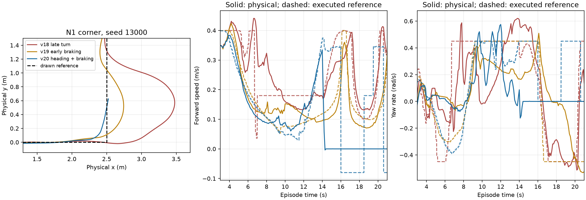

# Feedback recovery and N1 braking — 10 October 2026

## Completed work

1. Recovered only PI seeds **64015–64023**, preserving completed seeds
   64000–64014 and the full targeted PPO evaluation.
2. Finished the 24-seed flat comparison and inspected saved second-cable
   speed, yaw, encoder tracking and applied torque.
3. Rejected N1 v18, tested early-braking v19, then tested heading-preserving
   braking v20 after v19 traces exposed delayed turn response.
4. Kept map geometry, route waypoints, strict physical scoring, E1/S1 commands,
   motor limits and the existing estimator unchanged. No RL updates or Optuna
   were performed during this recovery.

All owned simulators and evaluation workers have exited. Rough curriculum
remains held. Neither N1 candidate passed physical readiness.

## Flat feedback timing

The frozen flat encoder subscription used BEST_EFFORT with **KEEP_LAST depth 1**.
Encoder/IMU interpolation needs an encoder sample at or before the latest IMU
timestamp. If a delivered encoder chunk retains only its newest sample,
interpolation can remain older than both latest raw streams. A deterministic
test reproduces a 42 ms fused-pose lag at a paused action boundary using this
delivery pattern, and shows that retaining the encoder history avoids it.
This reproduces a plausible transport mechanism; the original failed run did
not record every incoming callback, so its exact delivery sequence is unknown.

The recovery snapshot changes only the encoder subscription to depth **100**,
retaining the same BEST_EFFORT reliability. It does **not** extrapolate pose,
fabricate timestamps, step additional physics, alter fusion math, increase the
40 ms freshness tolerance, or suppress exceptions. Clock and action-boundary
checks remain byte-identical. Old source/snapshot manifests remain unchanged.
The existing rough snapshot already retains 100 encoder samples, so rough
transport was not changed.

All nine recovered PI episodes succeeded, with maximum recorded motion lag
**20 ms**. This bounded recovery passed; it is not proof that transport can
never fail again. The two transport histories in the merged PI batch are
explicitly recorded in per-seed provenance.

Recovery files:

- `rl_runs/flat_targeted_pi_recovery_v2/recovery_contract.json`
- `rl_runs/flat_targeted_pi_recovery_v2/pi/merged/summary.json`
- `rl_runs/flat_targeted_pi_recovery_v2/comparison.json`
- `rl_runs/flat_targeted_pi_recovery_v2/REPORT.md`

The first preparation attempt failed an environment-domain assertion before
evaluation; its directory is preserved separately as recovery v1. Recovery v2
sets the supervisor and child domain/partition consistently.

## Complete flat result

Both controllers physically arrived in **24/24** episodes on seeds 64000–64023.

| Metric | Targeted PPO | Matching PI |
|---|---:|---:|
| Mean completion time | 17.942 s | 17.521 s |
| Mean physical path RMSE | 0.03404 m | 0.03311 m |
| Mean RMS vertical acceleration | 3.15325 m/s² | 2.93177 m/s² |
| Mean RMS slip | 0.203381 | 0.184167 |

Arrival, completion and tracking gates pass; **quality fails**. Targeted PPO
has 7.6% higher mean vibration and 10.4% higher mean slip than PI. Relative to
the previous same-seed PPO, mean vibration increased 22.7% and slip increased
1.7%. The larger slip penalty is not qualified for adoption.

## Saved second-cable response

Read-only analysis: [response report](targeted_cable_response_2026-10-10/REPORT.md)
and `targeted_cable_response_2026-10-10/analysis.json`.

Window: physical x = 4.45 ±0.35 m. Values below are equal means over 24 episodes.

| Second-cable metric | Previous PPO | Targeted PPO | PI |
|---|---:|---:|---:|
| Speed scale | 0.98067 | 0.97973 | 1.00000 |
| Executed forward reference | 0.39226 | 0.39189 | 0.40000 m/s |
| Physical speed | 0.28497 | 0.28167 | 0.29572 m/s |
| Crossing RMS slip | 0.42533 | 0.43686 | 0.40623 |
| Absolute requested yaw | 0.11153 | 0.12675 | 0.10311 rad/s |
| Common applied torque | 0.54921 | 0.54800 | 0.52808 Nm |
| Absolute differential torque | 0.11221 | 0.11960 | 0.11127 Nm |
| Wheel-reference tracking RMSE | 2.6170 | 2.6554 | 2.6357 rad/s |

The extra penalty barely changed speed scaling or common torque. Targeted PPO
requested more yaw correction on average. Across the whole episode, the first
cable's mean-square slip contribution increased while the second cable's
contribution decreased slightly; a crossing-only RMS average and an episode
slip contribution use different denominators.

The paired mean episode slip difference versus PI is +0.01921, with a 95%
scenario-bootstrap interval [0.00251, 0.03457]. The difference versus previous
PPO has an interval spanning zero. These intervals measure scenario variation
for one targeted training seed, not robustness across independently trained
policies. Command/response associations are not causal identification.

**Next flat decision:** retain the previous checkpoints and avoid another
slip-weight increase. Investigate a bounded cable-crossing reference/acceleration
correction or yaw ablation before another training pilot. No new reward change
has been selected or started.

## N1 screening

All screens use the original map, N1 waypoints, seeds 13000–13002 and unchanged
readiness gates, including ≥95% arrival, RMSE ≤0.05 m, localization agreement,
no rollover and bounded physical commanded stall.

| Profile | Main change | Physical arrivals | Mean physical RMSE | Qualified |
|---|---|---:|---:|---|
| v18 | 0.20 m lookahead, late moving turn | 3/3 | 0.40471 m | No |
| v19 | Brake over 1.20 m; 0.30 m lookahead; 0.06 m/s turn | 3/3 | 0.09327 m | No |
| v20 | Brake over 1.40 m; 0.40 m lookahead; heading authority retained during braking; localized overspeed feedback | 0/3 | 0.03547 m before failure | No |

V19 reduced first-seed x overshoot from 0.978 m to 0.244 m, but still failed
tracking. Its wheel traces show physical speed exceeding the slow command and
physical yaw lagging the command at the corner.

V20 reduced first-seed x overshoot to 0.026 m. Two runs then stalled near
**(2.53 m, 0.63 m)**: wheel rotation continued while physical XY translation
was essentially zero, and all three bounded backoff attempts failed. The third
episode terminated `navigation_invalid`. The longest measured commanded stall
was 2.6 s. Lower RMSE on these shortened failed paths is **not** successful
tracking and must not be used to promote this profile.

The tests verify unchanged E1/S1 controller outputs, scoring/geometry and motor
command limits. Their new physical confirmation batches have not been run;
earlier qualified E1/S1 evidence remains preserved. No route is newly admitted
to curriculum.



**Next rough decision:** inspect caster/chassis/drive-wheel contact and the
localization validity event at the repeated stall before changing another
controller gain. The traces indicate lost traction or a contact obstruction,
but do not identify the contacting component. No contact sensor data was
captured; a particular mechanical cause is not yet confirmed. Preserve the
arrival/tracking gates and keep curriculum held. Do not resume an old optimizer
under either changed controller; any later training needs a new contract and
actor initialization with fresh critic/optimizer.

## Verification and reusable commands

Eight focused checks passed: encoder-history interpolation, stale-fused-pose
rejection despite fresh raw streams, unchanged motion barrier, E1/S1 command
equivalence for both N1 candidates, unchanged geometry/scoring, early braking,
heading authority under measured overspeed, and the existing action-end barrier
test. Saved traces reproduce recorded episode slip before phase attribution.
The plotted physical paths and command responses were visually inspected.

Completed evidence is reused on rerun. These commands do not start training:

```bash
cd ~/ninorobot
source /opt/ros/jazzy/setup.bash
source .venv/bin/activate
source install/setup.bash

# PI recovery only; completed seeds are retained.
python src/nino_rl/scripts/recover_flat_targeted_pi.py --run

# Read-only saved trace analysis.
python src/nino_rl/scripts/analyze_targeted_cable_response.py
python src/nino_rl/scripts/analyze_n1_braking_response.py

# Reuses the rejected v20 screen; no curriculum or Optuna is started.
python src/nino_rl/scripts/run_rough_n1_heading_braking_validation.py --run
```

The fixes are versioned experiment snapshots rather than edits to the old
study's frozen package. Use their manifest-backed runners to apply them.
