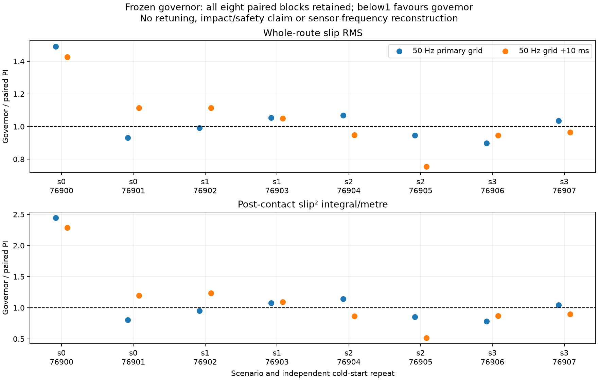
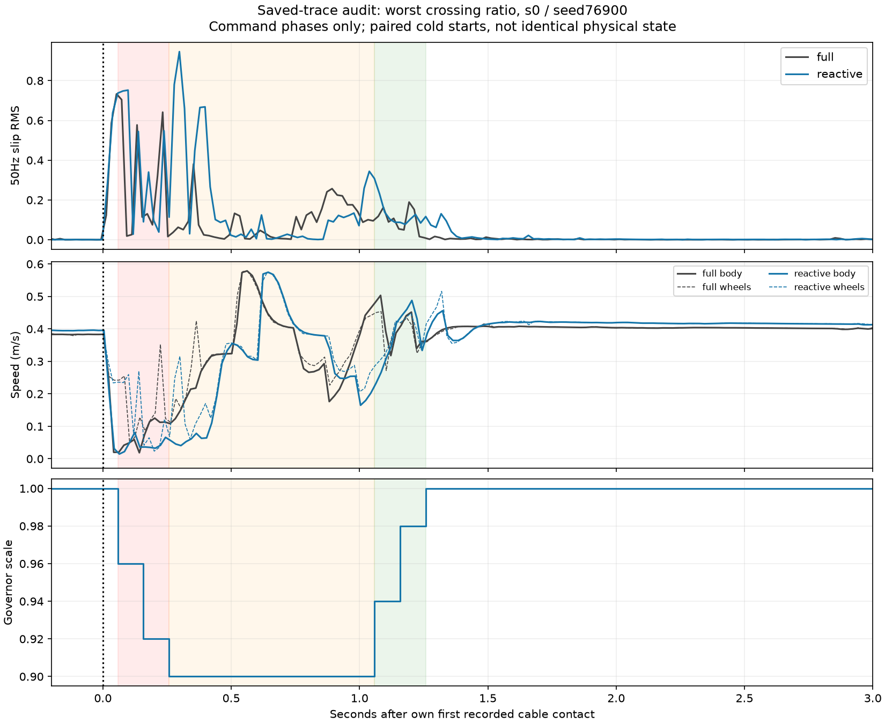

# Xác nhận governor đã khóa — instrumentation và bốn scenario mới

**Ngày:** 16/10/2026. **Đã hoàn tất đúng 18 episode, không tuning/training.**

## Quyết định

**Chưa mở Optuna. Giữ nguyên candidate; ưu tiên độ tin cậy phép đo.**
Instrumentation hoạt động: replay native và timestamp đều đạt. Nhưng lợi ích
slip của bộ tham số 0,90 / maximum hold 1,0 s **không lặp lại trên batch mới**.
Governor nhanh hơn 2,33%, trong khi slip và sampled vibration trung bình
cao hơn PI. Có **4/8 cặp đổi chiều so sánh slip khi dịch grid 10 ms**.

Đây không phải kết luận “mọi governor/RL vô ích”. Nó bác bỏ việc dùng kết
quả tốt trên một cáp thẳng để nâng cấp candidate hiện tại hoặc bắt đầu
search trên một objective còn nhạy sampling. Cũng không được dùng sensitivity
để xóa kết quả bất lợi: mean slip **cao hơn PI ở cả hai origin**.

## 1. Protocol chốt trước kết quả

[Protocol gốc](governor_frozen_confirmation_2026-10-16/protocol_before_results.json),
[execution plan trước batch](governor_frozen_confirmation_2026-10-16/execution_before_results.json).

- Instrumentation: seed **76800**, PI và governor, **2 episode**.
- Chỉ mở batch nếu cả hai arrival/stop 2 s đạt, native replay khớp tolerance
  1e−10, timestamp hữu hạn, future stamp ≤1 ms, joint age≤10 ms, GT age≤40 ms,
  |joint−GT skew|≤40 ms, common-grid route/crossing coverage≥98%.
  Các ngưỡng là kiểm tra thiết kế theo cadence simulation, không phải chuẩn
  phần cứng hoặc chứng nhận an toàn.
- Batch: **4 scenario × 2 controller × 2 lần lặp =16 episode**. Cold start
  độc lập; đảo thứ tự controller trong mỗi seed. Không khôi phục cùng snapshot.
- Giữ PI, robot/caster, physics 1 ms, detector, ramp 0,4/s và scoring; governor
  cruise 0,400 m/s, target 0,90, max hold 1 s; PI cruise 0,388 m/s.
  Không retune PI để ép time matching. Chỉ đổi x/yaw của collision/visual cáp.
- Cáp capsule cứng radius 0,011 m, phần trụ dài 4 m; không phải dây mềm.
  Mỗi scenario chạy trong domain riêng 90–93; trong mỗi domain chạy tuần tự.
- Native giữ nguyên. Common-grid 50 Hz và grid dịch +10 ms dùng chung
  công thức/tích phân cho route/crossing. Crossing từ first recorded contact
  +50 ms đến khi tâm thân qua **mặt phẳng pháp tuyến cáp 0,50 m**. Mốc này
  tính đúng góc cáp, không dùng x cố định 3,40 m của bài cáp thẳng cũ.
  Geometry/contact/GT phục vụ đánh giá, không đưa vào governor.

| Scenario | x cáp (m) | Góc (°) | Seeds hai lần lặp |
|---|---:|---:|---|
| s0 | 2,50 | −10 | 76900, 76901 |
| s1 | 2,50 | +10 | 76902, 76903 |
| s2 | 3,30 | −10 | 76904, 76905 |
| s3 | 3,30 | +10 | 76906, 76907 |

Go cho tuning tương lai yêu cầu: mọi physical/reporting gate đạt; mean time
và physical RMSE≤1,05×PI; mean whole RMS và crossing slip²/m cải thiện ở cả
hai origin, và ≥3/4 scenario cùng cải thiện. ≥2/8 cặp đổi chiều theo origin
được xem là repeated reversal và chuyển sang measurement-first. Đây là
ngưỡng nghiên cứu đã khai báo trước batch, không phải chuẩn ngành.

## 2. Instrumentation — PASS

- **2/2 arrival và stable stop 2 s**.
- Native replay: PI RMS **0,08058306**, governor **0,04414002**; khớp native
  đã lưu trong tolerance. Đây là kiểm tra reporting, không dùng chọn tham số.
- PI joint age khoảng **1 ms**, GT age **17 ms**, skew **16 ms**.
- Governor joint age **0–2 ms**, GT age **2 ms**, skew **0–2 ms**.
- World/robot/governor core/PI và config ngoài treatment khai báo khớp.

Snapshot cuối action không tự có nghĩa mọi sensor cùng timestamp: khác biệt
age giữa hai lượt đã được ghi rõ. Replay đúng xác nhận logging/công thức,
**không chứng minh native slip là phép đo đồng bộ hoặc true slip**.
[Gate đầy đủ](governor_frozen_confirmation_2026-10-16/instrumentation_gate.json).

## 3. Batch xác nhận — physical PASS, quality chưa đạt

**16/16 arrival/stop**, không bỏ episode; 16/16 native replay và timestamp
đạt. Coverage tối thiểu: primary **99,76%**, shifted **99,65%**. Joint age
tối đa khoảng 3 ms, GT age tối đa 20 ms. Không ghi nhận governor trigger
trước first recorded cable contact trong cả 8 lượt governor.

| Mean, n=8/controller | PI | Governor | Governor so với PI |
|---|---:|---:|---:|
| Completion time (s) | 17,1875 | 16,7875 | **−2,33%** |
| Physical path RMSE (mm) | 6,579 | 6,588 | +0,14%; qua mean tracking gate |
| Native whole slip RMS, giữ nguyên | 0,07873 | 0,10145 | +28,85% |
| Whole slip RMS, primary 50 Hz | 0,08188 | 0,08466 | **+3,40%** |
| Whole ∫slip² dt (s), primary | 0,11679 | 0,12090 | +3,52% |
| Crossing slip²/m (s/m), primary | 0,13439 | 0,13908 | **+3,49%** |
| Whole slip RMS, grid +10 ms | 0,08188 | 0,08381 | **+2,35%** |
| Crossing slip²/m, grid +10 ms | 0,13361 | 0,13726 | **+2,73%** |
| Whole vertical RMS đã đo (m/s²) | 1,749 | 1,829 | **+4,58%** |
| Crossing vertical RMS đã đo (m/s²) | 3,896 | 4,071 | +4,49% |
| Mean whole sampled vertical peak (m/s²) | 29,328 | 32,679 | +11,43% |

Các mean là trung bình episode, không pooled hàng nghìn frame. Peak/RMS
IMU giữ nguyên mọi outlier; không coi chúng là true impulse/true peak ở
tần số vật lý. Completion time không được khớp thực nghiệm, không gọi đây
là H3 ở cùng thời gian. Tốc độ approach hai controller khác nhau nên first
impact không phải negative control hoàn hảo.

### Tính lặp lại theo scenario

Ratio <1 có lợi cho governor; mỗi scenario gồm hai lần lặp/controller.

| Scenario | Whole RMS ratio primary / shifted | Crossing slip²/m ratio primary / shifted | Cải thiện cả hai metric ở cả origin? |
|---|---:|---:|---|
| s0 | 1,172 / 1,266 | 1,366 / 1,691 | Không |
| s1 | 1,022 / 1,082 | 1,011 / 1,165 | Không |
| s2 | 1,004 / 0,846 | 0,977 / 0,669 | Không |
| s3 | 0,965 / 0,955 | 0,910 / 0,884 | Có |

Chỉ **1/4 scenario** đạt hướng cải thiện cần thiết, dưới yêu cầu 3/4.
Seeds **76901, 76902, 76904, 76907** đổi chiều so sánh theo origin; 4/8
vượt gate ≥2/8. Global mean không đổi chiều: governor kém hơn ở cả hai.
N=2 repeat/scenario còn nhỏ; không diễn giải các phần trăm thành độ tin cậy
triển khai hoặc hiệu quả trên mọi cáp/pothole/groove.

## 4. Một audit offline cặp bất lợi nhất

Chọn theo **crossing slip²/m ratio primary lớn nhất**, s0 / seed76900,
không chọn một ví dụ có lợi. Ratio **2,443** ở primary, **2,284** ở shifted;
cặp bất lợi này không biến mất khi đổi origin.

| Cửa sổ event tương ứng | PI ∫slip² dt (s) | Governor ∫slip² dt (s) |
|---|---:|---:|
| Trước lệnh phanh, sau first contact | 0,01519 | 0,01521 |
| Phanh theo lệnh | 0,03034 | 0,04272 |
| Giữ target | 0,01235 | **0,06945** |
| Recovery theo lệnh | 0,00254 | 0,00385 |

Phần tăng lớn nhất của cặp này nằm trong **holding**, không phải cruise sau
cáp. Trong khoảng 0,30–0,50 s sau contact, trace governor cho thấy vận tốc
ngoại vi bánh cao hơn vận tốc thân rõ rệt; phanh đã bắt đầu khoảng 58 ms sau
contact, đạt scale0,90 sau khoảng 258 ms. Các contact bánh chủ động xuất
hiện muộn hơn PI khi canh theo own first contact: right wheel khoảng
0,874 s so với 0,752 s; left wheel 0,975 s so với 0,864 s.

Đây là **temporal association trong hai cold starts**, chưa chứng minh
holding gây trượt hoặc bracket geometry là nguyên nhân. Không có cùng trạng
thái sau contact, và tín hiệu GT vẫn 50 Hz. Không tự giảm hold, tăng target,
đổi ramp hoặc tăng penalty từ một cặp này.

[Số liệu phân pha](governor_frozen_confirmation_2026-10-16/worst_crossing_phase_audit.json).

## 5. Kết thúc đợt và việc tiếp theo

**Decision cố định:** `measurement_first_no_tuning`.

1. Giữ checkpoint/config, native scores, raw traces và toàn bộ kết quả bất
   lợi. Không mở thêm trial, PPO/predictor hoặc đổi physics/controller.
2. Bước tiếp theo phù hợp là **một audit offline trên timestamp GT gốc**, ghép
   joint tại timestamp đó, để tách ảnh hưởng chọn grid tùy ý khỏi nội dung
   sensor. Đây là đề xuất diagnostic mới, chưa thực hiện trong đợt này;
   không được ghi đè objective/kết quả đã khóa hoặc xem nội suy là dữ liệu
   GT tần số cao hơn.
3. Nếu sau đó metric đủ ổn định để xếp hạng mà candidate vẫn kém, có thể
   chuẩn bị một contract tuning cổ điển mới trên development riêng; không
   yêu cầu candidate hiện tại phải thắng PI trước mọi tuning. Nếu xếp hạng
   còn phụ thuộc phép đo, cần kiểm tra cadence/fidelity, chưa search tham số.
   Bank này đã dùng chẩn đoán nên không dùng lại để chọn rồi gọi independent test.

Không xác nhận H1/predictor từ các thử nghiệm này. H2 trước đó chỉ có local
oracle authority; batch mới chưa chứng minh lợi ích reactive lặp lại. Chưa có
sim-to-real hoặc tổng quát hóa trên sàn nhà máy hỗn hợp.

## Artifact và kiểm chứng

- [Decision và mọi gate](governor_frozen_confirmation_2026-10-16/decision.json).
- [Mọi episode, native outcomes, coverage, timestamp và vibration](governor_frozen_confirmation_2026-10-16/confirmation_episodes.json).
- [CSV so sánh](governor_frozen_confirmation_2026-10-16/episodes.csv).
- [Raw manifest — 18 case](governor_frozen_confirmation_2026-10-16/raw_manifest.json).
- Source/config/world metadata và native summaries được archive cùng report;
  raw logs lớn giữ nguyên tại `rl_runs/governor_frozen_confirmation_2026-10-16/`.
- 278 file được khóa từ trước **không thay đổi**: old studies, config,
  scores, archived results, core slip và governor core. [Hash check](governor_frozen_confirmation_2026-10-16/preservation_check.json).
- **14/14 tests offline đạt**: kiểm tra world chỉ đổi hai pose, clearance theo góc, timestamp gate,
  failed/missing outcomes và repeated-grid-reversal decision; cùng tests slip
  reporting trước đó. Simulator do đợt này sở hữu đã đóng; không dừng process khác.
  [Test log](governor_frozen_confirmation_2026-10-16/tests.log).
- Hỗ trợ `world_override` được thêm cho research launcher/logger/runner để
  ghi đúng world thực dùng; default world và cấu hình điều khiển không đổi.
