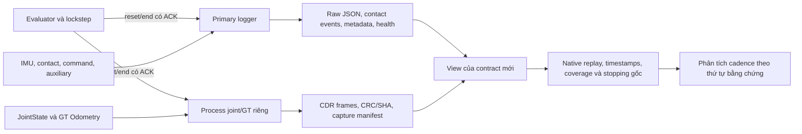

# Tích hợp recorder joint/GT vào contract riêng — 22/10/2026

> Cập nhật sau review ngân sách: v1 có lỗi chọn epoch ở biên reset khi clock
> pause. Đã sửa offline, 125 tests đạt và khóa v2. Xem
> [budget review](GOVERNOR_CADENCE_BUDGET_REVIEW_2026-10-22.md).
> Các kết quả v1 dưới đây là lịch sử, không phải contract để release mới.

## 1. Quyết định và trạng thái

**Đã nối kiến trúc hai logger vào runner, lifecycle của evaluator và đường
phân tích. Đã kiểm tra phần mềm; chưa chạy Gazebo và chưa cấp ngân sách mới.**

Contract sử dụng để review:
[isolated_joint_gt_cadence_v1](governor_isolated_cadence_contract_v1_2026-10-22/protocol.json).
`prepared_manifest.json` ghi `execution_authorized=false`,
`budget_released=false`, `simulation_attempts=0`.

Mọi batch trước vẫn đóng. Không dùng lại slot, retry, bù failure hoặc thêm
smoke episode. Bộ ngưỡng 10% / +0,5 s vẫn chỉ là đề xuất. Không mở predictor,
PPO, Optuna hay thử trên robot thật.

## 2. Kiến trúc chung cho cả ba controller



- PI cố định, governor 100 ms và governor 20 ms dùng cùng acquisition.
- Logger primary vẫn nhận joint/GT như trước, nhưng các hàng đó không được
  chọn cho measurement view. Không lấy nguồn cũ để lấp gap recorder riêng.
- IMU/contact/auxiliary giữ từ primary; joint/GT lấy từ recorder riêng.
- GT chỉ phục vụ đo/chấm điểm, không trở thành đầu vào governor.
- Không sửa PI, physics, geometry, torque limit, detector, ramp, hold,
  observation windows, thời gian điều khiển hay các trọng số.
- Toàn bộ file trong `inputs/` byte-identical với parent đã đóng; protocol
  lưu từng SHA để kiểm tra điều này.

## 3. Lifecycle được tích hợp

### Trước evaluation

Runner tạo session UUID riêng, gắn protocol/config/world hashes, job được
phân công và source hashes của từng logger. Recorder riêng được khởi động
trong process group sở hữu riêng, cùng domain và clock với primary.

Hai process phải có dữ liệu joint/GT, source age không quá 100 ms, status
không cũ quá 2 s và khác PID. Runner lưu `readiness_pair.json`. File
`ready.json` của candidate cũ một mình không đủ điều kiện này. Readiness có
deadline 10 s wall time, không phát lệnh motor và không retry.

### Reset

Evaluator chờ discovery của ít nhất hai subscriber episode trước khi phát
marker. Mỗi logger ACK nguyên marker có run ID, attempt nội bộ, seed,
timestamp và settings. Runner mỗi slot chỉ chạy một evaluation nên attempt
nội bộ là 1; session/job giữ attempt 1–12 của ledger riêng.

Evaluator đợi cả hai reset ACK trước khi tiếp tục `step()`. Việc đợi không
advance world, không đổi thời gian action/scoring. Gate đứng yên sau reset
0,5 s, deadline 5 s simulation của controller vẫn giữ nguyên.

### End và đóng file

End marker được phát như trước. Runner chỉ đợi end ACK sau khi evaluator
đã lưu native outcome: logger hỏng không được làm mất một arrival/failure
đã quan sát. Sau cửa sổ stopping 2 s gốc, runner đóng các process sở hữu.

Admission yêu cầu:

1. Hai status đã close, đúng UUID/PID/output/source binding từ readiness;
   không chấp nhận process khởi động lại.
2. Hai bộ reset/end trùng nhau và trùng terminal marker của evaluator.
3. Primary metadata complete, health sidecar hợp lệ, đúng config/world/code.
4. Capture complete, đúng code, CRC/SHA/counts/epoch/source timestamps hợp lệ.
5. Mọi raw source và file view giữ hash; lỗi/thiếu file không fallback legacy.

Nếu được cấp batch mới sau này, PI và 20 ms đầu tiên phải có stopping được
xác nhận để đi tiếp; các kiểm tra này nằm trong ngân sách mới.

## 4. Measurement view và metric

View ở `case/measurement_view`, dùng `view_manifest.json` và
`primary_metadata.json`; **không giả mạo legacy `metadata.json`**.

- Chỉ epoch reset được chọn được đưa vào sensor view; dữ liệu trước reset
  vẫn giữ trong raw capture nhưng không được làm boundary support cho lượt mới.
- Mọi hàng contact/IMU/auxiliary và spike của primary được giữ nguyên.
- Không resample sensor khi compose view, không deduplicate để làm đẹp,
  không zero-fill, không sửa raw hoặc native outcome.
- Các reader nhận view qua tham số tường minh; đường legacy mặc định vẫn
  đọc legacy. Peak/sequence/stopping cũng nhận cùng view, không vô tình quay
  về joint/GT primary.
- Native replay vẫn từ control trace 100 ms; accumulator và công thức cũ.
- Slip GT-header vẫn dùng GT gốc, chỉ interpolate joint theo quy tắc cũ.
- Coverage **98% từng window** và sensitivity grid 20 ms / dịch 10 ms giữ
  nguyên. Route đạt không làm crossing/sequence bị thiếu trở thành đạt.
- Cửa sổ stopping 2 s và các gate physical arrival/tracking giữ nguyên.

`admitted_for_new_contract=true` chỉ chứng minh lifecycle/provenance của
view. Nó **không** đồng nghĩa native replay, coverage hay physical stopping
đã đạt. Collector còn phải chạy tất cả gate gốc. Analyzer mới chặn so sánh
performance khi integrity không hợp lệ, nhưng vẫn giữ mọi slot/native failure.

## 5. Kiểm tra đã làm

### Offline

**123 tests đạt** trong các nhóm lifecycle/acquisition, storage faults,
cadence, observer health, executor, clear-floor, contact sequence, native
slip reporting và frozen confirmation. Nhóm contract mới được kiểm tra lại
sau khi thêm guard stopping cho hai lượt integration đầu.

Test gồm: thiếu/stale/future stream, sai UUID/hash/ACK, process restart,
thiếu end, primary chưa close, health lỗi, CRC/truncated capture, không
fallback legacy, giữ torque/spike/source stamps, loại support trước reset,
route coverage đạt nhưng một window cục bộ không đạt, và giữ native failure
khi acquisition không đầy đủ. Test AST của cadence xác nhận phần native
scoring trong `step()` không đổi. Thêm test từ chối source hashes của batch
production cũ.

Ba unit test executor cũ ban đầu bị từ chối vì fixture copy protocol
17/10 với hashes không còn khớp workspace hiện tại. Chỉ fixture trong thư
mục tạm được rebind để test cơ chế executor; **không sửa protocol/archive
production cũ hoặc bỏ kiểm tra hash trong runtime**.

### ROS giả, không Gazebo

[Kết quả](governor_acquisition_integration_2026-10-22/ros_fixture_sensor_rates/result.json):

| Hạng mục | Kết quả |
|---|---|
| Contact conversion fault | Busy/GIL stall khoảng 200 ms ở primary |
| Joint nguồn phát trong đoạn kiểm tra | 160 |
| Joint recorder riêng nhận | **159**, giữ danh sách timestamp thiếu |
| GT nguồn phát / nhận | **16 / 16** |
| Payload/source stamp của mẫu nhận | Khớp đầy đủ |
| Readiness, reset/end ACK, closure | Hai process hoàn tất |
| Exit code | 0 / 0 |
| Native failure giả | Timeout vẫn được giữ |

Đây là known-publisher counts của fixture, **không thay cho time coverage
của experiment**. Không tuyên bố loss-free, latency motor, control authority
hoặc governor tốt hơn từ kết quả này. Fixture không cung cấp một traversal
Gazebo hợp lệ để áp dụng quality gates.

Fixture đầu [giữ ở đây](governor_acquisition_integration_2026-10-22/ros_fixture/)
đã đóng hai logger và compose view, nhưng assertion yêu cầu nhận tuyệt đối
mọi message không đạt. Khi đó harness phát cả GT và joint ở mỗi vòng khoảng
500 Hz. Harness sau tách joint khoảng 500 Hz, GT 50 Hz, IMU 100 Hz; báo số
mẫu thiếu tường minh và kiểm tra equality của mẫu nhận. Production QoS,
sampling và gate coverage không bị sửa để qua fixture. Không xóa artifact
thất bại hoặc dùng fixture sau để tuyên bố fixture đầu đã đạt.

### Executor offline

[Dry-run cuối](governor_acquisition_integration_2026-10-22/final_executor_dry_run/summary.json)
chạy 12 adapter giả, **0 simulation launches**, 0 retry/replacement/extra
smoke. Mọi kết quả physical trong ledger này là synthetic, không phải dữ
liệu robot. `--release` vắng mặt không thể khởi động simulator.

Bản freeze thử ban đầu ở `governor_isolated_cadence_contract_2026-10-22`
chỉ dùng dry-run. Sau khi bổ sung guard stopping, nó không còn khớp dependency
hash và bị từ chối; bản review cuối là thư mục có `_v1_` trong tên ở mục 1.

## 6. Bước tiếp theo và thứ tự kết luận cadence

Phần mềm đã đủ để **review một ngân sách mới**, chưa đủ để kết luận phép đo
Gazebo hợp lệ. Nếu chấp thuận, đề xuất riêng tối đa 12 attempts: 2 seed
blocks × 3 controller × 2 repeats, cold start, không retry/bù/thêm smoke.
Release phải khớp hash contract và executor mới; release cũ không được dùng.

Chỉ sau khi live acquisition/native replay/coverage từng window/stopping
đạt, mới đọc kết quả theo thứ tự:

1. Reduced command có đến driver sớm hơn không? Dùng receive/publication
   timestamps cùng target; decision sớm riêng lẻ chưa đủ.
2. Wheel **và** body thực có thay đổi sớm hơn **trước contact tiếp theo**
   không? Giữ khác biệt approach/pre-intervention, contact-induced slowdown,
   age/support và toàn chuỗi contact. Có snapshot không tự chứng minh có
   thay đổi hữu ích; `timing_pass` cũ không được diễn giải thành actuator benefit.
3. Crossing/whole-sequence tốt hơn không, với slip/rung, failures, tracking
   và chi phí thời gian? Báo từng lượt, block, paired uncertainty và sampling
   sensitivity. Không áp ngưỡng ứng dụng đang ở mức đề xuất.

Integrity fault thì dừng batch mới. Mixed/không đủ bằng chứng thì báo chưa
xác định; không tự mở pilot, tăng số lượt hoặc nâng lên predictor/PPO.

## 7. File và cách kiểm tra lại (không chạy simulation)

- Runtime: `src/nino_rl/nino_rl/acquisition_contract.py` và
  `isolated_acquisition.py`; opt-in qua session riêng do runner tạo.
- Prepare: `src/nino_rl/scripts/prepare_isolated_cadence_contract.py`.
- Executor: `src/nino_rl/scripts/run_isolated_governor_cadence.py`.
- Analyzer: `src/nino_rl/scripts/analyze_isolated_governor_cadence.py`.
- Fault fixture: `src/nino_rl/scripts/fault_test_acquisition_contract.py`.
- Tests: `src/nino_rl/test/test_acquisition_contract.py`.

```bash
cd ~/ninorobot
source /opt/ros/jazzy/setup.bash
source .venv/bin/activate
export PYTHONPATH="$PWD/src/nino_rl:$PWD/src/nino_control:$PWD/src/nino_rl/scripts${PYTHONPATH:+:$PYTHONPATH}"

python src/nino_rl/scripts/prepare_isolated_cadence_contract.py \
  --validate docs/governor_isolated_cadence_contract_v1_2026-10-22
```

Không có release chạy mới được tạo trong công việc này. Kiểm tra compile,
hash freeze và `git diff --check` cũng đã được thực hiện. Nguồn code/snapshot
được lưu trong bundle mới; dữ liệu thật vẫn đang giữ lại.
