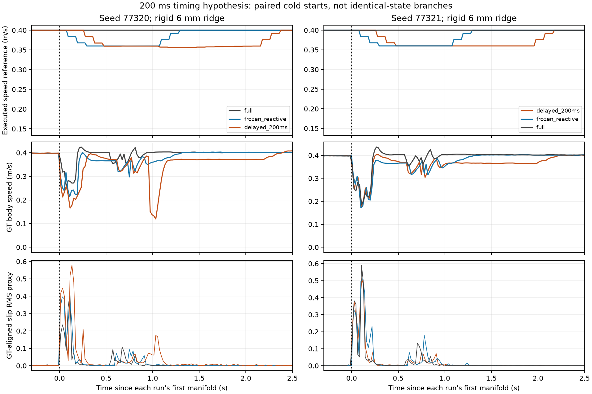

# Thí nghiệm delay phanh 200 ms — 16/10/2026

## Quyết định

Đã implement candidate opt-in và chạy **đúng 6/6 episodes**, không retry.
Tất cả đạt physical arrival, dừng ổn định 2 simulation seconds và các gate
reporting hiện có. Simulator của batch đã đóng.

**Không chọn delay 200 ms để dùng tiếp.** Delay thực thi đúng, nhưng lợi ích
không lặp lại giữa hai seed; tracking trung bình vượt giới hạn đã chốt.
Mặc định vẫn **0 ms**. Không thử thêm delay, không mở Optuna/PPO/predictor.
Đây là quyết định loại một candidate trong phạm vi thử, không chứng minh mọi
governor hoặc giả thuyết contact-informed control đều vô ích.

## 1. Contract và triển khai

Theo [protocol](governor_brake_delay_2026-10-16/PROTOCOL.md), world giữ gờ
capsule cứng cao 6 mm/radius 3 mm, x=3.10 m, góc +8°, collision floor box.
Hai seed mới 77320/77321; ba arm: PI full, governor frozen 0 ms, governor
200 ms. Thứ tự đảo theo block, cold start riêng từng lượt.

Tham số candidate duy nhất: `trigger_to_brake_delay_seconds: 0.0 → 0.2`.
Giữ robot, PI, detector, observations, cruise 0.4 m/s, target 0.90,
min/max HOLD 0.8/1.0 s, ramp 0.4/s, control 100 ms và physics 1 ms.
Chỉ metadata contract/telemetry được bổ sung; scoring native không đổi.

- Core thêm pha `DELAY`: giữ scale hiện tại, sau 200 ms mới bước vào HOLD.
  HOLD clock bắt đầu cùng tick phanh; ramp/bounds/release giữ như trước.
- Delay áp dụng cho mỗi trigger. Logic rearm/retrigger cũ được giữ; không
  nhân tiện sửa detector khi thấy kết quả.
- Stop, stale/invalid feedback và stall/failsafe vượt quyền delay. ROS wrapper
  còn hủy pending và phát zero ngay khi nhận stop trong lúc clock pause.
- Trace thêm trigger/brake-onset timestamp, elapsed clock và thời gian chờ
  còn lại. Timestamp gắn với **đầu** action; executed command vẫn lấy drive
  diagnostics. Contact/GT/caster chỉ dùng audit, không đưa vào governor.

Code: `src/nino_control/nino_control/governor_core.py`, `speed_governor.py`,
và phần telemetry của `src/nino_rl/nino_rl/ros_env.py`.
Runner: `src/nino_rl/scripts/run_governor_brake_delay.py`.

**Kiểm tra trước chạy:** 23 tests core/integration đạt. So sánh 10.000 quyết
định trên 5 profile với source trước sửa: mọi trường decision cũ trùng khi
delay=0; telemetry mới được tách khỏi phép so sánh. Source trước sửa được
giữ trong `governor_brake_delay_2026-10-16/implementation_before/`.

## 2. Kết quả từng lượt

Tất cả các hàng đạt arrival/2 s stop/reporting. Không loại spike hoặc episode.
Crossing window giữ **first manifold +50 ms đến body qua plane cách gờ
0.50 m**. Slip²·s/m là tích phân bình phương tỷ lệ trượt chia quãng đường,
không phải năng lượng cơ học J hoặc slip đã hiệu chuẩn trên robot thật.

| Seed | Controller | Time (s) | Physical RMSE (mm) | Whole RMS (m/s²) | Whole peak (m/s²) | Crossing RMS (m/s²) | GT crossing slip²·s/m |
|---|---|---:|---:|---:|---:|---:|---:|
| 77320 | PI full | 16.60 | 3.661 | 1.211 | 9.807 | 1.594 | 0.009569 |
| 77320 | Governor 0 ms | 16.70 | 4.215 | 1.249 | 14.364 | 2.186 | 0.010565 |
| 77320 | Governor 200 ms | 16.80 | **10.140** | 1.365 | 9.830 | 1.423 | **0.029851** |
| 77321 | Governor 200 ms | 16.80 | 3.671 | 1.505 | 15.742 | 2.394 | 0.018474 |
| 77321 | Governor 0 ms | 16.70 | 3.755 | 1.519 | 25.259 | 3.007 | 0.025026 |
| 77321 | PI full | 16.60 | 3.797 | 1.346 | 9.923 | 1.765 | 0.018432 |

Native whole-route slip và GT-timestamp whole-route slip được giữ riêng:

| Seed | Controller | Native slip RMS, không đổi | GT-native slip RMS |
|---|---|---:|---:|
| 77320 | PI full | 0.024943 | 0.023987 |
| 77320 | Governor 0 ms | 0.018188 | 0.030322 |
| 77320 | Governor 200 ms | 0.019098 | 0.043439 |
| 77321 | Governor 200 ms | 0.017913 | 0.033638 |
| 77321 | Governor 0 ms | 0.038218 | 0.037300 |
| 77321 | PI full | 0.021783 | 0.034109 |

Hai metric dùng cách ghép mẫu khác nhau; không chọn metric thuận lợi hơn
để tuyên bố thắng hoặc thay lại score study. GT-native và hai grid sensitivity
đã chốt tiếp tục dùng trong audit vật lý.

### Candidate 200 ms so với đối chứng

| Seed | Đối chứng | Crossing RMS | GT crossing slip²/m | Physical RMSE |
|---|---|---:|---:|---:|
| 77320 | Governor 0 ms | −34.9% | **+182.5%** | **+140.6%** |
| 77321 | Governor 0 ms | −20.4% | −26.2% | −2.2% |
| 77320 | PI full | −10.7% | **+212.0%** | **+177.0%** |
| 77321 | PI full | **+35.6%** | +0.23% | −3.3% |

Tracking trung bình: PI **3.729 mm**, governor 0 ms **3.985 mm** (1.069× PI),
governor 200 ms **6.906 mm** (1.852× PI). Cả hai governor không đạt mốc
1.05× PI trong batch này; không nới gate vì chênh tuyệt đối nhỏ.
Time trung bình 16.60/16.70/16.80 s đều trong mốc time; không phải một phép
time-matched PI riêng đã xác nhận. Việc giảm peak so với governor 0 ms ở cả
hai lượt không đủ để promote delay.

## 3. Timing đúng, cơ chế chưa cho lợi ích lặp lại

| Seed | Arm | Trigger đầu sau first manifold (ms) | Bắt đầu phanh (ms) | Drive feedback giảm đầu tiên (ms) | Contact bánh chủ động đầu (ms) | Số events |
|---|---|---:|---:|---:|---:|---:|
| 77320 | 0 ms | 76 | 76 | 93 | 598 | 1 |
| 77320 | 200 ms | 76 | 276 | 277 | 612 | **2** |
| 77321 | 0 ms | 78 | 78 | 97 | 612 | 1 |
| 77321 | 200 ms | 71 | 271 | 278 | 584 | **2** |

Ở mọi event 200 ms, trace ghi đúng hai tick pending, HOLD clock bằng 0 trong
pending. Event đầu giữ scale 1.00, event thứ hai giữ scale 0.90. Mọi onset
trừ trigger đều bằng 200 ms trong sai số số thực.

Lệnh phanh đầu vẫn trước manifold bánh chủ động 313–336 ms. Đây là khoảng
dẫn của **command**, không phải xác nhận vận tốc thân đã giảm do governor
trước impact. Body đã bị contact làm chậm ở cả PI; không dùng chênh command
để suy ra actuator lag độc lập.

Hai candidate tái kích hoạt ở +976/+771 ms sau first manifold, khi scale đã
0.90; onset event hai ở +1176/+971 ms. Vì vậy trạng thái reduced-speed được
kéo dài thay vì chỉ dịch nguyên một maneuver đơn event 200 ms. Đây là phản
ứng của logic rearm/retrigger đã giữ cố định trên quỹ đạo mới; không sửa
maxhold, rearming hay reward giữa batch.

## 4. Audit phase: chưa thể quy lỗi nhân quả cho delay

[Phase audit](governor_brake_delay_2026-10-16/phase_slip.json) dùng boundary
command của candidate, dịch theo first manifold của từng đối chứng; giữ cả
hai events, GT timestamps gốc, conservation sai số <1e−12 s và coverage đủ.
Đây là diagnostic phụ, không thay crossing score native.

Ở seed 77320, excess slip integral candidate − governor 0 ms trong common
crossing window là **+0.0146364 s**. Trong đó **+0.0124590 s**, khoảng 85%,
nằm ở *pending đầu*, trước khi candidate bắt đầu phanh; +0.0015958 s ở
pending lần hai. So với PI full, excess pending đầu là +0.0121925 s, dù
hai arm vẫn yêu cầu cùng cruise trước candidate onset. Không thể diễn giải
toàn bộ excess thành tác động của lệnh phanh trễ.

Precontact body median gần nhau (0.3973–0.3982 m/s), nhưng caster-right
rolling median thay đổi khoảng 0.55–2.99 rad/s. Các cold start không tái tạo
cùng trạng thái contact/caster; cùng seed không phải identical-state branch.
Slip proxy cũng không phải phép đo trực tiếp trượt caster.

Seed 77321 cho excess candidate − governor 0 ms **−0.0050001 s**; so với PI
full gần ngang (+0.0000108 s). Sự đổi chiều này và dữ liệu precontact giới
hạn kết luận: **candidate chưa chứng minh lợi ích**, chưa chứng minh delay
là nguyên nhân duy nhất làm slip/tracking xấu.

## 5. Độ tin cậy và bảo toàn dữ liệu

- 6/6 native RMS replay khớp; 6/6 kiểm tra timestamp đạt.
- Feedback age 1–21 ms, ít nhất 4 drive diagnostics/action; không failsafe.
- GT coverage toàn tuyến tối thiểu **99.405%**; crossing **100%**.
- Cả hai grid sensitivity đều giữ hướng crossing slip của GT trong bốn
  so sánh candidate/reference; không có đảo chiều thắng/thua giữa hai grid.
- First loaded component là caster-left wheel ở 6/6 lượt. Contact logger
  có sampling riêng; không coi thời điểm sample là exact engine force onset.
- First-50-ms IMU diagnostic **không khả dụng ở 4/6 lượt do partial window**;
  giữ nguyên trạng thái unavailable, không lấy RMS partial làm negative
  control hoàn chỉnh hoặc gán missing=0. Crossing reporting vẫn đạt gate
  coverage riêng đã chốt, không được suy rộng thành first-impact validation.
- Cùng world hash, robot/PI/core/timing provenance giữa sáu arm. New contract
  dùng core đã thêm delay; không gọi đó là cùng source hash với lịch sử.
- **1.466 file bảo vệ không đổi** trong batch; runtime sources không đổi
  lúc simulation chạy. Models, configs frozen và điểm study cũ giữ nguyên.
  209 file đầu vào mới đã được [hash](governor_brake_delay_2026-10-16/input_sha256.json).
- Không thêm episode, không retune vật lý hoặc detector. Matplotlib Axes3D
  warning chỉ xuất hiện khi reporting/plot, không gây crossing failure.

## 6. Bước sau

1. Giữ candidate và toàn bộ traces như kết quả âm; **không dùng delay 200 ms
   làm default, không tự thử giá trị khác**. Governor 0 ms vẫn là reference,
   không được xem là đã thắng PI trong batch này.
2. Nếu tiếp tục nghiên cứu H2, dùng chính traces mới để giải thích contact/
   caster và lần tái kích hoạt thứ hai; chốt được một quyết định trước khi
   xin thêm budget simulation. Không sửa rearming ngay chỉ vì thấy hai events.
3. Predictor/PPO và tuning tiếp vẫn chưa được mở bởi batch này. Theo Deep
   Research, bước kế tiếp cần giải quyết khả năng phân biệt lợi ích điều
   khiển với biến thiên tiếp xúc; không cần thêm mạng học để giải thích một
   candidate chưa có lợi ích lặp lại. Không có bằng chứng sim-to-real mới.

## Artifact

- [Protocol trước kết quả](governor_brake_delay_2026-10-16/PROTOCOL.md).
- [Quyết định offline](governor_brake_delay_2026-10-16/decision.json),
  [comparisons](governor_brake_delay_2026-10-16/comparisons.json),
  [reliability](governor_brake_delay_2026-10-16/reliability.json).
- Raw: `rl_runs/governor_brake_delay_2026-10-16/attempt_01` đến `attempt_06`.

