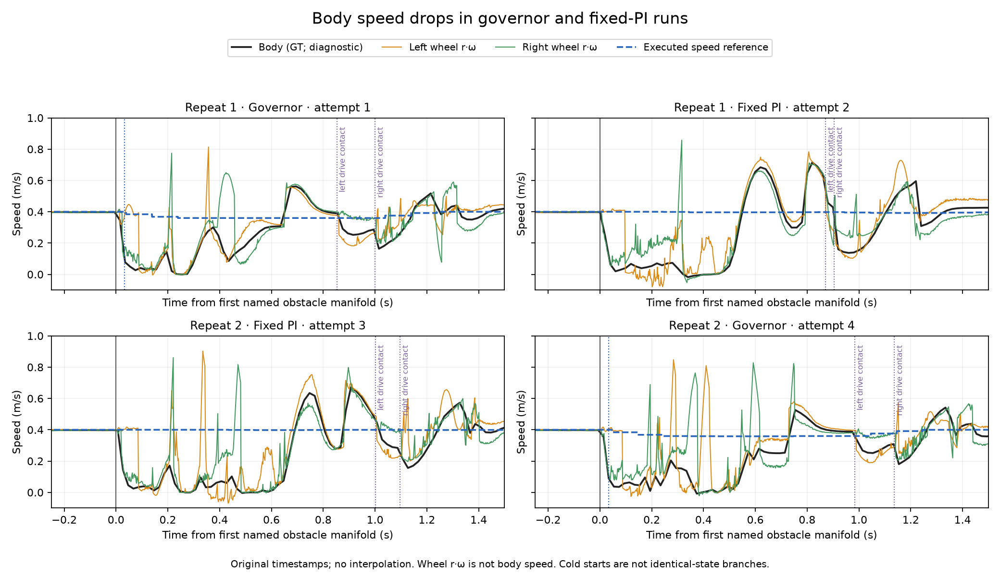

# Cửa sổ phản ứng governor sau contact — audit offline 16/10/2026

## Quyết định

Đã audit đủ **bốn trace frozen repeatability**, không chạy simulation mới,
không đổi controller, robot, native metric hoặc score study. Bước này kiểm
tra một phần câu hỏi H2 của Deep Research: **có cửa sổ để can thiệp vào các
contact tiếp theo không?** Không thay thế phép chứng minh lợi ích điều khiển.

Hai lượt governor phát lệnh giảm tốc 33–34 ms sau first named manifold,
và diagnostics ghi reference giảm 39–46 ms sau mốc đó. Tuy nhiên, **thân xe
đã bắt đầu giảm tốc trước lệnh governor**. PI cố định cũng ghi giảm tốc.
Không gọi lần giảm tốc này là actuator latency hoặc thành tích governor.

Lệnh có thời gian giảm trước các contact bánh chủ động ở scenario hiện tại.
Điều đó giữ hướng nghiên cứu khả thi về *thứ tự thời gian lệnh*, nhưng chưa
chứng minh lợi ích H2 lặp lại, H1/predictor, hay khả năng sim-to-real.

## 1. Phạm vi, nguồn và phương pháp

- Nguồn: bốn cold starts seed 77200 đã lưu trong
  `rl_runs/governor_frozen_repeats_2026-10-16/`; một gờ capsule cao 22 mm,
  x=3.10 m/góc +8°, PI/governor cruise 0.400 m/s. Không phải bốn scenario mới.
- Timestamps gốc; không đưa qua grid mới, không nội suy hoặc chấm lại slip.
- `t=0` là first named positive-obstacle manifold đã dùng trước đây.
  Sample có positive depth và force norm >1e−6 N lưu thành mốc riêng.
  Epsilon này chỉ phân biệt zero số học, không phải ngưỡng lực an toàn.
- Median baseline lấy từ −0.30 đến −0.05 s trước mốc đó. Audit kiểm tra
  speed ≤95% và ≤90% baseline trong ít nhất 60 ms, không nối qua gap >25 ms.
  Đây là định nghĩa chẩn đoán đã lưu trước khi tính kết quả, không đổi detector.
- Ground-truth `twist.linear.x` dùng đúng kênh dữ liệu đang ghi/native;
  chỉ phục vụ audit, không đưa vào governor. Encoder quy về `r·ω`, r=62.5 mm;
  đó không tự là vận tốc tịnh tiến thân hoặc phép đo slip độc lập.
- Bảng tại contact dùng sample gần nhất **không muộn hơn** mốc đó và age
  ≤25 ms. Thiếu sample được ghi `null`, không điền 0 hoặc lấy sample tương lai.

## 2. Timeline: giảm tốc không tự chứng minh tác động của governor

Tất cả số dưới đây là ms sau first named manifold, làm tròn từ timestamps.

| Lượt | Controller | Sample contact có lực đầu tiên | Bắt đầu chuỗi body giảm ≥10% | Xác nhận chuỗi 60 ms | Lệnh scale giảm đầu tiên | Sample reference thực thi giảm đầu tiên |
|---|---|---:|---:|---:|---:|---:|
| 1 | Governor | 13 | 15 | 75 | 33 | 39 |
| 2 | PI cố định | 13 | 20 | 80 | — | — |
| 3 | PI cố định | 12 | 27 | 87 | — | — |
| 4 | Governor | 11 | 14 | 74 | 34 | 46 |

“Bắt đầu chuỗi” được xác định **retrospective** sau khi có đủ sample xác
nhận 60 ms. Không có nghĩa một detector triển khai đã biết điều đó tại
14–15 ms. GT có chu kỳ khoảng 20 ms; contact sampling khoảng 10 ms. Không
diễn giải số làm tròn 1 ms như độ chính xác vật lý 1 ms.

Ở cả hai lượt governor, body giảm trước lệnh khoảng 18–20 ms. Cùng hiện
tượng xuất hiện ở PI cố định nên không thể lấy `first body slowdown − first
contact` làm độ trễ motor hoặc bằng chứng governor gây giảm tốc. Điều này
phù hợp với ảnh hưởng tiếp xúc, nhưng chưa xác định riêng bracket, fork,
tải caster hay numerics là nguyên nhân của mọi dao động.

33–34 ms là độ trễ tổng hợp đến **decision/lệnh trong simulation**. Trace
không tách riêng chính xác detection, transport, computation và actuator
lag, cũng không đo latency trên Pi. Reference trong drive diagnostics là
kết quả command path; nó không phải vận tốc thân đã thực hiện được.

## 3. Có kịp trước contact tiếp theo không?

| Mốc sau manifold đầu | Governor lượt 1 (ms) | Governor lượt 4 (ms) |
|---|---:|---:|
| Bánh caster trái bắt đầu manifold | 114 | 101 |
| Command scale đạt 0.90 | 233 | 234 |
| Bánh caster phải bắt đầu manifold | 384 | 310 |
| Bánh chủ động trái bắt đầu manifold | 853 | 984 |
| Bánh chủ động phải bắt đầu manifold | 999 | 1.136 |

Ở caster trái, lệnh đã giảm một phần (scale 0.96) nhưng chưa đạt 0.90.
Trước bánh chủ động trái, cả hai lượt đã có scale 0.90. Vì vậy, không đúng
nếu kết luận mọi contact tiếp theo đều quá nhanh để thay đổi *lệnh*. Cũng
không đúng nếu mặc định mọi bánh đã chạy chậm bằng reference.

| Lượt/contact bánh chủ động | Scale tại manifold | Reference gần nhất (m/s) | Body gần nhất (m/s) |
|---|---:|---:|---:|
| Governor 1, trái | 0.90 | 0.360 | 0.393 |
| Governor 1, phải | 0.90 | 0.360 | 0.287 |
| Governor 4, trái | 0.90 | 0.360 | 0.388 |
| Governor 4, phải | 0.98 | 0.376 | 0.309 |

Body không luôn bằng reference; wheel response cũng có transient lớn.
Không cộng thêm một “motor lag” suy từ lần body giảm đầu vào thời gian ramp,
vì như vậy vừa dùng response nhiễm contact vừa có nguy cơ cộng trùng độ trễ.
Chu kỳ command hiện cấp bước scale đầu ngay tại decision; timeline đo được
đáng dùng hơn việc cộng máy móc ramp liên tục và tất cả sampling delays.

Lượt 4 bắt đầu phục hồi trước contact bánh chủ động phải; lượt 1 thì chưa.
Đó là khác biệt đáng ghi nhận, **chưa phải bằng chứng tăng HOLD sẽ cải thiện
chất lượng**: cold starts không khôi phục cùng trạng thái, impacts biến thiên,
và spike lịch sử không lặp lại theo cùng một phase. Giữ nguyên tham số.



Đồ thị chỉ hiển thị −0.25 đến +1.50 s để đọc contact sequence; dữ liệu audit
giữ cửa sổ −0.50 đến +2.00 s. Không loại transient khỏi số liệu gốc.

## 4. Điều đã biết và chưa biết theo Deep Research

| Câu hỏi | Kết luận từ dữ liệu này |
|---|---|
| Có phát lệnh giảm trước contact bánh chủ động? | Có ở hai lượt governor này |
| Body giảm tốc sau contact? | Có ở cả governor và PI, nên riêng hiện tượng này không chứng minh hiệu quả governor |
| Đã xác định latency motor sạch khỏi contact? | Chưa; phải dùng phép đo actuator riêng nếu quyết định cần con số đó |
| H2 đã đạt về lợi ích có thể lặp lại? | Chưa; giữ kết luận repeatability trước, không promote bằng timeline |
| H1 history có dự đoán tốt hơn speed-only? | Chưa được kiểm tra; không xây predictor từ kết luận H2 chưa đủ |
| Bracket/geometry trên robot thật có khớp? | Chưa có số đo, xem phiếu đối chiếu cơ khí |

Mốc contact phụ thuộc trajectory và load; không lấy những thời điểm này làm
deadline cố định cho một speed profile chưa thử. First-contact GT/force,
caster state và global x tiếp tục chỉ dùng cho nhãn/oracle/diagnostic.

## 5. Bước tiếp theo và điểm dừng

**Cần chốt điều kiện phần cứng hiện có:** có robot thật để đối chiếu caster
hay hiện chỉ làm trong mô phỏng. Đã hỏi người dùng, chưa mặc định câu trả lời.

- Nếu có robot: đối chiếu gap/đường kính hai bên theo
  [hướng dẫn đã chuẩn bị](CASTER_MECHANICAL_REFERENCE_2026-10-16.md), rồi
  chọn một sai lệch thực sự cần sửa. Không bắt đo thêm vô hạn trước quyết định.
- Nếu hiện chỉ mô phỏng: phần cứng chưa xác nhận phải giữ là giới hạn của
  kết luận; có thể thiết kế screen fidelity/authority dưới giả thiết CAD,
  không gọi đó là xác nhận robot thật. Cần chốt một protocol nhỏ có điểm dừng
  trước khi chạy, thay vì tiếp tục cùng vòng reward/tuning.

Chưa tự mở simulation mới khi nhánh tiếp theo chưa được xác định. Không
điều chỉnh ramp, hold, reward hoặc geometry chỉ từ body slowdown ban đầu.

## 6. Verification và tái tạo

- **5/5 unit tests**: yêu cầu đủ duration, không nối gap, loại dip ngắn,
  ngắt chuỗi khi nonfinite, không dùng sample tương lai/stale.
- Các mốc manifold khớp audit trước; cả bốn attempts được giữ.
- **1.093 protected files không đổi**; input hashes của audit được lưu.
- Tool compile được; plot đã kiểm tra trực quan. Không đổi native metrics,
  study DB hoặc bất kỳ tham số runtime nào.

```bash
cd ~/ninorobot
python3 src/nino_rl/scripts/audit_governor_contact_timing.py \
  --run rl_runs/governor_frozen_repeats_2026-10-16 \
  --output /tmp/nino_contact_timing_audit
python3 src/nino_rl/test/test_governor_contact_timing.py
```

Output phải là thư mục mới. File gồm [protocol](governor_contact_timing_2026-10-16/protocol_before_analysis.json),
[timing và sampled series](governor_contact_timing_2026-10-16/timing.json),
[input hashes](governor_contact_timing_2026-10-16/input_sha256.json),
và [verification](governor_contact_timing_2026-10-16/verification.json).
