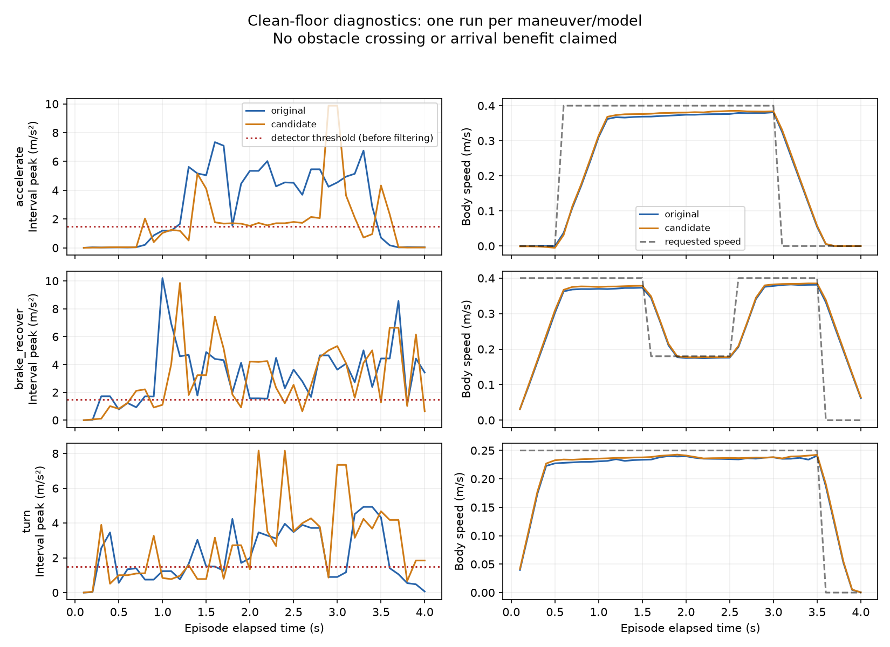

# Governor Nino — triển khai bước nền tảng, 15/10/2026

**Cập nhật tiếp theo:** candidate damping 0.001 đã được kiểm tra toàn tuyến
E1 seed 76000 và cửa sổ sau dừng. Xem
[sửa ổn định sàn sạch](CLEAR_FLOOR_STABILITY_FIX_2026-10-15.md) cho kết quả mới
và entry chạy profile sửa. Các quyết định bên dưới giữ nguyên như lịch sử vòng trước.

## Mục tiêu của vòng này

Phân biệt phản ứng do lệnh điều khiển/tiếp xúc sàn với contact vật cản, trước
khi dùng lịch sử cảm biến để chọn speed profile. Chưa xây risk predictor,
chưa train PPO và chưa mở Optuna. Ngưỡng detector, reward, PI, terrain và các
physical arrival gates không được thay để làm đẹp kết quả.

## Công cụ đã triển khai

1. `run_governor_foundation_probe.py`: ba maneuver sàn sạch, mỗi maneuver 4 s:
   tăng tốc/dừng, phanh/phục hồi, vừa tiến vừa rẽ. Cùng seed 76100–76102 và
   cùng lịch lệnh cho hai model. Chạy `profile=full` để đo đầu vào detector
   mà không để giảm tốc làm thay đổi dữ liệu nền.
2. `audit_governor_foundations.py`: replay reactive governor trên dữ liệu đã
   ghi; đối chiếu confirmation 0.04/0.20/0.30 s. Đây là shadow replay, không
   phải kết quả chạy motor của ba controller mới.
3. Contact audit: tỷ lệ tốc độ lăn caster so với tốc độ thân trong đoạn
   tiến thẳng/caster thẳng, độ xuyên contact, force nếu có. Đây là diagnostic
   mô phỏng, không là phép đo slip đã hiệu chuẩn trên robot thật.
4. Candidate vật lý riêng: damping trục quay bánh caster 0.01 → 0.001,
   giữ swivel damping và mọi thành phần khác. Mặc định model vẫn là 0.01.
5. Logger kiểm tra URDF thực tế từ `/robot_description`, lưu hash và damping
   quan sát được. Probe candidate từ chối world/model không khớp metadata.

Probe giữ clock checks, callback barriers và physical termination đang có.
Đến hết 4 s chỉ là hoàn tất một phép thử ngắn, **không phải đến đích**.
Mỗi maneuver mới reset môi trường. Cùng seed không đồng nghĩa restore toàn
bộ trạng thái engine/contact/controller; đây không phải exact branching.

## Audit kết quả rollover cũ

Bản lưu ngày 14/10 ghi seed 76000, termination `rollover` ở 19.70 s,
physical endpoint error 0.3043 m; contact cáp được ghi đầu tiên khoảng
7.23 s sau bắt đầu episode. Không đủ căn cứ quy rollover cho contact đầu
tiên, PI hay caster chỉ từ hai timestamp này.

Các raw log cũ trong `/tmp` không còn. Failed arrival vẫn giữ tại
`docs/governor_implementation_verification_2026-10-14/`. Chưa tuyên bố sửa
được rollover; cần một lượt E1 đầy đủ với contact/motor/IMU traces mới trước
so sánh chất lượng toàn route.

## Kết quả sáu phép thử sàn sạch

Đã chạy 240 bước, tổng 24 s mô phỏng: ba maneuver × hai model. Mỗi lượt
hoàn tất 4 s mà không có physical termination; clock error lớn nhất khoảng
1.5e-14 s. Đây không phải sáu lượt physical arrival.

| Maneuver | Peak IMU khoảng đo — gốc (m/s²) | Candidate (m/s²) | Số trigger replay gốc/candidate |
|---|---:|---:|---:|
| Tăng tốc/dừng | 7.341 | 9.874 | 1 / 1 |
| Phanh/phục hồi | 10.206 | 9.854 | 1 / 1 |
| Tiến và rẽ | 4.931 | 8.176 | 1 / 1 |

Confirmation 0.20 hoặc 0.30 s vẫn có một trigger ở **mọi** maneuver của cả
hai model. Debounce đơn thuần không giải quyết được kích hoạt trên sàn sạch.
Các lượt thực thi dùng `profile=full`, vì vậy actual governor events=0;
cột trigger là **shadow replay reactive**, không được trộn hai kết quả.

Trong các sample tiến thẳng đủ nhanh, caster phải có tỷ lệ tốc độ lăn/thân
median 0.256 → 0.651 ở lượt tăng tốc và 0.319 → 0.658 ở lượt phanh/phục hồi.
Caster trái khoảng 0.987–0.996. Candidate cải thiện chỉ báo rolling của
caster phải nhưng **chưa làm rung giảm nhất quán và chưa giải quyết detector**.
Không chọn candidate làm mặc định hoặc coi đây là xác nhận vật lý đúng.

Mỗi maneuver/model mới có một lượt, không đủ kết luận repeatability hay
hiệu quả ngoài những trường hợp này. Rung trên sàn sạch là tín hiệu trong
mô phỏng; trigger không chứng minh có cáp và cũng chưa chứng minh tất cả
rung đó chỉ là artifact. Cần phân biệt đáp ứng vật lý thật với contact/sensor
numerics trước khi đặt ngưỡng để tách nhiễu vật cản.



JSON, báo cáo replay và sáu CSV trace nhỏ lưu tại
`docs/governor_foundations_2026-10-15/`. Raw contact/IMU/joint data mới lưu
trong `rl_runs/governor_foundations_2026-10-15/`, không đặt trong `/tmp`.

Build `nino_description`/`nino_rl` thành công; **64 tests passed** gồm kiểm
tra candidate chỉ đổi wheel damping, giữ swivel damping, và từ chối model
hoặc world không khớp với probe.

## Lượt E1 đầy đủ trên sàn sạch — bị gián đoạn, giữ nguyên failure

Đã chạy thêm đúng một attempt full-speed PI, seed 76000, world `clear`, model
gốc damping 0.01. Supervisor ở profile `full`, không can thiệp giảm tốc.

- Trace hoàn chỉnh đến 17.50 s; physical x≈6.236 m, khoảng cách đích≈0.215 m.
- Ground truth vượt |roll|=15° tại khoảng 17.243 s, x≈6.225 m.
- Chassis bắt đầu contact với floor mesh tại khoảng 17.466 s.
- Ground truth cuối trước abort ghi roll≈−26.94°, pitch≈11.89°.
- Evaluator dừng vì `Corridor localization has no fresh accepted wall scan`.
  Đây là **measurement aborted**, không có episode arrival hoàn chỉnh.

Số lượng: **1 attempt, 0 completed episodes, 1 aborted measurement**.
Không ghi success hoặc impact bằng 0; không tạo success-rate cho batch rỗng.
Không coi đây là một completed rollover episode vì ngưỡng termination chưa
được evaluator chấm xong. Tuy nhiên, ground truth và chassis contact xác nhận
chuyển động nghiêng lớn thực sự trong mô phỏng, không chỉ pose ước lượng sai.

Evaluator đã được sửa để các lần startup/reset/step lỗi sau này vẫn ghi
`failure.json` và `summary.json` với `complete=false`, giữ trace đã có và
re-raise lỗi. Phép chạy vừa rồi bắt đầu trước sửa reporting; bản ghi lỗi của
nó được khôi phục từ evaluate log, đánh dấu `recovered_from_evaluate_log=true`.
Không kéo dài freshness timeout hay bỏ kiểm tra clock/sensor.

Artifacts nhỏ: `docs/governor_foundations_2026-10-15/clear_arrival_*`.
Raw contact/IMU/drive/ground-truth mới và evaluate log nằm trong `rl_runs`.
Tất cả simulator/probe do vòng này mở đã được đóng.

**Quyết định:** chưa nâng cấp candidate damping, chưa đổi threshold, chưa mở
predictor/PPO/Optuna. Cần sửa/kiểm chứng độ ổn định robot–PI–contact trên sàn
sạch và xử lý định vị mất hiệu lực khi robot nghiêng. Chưa xác định nguyên
nhân gốc là caster, mô hình tiếp xúc, cơ khí/COM hay đáp ứng motor.

## Lệnh chạy lại phép thử sàn sạch

Trong **cả hai terminal**:

```bash
cd ~/ninorobot
source /opt/ros/jazzy/setup.bash
source .venv/bin/activate
source install/setup.bash
export ROS_DOMAIN_ID=189
export NINO_ROS_DOMAIN_ID=189
export ROS_AUTOMATIC_DISCOVERY_RANGE=LOCALHOST
export GZ_PARTITION=nino_governor_foundations_189
```

Terminal A — model gốc:

```bash
ros2 launch nino_rl factory_floor_governor.launch.py \
  variant:=clear headless:=true caster_wheel_damping:=0.01 \
  config:=src/nino_rl/config/factory_floor_governor_full.yaml \
  output_directory:=rl_runs/governor_clean_repeat/contact
```

Terminal B — sau khi controller sẵn sàng:

```bash
python src/nino_rl/scripts/run_governor_foundation_probe.py \
  --case all --config src/nino_rl/config/factory_floor_governor_full.yaml \
  --logger rl_runs/governor_clean_repeat/contact \
  --output rl_runs/governor_clean_repeat/probe --run
```

Script in đường dẫn output cụ thể. Bỏ `--run` để xem kế hoạch. Không chạy
thêm ROS governor node song song với evaluator/probe.

Sau khi probe hoàn tất và đã đóng Terminal A bằng Ctrl+C, phân tích offline:

```bash
python src/nino_rl/scripts/audit_governor_foundations.py \
  rl_runs/governor_clean_repeat/probe \
  --logger rl_runs/governor_clean_repeat/contact
```

Hai đường dẫn parent được tự tìm run mới nhất; báo cáo lưu trong đúng thư
mục run đó và in đường dẫn JSON/Markdown cụ thể.

Candidate dùng launch argument `caster_wheel_damping:=0.001` và config
`factory_floor_governor_caster_candidate.yaml` ở cả launch/probe; dừng world
cũ trước khi mở world mới. Candidate là thí nghiệm vật lý, chưa là profile
được khuyến nghị triển khai.

## Cổng quyết định sau vòng này

- Nếu candidate chỉ sửa rolling mà chưa giảm background rung/trigger,
  không coi detector đã được hiệu chỉnh và không tự nâng ngưỡng.
- Chốt fidelity cần thiết của contact/IMU trước khi học: controller không
  nên học cách bù một artifact chưa được nhận diện của simulator.
- H2 có thể kiểm tra bằng oracle contact **riêng cho thí nghiệm**; không
  đòi predictor hoặc detector triển khai hoàn hảo trước mọi phép thử H2.
  Tuy nhiên, reference phải vượt được và kết quả phải lớn hơn biến thiên lặp.
- Trước so sánh ride quality: chạy lại E1 full PI có strict physical arrival,
  contact/motor/IMU trace và giữ mọi failure. Sau đó mới so các speed profiles.
- Dùng trace mới ở 16–17.6 s để chọn correction tiếp theo; không lặp ngay
  sweep rộng hoặc bỏ giới hạn để ép baseline đến đích. Kiểm tra đồng thời
  target/actual/torque bánh, caster swivel/rolling, support contacts và 3D pose.
- Predictor chỉ bắt đầu khi speed intervention có lợi và lịch sử có thông
  tin hữu ích; training/test scenario phải tách riêng. Optuna cho classical
  governor có thể dùng khi objective/splits và phép đo đủ ổn định; không
  yêu cầu PPO thắng PI mới cho phép mọi tuning.

Đây là một vòng sửa vật lý có đối chứng. Nếu không đạt, quyết định tiếp theo
phải tập trung vào fidelity/contact hoặc đo đạc phần cứng, tránh nối tiếp
các thay đổi reward/threshold không có phép kiểm chứng phân biệt nguyên nhân.
