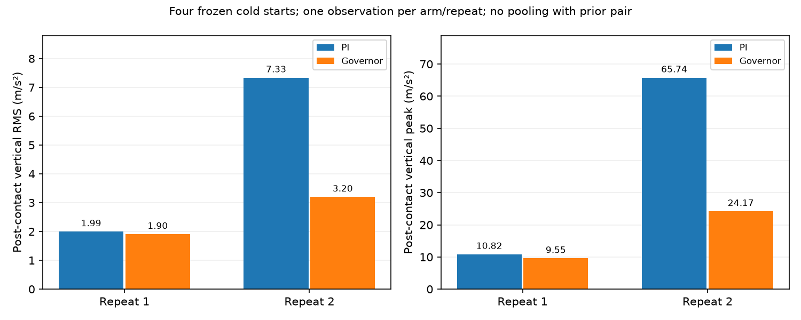

# Governor — bốn cold starts lặp, 16/10/2026

## Quyết định

Đã chạy đúng **4/4 attempts**, tất cả đạt physical arrival và dừng ổn định
2 giây. Native replay, timestamp, feedback và coverage đều đạt. Không retry,
không đổi tham số, không mở Optuna/PPO/predictor.

Hai cặp mới đều có crossing RMS/peak và GT crossing slip thấp hơn với
governor. Tuy nhiên, **whole-route RMS đổi chiều giữa hai cặp**, mức tác
động thay đổi nhiều, và spike 163.5 m/s² của lượt trước không lặp lại trong
hai lượt governor mới. PI tốc độ cố định cũng ghi peak 65.7 m/s².

**Chưa đủ căn cứ chọn một correction vào RECOVER.** Dừng mở rộng simulation
ở ngân sách này; đối chiếu contact reference và ràng buộc cơ khí trước khi
đổi controller hoặc huấn luyện. Đây không phải kết luận governor/RL vô ích.

## 1. Protocol và invariants

Thực hiện [protocol đã chuẩn bị trước](governor_readiness_v1_2026-10-16/next_repeatability_protocol.json):

- Seed 77200, E1, một gờ capsule cứng x=3.10 m/góc +8°.
- Repetition 1: governor rồi PI; repetition 2: PI rồi governor.
- Bốn cold starts riêng, chỉ một simulator chạy tại mỗi thời điểm.
- Cruise cả hai 0.400 m/s; governor target 0.90, min hold 0.8 s,
  max hold 1.0 s, ramp 0.4/s. Physics 1 ms, control 100 ms.
- Config SHA `6ce2de78c09eb502e89ab6e81f614a2c0064a05bacc1995df5e421d58e5cb7f5`.
- Robot, PI, detector, observations, estimator math, native metric và
  physical scoring giữ nguyên. Runtime readiness khớp lần kiểm tra trước.

Đây là repeatability screen trên scenario đã biết, **không phải test unseen**
hoặc cùng snapshot. Không gộp cặp instrumentation cũ vào score/bank mới.
Không kiểm tra mọi địa hình hoặc robot thật qua bốn lượt này.

## 2. Số liệu từng lượt

RMS/peak trong bảng là acceleration đứng của **crossing window**: từ first
named contact manifold +50 ms đến plane clearance 0.5 m. Cách đo này giữ
nguyên như contract cũ, không thay theo kết quả.

| Lặp | Controller | Time (s) | Physical RMSE (cm) | Crossing RMS (m/s²) | Crossing peak (m/s²) | GT crossing slip²·s/m |
|---|---|---:|---:|---:|---:|---:|
| 1 | PI | 16.70 | 1.093 | 1.993 | 10.819 | 0.19162 |
| 1 | Governor | 16.80 | 0.508 | 1.903 | 9.553 | 0.11814 |
| 2 | PI | 16.80 | 0.487 | 7.335 | 65.741 | 0.20524 |
| 2 | Governor | 16.90 | 0.454 | 3.197 | 24.169 | 0.18229 |

Slip²·s/m là chỉ số mô phỏng tích phân squared slip ratio theo thời gian,
chia quãng đường; không phải năng lượng cơ học. GT timestamp gốc và nội suy
joint giữ nguyên; không thay bằng grid thuận lợi hoặc loại các spike.

| Governor so với PI | Lặp 1 | Lặp 2 |
|---|---:|---:|
| Thời gian | +0.60% | +0.60% |
| Physical path RMSE | −53.53% | −6.82% |
| **Whole-route vertical RMS** | **+1.65%** | **−47.06%** |
| Crossing vertical RMS | −4.56% | −56.41% |
| Crossing peak | −11.70% | −63.24% |
| GT whole-route slip RMS | −19.45% | −6.16% |
| GT crossing slip²·s/m | −38.35% | −11.18% |

Mỗi ô chỉ có một observation/arm/repetition. Không có khoảng tin cậy đủ
thuyết phục hay bằng chứng cải thiện lớn hơn run-to-run variability từ n=2.
Không dùng mean bị chi phối bởi spike của PI để tuyên bố governor đã thắng.

## 3. Spike có thực sự thuộc RECOVER không?

| Lượt | Peak so với first manifold | Pha lúc peak | Nhận xét |
|---|---:|---|---|
| Governor lặp 1 | +1.315 s | CRUISE, scale 1.00 | Gần bánh trái trở lại sàn sau cáp |
| PI lặp 1 | +0.140 s | PI cố định | Gần caster trái bắt đầu chạm cáp |
| PI lặp 2 | +0.087 s | PI cố định | Bracket đã contact; caster wheel chưa bắt đầu contact được ghi |
| Governor lặp 2 | +1.154 s | RECOVER, scale 0.98 | Bánh chủ động phải vừa bắt đầu contact cáp |

Governor bắt đầu command giảm tốc khoảng 33–34 ms sau first manifold; về
CRUISE khoảng 1.233–1.234 s sau mốc đó. Đây là timeline lệnh, không đồng
nghĩa thân xe thay đổi vận tốc tức thì.

Lượt instrumentation trước vẫn giữ nguyên peak governor **163.5 m/s²**
trong RECOVER gần lúc bánh trái rời cáp. Hai lượt mới không tái hiện cùng
mức spike và contact phase đó. Không bỏ lượt cũ như một outlier vô nghĩa;
cũng không quy toàn bộ spike mới cho recovery, PI gains hoặc contact numerics.

## 4. Caster state và first-contact reference — audit offline

Trước contact, median body speed bốn lượt gần nhau: khoảng 0.3973–0.3977 m/s.
Swivel angle nhỏ, nhưng caster rolling state khác nhau rõ: median tốc độ
caster có giá trị khoảng 6.95–24.84 rad/s giữa các lượt/bên. **Không gọi
đây là slip chỉ từ wheel speed**: caster có thể ít chịu tải hoặc được nhấc
khỏi sàn. Seed giống nhau không khôi phục cùng contact/load state.

Audit thêm đúng cửa sổ này ghi 22–23 contact samples/bên: caster quay chậm
có median độ lớn vertical support wrench bằng **0 N**, bên quay nhanh khoảng
**15–19 N**. Mean vẫn khác 0 ở cả hai bên, cho thấy tải tiếp xúc gián đoạn
trong sampled window; không chứng minh caster mất tải suốt đoạn. Biến thiên
này có trước intervention, nên không được quy toàn bộ khác biệt crossing
cho slowdown/recovery. Không có căn cứ tăng damping hoặc gọi đó là lỗi PI.

### First named manifold chưa phải first loaded contact

**4/4 lượt ghi caster bracket trái trước**, caster wheel trái xuất hiện
khoảng 0.101–0.119 s sau đó. Kiểm tra manifold đầu tiên cho thấy lực bằng 0,
depth âm khoảng −1.2 đến −1.3 mm. Sample có force khác 0 và depth dương
xuất hiện sau khoảng **11–13 ms**.

Audit dùng force norm >1e−6 N để phân biệt zero số học, không phải ngưỡng
an toàn hoặc detector triển khai. Contact sensor hiện 100 Hz, nên sample có
lực đầu tiên không chứng minh chính xác instant tiếp xúc vật lý. Đã lưu
**hai reference riêng**, không đổi first-contact window hoặc chấm lại study.
Không đưa force/identity này vào governor.

### Khoảng hở cơ khí cần đối chiếu

Từ URDF và STL thực tế, nominal base height 62.5 mm, caster swivel origin
z=−21.5 mm, STL bracket min z≈−31.968 mm: thấp nhất danh nghĩa khoảng
**9.03 mm trên sàn**. Bánh caster Ø32 mm; gờ capsule của screen cao **22 mm**.
Mesh nguồn và mesh cài đặt khớp nhau.

Điều này xác định một ràng buộc cơ khí đáng kiểm tra trên robot thật;
**không tự chứng minh collision mesh sai hoặc phải nâng bracket**. Bounds
test tại hai GT poses lân cận không loại trừ giao nhau, nhưng cũng không
chứng minh fidelity của contact. Không thay geometry/friction/damping để
làm kết quả đẹp hơn.

## 5. Verification và giới hạn kết luận

- 4/4 physical arrival/stop, native replay, timestamp và GT windows đạt.
- Feedback age trong giới hạn 0.10 s; không có failsafe hoặc native outcome
  thiếu. Cấu hình từng case chỉ khác profile full/reactive.
- Robot/core/PI/timing hashes và world hash khớp giữa bốn lượt và cặp trước.
- **1,093 protected files không đổi**; kiểm tra thêm baseline bảo toàn 1,433
  files của vòng trước cũng không có thay đổi. Không ghi lại score/database cũ.
- Runner mới compile được; không sửa runtime hoặc chạy lại test suite cũ
  trong vòng này. Các simulator do screen mở đã đóng, không còn process
  của partition riêng.

`decision.json` tự động kiểm tra reversal của crossing RMS và whole-route
peak: cả hai không đảo chiều trong hai cặp mới. **Whole-route RMS có đảo
chiều**, nằm ngoài hai cột của flag tự động đó. Quality review riêng áp dụng
điểm dừng của protocol cho toàn bộ số liệu, không sửa flag/score sau kết quả.

Theo Deep Research, cần lợi ích vượt repeatability/noise có ý nghĩa trước
khi kết luận H2 hoặc xây H1/predictor. Bộ thử này có tín hiệu lợi ích nhưng
chưa xác nhận điều đó. Nó không chứng minh sim-to-real hay loại trừ giá trị RL.

## 6. Bước tiếp theo đã chọn

**Đối chiếu khoảng hở bracket nhỏ nhất và đường kính caster thật** với
9 mm/Ø32 mm mô phỏng, rồi chốt envelope vật cản có thể vượt. Đã yêu cầu
hai kích thước này; chưa giả định câu trả lời hoặc sửa mô hình.

- Nếu mô hình khác phần cứng: sửa đúng một sai lệch có đo đạc, contract mới,
  trước khi chọn correction cho governor.
- Nếu khoảng hở thấp là thật: bracket/cáp là một phần cơ khí của bài toán;
  không kỳ vọng speed governor tránh được first impact chưa quan sát. Chốt
  phạm vi obstacle phù hợp hoặc thay cơ khí/cảm biến cho yêu cầu vượt cao hơn.
- Giữ first-manifold và first-force timestamps tách biệt cho nghiên cứu tiếp;
  giữ cả whole-route và post-contact metrics. Không lọc spikes hoặc giả lập
  các contact không được ghi.

Không tự động kéo dài HOLD, tăng penalties, mở thêm seed, validation lớn,
Optuna/PPO/predictor trong vòng này. Đây là điểm dừng theo bằng chứng của
screen, không phải yêu cầu mô phỏng hoàn hảo vô hạn trước mọi tuning.

## Artifacts

- [Protocol trước kết quả](governor_frozen_repeats_2026-10-16/protocol_before_results.json).
- [Bốn episode đầy đủ](governor_frozen_repeats_2026-10-16/episodes.json).
- [Metrics CSV](governor_frozen_repeats_2026-10-16/episode_metrics.csv).
- [Caster/contact sequence](governor_frozen_repeats_2026-10-16/caster_sequence_context.json).
- [Caster support force trước contact](governor_frozen_repeats_2026-10-16/precontact_caster_floor_forces.json).
- [First bracket: geometry, force và depth](governor_frozen_repeats_2026-10-16/bracket_first_contact_geometry.json).
- [Quyết định tự động](governor_frozen_repeats_2026-10-16/decision.json) và
  [quality review](governor_frozen_repeats_2026-10-16/quality_review.json).
- [Verification/bảo toàn](governor_frozen_repeats_2026-10-16/verification.json).

Raw sensor/contact logs giữ tại `rl_runs/governor_frozen_repeats_2026-10-16/`;
config, source snapshots, log và CSV nhỏ được archive trong docs với input hashes.
