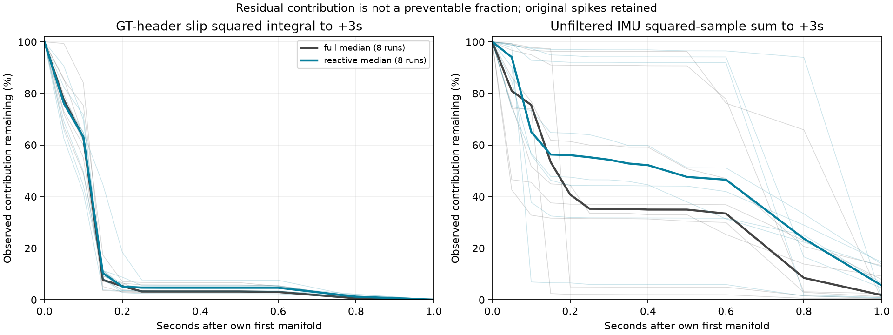

# Đánh giá hiện trạng và bước tiếp theo — 23/10/2026

> **Cập nhật thực thi sau audit:** xem
> [kết quả cadence 23/10](GOVERNOR_ISOLATED_CADENCE_RESULT_2026-10-23.md).
> V3 dừng ở 1/12 vì lỗi end/lifecycle; v4 đã sửa và qua 140 test nhưng chưa
> chạy. Phần dưới giữ quyết định và kết quả offline tại thời điểm trước batch.

## Kết luận

**Governor chạy được trong scenario đã thử, nhưng lợi ích lặp lại và quyền
điều khiển hữu ích sau contact vẫn chưa được chứng minh.** Acquisition v2
đã sẵn sàng ở mức phần mềm; chưa được xác nhận bằng Gazebo. Không cộng tiến
bộ logger vào thành tích controller.

Đã hoàn tất một audit offline có giới hạn theo khuyến nghị phản biện:
đọc **25 run đã lưu**, giữ **28 slot** (16 survey + 12 cadence), đủ tám cặp
survey, hai cặp cadence có integrity hợp lệ. Attempt cadence 9 và ba slot
chưa chạy vẫn hiện trong kết quả. Không có simulation mới.

**Quyết định:** H2 vẫn **chưa xác định**. Chưa có căn cứ dừng mọi can thiệp
sau contact vì còn thời gian trước drive contact và còn rung muộn. Tuy
nhiên, kỳ vọng giảm mạnh slip bằng đáp ứng muộn cần hạ xuống. Khuyến nghị
tiếp theo vẫn là **một screen cadence v2 mới, tối đa 12 attempts**, tập
trung vào actual response và chất lượng crossing. Không audit tiếp các
trace này. Screen chưa được release; không sử dụng lại slot batch đã đóng.

## 1. Công việc đã thực hiện

- [Kế hoạch khóa trước tính toán](governor_h2_timing_envelope_2026-10-23/plan.json).
- [Công cụ offline](governor_h2_timing_envelope_2026-10-23/audit.py),
  [tổng hợp](governor_h2_timing_envelope_2026-10-23/review.py),
  [kiểm tra provenance/native](governor_h2_timing_envelope_2026-10-23/verify.py).
- [Kết quả từng run/cặp](governor_h2_timing_envelope_2026-10-23/results/report.json),
  [CSV phần đóng góp còn lại](governor_h2_timing_envelope_2026-10-23/results/remaining_cost.csv),
  [quyết định có cấu trúc](governor_h2_timing_envelope_2026-10-23/results/decision.json).

Giữ công thức slip, timestamp GT gốc, interpolation support joint, native
replay, coverage ≥98%, mọi spike và failure. Không thay metric trong báo
cáo cũ. Cửa sổ bổ sung `tc..tc+3s` phục vụ phân rã, **khác** primary lịch sử
`tc+0,05..tc+3s`; không dùng nó thay primary hoặc đổi estimand.

`tc` là first manifold đã lưu của từng lượt, không tự gọi nó là first loaded
contact. Timeline lưu riêng first loaded của từng component, bracket giữa
mẫu contact trước đó và mẫu có tải đầu tiên. Đây là bracket quan sát, không
chứng nhận thời điểm lực bắt đầu liên tục giữa hai mẫu.

## 2. Slip tập trung rất sớm; rung có phần muộn đáng xem

Tỷ lệ dưới đây là phần **đóng góp quan sát còn lại** từ mốc cắt tới `tc+3s`,
chia cho tổng trong `tc..tc+3s`. Bảng ghi median và [min; max] của đủ tám
lượt mỗi arm, không phải CI và không phải hiệu quả governor.

| Sau contact | PI: slip² còn lại, % | Governor: slip² còn lại, % | PI: tổng bình phương mẫu IMU còn lại, % |
|---|---:|---:|---:|
| 100 ms | 62,87 [49,04; 84,12] | 63,20 [41,52; 71,67] | 75,51 [32,80; 97,87] |
| 200 ms | 5,29 [3,03; 7,09] | 5,12 [2,77; 18,46] | 40,79 [2,08; 96,29] |
| 300 ms | 3,23 [2,78; 6,68] | 4,67 [2,38; 7,61] | 35,26 [2,04; 96,29] |
| 600 ms | 3,03 [2,70; 5,40] | 4,66 [2,31; 7,58] | 33,41 [1,96; 77,78] |



Tổng bình phương mẫu IMU giữ nguyên các mẫu/rung/đỉnh; nó không phải năng
lượng joule, lực contact, hay tích phân theo thời gian. RMS/peak và coverage
gốc được lưu riêng trong JSON. Không so chiều cao hai đường median như một
ước lượng treatment effect.

**Suy luận:** chỉ kịp thay đổi tốc độ trước drive wheel không bảo đảm xử lý
được phần slip chủ đạo đã xảy ra trước đó. Rung muộn có thể vẫn là đích can
thiệp, nhưng biến thiên rất lớn. Các tỷ lệ trên **không phải trần lợi ích**:
một can thiệp sớm có thể làm đổi cả chuỗi contact sau nó.

## 3. Còn horizon trước bánh chủ động, nhưng chưa đo được causal response

Trong tám lượt governor survey:

- Input giảm tốc đầu ở khoảng **74–84 ms**, publication ở **82–98 ms** sau tc.
- Drive wheel trái có tải ở **609–628 ms**, phải **742–780 ms**.
- Nếu chỉ minh họa bằng response body90 trên sàn sạch **239–254 ms tính từ
  input ramp đầu**, còn khoảng **273–311 ms** trước drive trái. Không cộng
  thêm ramp lần nữa. Đây là **giả định chuyển scenario**, không phải bound
  thực nghiệm của motor response trong contact.
- Tại các mốc minh họa đó, governor chỉ còn khoảng **2,38–7,61%** slip²
  trong cửa sổ bổ sung. Điều này mô tả trajectory đã ghi, không dự báo
  profile mới sẽ giữ nguyên contact/slip.

Body90 không phải onset. Body10 lịch sử sàn sạch khoảng 34–39 ms từ input
đầu; đáp ứng nhỏ sớm hơn vẫn có thể liên quan đến early contact. Vì vậy
không lấy body90 muộn để bác bỏ toàn bộ giả thuyết 20 ms.

### Hai cặp cadence hợp lệ

Publication 20 ms vẫn sớm hơn 100 ms **40 và 42 ms**, như báo cáo cũ. Để
kiểm tra actual trajectories mà không bịa nội suy thời gian, audit dùng
candidate source stamps, reference as-of, trừ median chênh lệch trước
contact; giữ ba mức chênh lệch 0,01 / 0,02 / 0,04 m/s, sustained 60 ms.
Đây là sensitivity mô tả, không phải gate ứng dụng hoặc bộ nhận dạng latency.

| Seed/lặp | Body divergence 0,02 m/s | Wheel trái | Wheel phải |
|---|---|---|---|
| 77600/1 | bracket 262–286 ms | 246–250 ms | 96–100 ms |
| 77601/1 | Không có đoạn sustained trong cửa sổ tìm kiếm | Không có | 105–107 ms |

Cửa sổ tìm kiếm kết thúc ở +1s; “không có” không có nghĩa không bao giờ
phản ứng. Các bracket là theo first manifold riêng của candidate. Việc
xác nhận sustained cần dữ liệu muộn hơn bracket, không phải detector online.
JSON giữ cả mốc xác nhận, tuổi/reference support và mọi sensitivity.

Trước input đầu của cả hai arm, max độ lớn chênh lệch body đã hiệu chỉnh
baseline đã khoảng **0,045 và 0,111 m/s**. Thay sensitivity 0,02 thành
0,01 hoặc 0,04 làm một số dấu mốc xuất hiện/biến mất. Trừ median precontact
không loại được contact/caster variability hoặc chênh lệch pha do lookup.

**Không dấu mốc nào ở bảng được gọi là causal actuator onset.** Cùng seed
không tạo counterfactual cùng trạng thái vật lý. Không có causal response
estimate trong artifact (`null`). Các bound phần slip còn lại tại bracket
divergence chỉ có điều kiện trên dấu mốc mô tả đó, được lưu trong decision
JSON. Không dùng subset timing này để so performance của batch cadence lỗi.

## 4. Kiểm tra và giới hạn provenance

- **7 test helper đạt**: khác biệt trước lệnh, bracket sau lệnh, cấm support
  tương lai, không nối gap để xác nhận transient, NaN/missing, giữ spike và
  coverage không được đổi thiếu thành zero.
- **16/16** tích phân slip toàn tuyến survey tái tạo đúng báo cáo phase cũ.
- **25/25** native RMS replay khớp `episodes.csv`, kể cả attempt cadence lỗi
  observer. Điều này không làm coverage observer của attempt đó trở nên đạt.
- Các input của audit không đổi. Đối chiếu provenance phase cũ: **108/110**
  file byte-identical. Hai file source đã đổi từ trước audit này là
  `governor_core.py` và `prepare_governor_contact_sequence.py`; snapshot đúng
  SHA lịch sử được tìm thấy và AST của đúng ba hàm dùng ở đây
  (`quaternion_rpy`, `vertical_acceleration`, `signal_stats`) **không đổi**.
  Không tuyên bố toàn bộ source lịch sử byte-identical.
- [Verification](governor_h2_timing_envelope_2026-10-23/results/verification.json)
  xác nhận contract v2 vẫn valid, SHA
  `e573217d959e5b4a26e52f733d5cb4c4387284f9f1e27c1643cf72397f85ba0c`,
  `execution_authorized=false`, `budget_released=false`, `simulation_attempts=0`.

Không sửa controller/runtime, vật lý, geometry, scoring hoặc acquisition.
Toàn bộ công cụ mới nằm trong docs, không làm drift execution dependencies.

## 5. Đi tiếp thế nào và dừng ở đâu

### Bước ưu tiên: screen v2 duy nhất đã chuẩn bị

Giữ [lịch và gate v2](GOVERNOR_CADENCE_BUDGET_REVIEW_2026-10-22.md):
2 seed × PI/100ms/20ms × 2 repeats, tối đa 12 attempts, PI và 20 ms đầu
kiểm tra integration trong ngân sách, stop khi integrity fault, không retry.

Chỉ sau phép đo hợp lệ mới lần lượt trả lời:

1. Decision/driver command sớm hơn bao nhiêu?
2. Wheel **và** body thực có đáp ứng sớm hơn trước contact nào? Giữ contact
   đã xảy ra sớm và khác biệt trước input; nếu không phân biệt được thì unknown.
3. Slip/rung, arrival/stopping, tracking/time đổi ra sao trên cả batch?

Không đổi primary sang rung sau khi đã nhìn audit. Báo cả metric gốc và
trade-off; 10% / +0,5s vẫn là đề xuất. Nếu command sớm nhưng actual response
không rõ/lặp lại, hoặc chất lượng không rõ, kết thúc screen và giữ H2 unknown;
không tự mở tuning hoặc batch kế tiếp. Nếu measurement fail, đóng batch,
review lỗi cụ thể; không vá trace hay hạ coverage.

Phạm vi yêu cầu hiện tại giữ ngân sách mới ở mức đề xuất. Công việc offline
đã hoàn tất; bước tiếp theo phụ thuộc release cụ thể cho contract này,
không phụ thuộc phải có mọi dữ liệu thật ngay lập tức.

### Hướng song song đã chuẩn bị

[Ma trận operating envelope và kế hoạch tiếp tục](NINO_OPERATING_ENVELOPE_AND_NEXT_STEPS_2026-10-23.md)
tách rõ gờ cứng, bracket interference, cáp mềm và hõm/rãnh; giữ hướng cổ
điển/cơ khí làm nền, memory theo tuyến làm dự phòng. Robot thật vẫn giữ
lại; PPO/predictor/Optuna chưa mở. Đây là đề xuất kiểm chứng, chưa phải một
controller mới hoặc phạm vi vận hành được chứng nhận.

## Tái tạo

Từ workspace root, trong Python environment hiện có:

```bash
source .venv/bin/activate
python -m pytest -q docs/governor_h2_timing_envelope_2026-10-23/test_audit.py
python docs/governor_h2_timing_envelope_2026-10-23/audit.py --output /tmp/nino_h2_envelope_reproduction
```

Audit từ chối ghi đè thư mục output đã tồn tại. `review.py` và `verify.py`
đọc artifact `results/` đi kèm; verify cần source ROS Jazzy như workflow cũ.
