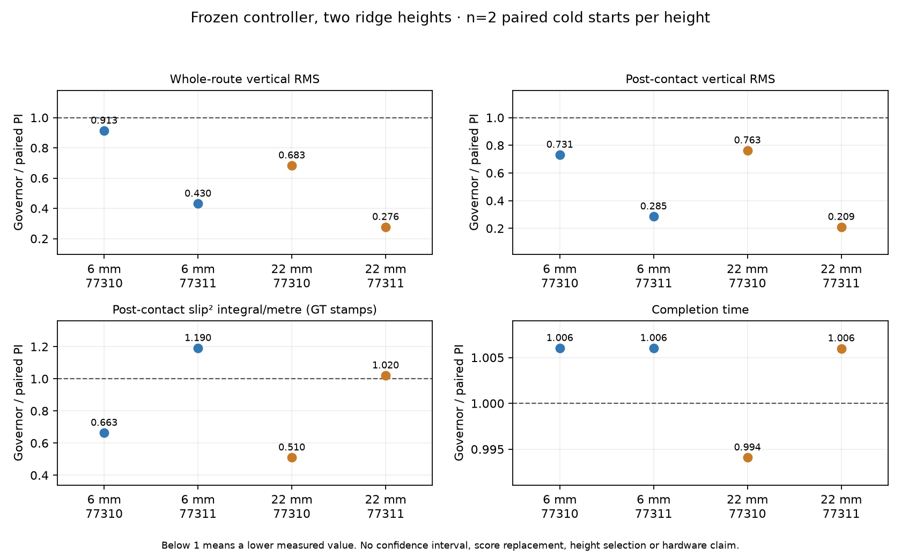

# Governor: screen gờ 6 mm / 22 mm — 16/10/2026

## Quyết định

Đã thực hiện đúng **8/8 episodes**, tất cả đạt physical arrival, dừng 2 giây
và reporting. Không retry, không thay robot/PI/detector/ramp, không mở tuning,
PPO hoặc predictor. Các simulator của batch đã đóng.

**Kết quả cơ chế rõ:** gờ 6 mm ghi **caster wheel trước ở 4/4 lượt**;
gờ 22 mm ghi **bracket trước ở 4/4 lượt**, kể cả khi xét sample positive depth
và force khác 0. Không thể xem hai chiều cao là cùng một chế độ tiếp xúc.

**Kết quả chất lượng chưa đủ để promote:** governor giảm whole-route và
crossing vibration RMS ở 4/4 cặp, nhưng GT crossing slip chỉ giảm ở 2/4 cặp.
Tracking trung bình cũng không đạt mốc so sánh 1.05× PI đang dùng. Do đó
chưa chứng minh lợi ích Pareto đủ lặp lại để mở predictor hoặc Optuna tiếp.

Audit thêm đúng một cặp có excess slip nhất quán chỉ ra phần tăng nằm ở
**pha bắt đầu phanh**, không phải holding/recovery. Đã chuẩn bị **một giả
thuyết timing** để thử riêng; chưa sửa controller hoặc chạy candidate đó.

## 1. Protocol và quan hệ với Deep Research

Theo [protocol đã chuẩn bị](governor_height_screen_2026-10-16/prepared_protocol_snapshot.json):

- Hai gờ capsule cứng cao 6/22 mm, radius 3/11 mm; x=3.10 m, góc +8°.
- Mỗi chiều cao: PI toàn tốc và governor frozen, hai seed 77310/77311.
- Order đảo giữa các block; mỗi case cold start riêng, một simulator tại
  một thời điểm. Không gọi đây là snapshot branches hay initial states giống hệt.
- Cruise 0.400 m/s; governor target 0.90, min hold 0.8 s, max hold 1.0 s,
  ramp 0.4/s. Physics 1 ms, control 100 ms. Sàn box, robot và PI giữ nguyên.
- Arrival/stop, native scoring, GT-timestamp slip và hai grid sensitivity
  giữ nguyên. Không pooling với history hoặc chọn chiều cao có score đẹp.

Gờ 6 mm được chọn thấp hơn clearance bracket CAD danh nghĩa 9.03 mm để
phân biệt cơ chế, không phải sửa thấp vật cản nhằm thay thế kết quả 22 mm.
World 22 mm **khớp byte-for-byte** world frozen trước; kiểm tra invariant
cho thấy floor/material/các model khác không đổi.

Đã đọc lại phần H2 và điều kiện tuning trong báo cáo Deep Research đính kèm.
Batch này làm đúng thứ tự **authority/timing trước prediction**, giữ final
executed commands và budget có điểm dừng. Tuy nhiên, **8 case này không thay
thế ma trận nhiều obstacle family/tốc độ mà báo cáo đề xuất**; không dùng
n=2/arm/height để xác nhận sim-to-real hoặc mọi cáp/pothole/groove.

## 2. Số liệu từng episode

Tất cả rows dưới đây đạt arrival/2 s stop. RMS toàn tuyến là metric native;
crossing RMS dùng IMU timestamps gốc trong window **first manifold +50 ms
đến body qua plane cách gờ 0.50 m**, như contract trước. Không lọc spike.

### Gờ 6 mm

| Seed | Controller | Time (s) | Physical RMSE (mm) | Whole RMS (m/s²) | Crossing RMS (m/s²) | GT crossing slip²·s/m |
|---|---|---:|---:|---:|---:|---:|
| 77310 | PI | 16.60 | 3.197 | 1.251 | 2.102 | 0.021553 |
| 77310 | Governor | 16.70 | 4.013 | 1.142 | 1.537 | 0.014295 |
| 77311 | PI | 16.60 | 4.072 | 2.190 | 6.032 | 0.016503 |
| 77311 | Governor | 16.70 | 3.721 | 0.942 | 1.721 | 0.019646 |

### Gờ 22 mm

| Seed | Controller | Time (s) | Physical RMSE (mm) | Whole RMS (m/s²) | Crossing RMS (m/s²) | GT crossing slip²·s/m |
|---|---|---:|---:|---:|---:|---:|
| 77310 | PI | 16.90 | 3.828 | 2.116 | 4.486 | 0.319048 |
| 77310 | Governor | 16.80 | 6.141 | 1.445 | 3.422 | 0.162607 |
| 77311 | PI | 16.70 | 5.443 | 4.951 | 12.212 | 0.166318 |
| 77311 | Governor | 16.80 | 5.880 | 1.367 | 2.555 | 0.169650 |

Slip²·s/m là chỉ số tỷ lệ trượt bình phương tích phân theo thời gian/chia
quãng đường, **không phải năng lượng cơ học J** hoặc slip đã hiệu chuẩn thật.

## 3. Governor so với PI: không gộp các tiêu chí thành một tuyên bố thắng

| Gờ/seed | Crossing vibration RMS | GT crossing slip²/m | Physical RMSE | Time |
|---|---:|---:|---:|---:|
| 6 mm / 77310 | −26.9% | −33.7% | +25.5% | +0.60% |
| 6 mm / 77311 | −71.5% | **+19.0%** | −8.6% | +0.60% |
| 22 mm / 77310 | −23.7% | −49.0% | +60.4% | −0.59% |
| 22 mm / 77311 | −79.1% | **+2.0%** | +8.0% | +0.60% |

Physical RMSE trung bình là **4.135 mm PI / 4.939 mm governor**, tăng khoảng
19.4%; chênh tuyệt đối nhỏ nhưng không vì thế bỏ mốc so sánh 1.05× PI sau
khi thấy kết quả. Physical arrival vẫn đạt đủ. Time trung bình 16.70/16.75 s;
đây không phải một phép time-matched riêng đã được xác nhận.

Peak toàn tuyến vẫn biến thiên: ở PI là 9.24/58.24 m/s² trên gờ 6 mm,
37.78/126.76 m/s² trên gờ 22 mm; governor tương ứng 9.85/13.00 và 24.15/11.80.
Không loại các spike hoặc dùng mean bị chi phối bởi chúng để tuyên bố cải
thiện chắc chắn. Trong cặp 6 mm/77310, whole peak governor còn cao hơn PI.

**Sampling sensitivity:** cặp 22 mm/77311 đổi thứ hạng slip giữa grid gốc
và grid +10 ms. GT-native cho crossing +2.0%, grid gốc +29.7%, grid dịch
−6.6%. Không chọn grid thuận lợi. Ngược lại, cặp 6 mm/77311 đều cho slip
worse trên cả ba phương pháp; vì vậy chỉ sửa cách lấy mẫu không giải thích
được toàn bộ bất lợi của governor.

## 4. Contact và trạng thái trước can thiệp

- 6 mm: first named manifold và first loaded sample đều thuộc caster wheel
  trái trong cả bốn lượt. 22 mm: đều thuộc bracket trái trong bốn lượt.
- Governor có một event/lượt, không có precontact event được ghi; min scale
  đạt 0.90. Điều này không tự chứng minh false-trigger rate bằng 0 ngoài bank.
- Trên gờ 6 mm, reduced command bắt đầu khoảng 77–79 ms sau first manifold;
  contact bánh chủ động trái khoảng 603–607 ms sau mốc đó. Cửa sổ muộn còn
  tồn tại, nhưng caster phải có thể đã contact ngay khi lệnh giảm tốc bắt đầu.
- Floor support và caster rolling state vẫn khác giữa cold starts. Không
  gọi caster quay chậm là slip nếu nó ít chịu tải, và không quy mọi khác biệt
  chất lượng cho policy.

First loaded sample dùng positive depth và force norm >1e−6 N để phân biệt
zero số học. Contact sampling 100 Hz không cho thời điểm tiếp xúc vật lý
chính xác hay contact impulse. Không đưa GT, force hoặc caster state vào
governor. Khác contact order theo height không tự chứng minh mesh sai.

## 5. Audit excess slip: 6 mm / seed 77311

Đây là cặp được chọn vì slip tăng theo cả ba time bases. Audit giữ nguyên
GT stamps, nội suy joint theo cùng rule và dùng phase boundaries thực của
governor; PI được dịch theo first contact riêng của nó.

Hai controller dùng **common end = clearance sớm hơn**, nên có thể kiểm tra
phase sum cùng duration. Đây là window chẩn đoán riêng, **không chấm lại hoặc
thay thế crossing score +19.0%** trong bảng trên.

| Pha | Governor − PI, tích phân slip ratio² (s) |
|---|---:|
| Trước reduced command, trong window | −0.0005341 |
| **Braking command** | **+0.0029426** |
| Holding command | −0.0000283 |
| Recovery command | −0.0000016 |
| Sau recovery, còn trong crossing | −0.0000003 |

Phase sums bảo toàn tổng cho cả hai controller; common window có coverage
100%. Phần tăng dương tập trung vào pha braking, không có căn cứ kéo dài
HOLD hoặc sửa RECOVER từ cặp này.

Trong braking, mean độ lớn lỗi wheel target là **0.1183 m/s governor /
0.1222 m/s PI**. Encoder–target error không tự là slip; ở đây nó cũng không
ủng hộ nhận định PI bám target kém hơn với governor.

Reduced command bắt đầu **+0.077 s**, trùng caster phải bắt đầu contact.
Named caster contacts kết thúc ở upper bounds **+0.214/+0.225 s** với governor,
so với +0.201/+0.203 s của PI. Precontact body speed gần nhau (~0.3976–0.3977),
nhưng caster trái median rolling 1.95/6.97 rad/s và caster phải sampled median
support 19.33/10.91 N (PI/governor). Vì vậy, **co-occurrence với braking chưa
chứng minh braking gây ra toàn bộ excess slip**.

## 6. Bước tiếp theo đã chọn — một giả thuyết, chưa phải correction đã xác nhận

**Không sửa PI, HOLD, reward hoặc physics theo suy đoán.** Giữ checkpoint,
controller frozen và toàn bộ kết quả 22 mm. Predictor/PPO/Optuna chưa được mở.

Một thí nghiệm có khả năng phân biệt cơ chế là **lùi brake onset 0.2 s sau
trigger cảm biến**, rồi giữ nguyên target, ramp và độ dài HOLD/RECOVER. Nó
thử xem phanh sau đoạn caster đầu có giảm excess slip mà vẫn kịp trước bánh
chủ động hay không. Đây là hypothesis từ trace, không phải nguyên nhân đã rõ.

- Chọn một giá trị 0.2 s: khoảng cách end caster upper bound tới trigger
  ~0.148 s được làm tròn lên theo control interval 0.1 s.
- Margin timing dự kiến chỉ ~76–91 ms trước contact bánh chủ động quan sát
  trước đây; delay có thể làm mất authority. Phải đo lại, không coi phép cộng
  này là bảo đảm vì trajectory/contact timing sẽ thay đổi.
- **Chưa implement/chưa chạy.** [Protocol candidate](governor_height_screen_2026-10-16/next_delay_hypothesis_protocol.json)
  giới hạn sáu episode mới, ba arms PI/frozen/delayed, seed 77320/77321.
- Contract mới, delay mặc định vẫn 0; stop/failsafe/watchdog phải vượt pending
  delay ngay, không replay lệnh cũ. Cần kiểm tra semantics trước simulation.
- Nếu không có lợi ích rõ hoặc kết quả tiếp tục mixed, bác bỏ giả thuyết
  delay trong scope này; không tự thử tiếp nhiều delay/ramp/penalty hoặc mở
  predictor. Nếu có tín hiệu tốt, cần confirmation riêng, chưa phải deploy.

Giữ phạm vi **CAD simulation**. Số đo caster thật vẫn chưa có; screen này
không xác nhận robot thật hoặc cáp mềm, nguy cơ quấn dây, pothole/groove.

## 7. Verification, bảo toàn và artifacts

- 8/8 physical arrival/2 s stop, replay native và timestamps đạt.
- Feedback age 0–20 ms, ít nhất bốn diagnostics/action; GT whole coverage
  tối thiểu 99.787%, crossing 100%.
- Cùng robot, PI/core/timing hashes; mỗi height dùng cùng world bytes giữa
  các seed/arm. Không oracle vào controller, không đổi action meanings.
- **1.180 protected files không đổi**, source snapshots không đổi; không còn
  process của partition riêng. Native metrics/study scores không bị viết lại.
- 4/4 geometry/protocol tests đạt; có thêm kiểm tra giữ unavailable/unattempted
  pairs. Các runner/audit compile được; plot đã được xem trực quan.
- Lỗi shutdown Gazebo vẫn lưu trong log sau các lượt đã thu xong; không
  được gán thành failure hoặc xóa attempt. Một lỗi quoting ở bước archive
  offline đã được sửa bằng script riêng; không tạo thêm simulation attempt.

[CSV từng episode](governor_height_screen_2026-10-16/metrics.csv) ·
[Paired ratios và sensitivity](governor_height_screen_2026-10-16/paired.json) ·
[Episodes/contact/load audit](governor_height_screen_2026-10-16/episodes.json) ·
[Phase audit](governor_height_screen_2026-10-16/excess_slip_phase_audit.json) ·
[Verification](governor_height_screen_2026-10-16/verification.json) ·
[Input hashes](governor_height_screen_2026-10-16/input_manifest_sha256.json) ·
[Deep Research alignment](governor_height_screen_2026-10-16/research_alignment.json).

Raw samples và log đầy đủ giữ tại `rl_runs/governor_height_screen_2026-10-16/`.
Config, worlds, control/drive traces và source snapshots nhỏ đã archive trong
docs. Batch tám episode đã hết budget; không chạy lại để tái tạo báo cáo.
