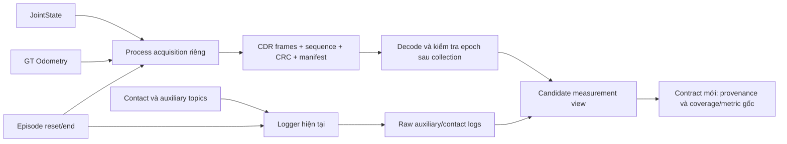

# Joint/GT acquisition tách process — thiết kế và fault test, 21/10/2026

## 1. Kết luận

**Candidate đã được xây và qua fault test offline/ROS cô lập. Chưa chạy
Gazebo hoặc bật vào pipeline scoring hiện tại.**

Trong fixture nguồn joint đặt 500 Hz, GT 50 Hz, một contact-conversion
callback của logger chung bị giữ GIL khoảng 250 ms. Recorder riêng thu đủ
**600/600 joint và 60/60 GT**, giữ nguyên thứ tự từng topic, source timestamps
và toàn bộ field ROS. Logger chung cùng nhận nguồn chỉ lưu **479 joint và
53 GT** trong lần kiểm tra cuối. Hai process đều dừng và close sạch.

**63 tests đạt**, gồm frame corruption/truncation, lỗi đĩa, hết budget, epoch,
clock/order, decode và composition, cùng health/cadence/core tests cũ.

Đây là bằng chứng candidate chống được **fault đã inject trong fixture**,
không phải bảo đảm loss-free dưới mọi tải, bằng chứng cải thiện governor,
hoặc xác nhận coverage trên Gazebo. Gate coverage **98%** và mọi metric,
sampling, controller giữ nguyên.

## 2. Vì sao dùng process riêng?

Batch trước ghi nhận joint gap 36 ms trong lúc contact callback mất
47,5 ms ở stage conversion. Dùng worker thread vẫn chia GIL và có thể chia
executor/callback group. Candidate chọn process/node riêng, không subscribe
contact, không thực hiện recursive JSON conversion trong callback sensor.



Path follower, governor, wheel PI và motor không đọc recorder hoặc file này.
GT vẫn chỉ là measurement/label của simulation, không được đưa vào actor.
IMU và contact/auxiliary vẫn ở logger cũ: candidate này bảo vệ **joint/GT**,
không tuyên bố đã tách mọi sensor.

## 3. Thành phần được triển khai

| Thành phần | Chức năng |
|---|---|
| `acquisition_frames.py` | Append-only binary frames, sequence, CRC từng frame, SHA toàn file, manifest complete/error |
| `isolated_acquisition.py` | ROS node riêng cho joint, GT và episode; không contact/control publisher |
| `decode()` | Decode CDR sau collection, kiểm tra header timestamp khớp envelope, tạo JSON view |
| `validate_episode()` | Chặn sai run/attempt, marker thiếu/đảo thứ tự, epoch cũ, clock regression và thiếu stream |
| `compose_view()` | Chọn authority joint/GT từ capture riêng cho toàn topic; giữ aux/contact từ primary |
| `fault_test_isolated_acquisition.py` | Publisher giả + logger bị stall + recorder riêng, so sánh đầy đủ nguồn phát |

Không sửa code của logger hiện có, launch, PI, governor, environment,
physics, detector, ramp, reward hoặc native scoring trong bước này. Chỉ
thêm hai module runtime candidate và các test/tool offline.

## 4. Capture contract

### Nhận và lưu

- Joint và GT dùng **cùng `qos_profile_sensor_data`: KEEP_LAST depth 5,
  BEST_EFFORT**. Không tăng queue để làm qua test.
- Episode dùng depth 10 như logger cũ; marker `reset` tăng epoch, `end`
  giữ epoch đó. Marker dùng run UUID/attempt của evaluator.
- Callback sensor chỉ lấy source stamp nguyên số ns, receipt ROS time,
  monotonic time, serialize ROS message thành CDR và append frame. Toàn bộ
  message fields được giữ; không lấy subset thuận lợi hoặc resample.
- CDR được tạo từ ROS message nhận được; không tuyên bố padding bytes phải
  giống một lần serialize độc lập ở publisher. Semantic fields và source
  stamps là tiêu chí equality; CRC/SHA bảo vệ bytes đã lưu.
- File dùng buffer 1 MiB, budget mặc định 512 MiB. Hết budget/short write/
  write error là explicit failure, không evict, reset file hoặc retry.
- `capture_manifest.complete=true` chỉ ghi sau flush/fsync/close thành công.
  Capture crash/incomplete không được reader chấp nhận như valid prefix.
- Shutdown dùng cơ chế stop request của observer đã sửa, giữ context sống
  đến khi file đóng xong. Không điều khiển shutdown của driver/PI.

### Điều gì counters không chứng minh?

Sequence đếm callback đã được recorder nhận, **không đếm message publisher
đã gửi nhưng DDS không giao**. CRC hợp lệ và manifest complete không chứng
minh sampling coverage đủ. Source gap và coverage phải được đo riêng như
trước. Recorder vẫn có thể mất mẫu khi chính process của nó không được
schedule hoặc storage bị block; không có ưu tiên real-time được chứng minh.

### Epoch/reset

Decoder yêu cầu đúng một reset và end của run/attempt được chọn, marker
bao phủ requested window và đúng thứ tự. Mọi joint/GT source stamp nằm
trong window phải thuộc epoch đó và xuất hiện sau reset marker; dữ liệu
epoch cũ có timestamp bị tái sử dụng bị từ chối. Source regression trong
window cũng bị từ chối. Không tự deduplicate, bù dữ liệu hoặc đổi clock.

Marker giao trễ có thể làm validation fail closed. Việc khớp marker receipt,
reset standstill và startup readiness với evaluator thực còn cần một
integration contract mới; file `ready.json` chỉ chứng minh subscriptions đã
được tạo, không thay thế discovery hoặc fresh-sensor checks.

## 5. Offline view và provenance

Các raw source không bị sửa. `compose_view()` tạo thư mục mới:

- Xác nhận primary observer close sạch và health hợp lệ nếu có.
- So khớp reset/end identity, time và order giữa hai process.
- Chỉ lấy **toàn bộ joint/GT từ capture riêng**; không dùng legacy joint/GT
  để vá chỗ thiếu, không trộn timestamp giữa hai nguồn.
- Giữ aux/contact rows của primary theo thứ tự riêng; giữ thứ tự sensor
  trong capture riêng. Không suy ra total callback order giữa hai process.
- Ghi số legacy sensor rows không được chọn, số capture rows, source paths
  và input hashes. Native outcomes/scores không được ghi lại.
- Checksum, malformed/truncated frame, wrong epoch hoặc mismatch làm fail.

View cố ý dùng `view_manifest.json`, không giả mạo `metadata.json` của
logger cũ; `valid_for_existing_scoring=false`. Collector cũ không được tự
coi đây là logger đã hợp lệ. Contract/collector mới phải kiểm tra provenance
cả hai nguồn, lifecycle và nguyên các coverage/metric gates cũ.

## 6. Fault tests và kết quả

### Unit/fault injection — 63 tests đạt

Các test mới kiểm tra:

1. Payload bytes lưu/đọc nguyên vẹn, nanosecond timestamp và callback sequence
   giữ nguyên, kể cả source stamp bằng nhau.
2. Truncated header/payload/checksum, bit flip, manifest count sai và file
   chưa complete đều bị từ chối.
3. Capacity exhaustion và write failure tạo failed manifest, không eviction.
4. Sai run/attempt, thiếu end/reset, marker đảo thứ tự, epoch cũ, dữ liệu có
   trước reset, clock regression và thiếu GT/joint không được admit.
5. Decode giữ đầy đủ field/timestamp; nonfinite JSON thành null như logger
   hiện có, không biến thành zero.
6. View không dùng legacy sensor có giá trị khác, giữ nguyên aux/contact,
   từ chối primary chưa close hoặc run identity khác, không sửa input.

### ROS fixture không Gazebo

Ba process: publisher dữ liệu giả, logger hiện tại với contact conversion
được inject busy/GIL stall, và recorder riêng. Domain 197/localhost, không
driver robot, không motor command. Joint phát 600 message với source stamp
cách 2 ms; GT phát 60 message cách 20 ms. Payload có thứ tự xác định để
đối chiếu mọi field và source stamp, không dùng làm dữ liệu huấn luyện.

| Lần kiểm tra | Recorder riêng joint/GT | Logger chung joint/GT | Kết quả |
|---|---:|---:|---|
| Fixture đầu | 600 / 60 | 478 / 53 | Assertion byte-hash CDR không đạt; offline xác nhận tất cả decoded fields đúng |
| Sửa tiêu chí payload semantic | 600 / 60 | 479 / 53 | Exact source/order/all fields đạt |
| Decode + composition cuối | **600 / 60** | **479 / 53** | Semantic parity và view authority/provenance đạt |

Fixture cuối inject busy stall khoảng **250 ms**, đủ làm queue nhỏ của
logger chung mất dữ liệu. Recorder riêng giữ đủ nguồn đã phát trong test.
Hai process thu thập đều exit code 0; các signal dừng không cắt file.

Lần assertion đầu không bị xóa hoặc viết lại thành pass: CDR của JointState
có representation/padding khác giữa các lần serialize độc lập dù fields
deserialize bằng nhau. Kiểm tra độc lập đã so cả 600 JointState và 60
Odometry với message kỳ vọng và source ns; không có field mismatch. Harness
sau so semantic toàn bộ fields thay vì padding; checksum corruption tests
vẫn giữ kiểm tra byte integrity. Không đổi sampling hay gate coverage 98%.

## 7. Giới hạn và bước trước batch mới

**Chưa xác nhận dưới Gazebo; chưa bật vào launch hoặc executor hiện có.**
Các batch cũ vẫn đóng, không nhận dữ liệu mới để bù failures. Không có
episode simulation, tuning, PPO, predictor hay thử robot thật trong bước này.

Bước kế tiếp là wiring contract/collector mới: start recorder riêng trước
evaluation, xác nhận readiness/lifecycle, đóng cả hai nguồn, tạo view và
kiểm tra nguyên native replay/timestamps/coverage từng window/physical stop.
Mọi arm phải dùng cùng architecture. Chỉ khi các kiểm tra đó qua mới dùng
view để so PI/governor; closure/CRC không thay cho coverage.

Không cần dữ liệu thật để làm integration phần mềm tiếp theo. Kết quả hiện
tại không phải sim-to-real hoặc bằng chứng governor có lợi.

## 8. Artifact và lệnh tái lập fixture

- [Verification](governor_isolated_acquisition_2026-10-21/verification.json).
- [ROS fault result cuối](governor_isolated_acquisition_2026-10-21/ros_contact_stall_with_view/result.json).
- [View manifest](governor_isolated_acquisition_2026-10-21/ros_contact_stall_with_view/composed_view/view_manifest.json).
- [Fixture đầu, giữ nguyên assertion result](governor_isolated_acquisition_2026-10-21/ros_contact_stall/result.json).
- [Kiểm tra decoded fields của fixture đầu](governor_isolated_acquisition_2026-10-21/ros_contact_stall/offline_semantic_verification.json).
- [Source snapshots](governor_isolated_acquisition_2026-10-21/source_snapshot/).
- [Recorder code](/home/tuanmac/ninorobot/src/nino_rl/nino_rl/isolated_acquisition.py).
- [Frame/epoch integrity code](/home/tuanmac/ninorobot/src/nino_rl/nino_rl/acquisition_frames.py).
- [Unit tests](/home/tuanmac/ninorobot/src/nino_rl/test/test_isolated_acquisition.py).

```bash
rtk bash -c '
cd ~/ninorobot
source /opt/ros/jazzy/setup.bash
source .venv/bin/activate
source install/setup.bash
export ROS_DOMAIN_ID=197
export NINO_ROS_DOMAIN_ID=197
export ROS_AUTOMATIC_DISCOVERY_RANGE=LOCALHOST
python docs/governor_observer_health_tools_2026-10-20/fault_test_isolated_acquisition.py \
  --output /tmp/nino_isolated_acquisition_new_fixture
'
```

Output phải chưa tồn tại. Lệnh chỉ chạy fixture ROS giả, không mở Gazebo.
