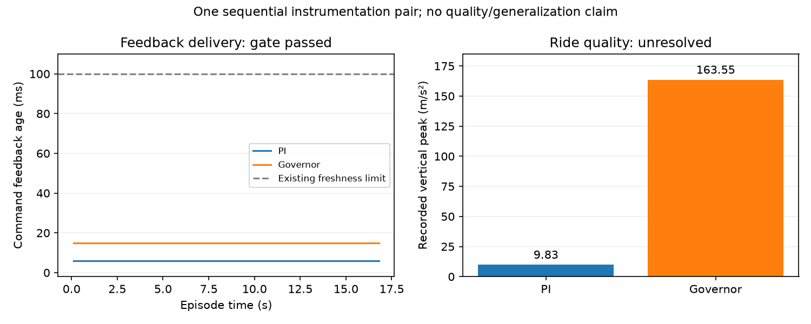

# Sửa startup/feedback readiness — 16/10/2026

**Audit offline mới nhất 17/10:** [đối chiếu PI–PI, contact/caster và pha IMU](GOVERNOR_PI_CONTACT_MECHANISM_2026-10-17.md).
Peak có phản hồi cơ học đi kèm; trạng thái caster đã khác trước cáp, thứ tự
contact không đảo. Reporting lấy thưa nhạy với spike; chưa định lượng được
ảnh hưởng pha acquisition IMU. Chưa chọn correction mới, không simulation/tuning.

**Cập nhật 17/10:** [gate đứng yên sau reset và bốn lượt PI-only](GOVERNOR_POST_RESET_PI_REPEATABILITY_2026-10-17.md)
đã hoàn tất. Các kết quả bên dưới giữ phạm vi cặp instrumentation lịch sử.

**Screen lặp tiếp theo đã hoàn tất:** xem [bốn cold starts và audit bracket/contact](GOVERNOR_FROZEN_REPEATS_2026-10-16.md).
Các kết quả và kế hoạch bên dưới giữ phạm vi của cặp instrumentation trước đó.

## Kết luận

Đã triển khai correction về lifecycle và đồng bộ callback, sau đó chạy đúng
**một cặp PI–governor tuần tự: 2/2 arrival vật lý và dừng ổn định 2 s**.
Instrumentation gate đạt, không có failsafe. Đây chưa chứng minh mọi startup
hoặc tải chạy song song đã ổn định.

**Chưa mở validation rộng hoặc tuning tiếp:** governor ghi rung lớn ở lúc
bánh chủ động rời cáp trong RECOVER. Đã audit offline, giữ nguyên spike và
native scores. Không có căn cứ coi giảm slip trong cặp này là thành công
về chất lượng chuyển động.

## 1. Correction đã thực hiện

| Thành phần | Thay đổi | Kiểm tra vẫn giữ |
|---|---|---|
| Estimator startup | Môi trường simulation hoãn fusion khi mới tham gia graph; kích hoạt sau reset drive xác lập origin/epoch. Suspend fusion qua teleport/model mutation | IMU/encoder gap, orientation, freshness và lỗi đã latch trong live epoch vẫn gây fault; không đổi công thức estimator |
| Drive diagnostics epoch | Xóa buffer khi reset hoàn tất; từ chối diagnostics có stamp trước hoặc bằng boundary đó | Không dùng feedback của episode trước |
| Governor/reset/action | Chờ callback đúng interval, có deadline, trong khi physics đã pause; feedback phải có stamp ≤ boundary và age ≤0.10 s | Không advance thêm physics, không extrapolate, không bỏ failsafe hoặc tăng giới hạn stale |
| Evaluation trace | Ghi control sample trước khi chờ drive trace; nếu thiếu thì ghi `trace_failure_context.json`, giữ terminal outcome thực sự quan sát được nếu có | Không bịa success, impact/slip=0 hoặc completed episode khi measurement lỗi |

API transport giữ hành vi estimator khởi động ngay cho caller mặc định;
simulation environment bật chế độ defer rõ ràng. Deployment governor/PI,
robot, vật lý, detector, ramp, reward, action meanings và config mặc định
không đổi. Đây là runtime instrumentation revision mới, không dùng kết quả
mới để chấm lại study v2 cũ.

Code: `ros_interface.py`, `ros_env.py`, `evaluation.py` trong
`src/nino_rl/nino_rl/`. Các file trước/sau sửa được snapshot cùng artifacts.

## 2. Offline verification

- **54 tests liên quan đạt**, gồm 10 fault-injection tests mới: backlog trước
  reset không được fusion, gap trong live epoch vẫn fault, reset không nhận
  diagnostics cũ, delayed callback được chờ, missing/stale/future feedback
  vẫn lỗi, và trace giữ nguyên failed terminal context.
- Một test cũ `test_training_uses_direct_straight_baseline_plus_rl_residual_torque`
  đòi literal `"accept_torque": "true"`, trong khi launch hiện dùng
  `LaunchConfiguration("accept_torque")` với default `true`. Lượt kiểm tra
  đầy đủ của nhóm ban đầu có 53 pass/1 fail; lượt focused sau bổ sung test có
  54 pass/1 deselected. Không sửa launch để vượt assertion này, không tuyên bố
  toàn bộ test suite đã xanh.
- Invocation đầu ghi đè `PYTHONPATH` làm mất ROS path, gây collection error;
  đã sửa invocation để nối thêm `$PYTHONPATH`. Cả log ban đầu và log sửa được giữ.

## 3. Protocol của cặp instrumentation

Đã chốt trước khi chạy trong `protocol_before_results.json`:

- E1, một capsule cứng trên nền box, x=3.10 m, góc +8°, seed **77200**.
- PI trước, governor sau; hai cold starts độc lập, chạy tuần tự domain 100.
- Cả hai cruise 0.400 m/s; governor target 0.90, minimum hold 0.8 s,
  maximum hold 1.0 s, ramp 0.4/s; control 0.1 s, physics 1 ms.
- Tối đa **2 attempts**, không chạy bù. Gate chỉ xác nhận instrumentation,
  arrival/stop, native replay, timestamps và coverage; không chọn tham số.
- Scenario này dùng để chẩn đoán, không gọi là test geometry chưa thấy.

## 4. Kết quả instrumentation và số liệu mô tả

| Chỉ số | PI | Governor |
|---|---:|---:|
| Physical arrival + dừng 2 s | Đạt | Đạt |
| Thời gian đến đích | 16.80 s | 16.80 s |
| Physical path RMSE | 0.636 cm | 0.475 cm |
| Control actions | 168 | 168 |
| Feedback age tại lệnh / cuối action | 6 ms | 15 ms |
| Diagnostics tối thiểu/action | 5 | 5 |
| Native RMS replay | Khớp | Khớp |
| Timestamp age/skew checks | Đạt | Đạt |
| GT-native route coverage | 100% | 99.762% |
| GT-native crossing coverage | 100% | 100% |
| Native slip RMS | 0.13293 | 0.09539 |
| GT-native whole slip RMS | 0.11984 | 0.08033 |
| GT-native crossing slip²·s/m | 0.29452 | 0.11943 |
| Sampled vertical RMS | 1.338 m/s² | **6.358 m/s²** |
| Sampled vertical peak | 9.834 m/s² | **163.547 m/s²** |

GT-native vẫn là proxy mô phỏng khoảng 50 Hz; native definition và replay
không thay. Governor giảm slip trong đúng cặp này nhưng rung xấu hơn nhiều.
Một cặp không đủ ước lượng độ lặp lại, khoảng tin cậy, tác động nhân quả của
profile hoặc mức an toàn thực tế.

## 5. Audit spike offline

Peak governor xuất hiện tại **sim 15.740 s**, khoảng **1.226 s sau first
contact**, trước clearance khoảng 1.14 s. Input command gần nhất ở 15.649 s:
phase **RECOVER**, scale **0.98**. Logger ghi:

- Bánh trái bắt đầu contact sàn tại 15.735 s, đồng thời kết thúc contact cáp
  được quan sát. Timestamp kết thúc contact là upper bound của logger.
- Bánh phải vẫn contact cáp; bắt đầu contact sàn khoảng 15.817 s.
- Executed command gần peak khoảng 0.391 m/s; GT body vx≈0.518 m/s.
  Encoder phải vượt target; PI phải đã áp mô-men hãm khoảng −0.376 N·m.
  Vì vậy, chưa có căn cứ nói PI chỉ đơn thuần “không chịu phanh”.
- Trong cửa sổ ±50 ms, contact samples là bánh chủ động/caster; không thấy
  bracket/chassis contact. Không đủ chứng minh interference hoặc loại trừ
  mọi contact không được lấy mẫu.
- Sampled contact force lớn nhất trong cửa sổ khoảng 77.6 N ở bánh phải/cáp,
  depth khoảng 0.159 mm. Đây **không phải integrated contact impulse**, cũng
  không nhất thiết là force đúng instant của IMU peak.
- Hai IMU samples lớn nhất, khoảng 163.5 và 73.1 m/s², đóng góp **94.57%**
  tích phân bình phương gia tốc trên raw sampled timeline của governor.
  Không loại hai sample này hoặc thay metric để tạo lợi ích.

**Suy luận có giới hạn:** pha phục hồi chồng lên quá trình bánh chủ động
rời cáp là vị trí đáng kiểm tra. Chưa chứng minh phục hồi gây spike; hai
cold starts không có cùng trạng thái contact, và sensor/contact sampling
có giới hạn. Không đổi hold time, penalty hoặc caster damping chỉ từ liên hệ này.

## 6. Quyết định và bước tiếp theo

Đã đạt gate instrumentation cho cặp này. Theo hướng Deep Research, chưa
chuyển sang predictor/PPO hoặc validation rộng khi crossing quality còn
phụ thuộc các spike chưa rõ repeatability.

**Bước tiếp theo đề xuất đã đóng phạm vi:** một screen lặp nhỏ, giữ nguyên
PI, governor, sensing/physics và scenario 77200: **2 repetitions × 2
controller = 4 cold starts**, thứ tự arm được chốt trước. Mục đích là kiểm
tra spike có lặp ở pha bánh rời cáp/RECOVER hay không, không tune tham số.
Screen này **chưa chạy**; cặp instrumentation hiện tại đã kết thúc đúng ngân sách.
Protocol cụ thể và thứ tự arm đã lưu tại
[`next_repeatability_protocol.json`](governor_readiness_v1_2026-10-16/next_repeatability_protocol.json).

- Nếu pattern lặp lại, chọn một correction về thời điểm phục hồi và kiểm
  chứng riêng dưới contract mới; không tăng penalties chung.
- Nếu pattern đổi chiều hoặc spikes lớn xuất hiện thất thường ở cả hai arm,
  dừng mở rộng và xác định fidelity cần thiết của contact/IMU, ưu tiên đo
  đáp ứng thật; không mở thêm nhiều trial để chọn một lượt thuận lợi.
- Nếu lợi ích chất lượng lặp lại và physical/reporting gates vẫn đạt,
  mới cấp ngân sách validation trên bank mới; không dùng lại bank đã xem
  như một test độc lập chưa thấy.

## 7. Bảo toàn và artifacts

**1,433 protected files không đổi**, bao gồm old study/database/scores,
report đã lưu, robot controller và config mặc định. Các simulator do cặp
này mở đã đóng; không còn process của partition này. Không chạy thêm simulation,
Optuna, training hoặc predictor sau hai attempts.

- [Instrumentation decision](governor_readiness_v1_2026-10-16/decision.json).
- [Quality review sau audit](governor_readiness_v1_2026-10-16/quality_review.json).
- [Hai episode và kiểm tra timestamp](governor_readiness_v1_2026-10-16/episodes.json).
- [Peak context, contact/motor/IMU](governor_readiness_v1_2026-10-16/peak_context.json).
- [Tests](governor_readiness_v1_2026-10-16/offline_focused_tests.log).
- [Preservation/cleanup](governor_readiness_v1_2026-10-16/preservation_and_cleanup.json).
- [Input SHA manifest](governor_readiness_v1_2026-10-16/source_manifest_sha256.json).

Raw `.jsonl` sensor/contact giữ tại `rl_runs/governor_readiness_v1_2026-10-16/`;
artifacts trong docs gồm log, config, trace CSV, metadata và source snapshots.
