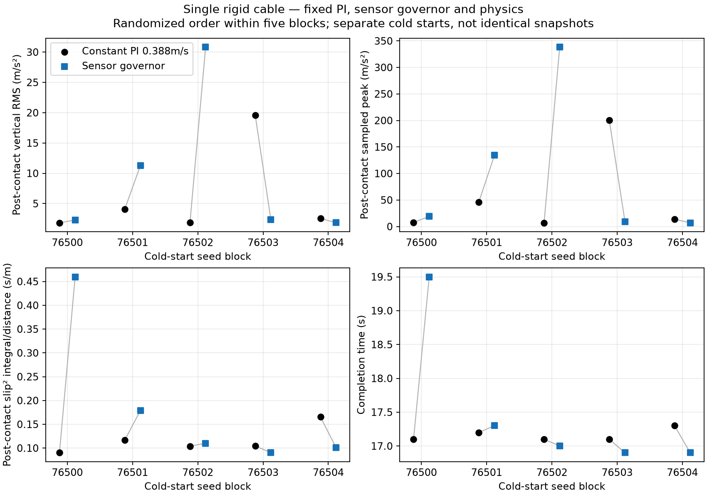

# Governor so với PI tốc độ cố định — đối chứng thời gian

## Protocol ghi trước simulation

Tiếp tục từ [repeatability](CONTACT_REPEATABILITY_TIMING_2026-10-16.md).
Deep Research yêu cầu tách lợi ích thích nghi khỏi việc đơn thuần đi chậm;
giữ H2 trước predictor/H1. Không đổi governor hoặc tìm lại reward/threshold.

### Hai nhánh cố định, 10 episode

- Sensor governor: nguyên candidate Moderate 0.85, cruise 0.400 m/s, cùng
  detector/observations/hold/release/ramp 0.4/s; không oracle input.
- Constant PI: governor profile `full` (scale luôn 1), cruise **0.388 m/s**.
  Tên `full` trong raw là transparent governor, không có nghĩa cruise 0.400.
- Ước lượng tốc độ tham chiếu từ batch development trước:
  `0.4 × 16.72 / 17.24 = 0.387935 m/s`, làm tròn 0.388. Đây **chưa phải**
  time match đã đo. Profile 0.394 cũ được giữ nguyên, không dùng trong batch.
- 5 cold-start blocks seeds **76500–76504**, hai controller mỗi block;
  thứ tự lấy RNG seed **76550**, lưu plan trước khi launch. Đây là các lượt
  development mới, không gọi unseen terrain hoặc final test.
- World capsule/nền hộp, geometry, physics 1 ms, PI/robot/reset/damping,
  native physical scoring và dừng 2 s giữ nguyên. Khác biệt cố ý chỉ là
  governor profile và cruise của nhánh PI tham chiếu.

### Đọc kết quả và điểm dừng

1. Báo đủ native arrivals/failures/unavailable/stopping; không thay đổi gate.
2. Báo thời gian trung bình/range và từng block. Chỉ gọi **gần khớp thời gian**
   nếu chênh mean ≤2% (khoảng 0.34 s tại 17 s). Đây là dải so sánh exploratory
   được chọn trước chạy, không phải chuẩn ngành hoặc tolerance triển khai.
   Nếu vượt dải, ghi chưa khớp và **không tự quét tốc độ trên cùng bank**.
3. Cùng cửa sổ event first+0.05 → body qua x=3.40 m, thêm whole-route RMS,
   sampled peak, slip²/m, path RMSE, timing/actual wheel response/contact.
   Không gọi slip²/m là J; không gán missing contact/impact bằng 0.
4. Approach speed cố ý khác. First impact/prefix chỉ là mô tả, **không phải
   negative control của hai điều kiện tiếp cận tương đương**.
5. Không loại cold starts theo caster state/impact; không giả restore được
   engine/contact snapshot. Unit là episode/block, không phải sensor frame.
6. Nếu không có trade-off chất lượng tốt hơn PI gần cùng thời gian, **không
   mở predictor/PPO/Optuna**, không thêm correction phỏng đoán. Giữ PI/reactive
   reference và ra no-go cho việc phát triển predictive trong envelope này.
   Nếu có tín hiệu nhất quán, chỉ cân nhắc bước feasibility tiếp theo; một
   cáp/một speed không đủ chứng minh H1/generalization hay sim-to-real.
7. **Dừng sau 10 episode**, giữ mọi dữ liệu. Không lặp lại để tìm một winner.

## Trạng thái

**Hoàn tất 16/10/2026:** 10/10 arrival và dừng ổn định 2 s. Batch đã đóng;
không predictor/PPO/Optuna, không sweep thêm speed/threshold/hold/reward.
Governor chưa chứng minh lợi ích ổn định so với PI tham chiếu. Mean time
chênh **+2.098%**, vừa ngoài band 2% đã chốt: **chưa đạt time match**.
Không nới band hoặc bỏ episode chậm để thay đổi nhãn đó.

## Kết quả mới — mỗi nhóm 5 cold starts

`full` trong artifact là **constant PI cruise 0.388 m/s**, không phải Full PI
0.400 của batch trước. Sensor governor giữ cruise 0.400 và target scale 0.85.
Source world, robot, governor core và PI cùng SHA; config chỉ khác profile
và cruise tham chiếu đã khai báo. Physical scoring giữ nguyên.

| Trung bình | PI 0.388 m/s | Sensor governor | Nhận xét |
|---|---:|---:|---|
| Physical arrival / stop 2 s | 5/5 / 5/5 | 5/5 / 5/5 | Không fail/unavailable |
| Completion time (s) | 17.16 | 17.52 | Governor +2.098%, chưa trong band |
| Physical path RMSE (mm) | 5.770 | 4.854 | Governor thấp hơn về mean |
| Post-contact vertical RMS (m/s²) | 5.975 | 9.718 | Governor cao hơn |
| Post-contact sampled peak (m/s²) | 54.926 | 101.580 | Governor cao hơn |
| Post-contact P95 abs acceleration (m/s²) | 4.380 | 4.898 | Statistic bổ sung, không thay score |
| Post-contact slip²/m (s/m) | 0.11607 | 0.18794 | Governor cao hơn |
| Whole-route vertical RMS (m/s²) | 2.599 | 4.055 | Governor cao hơn |
| Whole-route slip RMS | 0.08597 | 0.08582 | Gần nhau về mean, không đủ kết luận tốt hơn |

Post-contact window vẫn first recorded contact +0.05 s → body qua x=3.40 m.
P95 được tính trên các mẫu IMU native trong cùng cửa sổ; không xóa spike,
không thay RMS/peak/scoring. Slip²/m là tích phân tỷ lệ slip bình phương theo
thời gian/chia khoảng cách, không phải J và không đo được tuyệt đối chỉ từ
IMU/encoder trên phần cứng.

### Từng block, không chọn các lượt tốt nhất

| Seed | Time PI → governor (s) | Post RMS PI → governor | Post peak PI → governor | Slip²/m PI → governor |
|---|---:|---:|---:|---:|
| 76500 | 17.1 → 19.5 | 1.821 → 2.306 | 7.644 → 19.112 | 0.09013 → 0.45974 |
| 76501 | 17.2 → 17.3 | 4.068 → 11.261 | 46.212 → 134.210 | 0.11655 → 0.17869 |
| 76502 | 17.1 → 17.0 | 1.855 → 30.852 | 6.959 → 338.615 | 0.10407 → 0.11007 |
| 76503 | 17.1 → 16.9 | 19.607 → 2.320 | 200.051 → 9.045 | 0.10431 → 0.09040 |
| 76504 | 17.3 → 16.9 | 2.525 → 1.850 | 13.762 → 6.917 | 0.16528 → 0.10078 |

RMS/peak/slip²/m thấp hơn ở **2/5 cặp**, không phải 5/5 như post RMS so với
Full PI 0.400 trong batch trước. Hai batch có baseline khác nhau; không gọi
đây là replication cùng treatment hoặc phủ nhận dữ liệu tốt cũ. Kết quả hiện
tại **không chứng minh lợi ích adaptive ngoài việc chạy chậm**, đồng thời
cũng chưa là H3 time-matched hoàn chỉnh vì band không đạt.

## Kiểm tra nền tảng và giới hạn phép đo

- PI **499.94–500.00 Hz**, không dt fallback/invalid/future joint sample.
  Raw dt max 4 ms, max observed joint age 6 ms. Không có căn cứ sửa gains
  hoặc scheduling chỉ từ batch này.
- Governor có đúng 1 event/lượt, không precontact event; motor target giảm
  ≥10% sau **312–327 ms** từ first recorded contact, trước driven-wheel
  contact trong cả 5 lượt. Thực thi được không tự bảo đảm quality benefit.
- Seed 76500 governor mất **3.713 s** từ first recorded contact tới driven
  wheel contact, so với PI **0.720 s**; hoàn tất 19.5 s và slip²/m cao. Đây
  là lượt crossing kéo dài cần audit, **không đổi native success thành stall
  failure** hoặc loại khỏi báo cáo.
- Peak governor 134.21/338.62 ở 76501/76502 xảy ra sau first contact khoảng
  **1.710/1.211 s**, sau governor decision. Peak PI 200.05 ở 76503 tại +0.594 s.
  Mẫu lớn nhất chiếm lần lượt **98.64% / 99.55% / 97.30%** tích phân gia tốc
  bình phương ở cửa sổ post-contact. Không loại các mẫu này.
- Spatial audit không ghi cable contact point ngoài body disk 0.75 m ở cả
  10 lượt. Điều đó không chứng minh toàn bộ contact fidelity đã đúng.
- IMU vẫn 50 Hz; contact logger cũng downsample. Chưa phân biệt được impact
  vật lý, contact numerics và ảnh hưởng sampling chỉ bằng các statistic này.
  Không tái dựng impulse hoặc gọi spike là lỗi đã chứng minh.
- Approach speed cố ý khác (đo khoảng 0.3843 và 0.3959 m/s). First impact
  **không được dùng làm negative control** giữa hai nhóm. Analysis đã chặn
  sign-flip prefix cho trường hợp này; toàn bộ dữ liệu vẫn được giữ.

## Quyết định và bước tiếp theo

1. **Không promote candidate, không mở predictor/PPO/Optuna.** Hiện chưa có
   lợi ích chất lượng ổn định vượt baseline gần cùng thời gian. Chênh band
   2.098% so với 2% không phải lý do duy nhất: quality/slip/tail cũng xấu
   trong 3/5 cặp, với peak biến thiên lớn ở cả PI và governor.
2. **Không tự quét lại speed để ép time match**, không tăng penalty/hold hay
   đổi collision để tìm lại một batch thuận lợi. Ngân sách 10 đã hoàn tất.
3. Việc tiếp theo có giá trị là **audit trace đã lưu**, tập trung governor
   76500 (crossing/slip kéo dài), governor 76501/76502 và PI 76503 (peak):
   ghép contact identity/geometry, motor/PI, pha governor và IMU trên timeline.
   Đây là phân tích offline, chưa chạy ở vòng báo cáo này.
4. Chỉ mở lại experiment nếu audit hoặc đo phần cứng cung cấp bằng chứng mới
   về một lỗi measurement/physical assumption cụ thể. Không hứa sửa được
   mọi spike từ logger 50 Hz; có thể cần đối chiếu clearance caster/fork,
   đáp ứng motor và bandwidth IMU thật. Không sửa cơ khí mô phỏng tùy ý.
5. Nếu không có bằng chứng mới làm thay đổi giả thiết, **dừng phát triển
   predictive cho cấu hình/envelope hiện tại**, giữ PI/reactive làm reference.
   Chưa mở rộng mixed map, pothole/groove curriculum hoặc RL để bỏ qua H2.

Theo Deep Research, predictor tốt không tự tạo thêm quyền điều khiển hoặc
sửa contact physics. Kết quả này không chứng minh RL/predictive governor vô
ích cho mọi robot; nó chặn việc đầu tư thêm vào learning trên setup chưa
chứng minh được lợi ích. Phạm vi vẫn một rigid cable-like obstacle trong sim,
chưa phải cáp mềm/quấn dây, nhiều vật cản hay sim-to-real.

## Dữ liệu và verification

- Raw: `rl_runs/governor_time_comparison_2026-10-16/`.
- [Native/crossing results](governor_time_comparison_2026-10-16/result.json).
- [Time matching, block metrics và P95](governor_time_comparison_2026-10-16/block_analysis.json).
- [PI/support/IMU audit](governor_time_comparison_2026-10-16/pi_support.json).
- [Contact spatial audit](governor_time_comparison_2026-10-16/contact_geometry.json).
- [Protocol lưu trước analysis](governor_time_comparison_2026-10-16/protocol_before_analysis.md).
- Source/config/native outcomes/raw hashes được lưu trong `provenance/`.

Runner mới chỉ override cruise của nhánh `full`; regression test xác nhận
governor vẫn giữ 0.400. Analysis phân biệt first impact không comparable khi
approach speed khác nhau. **9 focused tests pass** cho runner/report/statistics;
compile và figure 2D pass. Không sửa timing hoặc physical arrival checks.
