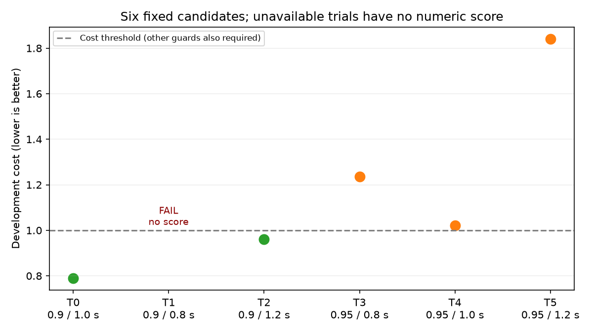

# Governor cổ điển — study GT timestamp v2, 16/10/2026

## Quyết định

Đã thực hiện **đúng 40 attempts**, gồm 24 development và 16 validation,
không chạy bù hoặc thêm trial. **35 attempts xác nhận arrival vật lý và dừng
ổn định 2 giây mô phỏng; 5 attempts bị gián đoạn đo lường.** Không được trình
bày thành tỷ lệ thành công 35/35 của toàn batch.

Study chọn lại candidate khởi đầu **target scale 0.90 / maximum hold 1.0 s**
trên development. Tuy nhiên, ba lượt PI đối chứng của validation thiếu dữ
liệu, nên quyết định là **`validation_unavailable_no_retry`**, không phải
validation pass hay kết luận governor thất bại khi vượt cáp. Không có tham số
mới được xác nhận để thay mặc định; chưa mở predictor, PPO hoặc curriculum.

Điểm có thể hành động ngay là **readiness của sensor/drive feedback ở đầu
lượt chạy**. Không có căn cứ tăng budget hoặc đổi reward từ batch này.

## 1. Quan hệ với Deep Research

Tuân theo [kế hoạch nghiên cứu governor](DEEP_RESEARCH_THIET_KE_GOVERNOR_NINO_2026-10-14.md):
kiểm chứng phép đo và controller đơn giản trước; cho phép tune governor cổ
điển trên development với objective cố định, tách validation và có điểm dừng.
Đây không phải bằng chứng cho H1 về dự đoán, H3 về predictive governor,
hay sim-to-real. Không huấn luyện mạng hoặc dùng contact/GT làm đầu vào governor.

Các điều kiện giữ cố định: E1, một gờ dạng capsule cứng, nền box collision
đã kiểm tra, robot/caster, wheel PI, detector, ramp 0.4/s, control interval
0.1 s, physics step 1 ms và physical arrival/stop gates. Vị trí/góc vật cản
chỉ dùng tạo scenario và phân tích, không đưa vào supervisor.

## 2. Search đã chốt trước khi chạy

Đề xuất ban đầu là thay `minimum_hold_seconds`. Audit tám trace chẩn đoán
cho thấy quiet timer luôn bằng 0 trong HOLD; các lượt đều thoát theo maximum
hold. Vì vậy, trước kết quả mới, đã công bố và lưu **contract mới** tìm hai
tham số có hiệu lực:

- `target_scale`: 0.90 hoặc 0.95.
- `maximum_hold_seconds`: 0.8, 1.0 hoặc 1.2 s.
- `minimum_hold_seconds` giữ 0.8 s.
- Cruise của **cả PI và governor là 0.400 m/s**.

Đây là **sáu điểm cố định được enqueue và quản lý bằng Optuna**, không phải
tuyên bố hội tụ Bayesian hoặc tìm tối ưu toàn cục. Candidate hiện tại được
queue đầu tiên; không nhập score của study cũ. Search, objective và baseline
khác contract cũ nên các cost không được so sánh trực tiếp.

Preflight synthetic xác nhận cả sáu cấu hình thực thi được target và tạo
duration khác nhau. Trong trace thực tế, max hold 0.8/1.0/1.2 tương ứng
thời gian command ở HOLD khoảng **0.8/1.0/1.1 s**. Timer nội bộ có quy ước
cộng dt khi vào pha; báo cấu hình và thời gian thực thi riêng, không sửa core
giữa study để ép chúng bằng nhau. Tất cả các HOLD hoàn chỉnh thoát khi quiet=0.

### Scenario và ngân sách

| Tập | Vị trí x / góc cáp | Seeds | Số attempts |
|---|---|---|---:|
| Development d0 | 2.70 m / −8° | 77000 | 2 controller × 6 trial = 12 |
| Development d1 | 3.10 m / +8° | 77001 | 2 controller × 6 trial = 12 |
| Validation v0 | 2.35 m / −12° | 77100–77101 | 4 |
| Validation v1 | 2.85 m / +12° | 77102–77103 | 4 |
| Validation v2 | 3.35 m / −6° | 77104–77105 | 4 |
| Validation v3 | 3.65 m / +6° | 77106–77107 | 4 |

Mỗi arm cold start riêng, shuffle thứ tự trong paired block. Đây **không phải
khôi phục cùng snapshot contact/controller integrator**. Sáu development
trial chạy ở domain/partition độc lập 94–99; validation dùng 90–93. Sáu
simulator song song có thể tác động scheduling, nhưng chưa chứng minh đây
là nguyên nhân các lỗi. Không tuyên bố hai seed loại bỏ contact variability.

### Objective cố định

Với mỗi cặp governor g / PI p:

\[
J=\operatorname{mean}_{pairs}\left[
0.5\left(\frac{T_g}{T_p}+\frac{C_g}{C_p}\right)
+\max\left(0,\frac{RMSE_g}{RMSE_p}-1.05\right)\right].
\]

`C = ∫ slip_ratio² dt / quãng đường GT`, đơn vị s/m; là proxy slip của dự
án, **không phải năng lượng cơ học tính bằng joule**. Crossing window bắt đầu
50 ms sau first contact đến khi thân qua mặt phẳng pháp tuyến cáp 0.5 m.
Route window giữ nguyên theo trace. T dùng thời gian đến đích, không cộng
cửa sổ dừng 2 s; cửa sổ này là gate riêng cho cả hai arm.

GT giữ timestamp/header và giá trị gốc, joint nội suy tại đó với gap tối đa
10 ms, không extrapolate. Native metric không bị thay. GT hiện khoảng 50 Hz:
đây không phải phép đo đầy đủ slip/impact tần số cao hoặc slip đã hiệu chuẩn thật.

Đủ điều kiện chọn khi tất cả arrival/stop/reporting đạt, J<1, mean time,
physical RMSE và GT-native whole-route slip RMS không quá 1.05 lần PI.
Ngưỡng 5% là lựa chọn của contract, không phải tiêu chuẩn ngành. Rung/peak
được báo nhưng **không tối ưu hoặc xác nhận bằng objective này**.

Known candidate physical failure được giữ với penalty; reference thiếu hoặc
measurement lỗi tạo Optuna FAIL, không gán zero. Validation áp cùng gate;
thiếu đối chứng khiến toàn kết luận không khả dụng, không lọc chỉ các cặp đẹp.

## 3. Kết quả development

Mỗi trial có hai paired scenario, chưa đủ ước lượng độ bền của ranking.
Các tỷ lệ trong bảng là chênh lệch giữa mean governor và mean PI của trial đó.

| Trial | Target / max hold | Cost J | GT crossing slip | GT whole RMS | Mean time | Qua gate chọn? |
|---|---|---:|---:|---:|---:|---|
| 0 | 0.90 / 1.0 s | **0.79021** | −42.63% | −23.21% | +0.30% | Có — được khóa |
| 1 | 0.90 / 0.8 s | Không có score | Không đủ cặp | Không đủ cặp | Không đủ cặp | FAIL: startup IMU |
| 2 | 0.90 / 1.2 s | 0.96159 | −13.22% | −5.59% | +0.60% | Có |
| 3 | 0.95 / 0.8 s | 1.23502 | +46.37% | +17.73% | +0.30% | Không |
| 4 | 0.95 / 1.0 s | 1.02052 | −8.19% | −4.02% | +0.30% | Không: cost |
| 5 | 0.95 / 1.2 s | 1.84089 | +25.17% | +10.65% | +0.60% | Không: cost/tracking/slip |

J là mean cost từng cặp, không phải phép tính lại từ ratio của các mean;
tracking penalty ở một cặp vẫn ảnh hưởng J dù mean tracking đạt.
**22/24 attempts development arrival/stop đạt, hai abort trước episode**.
Trial 0 chính là tham số candidate cũ, nên không gọi đây là một correction
tham số mới đã tạo cải thiện. Lợi ích development cần kiểm chứng độc lập.

## 4. Validation sau khi khóa candidate

Candidate được ghi vào `selection_before_validation.json` trước khi chạy
bank mới; không chọn lại sau kết quả. **13/16 attempts arrival/stop đạt**:
governor 8/8, PI 5/8; ba PI còn lại không có completed native outcome.

| Seed | PI / governor arrival-stop | GT crossing slip thay đổi | GT whole RMS thay đổi |
|---|---|---:|---:|
| 77100 | Đạt / đạt | +8.41% | +2.80% |
| 77101 | Abort encoder startup / đạt | Không khả dụng | Không khả dụng |
| 77102 | Abort diagnostics / đạt | Không khả dụng | Không khả dụng |
| 77103 | Đạt / đạt | −27.73% | −13.04% |
| 77104 | Đạt / đạt | −43.92% | −23.33% |
| 77105 | Đạt / đạt | −22.21% | −10.72% |
| 77106 | Abort diagnostics / đạt | Không khả dụng | Không khả dụng |
| 77107 | Đạt / đạt | −10.89% | −3.47% |

Đây là bảng mô tả tất cả tám block, **không phải validation score trên tập
con thành công**. Bốn trong năm cặp có dữ liệu giảm crossing slip, một cặp
tăng; ba cặp thiếu vẫn ngăn kết luận đầy đủ. Không thay mean của hai nhóm
có số lượng khác nhau thành phép so sánh công bằng.

Rung chưa ổn định: governor whole-route sampled RMS tăng khoảng 103% ở
77100 và giảm khoảng 77% ở 77105; PI 77105 có RMS khoảng 5.90 m/s². Không
suy ra governor đã cải thiện ride quality từ slip score hoặc từ các spike
đơn lẻ. Không tối ưu lại metric/threshold theo những kết quả này.

## 5. Audit lỗi offline — không chạy thêm simulation

Năm attempt gián đoạn vẫn được lưu đầy đủ:

1. Trial 1, seed 77001, cả PI/governor: `Assisted odometry cannot interpolate
   across an IMU gap`, phát sinh trong constructor chờ sensor ban đầu.
2. Validation seed 77101 PI: `Assisted odometry encoder gap exceeded its bound`
   trước khi có episode hoàn chỉnh.
3. Validation seed 77102 và 77106 PI: evaluator báo thiếu stamped diagnostics
   ở action đầu. Logger còn ghi rõ **`governor_failsafe / stale_drive_feedback`**
   tại đầu episode, scale=0, không đạt đích. Hai event failsafe này không bị
   bỏ qua chỉ vì evaluator chưa kịp ghi một completed `episodes.csv`.

Hai logger của trial 1 ghi IMU cách nhau tối đa 20 ms, không ghi gap >100 ms.
Điều này **không phủ định lỗi của evaluator**: logger và evaluator là hai
consumer khác nhau. Chưa xác định DDS delivery, callback scheduling hoặc
epoch startup là nguyên nhân gốc. Không tăng gap limit để qua lỗi.

Code inspection xác định ranh giới cần sửa/đo: `_governor_command()` đọc
diagnostics đang có ngay trước action; evaluator cũng đọc diagnostics ngay
sau `env.step()`. Sensor/motion barrier chưa tự chứng minh diagnostics đã
đến cùng epoch/interval. Với 77106, raw event có failsafe ở sim 7.304 s,
end ở 7.404 s; logger riêng vẫn có diagnostics. Câu lỗi yêu cầu “restart
updated effort_drive” không chứng minh driver cũ: hash driver thực tế khớp
giữa những lượt hoàn chỉnh. Không sửa PI gains, ramp hay detector theo lỗi này.

## 6. Verification và bảo toàn

- Bốn test của study đã đạt trước launch: execution authority sáu candidate,
  fixed cost/guards, giữ physical failure, và từ chối missing/corrupt reference.
- Hai script mới compile được; số case/arm đúng contract 40/40, không trùng
  hoặc bỏ attempt. Raw log và config từng case giữ tại `rl_runs`.
- **35/35 completed traces** tái tạo native RMS và đạt timestamp checks;
  GT route/crossing đủ coverage. Đây là kiểm chứng trên completed traces,
  không chuyển năm abort thành reporting pass.
- Robot/core/PI/timing hashes khớp, world hash khớp trong từng scenario;
  case config chỉ khác target/max hold/profile. Cruise=0.4, minimum hold=0.8
  ở cả 40 case. Không thay native metric.
- **489 protected files không đổi**, gồm kết quả/study/config cũ, controller
  và config mặc định. Database mới được archive bằng SQLite backup.
- Simulator do batch mở đã kết thúc; không chạy thêm trial hoặc training.

Artifacts: [accounting checks](gt_governor_optuna_v2_2026-10-16/accounting_checks.json),
[trial registry](gt_governor_optuna_v2_2026-10-16/trials.json),
[decision](gt_governor_optuna_v2_2026-10-16/decision.json),
[episode table](gt_governor_optuna_v2_2026-10-16/episodes.csv),
[startup events](gt_governor_optuna_v2_2026-10-16/validation_startup_events.json).

## 7. Bước tiếp theo và điểm dừng

**Ưu tiên một correction về startup/feedback readiness**, dưới phiên bản
instrumentation mới, trước khi cấp ngân sách tuning tiếp:

1. Khi đang dừng, thiết lập epoch và yêu cầu IMU/encoder/drive feedback thực
   sự tươi tại reset boundary trước lệnh chuyển động đầu. Chờ callback có
   deadline khi physics đã pause; không dùng sleep tùy ý, extrapolation hoặc
   bỏ freshness/clock checks. Nếu chưa đủ thì báo startup unavailable rõ ràng.
2. Giữ được trace/error context của action vừa kết thúc dù drive-trace check
   lỗi; bảo toàn event failsafe và nguyên nhân, không ghi arrival success.
3. Kiểm tra bằng fault-injection offline rồi mới cấp **một cặp instrumentation
   tuần tự PI/governor** theo protocol mới. Đây là bước đề xuất, **chưa chạy**;
   batch hiện tại đã hết ngân sách, không tự chạy bù hoặc thay score cũ.

Nếu measurement gate đạt, có thể lập một validation bank mới, khóa candidate
trước khi chạy. Bank 77100–77107 đã được xem, không gọi lại là test chưa thấy.
Chỉ mở tuning tiếp khi rollout/reporting ổn định; không cần đợi PPO thắng PI,
nhưng cũng không tăng trial để bù lỗi hạ tầng. Nếu lợi ích không lặp lại sau
một vòng sửa có căn cứ, dừng mở rộng và chọn phương án đơn giản phù hợp hơn.

Map nhiều vật cản, pothole/groove, tuyến rẽ và robot thật vẫn là phạm vi cần
kiểm chứng riêng. Một capsule cứng không đại diện dây mềm hoặc nguy cơ quấn dây.
