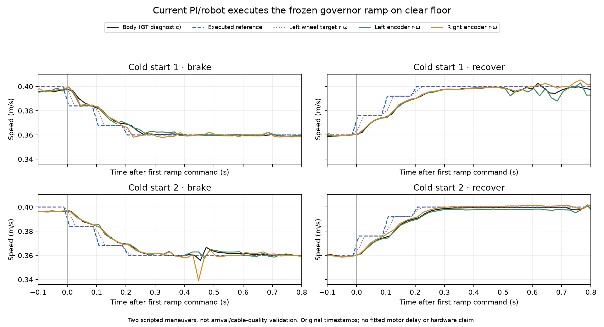

# Đáp ứng robot–PI với ramp governor trên sàn sạch — 16/10/2026

## Kết quả và quyết định

Đã chạy đúng **hai cold starts**, mỗi lượt **12 giây mô phỏng/120 bước**,
seed 77300 và 77301. Cả hai hoàn tất, không physical termination, không
governor event. Robot thực hiện được giảm tốc và phục hồi theo chuỗi lệnh
đã khóa; không có căn cứ từ phép thử này để tăng PI gains hoặc bỏ ramp.

Đây là **maneuver kiểm tra command path**, không phải hai episode arrival,
không phải governor tự phát hiện vật cản, không chấm lại study hoặc xác nhận
H2 về chất lượng vượt cáp. CAD vẫn chưa được đối chiếu số đo robot thật.

## 1. Vì sao cần bước này?

[Audit contact trước](GOVERNOR_CONTACT_TIMING_2026-10-16.md) phát hiện body
giảm tốc trước lệnh governor và PI cố định cũng giảm tốc. Không thể lấy
response nhiễm va chạm đó làm latency motor.

Trước khi chạy mới, đã khai thác [maneuver sạch lịch sử](clear_floor_actuator_response_2026-10-16/response.json):
lệnh 0.40→0.18 m/s đổi reference ở khoảng 14 ms, wheel target đạt 90% thay
đổi ở 274 ms, body ở 308 ms. Nhưng baseline body trước phanh chỉ 0.378 m/s;
đây là reference step lớn, không phải ramp scale 0.90 hiện tại. Config PI
và URDF khớp, nhưng thiếu đầy đủ PI source provenance của thời điểm chạy.
Vì vậy không dùng những số này như mô hình motor đã hiệu chuẩn.

Đã chốt một budget mới đúng hai maneuver để đo đúng chuỗi đang quan tâm,
ghi source hashes và tách reference, wheel target, encoder, body.

## 2. Protocol đã khóa trước khi chạy

- Một simulator tại một thời điểm, domain 104/partition riêng; cold start
  cho từng seed, không retry hoặc chạy bù.
- Sàn box phẳng, không cáp hoặc vật cản thấp; physics 1 ms, control 100 ms.
- Cùng URDF với screen contact trước; caster damping 0.001. PI parameters,
  core governor và estimator giữ nguyên. Không sửa robot mass/geometry.
- Dùng profile `full` để detector không can thiệp. Probe phát chuỗi vận tốc
  tiến, yaw=0, có cùng các bước scale của governor frozen 0.90:

| Thời gian sau reset (s) | Lệnh tiến (m/s) |
|---|---:|
| 0.0–7.0 | 0.400 |
| 7.0 | 0.384 |
| 7.1 | 0.368 |
| 7.2–8.0 | 0.360 |
| 8.0 | 0.376 |
| 8.1 | 0.392 |
| 8.2–10.0 | 0.400 |
| 10.0–12.0 | 0.000 |

Đây là thực thi open-loop output sequence, không thay reward hoặc huấn luyện
actor. Không đưa contact/GT vào governor. Input frame/sensor checks hiện có
vẫn chạy. Quyền điều khiển bằng lệnh thẳng trong probe khác nhiệm vụ bám
route; không dùng nó để tuyên bố tracking qua cáp đã tốt.

Thêm case opt-in `matched_governor_ramp` vào foundation probe; `--case all`
vẫn giữ nguyên ba maneuver cũ. Runner mới không sửa launch/controller mặc định.

## 3. Đáp ứng thực đo từ timestamps gốc

Baseline là median body trong 0.30–0.05 s trước mỗi pha. “90%” nghĩa là
hoàn thành 90% thay đổi từ baseline quan sát đến target, không phải giảm
90% tốc độ. Onset chỉ được xác nhận khi tồn tại ít nhất 40 ms dữ liệu sau
đó, không có gap >25 ms. Không nội suy hoặc resample.

| Đại lượng | Lượt 1 | Lượt 2 |
|---|---:|---:|
| Body trước phanh (m/s) | 0.39561 | 0.39618 |
| Body trước phục hồi (m/s) | 0.35900 | 0.35994 |
| Reference đạt 90% thay đổi khi phanh (ms) | 205 | 208 |
| Wheel target trái/phải đạt 90% thay đổi khi phanh (ms) | 205 / 205 | 208 / 208 |
| Encoder trái/phải đạt 90% thay đổi khi phanh (ms) | 265 / 225 | 248 / 248 |
| **Body đạt 90% thay đổi khi phanh (ms)** | **239** | **254** |
| **Body đạt 90% thay đổi khi phục hồi (ms)** | **279** | **254** |

Mốc trong bảng tính từ **lệnh đầu tiên của chuỗi ramp** (7.0 hoặc 8.0 s).
Lệnh cuối ramp ở +0.2 s. Diagnostics/GT khoảng 20 ms mỗi sample nên không
diễn giải số làm tròn theo ms thành độ chính xác vật lý 1 ms.

Body bắt đầu đạt 10% thay đổi sau 34–39 ms; sau đó cần thêm thời gian để đạt
mức giảm yêu cầu. Reference và wheel target bám gần nhau ở ramp nhỏ này;
wheel encoder/body có trễ và dao động riêng. Không cộng toàn bộ 239–254 ms
vào thêm một lần ramp 250 ms: đó sẽ đếm trùng phần ramp đã thực hiện.



## 4. Dừng, telemetry và bảo toàn

Hai lượt đều phát zero trong giây 10–12. Để mô tả **sau khi đã giảm tốc**,
audit riêng giây 11–12, không gọi thời gian phanh ban đầu là trạng thái đứng
yên và không nhập số này vào gate arrival cũ.

| Giây 11–12 | Lượt 1 | Lượt 2 |
|---|---:|---:|
| GT samples / coverage | 50 / 0.98 s | 50 / 0.98 s |
| Max độ lớn vận tốc body (mm/s) | 0.442 | 0.444 |
| Max dịch chuyển từ sample đầu cửa sổ (mm) | 0.098 | 0.145 |

Ngưỡng mô tả 20 mm/20 mm·s⁻¹ trong audit không phải tiêu chuẩn ngành hay
gate đã được đăng ký trước cho crossing; số gốc trong bảng là kết quả cần
đọc. Không vì bảng dừng này mà tuyên bố robot thật dừng an toàn.

- Đúng hai attempts, 240 bước; clock error tối đa khoảng 3.91e−14 s.
- Raw GT/drive gaps ≤25 ms; schedule thực tế khớp lịch đã khóa.
- Hai logger đóng đầy đủ; không có named obstacle contact trong maneuver.
- URDF hash khớp cả hai lượt và screen contact trước. Source hashes robot,
  PI/core/estimator và config không đổi trong lúc chạy.
- **1.093 protected files và 165 input files của screen cũ không đổi**.
- Không còn process thuộc partition probe. Gazebo vẫn ghi lỗi shutdown
  sau khi maneuver xong; giữ log, không gán nó thành physical crossing failure.
- Các kiểm tra boundary của lịch lệnh/default cases đạt; năm unit tests
  của helper timing đạt và các script mới compile được. Đây không phải test
  sim-to-real hoặc chứng nhận bộ điều khiển.

## 5. Kết luận đối với H2 và hướng tiếp theo

Trong CAD simulation hiện tại, chuỗi ramp có thể thay đổi chuyển động thân
trên sàn sạch trong khoảng 0.24–0.28 s. So với contact bánh chủ động sau
first manifold khoảng 0.85–1.14 s trong screen trước, **không thấy một bế
tắc timing toàn cục** cho các contact muộn. Caster trái sớm khoảng 0.10–0.12 s
vẫn không có cùng khoảng thời gian phản ứng.

Đây chỉ là đối chiếu mô tả giữa hai phép thử. Obstacle forces, tải bánh,
trạng thái caster và thời điểm contact thay đổi khi can thiệp. Không cộng
trừ các số này để cam kết governor sẽ đạt cùng response trên vật cản.
**Không chọn sửa PI, không nâng gains, không bỏ ramp và chưa mở predictor.**

Bước kế tiếp đã chuẩn bị: **screen cơ chế trên gờ 6 mm và 22 mm**, giữ robot,
PI và governor frozen, tối đa **8 episodes** (2 heights × 2 controller × 2
repetitions). [Protocol cụ thể, chưa chạy](matched_ramp_response_2026-10-16/next_height_screen_protocol.json).

6 mm thấp hơn clearance bracket danh nghĩa 9.03 mm, nhằm kiểm tra contact
sequence có đổi từ bracket-first sang wheel-first hay không. Đây là một
**scenario nghiên cứu mới**, không phải thu nhỏ vật cản để thay kết quả
22 mm hoặc tuyên bố phạm vi nhà máy đã được giải quyết. Cả hai chiều cao
phải được giữ trong báo cáo; không chọn height có kết quả đẹp để promote.

Screen này có thể làm trong phạm vi mô phỏng dưới giả thiết CAD; việc thiếu
số đo thật không chặn mọi nghiên cứu simulation. Tuy nhiên, nhận định về
robot thật vẫn phải chờ [đối chiếu caster](CASTER_MECHANICAL_REFERENCE_2026-10-16.md).
Nếu thiếu telemetry/physical failure thì dừng và giữ attempt; hết budget
thì kết luận cơ chế/repeatability, không tự mở tuning hoặc thêm seed.

## Artifacts và tái tạo

- [Protocol trước kết quả](matched_ramp_response_2026-10-16/protocol_before_results.json).
- [Attempts](matched_ramp_response_2026-10-16/attempts.json),
  [response gốc và series](matched_ramp_response_2026-10-16/response.json),
  [verification](matched_ramp_response_2026-10-16/verification.json).
- [Hashes](matched_ramp_response_2026-10-16/input_sha256.json) và
  [bảo toàn/cleanup](matched_ramp_response_2026-10-16/preservation_and_cleanup.json).
- Raw sensor logs/source snapshots giữ tại `rl_runs/matched_ramp_response_2026-10-16/`.

Chạy lại **audit offline** vào thư mục mới:

```bash
cd ~/ninorobot
python3 src/nino_rl/scripts/audit_matched_ramp_response.py \
  --run rl_runs/matched_ramp_response_2026-10-16 \
  --output /tmp/nino_matched_ramp_audit
```

Không chạy lại simulation chỉ để tái tạo báo cáo. Hai maneuver đã dùng hết
budget của protocol này; runner từ chối output tồn tại để tránh retry ngầm.
