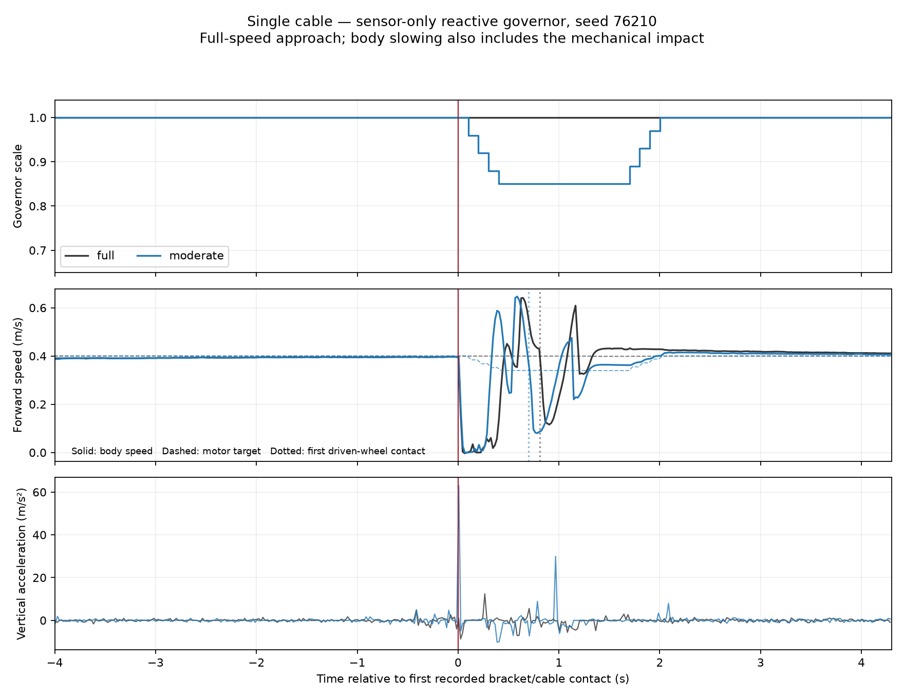

# Governor dùng gyro/wheel error — một ablation có căn cứ

## Protocol trước closed-loop confirmation

H2 với capsule đã cho tín hiệu local tích cực: Moderate oracle giảm RMS/peak/
slip²/m ở cả ba paired cold starts, vẫn arrival/stop 3/3. Điều này mới cho
phép kiểm tra detector dùng cảm biến; chưa cho phép mặc định xây predictor.

Audit sàn sạch cho thấy vertical-only vượt ngưỡng nhiều lần khi command ổn
định, còn gyro/wheel-error không vượt trong ba development baselines. Chọn
**một** correction: `vertical_only_trigger_enabled: false`.

- Gyro x/y hoặc wheel-error có acceleration allowance vẫn có thể trigger.
- Giữ vertical cho log và quiet/release; giữ toàn bộ threshold, confirmation,
  startup, rearming, target Moderate 0.85, hold 0.8–2.5 s, ramp 0.4/s.
- Mặc định core vẫn true để giữ contract cũ. Config candidate riêng; không
  thay ROS command stack trên Pi, reward hoặc physical scoring.
- Không đưa contact, tọa độ, preview, caster state hay ground truth vào detector.
- Đây là ablation nguồn trigger, chưa phải detector nhận dạng contact chính
  xác hoặc expected-response model đầy đủ theo command history.

## Hai phần thí nghiệm, có điểm dừng

1. Trên clear-box: ba maneuver 4 s, seeds 76300–76302: tăng tốc/dừng,
   phanh/phục hồi, tiến/rẽ. Yêu cầu hoàn tất mà không physical termination,
   không governor event và scale giữ 1. Đây không phải ba arrival episodes.
2. Chỉ khi phần 1 pass: capsule cable, E1, Moderate sensor-only seeds
   76210–76212, mỗi seed cold start độc lập, so với Full capsule đã lưu.
   Đây vẫn là development scenarios, chưa phải unseen validation.

Kiểm tra không precontact trigger, latency contact→sensor decision (offline
label), motor target, arrival/stop, post-contact quality và whole route.
Giữ failures/missing data. Nếu correction này không pass, dừng sửa tiếp trong
vòng này; không thử thêm threshold/profile hoặc chạy predictor/PPO/Optuna.

Native Full tham chiếu dùng core trước khi thêm flag. Nhánh mặc định true
của core mới giữ nguyên logic cũ; các regression test cũ vẫn phải pass.
Hash core sẽ khác và được ghi rõ, không giả là cùng source binary.

Nếu candidate cảm biến đến đích, không precontact trigger và có tín hiệu chất
lượng tích cực, thêm **một** đối chứng PI fixed cruise 0.394 m/s, seeds cũ,
trên cùng capsule. Chọn trước từ Full 16.667 s và oracle Moderate 16.933 s,
không xem outcome sensor để tìm speed tốt nhất. Giữ minimum approach speed,
steering, goal, scoring và mọi phần khác. Chỉ gọi time-matched nếu mean time
chênh ≤1% (khoảng một–hai control ticks ở hành trình này); nếu không, báo
near-time reference và không tiếp tục dò speed. Đây là tolerance thiết kế
phép so sánh, không phải chuẩn an toàn/ngành.

Vòng này dừng sau các check đã định; chưa chuyển sang predictor hoặc RL vì
H1, nhiều geometry/dynamics và robot thật chưa được kiểm chứng.

## Trạng thái

Đã hoàn tất candidate và vòng kiểm chứng đã định. **Không promote candidate
thành controller chất lượng tốt hơn PI**. Các config/trace được giữ lại để
audit, mặc định core/command stack Pi không đổi.

## Kết quả negative controls

Ba maneuver hoàn tất 40 bước/4 s mỗi case, không physical termination,
không event và minimum scale 1. Clock error lớn nhất khoảng 5.3e-14 s.
Đây là **3 bounded maneuvers**, không ghi thành ba successful arrivals.

## Kết quả sensor-only trên cáp

Cả ba đến đích vật lý, dừng ổn định 2 s, một event/lượt, không precontact
event. Trigger khoảng 0.101–0.104 s sau stamped contact. Contact/GT chỉ phục
vụ logger/evaluator, không đi vào governor. Các điểm contact xa robot không
được ghi trong ba lượt candidate này; xem geometry artifact để kiểm tra.

Post-contact first+0.05 s → clearance x=3.40 m. RMS/peak m/s²; slip²/m s/m.

| Seed | Controller | Time (s) | Post RMS | Post peak | Post slip²/m |
|---|---|---:|---:|---:|---:|
| 76210 | Full PI | 16.7 | 2.182 | 12.396 | 0.14993 |
| 76210 | Sensor Moderate | 16.9 | 3.670 | 29.914 | 0.09549 |
| 76211 | Full PI | 16.7 | 1.858 | 10.753 | 0.13911 |
| 76211 | Sensor Moderate | 17.9 | 1.610 | 15.401 | 0.22897 |
| 76212 | Full PI | 16.6 | 2.398 | 11.566 | 0.07401 |
| 76212 | Sensor Moderate | 16.9 | 2.188 | 12.404 | 0.09245 |

Mean Sensor so với Full: RMS **tăng 16.0%**, peak **tăng 66.3%**, slip²/m
**tăng 14.8%**, time tăng 0.567 s. Correction đã xử lý báo giả trong screen,
nhưng **không qua quality gate**. Không chạy đối chứng 0.394 m/s có điều kiện;
file reference chỉ được chuẩn bị, chưa có kết quả time-matched.

## Audit sequence và caster trước contact

Seed 76210: oracle HOLD bắt đầu first+0.099 s, sensor first+0.101 s;
RECOVER lần lượt first+1.699/1.701 s. Vì lệnh gần trùng nhau, không có căn cứ
quy toàn bộ chênh lệch rung cho delay detector hoặc đề xuất tăng penalty.

Khoảng first bracket→caster wheel lại khác: oracle khoảng 0.148 s, sensor
khoảng 0.039 s. Tại mẫu ~50 ms trước first, caster wheel left/right của
oracle khoảng 1.27/24.80 rad/s; sensor khoảng 24.74/6.95 rad/s, trong khi
vận tốc thân tiếp cận đều gần 0.396 m/s. Đây là trạng thái contact/caster
khác nhau cần kiểm soát/stratify; **wheel quay chậm không chứng minh slip
nếu caster không chịu tải**. Joint caster chỉ dùng audit đặc quyền offline,
không được thêm vào input triển khai. Chưa xác định nguyên nhân vật lý hay
numerical của những khác biệt này.

Negative-control window trước actuation cũng không tương đương: trong 50 ms
đầu seed 76210, Sensor peak **63.15 m/s²** so với Full **8.72 m/s²**, dù
Sensor chỉ ra lệnh tại first+0.101 s. Seed 76212: **21.40** so với **5.26**.
Không thể quy khác biệt trước actuation này cho correction trigger. Điều đó
không tự chứng minh engine sai; nó cho thấy initial/contact state chưa được
ghép đủ sát và phải đánh giá robustness/repeatability. Vì vậy bảng quality
là kết quả quan sát, chưa là ước lượng causal thuần của detector mới.

## Điểm dừng và việc còn lại

Đã thử một ablation nguồn trigger và ra quyết định: giữ candidate làm bản
chẩn đoán, chưa chấp nhận chất lượng. Dừng sửa threshold/hold/reward trong
vòng này. Predictor, PPO, Optuna, curriculum và mixed-map runs chưa chạy.

Việc có giá trị tiếp theo là kiểm tra repeatability/ranking theo trạng thái
caster chịu tải/quay trước contact với các điều kiện đầu có kiểm soát, và
đối chiếu cơ khí/motor thật trước khi randomize khoảng vật lý. Không ép caster
không chịu tải quay theo vận tốc thân để làm đẹp số liệu; không gọi repeated
seed là exact branching. Nếu tiếp tục H1, cần dữ liệu can thiệp/scenario
độc lập; không chia các frame chồng lấn của những run này để báo generalization.

## Artifact

- [So sánh native/paired/timing/provenance](governor_motion_trigger_2026-10-16/result.json).
- [Sequence và caster audit](governor_motion_trigger_2026-10-16/sequence_repeatability.json).
- [Contact geometry](governor_motion_trigger_2026-10-16/contact_geometry.json).
- Raw positive: `rl_runs/governor_motion_cable_2026-10-16/`.
- Raw negatives: `rl_runs/governor_motion_negative_2026-10-16/`.
- 23 focused software tests pass sau correction, gồm giữ default behavior,
  ramp, failsafe, oracle isolation, missing/failure reporting và world invariant.

