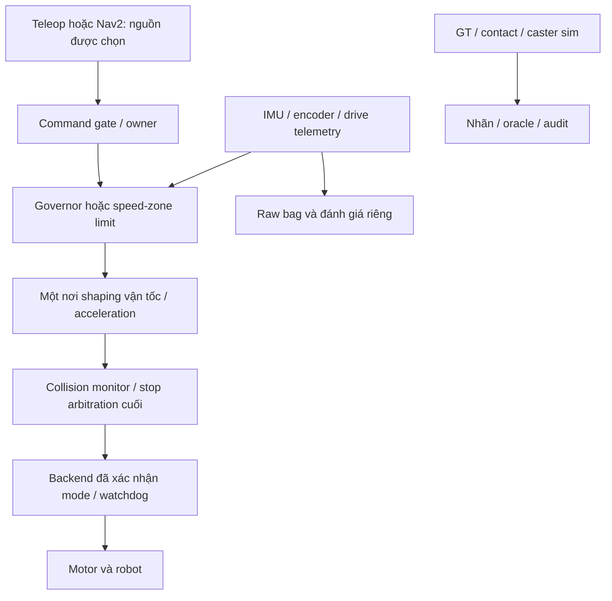

0# Nino — phản biện độc lập và quyết định đầu tư tiếp

**Ngày tra cứu và review: 23/10/2026.** Trạng thái mới nhất: v6 đã đóng;
v7 chỉ chuẩn bị phần mềm, chưa release/chạy Gazebo. Báo cáo này thực hiện
phạm vi **nghiên cứu, đọc offline và đề xuất**; không mở simulation, hardware,
tuning, sửa controller, cấp ngân sách hoặc chấp nhận ngưỡng ứng dụng.

## Quy ước bằng chứng

- **[N] Dữ liệu Nino:** tài liệu/code/artifact đã đọc, hoặc thông tin người
  dùng cung cấp được ghi rõ. Số mô phỏng không là số đo robot thật.
- **[T] Tài liệu bên ngoài:** công trình/tài liệu chính thức có liên kết.
- **[S] Suy luận của người review:** giải thích có điều kiện từ [N]/[T].
- **[Đ] Đề xuất chưa kiểm chứng:** lựa chọn, contract hoặc thí nghiệm tương lai.

Một đoạn mang nhãn áp dụng cho các câu trong đoạn đó. Các bảng có cột bằng
chứng hoặc nhãn trong ô. Không dùng các nhãn này như thang đánh giá chất lượng.

## 1. Tóm tắt quyết định

**[S] Nino hiện là nền tảng nghiên cứu contact và tích hợp có giá trị, nhưng
chưa có speed governor chứng minh cải thiện hệ thống đủ lặp lại.** Nút chặn
trực tiếp là measurement readiness; câu hỏi khoa học quan trọng hơn vẫn là
**H2: còn outcome nào actuator kịp thay đổi sau contact đầu?** Thay logger
không trả lời H2. Thêm predictor hoặc PPO lúc này làm tăng số giả thiết.

| Quyết định đề nghị | Căn cứ và mức tin cậy |
|---|---|
| Giữ PI/ramp và reactive frozen làm đối chứng; chưa promote fast governor | [N] Survey tốt nhất chưa cho lợi ích slip rõ; [S] tin cậy cao về sự thiếu bằng chứng, không phải bằng chứng mọi governor đều vô ích |
| Đóng vòng correction acquisition ở v7; không tự tạo v8 sau failure mới | [N] V3–v6 đều dừng tại PI đầu, lý do khác nhau; [S] chi phí integration đã trở thành rủi ro đầu tư, tin cậy cao |
| Có thể đề nghị **một** screen v7 tối đa 12 nếu quyết định tiếp tục H2; chưa chạy trong lượt này | [N] Review nguồn/provenance đạt; [Đ] chỉ khảo sát mô tả, không xác nhận lợi ích công nghiệp hoặc causality mạnh |
| Ưu tiên dài hạn: operating envelope và motion contract cổ điển có nhận dạng backend | [S] tái sử dụng phần cứng, giải quyết các thông số còn thiếu để chọn action; tiềm năng ứng dụng cao, hiệu quả cụ thể chưa kiểm chứng |
| Dự phòng: memory chất lượng mặt sàn theo tuyến → speed zone/avoidance | [S] tạo preview ở lần sau, giảm phụ thuộc phản ứng trong 100–200 ms đầu; phụ thuộc định vị và độ ổn định mặt sàn |
| Chưa mở predictor/PPO/BC training hoặc Optuna rộng | [N] H2/H3 chưa xác lập; [S] tin cậy cao về thứ tự ưu tiên, không cấm calibration/classical tuning riêng có căn cứ |
| Chưa đưa governor xuống robot thật | [N] thiếu backend verification, response/body reference và dữ liệu nguồn điện sau sửa |

**[N] Kết quả trung tâm vẫn là survey 18/10:** 8 PI + 8 governor đều đến
đích/dừng; benefit slip sau contact **−1,01%, CI95 mô tả [−24,21%; +15,68%]**;
thời gian governor tăng 0,125 s. Giữ estimand trung bình hai tỷ lệ block.
Không đọc CI này thành “tương đương”, “vô hiệu” hoặc bằng chứng đủ power.
[Báo cáo survey](GOVERNOR_DESCRIPTIVE_SURVEY_2026-10-18.md).

**[Đ] Cách chọn trade-off tạm thời:** dùng vector
`(task failures, time, physical tracking, post-contact slip proxy, vibration)`.
Chốt trước dữ liệu mới metric nào là mục tiêu và phần tăng nào được chấp
nhận; khi chưa chốt thì chỉ trình bày Pareto/trade-off, không chọn một
weighted reward làm định nghĩa “tối ưu”. 10%/+0,5 s vẫn là đề xuất. Báo cáo
nghiên cứu có thể kết luận unknown; triển khai cần yêu cầu của payload,
tuyến và nhà máy được chấp nhận riêng.

## 2. Dự án là gì và đã tới đâu?

### 2.1. Nền tảng và mức đạt

| Thành phần | Hiện trạng [N] | Mức kết luận phù hợp [S] |
|---|---|---|
| Robot | Vi sai, 2 bánh chủ động + 2 caster thụ động | Không áp mô hình robot tự cân bằng/robot chân |
| Pi/ROS | Người dùng báo Pi 5, Ubuntu 24.04 arm64; ROS Jazzy từng hoạt động | Chưa đo compute/latency khi driver và navigation cùng chạy |
| Motor | Người dùng xác nhận CyberGear, đường điều khiển có STM32 | Chưa biết mode/vòng PI đang thực thi; không gán CAN ID hoặc firmware |
| Sensor | Người dùng xác nhận IMU, drive encoder, LiDAR ngang 2D | Chưa có inventory publisher + valid samples cuối cùng trên robot |
| Geometry | URDF drive radius 62,5 mm; separation hiệu dụng ~342,7 mm; caster Ø32 mm; bracket clearance ~9,03 mm | Danh nghĩa CAD, không là operating limit hoặc số đo có tải |
| Mass/power | URDF ~5,591 kg; từng có cảnh báo undervoltage/nguồn Pi | Chưa cân hoặc xác minh sửa nguồn; không kết luận nguồn là nguyên nhân slip sim |
| Sim/control | Harmonic, các screen DART/Bullet; follower riêng, wheel PI xuất torque, reactive governor | E1 screen không phải phép đánh giá Nav2 |
| RL/tools | PPO/BC lịch sử, Optuna đã chạy; TensorBoard/Laya trong workflow | Chưa có learned controller được xác nhận vượt reactive hoặc deployable |
| Acquisition | Joint/GT recorder riêng + primary IMU/contact/aux; v7 queue 100 | Software readiness đạt theo review; Gazebo readiness v7 chưa biết |
| Hardware package | `nino_pi` có bag/audit/teleop/mapping/navigation helpers | Công cụ tích hợp; không kèm driver thật hoặc dataset thật đã kiểm tra |

Nguồn [N]: [geometry/caster](CASTER_MECHANICAL_REFERENCE_2026-10-16.md),
[package thu thật](../src/nino_pi/REAL_DATA_COLLECTION.md),
[workflow laptop](../src/nino_pi/LAPTOP_CONTROL_AND_COLLECTION.md).
Các xác nhận thiết bị từ người dùng chưa được review này kiểm tra trên phần cứng.

### 2.2. Timeline: không gộp các experiment

| Giai đoạn | Bằng chứng [N] | Diễn giải [S] |
|---|---|---|
| Rough pilot rev57 | 20.480 bước, 5 evaluation seeds; slip²/m disturbance cao hơn reactive ~16,3% | Có slowdown/recovery và arrival; không đạt quality gate lịch sử; 5 evaluation seeds không là 5 training seeds |
| Flat lịch vị trí | Brake/recover tại vị trí biết trước | Oracle/đối chứng preview, không chứng minh phát hiện cáp lạ |
| 13–17/10 contact lab | Map, primitive/mesh audit, caster damping correction, controlled capsule/oracle screens | Hạ tầng và correction mô hình; chưa là bằng chứng sensor-only governor có lợi ổn định |
| 18/10 survey | 16 attempts hợp lệ, 8 cặp, hai block đổi chiều | Bằng chứng controller hoàn chỉnh nhất; không promote |
| 20/10 phase/timing audit | ~93,8% slip² governor từ contact đầu đến hết hạ lệnh; recovery ~0,007% | Không có căn cứ tập trung sửa recovery hoặc tăng torque cap |
| 20/10 cadence | 9/12 rồi hard stop; hai cặp publication sớm 40/42 ms | Command path có khác biệt; actual response hữu ích chưa được nhận dạng |
| 21/10 corrected logger | 1/12, crossing coverage 96,9024% | Shutdown sửa được; acquisition chưa đủ |
| 22/10 v2 | Epoch/lifecycle/CDR integration; 125 software tests tại revision đó | Không là 125 crossing trials |
| 23/10 v3 → v5 | Mỗi batch 1/12; lần lượt ACK freshness, native identity, thiếu auxiliary metadata | Integration failures khác nhau; không phải ba lần kiểm tra governor thất bại |
| 23/10 v6 | PI arrival/stop đạt; crossing 97,9777553%, thiếu 10 joint samples riêng recorder | Measurement fail; các slot còn lại đóng |
| 23/10 v7 | Queue riêng 5→100, fixture ROS và 156 tests theo báo cáo trước; chưa release | Candidate acquisition, chưa có contrast controller mới |
| Review này | Đọc/browse và static review v7, **0 sim/ROS node/hardware** | Không tạo performance data mới |

### 2.3. Review v7 đã làm ngay trong lượt này

**[N]** [Review máy đọc được](nino_independent_review_2026-10-23/review_v7.json)
xác nhận protocol SHA v7
`571f72edfaf74710390b59db784805da1d1015425255b4dc5d415492bcc0a351`,
73 file run v6 không đổi, fixed/schedule/physical inputs v6–v7 giống nhau.
Chỉ recorder và contract preparer đổi trong execution dependencies. Hash
fixture khớp source hiện tại. Không chạy lại tests/fixture hoặc sửa source
runtime trong review này; **156 passed là kết quả đã ghi của lượt trước**.

**[N]** Fixture production-QoS: joint 500 Hz/GT 50 Hz, consumer ngừng
service khoảng 92 ms. Depth 5 nhận joint 25/50; depth 100 nhận 50/50;
GT 5/5 ở cả hai. **[S]** Đây là bằng chứng về dung lượng queue trong fixture,
không chứng minh queue overflow là nguyên nhân duy nhất v6 hoặc delivery
loss-free trong Gazebo. Backlog/epoch/closure vẫn là rủi ro cần gate gốc.
[Báo cáo v6/v7 và raw fixture](GOVERNOR_ISOLATED_CADENCE_V6_RESULT_2026-10-23.md).

## 3. Bản đồ vấn đề và phản biện cách đặt bài toán

### 3.1. Xếp hạng nút thắt

| Hạng / lớp | Bằng chứng → giả thuyết [N/S] | Phép phân biệt [Đ] → quyết định |
|---|---|---|
| 1 khoa học: control authority | Early slip peaks 98–195 ms; body đã chậm do contact trước lệnh; drive contact muộn còn horizon | Phân biệt actual wheel **và** body trước từng loaded contact, không chỉ target → H2 unknown nếu không nhận dạng được |
| 1 vận hành nghiên cứu: acquisition | V6 raw recorder thiếu mẫu có trong primary; decode không đổi timestamp | V7 bounded screen nếu được release; failure mới → dừng cadence architecture hiện tại, không tune controller để qua logger |
| 2: objective / application | Chưa có payload/throughput/rung/slip limit được chấp nhận | Chốt vector và decision contract trước xác nhận lợi ích; không tự gọi 10% là yêu cầu nhà máy |
| 3: repeatability / causality | Cặp cùng seed khác trước can thiệp; initial approach không xác định caster load | Whole-run grouping, order/block reports, pre-intervention traces; không trừ hậu nghiệm cho ra treatment effect |
| 4: cơ khí/contact fidelity | Small caster, bracket; 6 mm caster-first khác 22 mm bracket-first | Geometry có tải + contact order; chỉ sửa sai lệch đã đo. Chưa biết cơ khí hay numerics chiếm ưu thế |
| 5: observability | Wheel error là tracking proxy; IMU chứa cả tự gây lệnh và va chạm | Independent reference cho validation; estimator assumptions phải thử riêng, không coi proprioception bất khả thi tuyệt đối |
| 6: hardware/model discrepancy | Chưa xác nhận driver/backend/nguồn/ramp thật | Session tối thiểu trước motion; chưa có cơ sở chuyển gain sim hoặc torque contract |
| 7: generalization | Một capsule +8°/E1/.4 m/s chiếm bằng chứng gần nhất | Generalization là gate sau; mixed map không khắc phục thiếu H2 |

**[S]** Hạng trên phục vụ quyết định nghiên cứu sắp tới. Với robot thật,
backend/nguồn/cơ khí trở thành điều kiện tiên quyết; thứ tự không có nghĩa
chúng ít quan trọng hơn cho triển khai.

### 3.2. Timing và tác dụng của action

**[N]** Audit 23/10 cho thấy sau 200 ms, PI còn 3,03–7,09% tích phân slip²
trong cửa sổ bổ sung `tc..tc+3s`; rung muộn biến thiên rộng. **[S]** Con số
này chỉ là phần outcome còn lại trên trajectories đã chạy. Nó không là
trần benefit cho mọi action: phanh sớm có thể thay đổi cả chuỗi contact.
Tuy nhiên, nó làm mục tiêu “giảm mạnh slip bằng can thiệp muộn” kém hấp dẫn
hơn mục tiêu kiểm soát phase còn lại cụ thể.
[Audit timing-envelope](GOVERNOR_H2_TIMING_ENVELOPE_2026-10-23.md).

**[S] Tính minh họa offline:** ramp 1→0,90 với 0,4 scale/s cần **0,25 s**.
Nếu hai ramp liên tục giống hệt nhau chỉ dịch sớm 40–42 ms, cùng reference
0,4 m/s, chênh lệch reference trên đoạn ramp chỉ khoảng **0,0064–0,00672 m/s**.
Đây không phải bound trên code rời rạc/retrigger hoặc vận tốc thực; nó cho
thấy vì sao “publication sớm 40 ms” chưa đồng nghĩa body phản ứng sớm mạnh.
Không cộng thêm 0,25 s vào số đo body90 nếu số đo đó đã tính từ đầu ramp.
GT 50 Hz không hỗ trợ nội suy để tuyên bố onset chính xác vài ms.

**[S]** Khi cần phân biệt effect nhỏ hơn biến thiên contact và độ phân giải
đo, câu trả lời đúng có thể là **không nhận dạng được với thiết kế này**.
MPC hoặc predictor không tạo thêm actuator authority. Thay đổi action
amplitude/ramp/preview là một giả thuyết mới, không phải correction “cadence”.

### 3.3. Operating envelope: tách từng cơ chế

| Tình huống | Quyết định nghiên cứu/vận hành đề nghị [Đ] | Căn cứ / giới hạn |
|---|---|---|
| Sàn sạch, khô, support liên tục | PI + shaping; đo response, giới hạn tải được ghi rõ | [N] Có clean-floor sim; chưa là hardware envelope |
| Gờ cứng đã cố định, thấp, geometry và clearance đã kiểm tra | Xem xét vượt hoặc giảm trước gờ; giữ stall/stop path | [N] 6 mm sim vượt được; không suy chiều cao thật được phép |
| Gờ/bracket có thể mắc, caster không có support | Tránh hoặc xử lý cơ khí/mặt sàn; không mặc định thêm torque | [S] Speed-only không tạo clearance hoặc support |
| Cáp mềm/lỏng/đang có nguy cơ kéo-quấn | Ưu tiên tránh, cố định/che cáp hoặc xử lý mặt sàn trước | [N] Rigid capsule không mô tả kéo/quấn; không xem slowdown là biện pháp đã đủ |
| Groove ngang | Xét rộng/sâu/mép/góc tiếp cận, khả năng bánh bắc qua và exit | [S] Mất support rồi va mép ra khác cơ chế gờ dương |
| Groove dọc theo hướng caster | Xem khả năng bánh lọt/dẫn hướng/kẹt; tránh nếu chưa có envelope | [S] Một scalar obstacle severity không biểu diễn được nguy cơ này |
| Pothole nông | Xét footprint, support từng bánh, tip/clearance và mép ra; vượt/đi vòng quyết định riêng | [N] Mesh âm có code, chưa được xác nhận bởi box-floor test |
| Vật cản chưa biết ở lượt đầu | Không bảo đảm preview bằng horizontal LiDAR; cân nhắc preview sensor nếu ứng dụng bắt buộc | [S] Chọn sensor sau khi xác định vật cần nhìn, khoảng cách và failure modes |
| Đoạn sàn lặp lại trên cùng tuyến | Memory có uncertainty/TTL; speed zone hoặc tránh từ trước | [Đ] Cần nhận biết đổi layout và sai định vị; không bảo đảm lần đầu |

**[S] Vì sao đi chậm không luôn tốt:** tốc độ thấp có thể giảm phần động
năng nhưng không loại phản lực hình học, ma sát tĩnh hoặc thiếu traction;
giảm quá mức có thể làm robot mất khả năng tiếp tục vượt. Đó là lý do cần
vừa đo crossing quality vừa giữ stall/arrival và minimum-forward đã kiểm
chứng theo envelope. Không chọn một vận tốc tối thiểu chung cho mọi vật cản.
Mô hình friction có wheel-lock [S3] và kết quả caster/toàn robot khác nhau
[S1] hỗ trợ việc kiểm tra cơ khí trước lời hứa “slowdown luôn giảm risk”.

### 3.4. Khi nào measurement đã đủ?

**[Đ]** Đủ cho screen v7 khi cùng pipeline của mọi arm đạt lifecycle/source
binding, native replay, timestamps, cadence, stopping và coverage 98% ở
**từng window bắt buộc**, không gap sai epoch hoặc provenance. Khi đó quay
lại câu hỏi controller; không thêm logging chỉ vì còn một peak khó giải thích.

**[S]** Gate 98% kiểm soát thiếu support, không bảo đảm 2% còn lại vô hại,
không chống aliasing GT/IMU hoặc bảo đảm phép suy nhân quả. Giữ nguyên gate
cho comparability; không có cơ sở hạ vì v6 thiếu rất ít. Muốn thay contract,
cần chứng minh riêng bằng các pattern missing quanh transient và ước lượng
sai số metric, trước một dataset xác nhận mới. Không chữa archive cũ.

## 4. Công trình/phương pháp liên quan: đã giải được phần nào?

### 4.1. Các nghiên cứu chính

**[T]** Bảng ghi đúng phần đã truy cập. “NR” = chưa trích xuất được trong
phần đã đọc, không suy rằng tác giả không công bố. Preview chỉ sensing vật
cản phía trước, không tính path reference là terrain preview. Không nguồn
nào dưới đây xác nhận toàn bộ operating envelope Nino.

| Nguồn | Robot/caster; sensing | Action/rate; obstacle/preview | Real/sim, quy mô và đối chứng | Kết quả sát quyết định Nino / khác biệt |
|---|---|---|---|---|
| [S1 — Lee 2024](https://doi.org/10.1038/s41598-024-63825-y) | 2 drive + 2 caster mới; caster cơ khí khác Nino | Chạy 0,1 m/s; step; không có learned preview, control rate NR | Prototype + dynamics sim; số lặp NR; regular caster là tham chiếu thiết kế | Caster riêng vượt 65 mm, toàn robot 30 mm; grip/COM vẫn giới hạn. **Một phần: cơ khí**, không là speed adaptation hoặc ngưỡng cho caster Ø32 mm |
| [S2 — Arrizabalaga 2021](https://arxiv.org/html/2110.05604) | ActiveShuttle vi sai + caster; observer, encoder caster để validation | NMPC acceleration, 20 Hz/horizon 2 s; hairpin/rotation; không floor preview | Robot thật; hairpin 10 lần mỗi planner; so agnostic và path filter | Torque giảm với tracking/time trade-off. **Giả thiết khác:** bore torque khi đổi hướng, không caster đập gờ hoặc rơi hõm |
| [S3 — Park 2017](https://web.eecs.umich.edu/~kuipers/research/pubs/Park-icra-17.html) | Wheelchair ~120 kg, 2 drive/4 caster; encoder+commands | Discrete friction dynamics; rate NR; sàn phẳng/no-slip | Dữ liệu thật, calibration/prediction; test duration/replication không trích đủ | Mô hình nhỏ dự đoán deadband/steady motion; **một phần: backend ID**, không chứng minh contact slip hoặc compute trên Pi |
| [S4 — Siwek 2023](https://www.mdpi.com/1996-1944/16/2/683) | TurtleBot2, drive/support wheels; odom/inertial | v/ω tracking; offline L-M + online RLS; rate NR; không low-obstacle preview | Sim + lab thật; so parameter initialization/identification methods; số lặp NR | Nhận dạng hỗ trợ tracking. **Giả thiết khác:** không là đo body slip độc lập hoặc giảm impact qua cáp |
| [S5 — Yu 2023](https://arxiv.org/html/2209.15140) | Husky 4 bánh/skid steer; IMU 200 Hz, encoder 13,5 Hz; ZED/ORB-SLAM3 cho reference | Estimation, không speed controller; soap/sand, không preview | Hai sequences thật; so InEKF không DOB | Ước lượng slip có điều kiện; α>0 trong mô hình slip suy giảm, tuning/covariance heuristic. **Một phần: observability**; không loại nhu cầu reference validation trên Nino |
| [S6 — laser ICR 2015](https://pmc.ncbi.nlm.nih.gov/articles/PMC4481911/) | Pioneer P3-AT 4 bánh, encoder; **scanner ngoài robot nhìn tấm mốc** | Wheel speed; 8 curvature ×5 speed =40 conditions; rate NR; không gờ | Tile-floor thật + dynamic sim; so default odometry | Cải thiện dead reckoning dưới firm-ground/contact assumptions. Không chứng minh onboard LiDAR Nino là body GT hoặc đo được transient 20 ms |
| [S7 — BADGR](https://arxiv.org/html/2002.05700) | Jackal 4 bánh; RGB preview, IMU/encoder/GPS/LiDAR; TX2 | Candidate v/ω sequences → events; dữ liệu subsample 4 Hz, không đồng nhất control rate | Thật: 34 h urban +8 h off-road; urban 25 lượt/phương pháp; so LiDAR/naïve và bỏ bumpy cost | Experience labels giúp chọn đường êm. **Một phần/giả thiết khác:** image preview, action coverage lớn, khác first-contact sensor-only và Pi |
| [S8 — Garone survey](https://merl.com/publications/docs/TR2016-102.pdf) | Tổng quan nhiều hệ, không robot/caster chuẩn | Sửa reference cho closed loop đã ổn định dưới state/input constraints; rate phụ thuộc hệ | Tổng quan lý thuyết/ứng dụng, không một low-obstacle experiment | Reference governance đã có nền lý thuyết. Nino state machine chưa là constraint-invariant RG; cần model/bounds để có bảo đảm |
| [S9 — Le Lidec](https://arxiv.org/html/2304.06372) | Benchmark rigid contact/solvers, có quadruped showcase | So friction/contact formulations; không Nino speed policy | Numerical benchmarks; không real Nino/caster experiment | Sai khác solver có thể đổi response. **Một phần: fidelity method**; không cho phép mặc định DART/Bullet sai hoặc thay engine chắc tốt hơn |

**[S] Ba kết luận từ đối chiếu:**

1. Caster-aware planning và action-conditioned event prediction đều đã có;
   “thêm caster awareness” hoặc “dự đoán risk từ history+action” riêng lẻ
   chưa đủ cho novelty. Phải xác định khoảng trống cụ thể và baseline.
2. Không nên tuyên bố IMU+encoder không thể ước lượng slip trong mọi trường
   hợp; S5 có kết quả thật dưới giả thiết động lực học. Ngược lại, một
   observability proof của mô hình đó không tự xác nhận transient caster
   unloading của Nino. Validation reference vẫn cần độc lập.
3. Đổi cơ khí hoặc motion planning có thể có giá trị hơn speed-only, nhưng
   bore torque, sharp step, rigid capsule và cáp mềm là các cơ chế khác.
   Kết quả ngoài không thay thế experiment Nino.

### 4.2. Công cụ chuẩn so với kiến trúc đang xây

| Nguồn chính thức [T] | Đã giải được | Hàm ý cho Nino [S/Đ] |
|---|---|---|
| [S10 — ROS Jazzy QoS](https://raw.githubusercontent.com/ros2/ros2_documentation/jazzy/source/Concepts/Intermediate/About-Quality-of-Service-Settings.rst) | KEEP_LAST/depth, reliability và compatibility | Queue100 chỉ thêm finite capacity; BEST_EFFORT vẫn có thể mất. Không đổi reliable tự động khi publisher/interface chưa kiểm tra |
| [S11 — ROS Executors](https://raw.githubusercontent.com/ros2/ros2_documentation/jazzy/source/Concepts/Intermediate/About-Executors.rst) | Callback execution/scheduling; trang giải thích chủ yếu rclcpp | Multi-thread không tự làm code Python hết contention; process riêng là lựa chọn có căn cứ, không là hard realtime guarantee |
| [S12 — rosbag2 Jazzy](https://raw.githubusercontent.com/ros2/rosbag2/jazzy/README.md) | Raw record/play, storage/conversion, QoS overrides, sim-time | Tái dùng cho hardware; nếu thay custom recorder cần preserve header+receipt+epoch và kiểm coverage. Bag file closed không có nghĩa source complete |
| [S13 — Nav2 Velocity Smoother Jazzy](https://docs.nav2.org/jazzy/configuration_and_development/configuration_guide/core_servers/configuring_velocity_smoother/) | Velocity/accel/deadband shaping, open/closed-loop feedback | Là baseline tích hợp mạnh; không phát hiện gờ. Closed-loop odom cần rate/latency phù hợp; encoder odom khi slip chưa là body GT |
| [S14 — Nav2 Speed Filter Jazzy](https://docs.nav2.org/jazzy/configuration_and_development/configuration_guide/core_servers/costmap_2d/costmap_filters/speed_filter/) | Mask map → speed limit | Nền cho memory/speed zones, không phải nghiên cứu mới tự thân. **Speed limit =0 nghĩa không hạn chế**, không dùng làm lệnh STOP |
| [S15 — Nav2 Collision Monitor Jazzy](https://docs.nav2.org/jazzy/tutorials/general_tutorials/using_collision_monitor/using_collision_monitor/) | Sensor-zone stop/slowdown; đặt cuối velocity postprocessing | Governor không được restore speed sau lớp stop cuối. Horizontal scan không làm mọi dây/hõm thành vật được monitor nhìn thấy |
| [S16 — maxon commissioning](https://support.maxongroup.com/hc/en-us/articles/6719969220380-EPOS4-IDX-Important-steps-during-initial-commissioning) | Ví dụ hãng về setup/current rồi velocity/position tuning, ảnh hưởng tải | Chỉ minh họa nguyên tắc commissioning; **không là manual CyberGear**, không sao chép gains/CAN fields hoặc quy trình maxon sang Nino |
| [S17 — DAgger](https://proceedings.mlr.press/v15/ross11a.html) | Sửa distribution shift khi learner tạo state khác demonstrations | Chỉ xem xét khi có teacher deployable đáng tin; không biến privileged oracle hoặc teacher chưa thắng baseline thành controller tốt bằng BC |

### 4.3. Fidelity đủ cho quyết định nào?

**[Đ]** Dùng fidelity theo tầng: (a) geometry/support/contact order đúng cơ
chế, (b) command→wheel/body lag/ramp đúng khoảng và units, (c) outcome/ranking
ổn định trong uncertainty vật lý có căn cứ. Chỉ thêm contact complexity nếu
một discrepancy có thể đổi quyết định đang xét. Không cần tái tạo từng
contact force sample mới được so cadence, nhưng không được dùng impact
numérics chưa kiểm chứng để hứa giảm hư hại payload.

**[S]** Box-floor correction trả lời lỗi clear-floor mesh của screen đó.
Nó không xác nhận negative terrain; blanket switch sang box sẽ lấp hõm và
đổi bài toán. Damping caster đã chỉnh là candidate mô hình, chưa là parameter
đo thật. Domain randomization nên theo interval đo/identified, giữ tương
quan load–friction–response; randomize rộng tùy ý không tạo sim-to-real proof.

## 5. Giữ / đơn giản hóa / thay thế / tạm dừng

| Nhánh | Quyết định [Đ] | Điều kiện mở lại / phần cần bỏ |
|---|---|---|
| Wheel PI/motor backend | **Giữ**, nhận dạng và tuning cổ điển theo contract riêng khi cần | Chốt mode/units/limits trước; không tăng torque cap chỉ vì slip |
| Reactive governor | **Giữ frozen làm baseline**, chưa bật mặc định triển khai | Chỉ đơn giản state/window khi ablation có câu hỏi và ngân sách; không sửa cả detector+ramp+hold cùng lúc |
| 20 ms cadence | **Một review/screen cuối có giới hạn nếu được release** | Measurement fail mới → dừng series; actual response unknown → không tự chuyển thành thắng H2 |
| Reference governor/MPC | **Chưa thay hiện tại** | Model/constraints/horizon có tác dụng trước; so với scalar profiles và shaping trước một solver lớn |
| Predictor | **Tạm dừng xây/train** | H2 trên horizon có tác dụng và đủ action coverage; H1/H3 có gate riêng |
| PPO/BC/DAgger | **Tạm dừng training** | Không lặp rev57 để kỳ vọng return đẹp; BC cần teacher tốt và deployable; PPO phải có lợi thế ngoài tuning nhỏ |
| Optuna | **Giữ công cụ, hoãn search rộng** | Đã từng chạy, không xóa lịch sử. Có thể mở classical parameter study nhỏ sau contract/calibration; không cần chờ PPO thắng |
| Observation history | **Giữ history ngắn theo giây và executed commands** | Không stack frame count theo cadence tùy ý; tuổi mẫu, missing và command-induced features phải rõ; không thêm RNN trước H1 |
| Map/curriculum | **Giữ tài nguyên; hoãn mixed training** | Separate rigid/negative/soft mechanisms; split scenario trước học; E1 đã xem không gọi unseen |
| Navigation | **Giữ, xem là nguồn giá trị ứng dụng độc lập** | Kiểm turns/tracking/localization; speed filter/memory cần baseline fixed zone, không cộng thành lợi ích governor |
| Acquisition/reporting | **Đơn giản trách nhiệm**, giữ raw + một authority mỗi sensor | Không thêm source merge/rescue. Nếu thay recorder: contract riêng, không chạy shadow recorder thêm vào budget cũ |
| Metric output | **Giữ archive đầy đủ, giảm dashboard quyết định** | Native riêng, GT slip riêng, failures/time/tracking/rung; không chọn một sampling thuận lợi |
| Laya/TensorBoard | **Giữ như monitoring tùy chọn** | Không quyền command realtime, tự đổi reward/stage hoặc tự promote |
| Sim-to-real | **Thay checklist toàn bộ bằng từng decision gate** | Unknown giữ null; đọc topic trước khi hỏi model MCU; không coi tests là deployment validation |

### H1, H2, H3 và predictor contract nếu mở lại

| Giả thuyết | Bằng chứng cần [Đ] | Điều không đủ |
|---|---|---|
| H1 thông tin | Held-out episode/scenario cho history+command so speed-only và reactive summaries; incremental forecast/ranking skill ở cùng action support | Phát hiện disturbance hoặc dự đoán outcome dưới một behavior duy nhất không chứng minh action ranking |
| H2 authority | Executed profiles khác rõ, actual wheel/body thay đổi trước phase tiếp xúc còn lại; outcome và stall cùng được quan sát | Target giảm, timing_pass, first-impact body dip, oracle thắng một lần |
| H3 hệ thống | So tuned reactive, PI, slower/time-matched và preview-zone khi hợp lý; time/tracking được khớp bằng tuning development trước test; uncertainty và failures đầy đủ | Arrival tốt, return cao hoặc so với baseline yếu/thời gian không tương đương |

**[Đ] Predictor design có giới hạn nếu các gate trên mở được:**

- Input chỉ IMU/encoder/command history trước thời điểm quyết định, kèm
  timestamp/age/validity. GT/contact/caster chỉ label/oracle. Không lấy future
  executed target làm input tại t; nó là treatment thực thi để audit/label.
- Window forecast bắt đầu sau khi action có thể ảnh hưởng outcome. Lưu
  label riêng cho contact còn lại/rung muộn/slip/mất tiến triển, kèm window
  coverage và phase uncertainty; không lấy first-impact đã xảy ra làm thành
  tích dự báo điều khiển. Predeclare horizon theo đo response, không bịa ms.
- Action library nhỏ: hold và 1–2 slowdown/recovery khả thi **sau calibration**.
  Giữ requested, limited và executed profiles; action bị limiter làm giống
  nhau không là ba treatment. Thu coverage từng arm trong cùng groups;
  randomized/blocked data collection nếu tạo dataset mới, chưa chạy ở đây.
- Chia train/validation/test nguyên episode, geometry/location, payload và
  acquisition session; purge windows chồng support qua ranh split. Train
  block-seed khác test nhưng cùng một gờ chưa là geometry generalization.
- Task failure là label, không bị bỏ; acquisition failure là unknown/masked
  measurement, không gán low risk. Horizon thiếu cuối episode là censoring;
  giữ time-to-event hoặc complete-window flag, không tự gán outcome 0.
- Ưu tiên linear/regularized regression hoặc small tree với features rõ;
  ablate history. So Brier/log loss và calibration khi dùng probability;
  residual/quantile coverage khi dự báo liên tục; split calibration riêng.
- Action ranking phải kiểm trên các profiles đã được thực thi với support,
  regret so oracle quan sát trong groups không phải exact-state counterfactual.
  Bootstrap/uncertainty theo episode/block; không resample hàng nghìn frames
  như samples độc lập. Nếu không phân biệt ranking → abstain.
- OOD/uncertainty theo sensor age/noise, payload, speed/action range; action
  ngoài support bị từ chối. Fallback về baseline đã kiểm trong envelope.
  Minimum-forward chỉ khi không có stop request và traversal đã kiểm; không
  cưỡng bức tiến qua cáp dễ quấn hoặc bracket mắc. Learned risk probability
  không là safety guarantee/certification.

## 6. Tối đa bốn hướng phát triển, kèm tự phản biện

### Hướng A — motion contract cổ điển và operating envelope (**ưu tiên**)

**[Đ] Nhu cầu/đầu ra:** robot đi tới đích với chuyển động có thể dự đoán
dưới tải đã ghi. Câu hỏi: backend/ramp/giới hạn hiện tại có gây phần lớn
chi phí motion quality không? Đầu ra là response model nhỏ theo mode/load,
bảng envelope và profile PI/shaping có provenance; chưa cần thuật toán mới.

**[Đ] Tái sử dụng/thay:** Pi/STM32/encoder/IMU/LiDAR, path follower, `nino_pi`
collector và native evaluator. Bỏ nhu cầu PPO trong vòng này. Cần driver
thật xuất target/actual/limits; body reference chỉ bắt buộc cho body/slip
claim. Không đòi torque sensor hoặc model MCU để ghi topic đã có.

**[S/T] Cơ chế/baseline:** nhận dạng delay/deadband/response rồi chọn shaping
ít tham số, payload speed table nếu tải thật khác đáng kể; S3/S4 hỗ trợ
identification, S13 hỗ trợ integration. Baseline mạnh: PI đã tune, cùng
limiter/shaper; slower/time-matched PI được thiết lập trước test.

**[S] Tự phản biện:** clean-floor model có thể không dự đoán unloading khi
caster chạm gờ; shaping có thể giảm throughput mà không giảm impact.
Giả thiết yếu nhất là model nhỏ transfer được tới envelope đang quan tâm.

**[Đ] Thí nghiệm phân biệt:** response profiles tại T3, cố định payload,
pin/mặt sàn và backend; không obstacle ban đầu. Sau đó chỉ đề nghị contact
protocol riêng nếu model/ranking đủ rõ, không dùng clean-floor pass để
promote contact controller.

**[Đ] Go/no-go/unknown:** go khi requested→executed→actual tái lập và model
đơn giản tốt hơn persistence trên toàn lần giữ ngoài fit. Unknown nếu body
reference/clock thiếu; no-go cho model transfer khi residual theo contact
chi phối. Khi thất bại, chuyển xử lý cơ khí/route thay vì thêm model lớn.
Effort **thấp–vừa**, phụ thuộc dữ liệu thật **cao** cho deployment, nghiên
cứu **vừa** nếu đóng góp envelope/validation rõ; giá trị tích hợp **cao**.

### Hướng B — memory chất lượng mặt sàn và tốc độ theo tuyến (**dự phòng**)

**[Đ] Nhu cầu/đầu ra:** tuyến nhà máy đi nhiều lần. Học nhớ đoạn gây rung/
stall rồi giảm trước hoặc đi vòng ở lượt sau; đầu ra event map có location
uncertainty/TTL và speed-zone interface, chưa cần neural policy.

**[Đ] Tái sử dụng/thay:** LiDAR localization, IMU/encoder, map/routes và bag.
Thay yêu cầu phản ứng kịp lần chạm đầu bằng preview từ lần đi trước. Code
mới tối thiểu: event→map association, uncertainty dilation, version/expiry,
speed-limit consumer; horizontal LiDAR không trở thành terrain detector.

**[S/T] Cơ chế/baseline:** S14 đã có speed mask interface; S7 cho tiền lệ
experience→motion preference dưới giả thiết khác. Baseline phải có **fixed
known zone**, không chỉ cruise PI; learned memory cần hơn map thủ công khi
địa điểm/chất lượng thực sự thay đổi.

**[S] Tự phản biện:** fixed E1 một capsule có thể chỉ cần một speed zone;
memory không có lợi thế nếu floor thay đổi liên tục hoặc localization sai.
Vết rung có thể do tự tăng tốc/turn, không do sàn.

**[Đ] Thí nghiệm phân biệt trước khi xây đầy đủ:** trong protocol riêng,
so hai vị trí gờ đã tách khỏi train, event gắn đúng/sai location và fixed
zone có cùng time budget; giữ observer và action profiles. Chưa gán số
lượt/budget thứ tư ở roadmap này. Nếu chỉ có dữ liệu một vị trí thì kết
luận **chưa đủ để kiểm memory**, không train predictor từ repeated frames.

**[Đ] Go:** event-map repeatability và preview margin vượt uncertainty
định vị/response; **no-go:** stop/avoidance quyết định toàn bộ hoặc không
hơn fixed zone; **unknown:** chưa biết drift/TTL. Fallback vùng chậm thủ công
hoặc quản lý mặt sàn. Effort **vừa**, hardware dependency **vừa–cao**,
sim-to-real risk **vừa**, ứng dụng **cao với tuyến lặp**, novelty **thấp–vừa**.

### Hướng C — caster/clearance và mặt sàn trước thuật toán

**[Đ] Nhu cầu/đầu ra:** loại các trường hợp cơ khí không phù hợp. Câu hỏi:
caster/bracket/load support có ràng buộc lớn hơn speed adaptation không?
Đầu ra là bảng geometry có tải, contact-order evidence và một lựa chọn
cơ khí/floor treatment cụ thể, không mặc định thay bánh lớn ngay.

**[Đ] Tái sử dụng/thay:** CAD/URDF/STL, contact lab, ảnh/video có mốc. Chỉ
thêm phép đo tĩnh và fixture rigid phù hợp nếu sau này được cho phép. Không
cần encoder caster/force sensor cho quyết định clearance đầu tiên. Nếu sửa
cơ khí, cập nhật footprint/radius/calibration và contract trước test.

**[S/T] Cơ chế/baseline:** S1 cho thấy năng lực caster riêng khác toàn xe;
S2 cho thấy motion planning có thể giảm tải do caster alignment. Nino phải
phân biệt bracket collision, swivel bore torque và loss of support. So
baseline phần cứng cũ, cùng speed/payload; không đồng thời đổi controller.

**[S] Tự phản biện:** bánh/caster lớn có thể đổi footprint/COM hoặc không
vừa chassis; bracket clearance đúng vẫn không giải quyết traction. Giả thiết
yếu nhất là ràng buộc có thể sửa rẻ mà không tạo hạn chế mới.

**[Đ] Thí nghiệm nhỏ đầu tiên:** đo **hai bên bracket clearance và Ø caster
dưới tải đã ghi**, ảnh ngang cùng mặt thước, không chuyển động. Nếu không
đủ phân biệt sai khác CAD trong uncertainty, không sửa. Go khi xác định
binding mechanism và có phương án sửa cụ thể; no-go cho traversal envelope
nếu cơ khí không cho phép → tránh/xử lý floor. Chi phí đo **thấp**, sửa
**vừa–cao tùy cấu trúc**, hardware dependency **cao**, novelty thuật toán
**thấp**, ứng dụng có thể **cao nhất nếu cơ khí đang chặn**.

### Hướng D — predictor nhỏ cho phần tiếp xúc còn lại

**[Đ] Nhu cầu/đầu ra:** chỉ giữ nếu tồn tại nhiều profile sau contact có
outcome khác nhau mà reactive features chưa chọn được tốt. Đầu ra là
action ranking/risk model với abstention, không PPO end-to-end.

**[Đ] Tái sử dụng/thay:** history, locked evaluator, labels từ GT/contact,
Pi sensing boundary; cần action-covered dataset mới, split/calibration/OOD
và executed-profile ledger ở §5. Không dùng oracle input khi triển khai.

**[S/T] Cơ chế/baseline:** S7 là tiền lệ prediction+action selection;
giả thiết Nino khó hơn về sensor-only sau first contact. Baselines: speed-only,
reactive feature model, tuned state machine và best fixed feasible profile.

**[S] Tự phản biện:** không có authority hoặc action ranks không ổn định
thì prediction accuracy không tạo system benefit. Dataset chỉ một behavior
không giải quyết counterfactuals; training lớn có thể chỉ học obstacle location.

**[Đ] Thí nghiệm nhỏ:** chỉ sau T2 có tín hiệu, một dataset protocol riêng
cho library 2–3 profiles với đủ groups; chưa cấp budget hoặc viết trainer.
Go chỉ khi H1 incremental ranking và H3 ngoài baseline; no-go/unknown khi
H2 yếu hoặc ranking không phân biệt. Fallback A/B/C. Effort **vừa–cao**,
sim-to-real risk **cao**, tiềm năng nghiên cứu **vừa có điều kiện**, ưu tiên
hiện tại **thấp nhất**.

### Xếp hạng có điều kiện

| Hướng | Giá trị ứng dụng | Khả thi với đồ hiện có | Bằng chứng cơ chế | Effort / sim-to-real | Thứ tự [S] |
|---|---|---|---|---|---|
| A classical/envelope | Cao | Cao nếu driver telemetry dùng được | S3/S4 + hạ tầng Nino; chưa có response thật | Thấp–vừa / vừa | **1** |
| B route memory | Cao trên tuyến lặp | Khá; cần định vị có uncertainty | Interface chuẩn có; Nino chưa test | Vừa / vừa | **2, dự phòng** |
| C cơ khí/floor | Rất cao nếu binding | Đo dễ; sửa tùy kết cấu | Gần cơ chế Nino, thiếu đo thật | Đo thấp, sửa biến thiên / phụ thuộc thật | **Ưu tiên lên 1 nếu đo xác nhận binding** |
| D predictor | Chưa rõ | Chưa đủ action data/H2 | Có tiền lệ khác giả thiết | Vừa–cao / cao | **4** |

## 7. Lộ trình tối đa ba thí nghiệm có điểm dừng

**[Đ]** Đây là roadmap, không phải release. Không có ngân sách hoặc ngưỡng
mới được chấp nhận trong báo cáo. Chỉ T1 đã thực hiện; T2/T3 chưa chạy.
Các phép kiểm nhỏ nêu trong bốn hướng là điều kiện thiết kế về sau, không
phải danh sách trials được phép cộng thêm vào ba bước này.

### T1 — review offline contract và authority budget (**đã hoàn tất**)

- **Câu hỏi:** correction v7 có đúng một cơ chế và giữ nguyên controller/
  physical/scoring contract không? Có bằng chứng đủ để đề nghị screen nữa không?
- **Điều kiện/lặp:** một cặp revision v6/v7; kiểm đúng 73 protected files,
  toàn bộ frozen dependencies/inputs; review hai cấu hình queue fixture đã
  lưu. Không statistical repetitions vì đây là equality/provenance audit.
- **Đối chứng/metric:** v6 frozen vs v7, hashes/fixed/schedule; mẫu nhận và
  source-gap fixture. Không dùng counts làm thay crossing coverage.
- **Kết quả [N]:** review đạt; ramp calculation và giới hạn trong §3.2;
  scripts/results trong `nino_independent_review_2026-10-23/`.
- **Pass/stop/unknown:** pass software review; stop nếu drift/hash không
  khớp; Gazebo readiness và H2 **unknown**. Không thêm test vòng lặp ở T1.
- **Correction allowance:** queue5→100 đã là correction có bằng chứng của
  chu kỳ này. Review này không thực hiện correction thứ hai.

### T2 — screen cadence v7, chỉ nếu quyết định còn theo H2

- **Information gain:** phép đối chiếu command→wheel/body→outcome còn thiếu;
  không lấy predictor làm công cụ đo authority.
- **Điều kiện/lặp:** schedule đã freeze: 2 block 77600/77601 × PI/100 ms/
  20 ms ×2 repeats = **trần 12**. Mỗi contrast 4 cặp, chỉ đủ mô tả; hai seed
  không là hai geometries. PI và fast đầu là integration checks trong 12.
- **Giữ cố định:** inputs/scoring/physics1ms, follower100ms, sensor windows
  theo giây, PI/limits, target/ramp/hold/detector; acquisition chung mọi arm.
- **Metric/uncertainty:** requested/receive/publication/limited target riêng;
  wheel và body gốc, bracket onset theo source stamps và contact support;
  full outcome vector/cặp/block, native riêng và sensitivity20ms/+10ms.
  Giữ pre-command differences, spikes, failures và slots chưa chạy.
- **Pass readiness:** mọi gate gốc đạt, gồm 98% từng window và stop2s. Body
  response/contact timing chồng uncertainty thì H2 unknown; không nội suy
  để chia nhỏ GT50Hz. Contact-induced dip không được tính là response.
- **Go nghiên cứu:** chỉ đề nghị classical profile comparison tiếp nếu
  actual response đi trước phase còn lại và outcome có tín hiệu nhất quán
  cần xác nhận. Đây không phải H3 hoặc deployment pass.
- **Stop:** integrity fault → đóng; hết12/mixed/grid-sensitive → không
  promote, không tăng N tự động. Command sớm nhưng actual chưa nhận dạng →
  kết thúc cadence setup này. Queue vẫn mất → không tạo v8 tự động; chọn
  acquisition architecture hoặc chuyển B/C qua một quyết định riêng.
- **Correction allowance:** **0 bổ sung trong/để cứu T2**; queue correction
  đã dùng. Không đổi logger/threshold/PI sau kết quả trong cùng protocol.
- **Chi phí/phụ thuộc:** vừa do cold start và integration, không ước lượng
  giờ chạy khi throughput chưa đo. Không cần hardware để trả lời screen sim.

### T3 — session hardware tối thiểu cho motion contract, khi mở lại hardware

- **Phụ thuộc:** hiện vẫn giữ hardware; chỉ đề xuất, không SSH/phát motor.
  Có thể chọn T3 thay tiếp tục contact research nếu ứng dụng trở thành ưu tiên.
- **Bước đứng yên:** một session raw bag/audit, không motion. Xác nhận valid
  IMU/encoder, command ownership, backend mode, available telemetry và
  bằng chứng nguồn. Hai phép đo tĩnh C lấy cùng trạng thái tải nếu làm được;
  không yêu cầu COM/inertia/friction đầy đủ mới được ghi bag.
- **Chỉ khi motion được mở riêng:** 2 profiles (hold và matched-ramp nhỏ)
  ×3 repetitions = **6 đoạn đáp ứng**, một payload/mặt sàn/backend. Ba lần
  để nhìn repeatability và giữ một lần ngoài fit, không chứng minh reliability.
  Mức speed/amplitude cụ thể chưa chốt vì chưa xác nhận backend/limits;
  không sao chép 0,4 m/s hoặc gain sim vào protocol thật.
- **Thu/đối chứng:** các tầng command→limited target→encoder→body reference
  độc lập; sensor headers + receipt/clock uncertainty, fault/limits/power.
  So simple delay/lag/deadband model với persistence/nominal hold, fit và
  evaluate theo nguyên lần; chưa thêm obstacle.
- **Metric/gate:** onset/settling interval, asymmetry/overshoot/residuals,
  saturation và lỗi lặp; noise-derived detection rule phải khóa trước phân
  tích response. Go nếu đường lệnh và model tái lập trong scope này; thiếu
  reference/clock thì body/slip unknown dù encoder hợp lệ.
- **Stop:** power/fault/mapping/owner chưa rõ thì không motion; telemetry
  thiếu thì chỉ ra đúng interface cần bổ sung. Một correction interface có
  căn cứ tối đa qua protocol riêng; không tuning nhiều gain để tìm run đẹp.
- **Chi phí:** thấp–vừa cho inventory/response, phụ thuộc robot/người vận
  hành; không cần model STM32 để đọc ROS data đã có.

### Cách xử lý effect nhỏ, failures và sampling sensitivity

**[Đ]** Giữ estimand lịch sử cho archive. Dữ liệu mới phải nêu population,
đơn vị lặp và objective trước chạy; không tăng sample size sau khi nhìn CI.
Với effect đổi dấu theo block/grid: **unknown, không promote**, thay vì
chọn pooled ratio hoặc grid đẹp. “Không khác biệt rõ” không là equivalence;
muốn equivalence cần margin ứng dụng và thiết kế riêng trước dữ liệu mới.

**[Đ]** Vẫn giữ đủ 17 metric trong artifact cũ, nhưng decision sheet chỉ
hiện failures, time, physical tracking, slip²/m và vibration cùng validity/
uncertainty; peaks là diagnostic giữ toàn bộ. Research direction mới có thể
ưu tiên late vibration nếu được application chọn, nhưng cần contract riêng
và dataset xác nhận mới, không đổi mục tiêu sau khi thấy slip yếu. Task
failures không biến thành missing; acquisition missing không biến thành 0
hoặc task failure. Không tổng hợp success-only để che các trường hợp khó.

## 8. Lộ trình robot thật: trách nhiệm từng tầng

**[Đ] Kiến trúc đề nghị**, phải đối chiếu với driver thật trước áp dụng:

**[S/T]** Đặt stop arbitration cuối chuỗi velocity để một governor/recovery
không phát lại lệnh dương sau stop; điều này phù hợp hướng dẫn Collision
Monitor [S15]. Watchdog backend vẫn là trách nhiệm riêng. Nếu thêm governor
vào `nino_pi`, cần remap/owner contract mới; sơ đồ không mô tả hệ đã chạy.
Twist/TwistStamped theo installed Jazzy/driver thật, không suy từ default
Rolling. Không dùng SpeedFilter limit0 như stop [S14].

**[Đ] Hai lựa chọn PI mode cần tách:**

- CyberGear speed mode nếu được xác nhận: Pi gửi wheel speed reference có
  giới hạn, firmware giữ velocity loop; governor không đồng thời chạy thêm
  external wheel velocity PI xuất torque.
- Torque/current backend nếu được xác nhận: external wheel PI chỉ sau khi
  units/sign/rate/limits/current inner-loop contract rõ. “Current mode”
  không tự là measured shaft torque. Không bật cả hai velocity PI chồng nhau.

**[N/S]** Chưa lấy được manual CyberGear chính hãng có version khớp firmware
Nino. Vì vậy không đưa CAN IDs, parameter indices, gain hay bandwidth cụ
thể. S16 chỉ hỗ trợ nguyên tắc commissioning dưới tải; không xác nhận
implementation CyberGear. Cần đọc đúng firmware/driver contract khi có.

**[Đ] Telemetry tối thiểu cho claim sắp tới:** command owner+timestamp,
requested/limited wheel targets, actual wheel speed, raw IMU, backend mode,
limits/faults; current/voltage/temperature nếu driver có. Gắn nhãn torque
command / reported estimate / Kt×Iq estimate / independently measured;
thiếu kênh giữ unavailable, không suy từ `/cmd_vel` hoặc effort tên gọi.

**[Đ] Pi compute/latency budget:** chưa gán con số realtime. Đo end-to-end
sensor header→arrival→decision→publish→driver receive→wheel/body trên Pi
với driver/navigation/bag cùng hoạt động; báo median/tails/max, missed
deadlines, thermal/throttle và clock-offset uncertainty. Nếu timestamp
khác clock domain chưa sync thì không gọi hiệu hai số là latency.
Inference budget lấy từ horizon actuator có ích trừ sensor/window/backend
delay và jitter dự phòng đã đo; nếu phần còn lại không dương thì dừng predictor.
State machine/model nhỏ là baseline compute; số motor internal update Hz
không phải guaranteed Pi command Hz.

**[Đ] Deployment gate:** sau inventory, backend/response/envelope thật mới
đến thử rigid fixture phù hợp, classical comparison, rồi generalization
theo payload/angle/routes và trường hợp phải stop/avoid. Horizontal scan
không cấp bảo đảm cho low obstacles/negative terrain. Không gán certification
hoặc ngưỡng rung tải hàng từ sampled body IMU; payload sensor/mount transfer
chỉ đo khi nhiệm vụ thật cần claim đó.

## 9. Điều chưa thể kết luận và dữ liệu thiếu có thứ tự

| Ưu tiên quyết định | Thiếu gì | Hệ quả nếu chưa có |
|---|---|---|
| H2 trong sim | Contrast actual response có measurement hợp lệ trước contact còn lại | Chưa biết speed-only có benefit hữu ích; không mở predictor |
| Readiness v7 | Live acquisition theo cùng contract | Tests/fixture không thay window coverage |
| Chọn trade-off | Payload/throughput/tracking/rung hoặc slip tolerance được chấp nhận | Không có lựa chọn “tối ưu nhà máy” duy nhất |
| Hardware motion | Driver/backend/owner/power verification, actual target/encoder | Chưa gửi governor/gain sim xuống robot |
| Slip/latency thật | Body reference độc lập + radius/clock/mounting uncertainty | Encoder-only vẫn thu được; chưa đo slip thật/body lag chính xác |
| Cơ khí binding | Clearance/caster Ø/bố trí dưới tải và obstacle thật | Chưa chọn tăng caster/nâng bracket hoặc traversal height |
| Generalization | Layout/góc/payload/turns và negative/soft obstacle protocol riêng | Một capsule E1 không đại diện factory floor |
| Novelty | Đối chiếu nhiệm vụ cụ thể với prior art, experiment rộng hơn | Chưa tuyên bố một thuật toán mới chỉ vì chưa thấy tên Nino |

**[S] Giá trị hiện có:** học tập/tích hợp ROS/control/acquisition rõ ràng;
measurement method có tiềm năng nếu đơn giản hóa và tái lập cho bên ngoài;
ứng dụng cần envelope/driver validation; novelty mạnh của predictive
governor chưa xác lập. Một báo cáo giới hạn authority + protocol đánh giá
có thể là đóng góp có ích dù không có PPO thắng baseline, nhưng chưa bảo
đảm đủ cho một venue nghiên cứu cụ thể.

## 10. Nguồn, phạm vi đọc và giới hạn tìm kiếm

### 10.1. Tài liệu Nino thực sự dùng trong review

**[N] Đọc đầy đủ báo cáo hiện trạng ưu tiên:** budget review22/10;
acquisition integration22/10 (ghi chú v2 và lịch sử v1); corrected logger21/10;
cadence result20/10; phase audit20/10; descriptive survey18/10; caster
mechanical reference16/10; report v6/v7 mới nhất. Đối chiếu protocol/manifest
**v2 và v7**, không thay v1 cho v2. V2 là design baseline lịch sử; v7 là
revision chuẩn bị mới nhất, không phải kết quả live.

**[N] Đọc có chọn mục theo quyết định:** tổng quan12/10 (platform, control,
PPO/BC/tools, kết quả và sim-to-real); contact lab13/10 (geometry, negative
terrain và randomization); continuation16/10 (kết luận, capsule/trigger
ablation); timing-envelope23/10 (kết quả/cách đo); hardware collection §1–2,
field guide §1–2, template JSON đầy đủ, laptop workflow §1/§6. Không đọc
mọi shell recipe hoặc gọi chúng. Source đã kiểm tra: governor cadence,
adapter, các field/state của core, isolated recorder, contract preparer;
không tuyên bố audit toàn bộ repository.

**[N] Artifact dùng trực tiếp:** frozen inputs/dependency hashes v6/v7,
diagnosis/fixture/result/source hashes v6, static review mới. Raw run v6
được hash kiểm nguyên trạng; không replay lại tất cả bags hoặc tái tính
survey trong review này. Số survey/audit được dẫn từ báo cáo đã có, không
giả vờ là một independent raw-data replication mới.

### 10.2. 17 nguồn ngoài được chọn

Ngày truy cập tất cả: **23/10/2026**. Nguồn nghiên cứu qua bản tác giả/
publisher; tài liệu phần mềm không peer-reviewed và không là benchmark
hiệu quả trên Nino. Các link trong bảng §4 dẫn sát nội dung đã dùng.
[Registry 17 nguồn, nhóm truy vấn và giới hạn truy cập](nino_independent_review_2026-10-23/sources.json)
được lưu riêng để kiểm tra lại.

| ID | Nguồn và trạng thái | Phần đọc / giới hạn truy cập |
|---|---|---|
| S1 | Lee, Kim, Seo, *Design and analysis of a mobile robot with novel caster mechanism for high step-overcoming capability*, Scientific Reports 14:13745, 2024; **peer-reviewed** | Publisher text qua search index: design/simulation/experiments/conclusions; open trực tiếp HTML/PDF bị redirect IDP. Không tự suy số lặp hoặc rate |
| S2 | Arrizabalaga et al., *A caster-wheel-aware MPC-based motion planner for mobile robotics*, **ICAR2021 peer-reviewed**; bản tác giả arXiv2110.05604 | HTML model/estimator/experiments; DOI10.1109/ICAR53236.2021.9659478 xác nhận trên arXiv |
| S3 | Park, Lee, Kuipers, *Discrete-time Dynamic Modeling and Calibration of Differential-Drive Mobile Robots with Friction*, **ICRA2017 peer-reviewed** | Trang tác giả và indexed author PDF; fetch PDF trực tiếp timeout. Không lấy tốc độ laptop thành compute budget Pi |
| S4 | Siwek et al., *Identification of Differential Drive Robot Dynamic Model Parameters*, Materials16(2):683, 2023; **peer-reviewed** | Publisher index có model/conclusions; PMC captcha, publisher direct429. Không suy independent body GT từ tracking paper |
| S5 | Yu et al., *Fully Proprioceptive Slip-Velocity-Aware State Estimation for Mobile Robots via Invariant Kalman Filtering and Disturbance Observer*, **IROS2023 peer-reviewed** | Author arXivv2/HTML: observability, experiments, discussion; không dùng abstract thay điều kiện α/covariance |
| S6 | *Analysis and Experimental Kinematics of a Skid-Steering Wheeled Robot Based on a Laser Scanner Sensor*, Sensors15:9681–9702, 2015; **peer-reviewed** | Full indexed publisher/PMC text, experimental setup; directfetch bị hạn chế. Phân biệt scanner ngoài với LiDAR trên robot |
| S7 | Kahn, Abbeel, Levine, *BADGR: An Autonomous Self-Supervised Learning-Based Navigation System*, **RA-L2021 peer-reviewed**, DOI10.1109/LRA.2021.3057023 | Author arXiv2002.05700v2/HTML + publisher metadata; không tải/chạy repository hoặc checkpoints |
| S8 | Garone, Di Cairano, Kolmanovsky, *Reference and Command Governors for Systems with Constraints: A Survey on Theory and Applications*, **Automatica75:306–328, 2017 peer-reviewed** | Author MERL TR2016-102 PDF; đọc intro/architecture/uncertainty, không claim toàn bộ proofs đã audit |
| S9 | Le Lidec et al., *Contact Models in Robotics: a Comparative Analysis*, bản tác giả **preprint v3 21/7/2024** được đọc | Full HTML modelling/benchmark outline; có bản T-RO2024, nhưng review nội dung theo bản arXiv được chỉ rõ, không audit phần hardware Nino |
| S10 | ROS2 Jazzy, *Quality of Service settings*; **official docs** | `ros2_documentation/jazzy` raw RST; docs.ros.org bị Anubis, dùng bản nguồn cùng branch |
| S11 | ROS2 Jazzy, *Executors*; **official docs** | Raw RST cùng branch; giải thích chủ yếu rclcpp, không lấy làm proof cụ thể GIL/GC của Nino |
| S12 | `ros2/rosbag2`, Jazzy README; **official repository** | Raw README recording/sim-time/QoS; không benchmark mất mẫu trên máy Nino |
| S13 | Nav2 Jazzy, *Velocity Smoother*; **official docs** | Các mục feedback/accel/deadband/timestamps; không dùng default Rolling cho Jazzy |
| S14 | Nav2 Jazzy, *Speed Filter Parameters*; **official docs** | Mask/speed-limit semantics; không tự là traversability memory đã đánh giá |
| S15 | Nav2 Jazzy, *Using Collision Monitor*; **official docs** | Sensor chain và last velocity link; không claim chứng nhận an toàn hoặc detect mọi vật cản thấp |
| S16 | maxon, *EPOS4/IDX: Important steps during initial commissioning*, cập nhật2024; **official vendor docs** | Current→velocity/position và tải; khác hãng CyberGear, chỉ tham khảo commissioning principle |
| S17 | Ross, Gordon, Bagnell, *A Reduction of Imitation Learning and Structured Prediction to No-Regret Online Learning*, **AISTATS2011 peer-reviewed** | PMLR abstract/PDF intro, sequential distribution shift; không là Nino traversal experiment |

**[S] Giới hạn tìm kiếm:** tìm theo differential-drive/caster traversal,
caster MPC/bore torque, slip observability/LiDAR reference, action-conditioned
navigation, contact-model fidelity và official Jazzy/Nav2 acquisition. Không
phải systematic review đăng ký PRISMA hoặc exhaustive novelty search. Bỏ
blog/reddit/SEO và secondary summaries khỏi bằng chứng kỹ thuật. Tìm được
CyberGear guides/repositories cộng đồng nhưng chưa xác nhận manual chính
hãng/version; không dùng để đưa parameter IDs hay motor limits. Không thêm
nguồn robot chân để đủ số; S9 chỉ tham khảo phương pháp contact modelling,
không là bằng chứng traversal cho robot bánh/caster.

### Một việc nên làm ngay và điều kiện đổi khuyến nghị

**[Đ] Dùng review v7 đã hoàn tất để chốt decision contract cho câu hỏi H2,
trước mọi lượt chạy nữa:** chỉ tiếp tục nếu chấp nhận rằng một screen tối
đa12 có thể kết thúc unknown và failure measurement mới sẽ dừng series
cadence hiện tại. Chưa có release thì tiếp tục A/B/C ở mức thiết kế, không
tự mở batch. Phần nghiên cứu/đối chiếu tài liệu của review này đã hoàn tất.

**[S] Tôi đổi khuyến nghị tạm dừng predictor khi** có actual wheel/body
contrast hợp lệ trước phase còn lại, action ranking có thể nhận dạng và
trade-off đáng đầu tư so baseline cổ điển. **Tôi chuyển ưu tiên ngay sang
cơ khí/floor** nếu đo có tải cho thấy clearance/support/traction là binding;
**sang memory/preview** nếu lần đi trước tạo khoảng chuẩn bị hữu ích trong
khi post-contact authority quá yếu. Software test count, thêm bước PPO hoặc
PI arrival thành công không đủ làm tôi đổi các quyết định này.

[S1]: https://doi.org/10.1038/s41598-024-63825-y
[S2]: https://arxiv.org/html/2110.05604
[S3]: https://web.eecs.umich.edu/~kuipers/research/pubs/Park-icra-17.html
[S4]: https://www.mdpi.com/1996-1944/16/2/683
[S5]: https://arxiv.org/html/2209.15140
[S6]: https://pmc.ncbi.nlm.nih.gov/articles/PMC4481911/
[S7]: https://arxiv.org/html/2002.05700
[S8]: https://merl.com/publications/docs/TR2016-102.pdf
[S9]: https://arxiv.org/html/2304.06372
[S10]: https://raw.githubusercontent.com/ros2/ros2_documentation/jazzy/source/Concepts/Intermediate/About-Quality-of-Service-Settings.rst
[S11]: https://raw.githubusercontent.com/ros2/ros2_documentation/jazzy/source/Concepts/Intermediate/About-Executors.rst
[S12]: https://raw.githubusercontent.com/ros2/rosbag2/jazzy/README.md
[S13]: https://docs.nav2.org/jazzy/configuration_and_development/configuration_guide/core_servers/configuring_velocity_smoother/
[S14]: https://docs.nav2.org/jazzy/configuration_and_development/configuration_guide/core_servers/costmap_2d/costmap_filters/speed_filter/
[S15]: https://docs.nav2.org/jazzy/tutorials/general_tutorials/using_collision_monitor/using_collision_monitor/
[S16]: https://support.maxongroup.com/hc/en-us/articles/6719969220380-EPOS4-IDX-Important-steps-during-initial-commissioning
[S17]: https://proceedings.mlr.press/v15/ross11a.html
