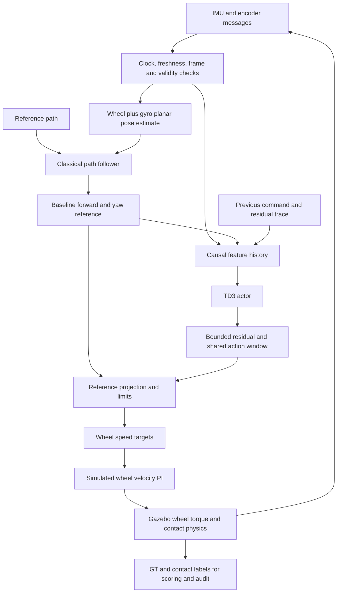
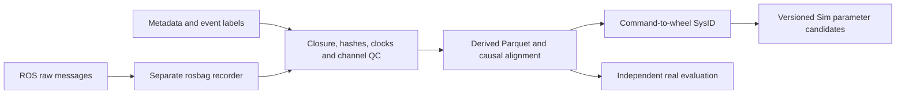

# Nino: project, sensors, control, RL and current evidence

Review date: **9 November 2026**, Asia/Bangkok.

This is a source-based overview of the active control, simulation, learner,
acquisition and GUI paths, with the saved results checked separately. It is
not a new robot experiment or training run. Historical reports, generic
templates, an effective job configuration and the firmware actually running
on the MCU describe different evidence levels.

## 1. The project in one paragraph

Nino is a differential-drive mobile robot with two driven wheels and two
passive casters. The selected application is to follow a reference path and
reach its destination while dealing with **previously unknown, mechanically
traversable low floor obstacles**. The research question is whether causal
IMU/encoder/command history and a bounded correction to a classical motion
controller improve this task. Classical guidance, actuator control, command
ownership, measurements and evaluation remain essential parts of the system.

The repository has an implemented and trained residual TD3 branch, causal
history, a reactive governor, simulation backends and a combined data/training
Studio. **The new unknown-obstacle goal task is still a specification.**
The existing trained `common103_v2` task uses scheduled stopping and a local
progress marker; its success flag does not establish success on the new task.

### Three conclusions to keep in mind

1. TD3 has trained: the latest recovered v2 checkpoint inspected is at
   **40,860 global steps**, with 30,858 recorded optimizer update cycles.
   The latest job failed a sensor timing check before final evaluation.
2. The currently trained TD3 has **one common velocity correction action**.
   The path follower supplies yaw control. Generic two-action residual code
   and the real SAC torque controller are separate interfaces.
3. TD3 does not yet have deployment authority on the physical robot. Real
   torque/SAC experiments and real sensor data do not validate a TD3
   velocity checkpoint with a different observation/action/reward contract.

## 2. What the software and hardware contain

### Workspaces

| Location | Role |
|---|---|
| `/home/tuanmac/ninorobot` | Main ROS workspace: simulation, controls, RL and Studio |
| `/home/tuanmac/nino_research` | Research jobs, traces, evaluations and checkpoint bundles |
| Client workspace `stm32-n-i-v-i-pi/artifacts` | Preserved real-data reviews, source snapshots, hashes and preparation records |
| Pi `~/nino-real-test` | Real drivers, bridge, estimator, navigation and the separate PI/SAC torque controller |
| Local `Microros_H723_USB` checkout | Reference firmware source, including local modifications; not proof of the MCU's flashed binary |

### Main packages

| Package | Responsibility |
|---|---|
| `nino_description` | URDF/Xacro, masses/inertias, wheel/caster geometry, collision, worlds, simulated sensors and bridges |
| `nino_control` | Wheel PI, reactive governor, feature/history assembly, residual projection, portable actor and read-only shadow |
| `nino_rl` | Gazebo/Gym adapters, task/reward wrappers, TD3/PPO tools, experiment contracts, evaluations, timing/contact audits and SysID |
| `nino_pi` | Command selection helpers, raw collection, QC/export, session metadata, Studio, training controls, map and evidence dashboard |
| `linorobot2` | Existing supporting ROS/navigation packages; package presence does not establish that a launch is active |

### Physical system and evidence

- Raspberry Pi 5, Ubuntu 24.04 arm64 and ROS 2 Jazzy.
- STM32H7 connected by USB; micro-ROS Agent exposes firmware messages to ROS.
- Two drive motors, reported by the operator as CyberGear, connected via CAN.
  The reference firmware uses files named `robstride_drv` and describes
  velocity/MIT protocol modes. Exact actuator variant and active binary need
  their own identification; filenames alone do not establish either.
- IMU, drive-wheel feedback and RPLIDAR A1 M8 horizontal 2D LiDAR are available.
- RC receiver/transmitter and a physical emergency-stop button exist.
- No confirmed independent body-speed sensor, contact force sensor, caster
  encoder, downward sensor or camera is required/available in the current plan.

### Geometry is not yet one calibrated model

| Quantity | Simulation values used by current factory runs | Current Pi declarations |
|---|---:|---:|
| Drive wheel radius | 0.0625 m | 0.060 m |
| Drive separation | 0.34273666 m | 0.345 m |
| Caster radius | 0.016 m in the model | Not independently calibrated here |
| IMU mounting | Sim model/adapter configuration | Identity rotation and zero translation relative to `base_link` |

Historical operator measurements and the 27 October IMU yaw +90° check differ
from current Pi declarations. They are retained as historical evidence. A
declared TF, axle height and effective rolling radius are distinct quantities.
Sim masses, caster damping and clearance are model parameters, not hardware
measurements. Real body geometry, payload and mounting still limit transfer.

## 3. The full control architecture

The implemented simulation research path is:



At deployment the selected velocity backend would replace the last control
stages with:

```text
Final ROS velocity request (v, yaw rate)
  → STM32 arbitration / watchdog / velocity-mode handling
  → left/right motor speed references over CAN
  → motor's internal velocity loop
  → wheel motion
```

The TD3-to-real connection above still requires an appropriate deployment
adapter, matching checkpoint ABI, mode/owner qualification and hardware tests.
The generic shadow executable currently publishes diagnostic traces only.

## 4. Where the real sensor data originate

| Channel | Producer and payload | What it provides |
|---|---|---|
| `/imu/data` | STM32 IMU/INS → micro-ROS; acceleration, angular velocity, orientation/covariance/header when provided | Raw inertial evidence in the declared sensor frame |
| `/motor_fb` | Motor CAN feedback → STM32 → micro-ROS `JointState` | Named left/right positions rad, speeds rad/s and reported effort |
| `/motor_status` | Firmware `UInt8` | Raw status variables under a version-specific schema |
| `/joint_states` | STM32 bridge | Converted/renamed wheel states for the robot model |
| `/imu/bridge` | STM32 bridge | Republished IMU, not a second physical IMU |
| `/odom/unfiltered` | Bridge wheel kinematics | Encoder odometry using declared geometry |
| `/odom` | EKF when launched | Fused estimate, using encoder and gyro information in the current Pi profile |
| `/scan_raw` | RPLIDAR driver | Original horizontal laser ranges and timestamps |
| `/scan` | Deskew node when enabled | Processed scan; it is not a second independent laser measurement |
| `/tf`, `/tf_static` | RSP/estimator/localization as applicable | Declared static geometry and estimated dynamic transforms |

The reference firmware names raw wheels `left_wheel`/`right_wheel`. The bridge
publishes `left_wheel_joint`/`right_wheel_joint`. The adapter must use the names
matching its selected topic; changing topic without changing the mapping fails.

Firmware-reported torque/effort, requested torque, current-derived estimates
and independently measured torque are different quantities. This project
does not obtain independent physical torque merely from an effort field.

### What the sensors cannot establish alone

- Encoder speed measures wheel rotation. Spinning wheels can coexist with a
  stationary body; encoder odometry then remains an estimate.
- Gyro Z helps estimate turning. It does not independently measure forward
  body speed or longitudinal slip.
- Accelerometers include gravity and mounting/rotation effects. They are not
  directly body velocity, contact force or payload damage.
- The horizontal LiDAR helps localization and horizontal obstacle monitoring.
  It is not reliable preview of every low cable, hole or groove.

## 5. How messages become usable control information

The core `ObservationAssembler`:

1. Caches IMU, wheel, baseline command, final command and explicit health state.
2. Keeps source time and receipt time separately.
3. Rejects duplicate/reversed samples rather than renewing freshness with them.
4. Requires the inputs needed by its contract and checks their ages.
5. Applies the configured yaw rotation to gyro/acceleration vectors.
6. Produces the feature values and trace of which source samples were used.

The current yaw transform is not a general calibrated 3D IMU transformation.
Raw acceleration retains gravity in the TD3 feature contract. Full mounting,
roll/pitch, gravity handling and lever-arm effects matter when claiming body
acceleration or transferring the policy. Setting `header.frame_id` or a TF
does not automatically rotate a raw message's numerical fields.

### Clock differences

- **Source/header time:** producer's timestamp.
- **Receipt/bag time:** when an observer or recorder received a message.
- **Monotonic time:** local elapsed-time reference for liveness/deadlines.
- **Simulation time:** stepped Gazebo clock, separate from wall-clock duration.

`Twist` has no header. Its bag timestamp is not the time a motor applied a
command. A command-to-wheel delay fitted from receipt clocks combines transport,
shaping and actuator response; it cannot isolate all those components.

The Pi bridge currently preserves validated raw IMU timestamps, while its
legacy wheel/odometry stamp sanitizer may replace invalid source timestamps
and enforce monotonic output. This is a reason to retain the raw channels.

## 6. The exact observation history

The shared base frame has **20 scalar features**:

| Group | Features | Count |
|---|---|---:|
| Baseline | Forward reference m/s, yaw reference rad/s | 2 |
| Wheels | Left/right angular speed rad/s | 2 |
| Gyro | X/Y/Z rad/s | 3 |
| Acceleration | X/Y/Z m/s², retaining gravity | 3 |
| Final reference history | Previous final forward/yaw reference | 2 |
| Proposed residual history | Previous common/differential proposal | 2 |
| Accepted residual history | Previous common/differential accepted contribution | 2 |
| Age | IMU and wheel receipt/source age under the selected clock contract | 2 |
| Consistency proxies | Encoder yaw minus gyro Z; normalized wheel asymmetry | 2 |

Values use fixed physical normalization scales and clip to `[-5,5]`. These
scales are numerical choices, not verified hardware limits.

`FeatureHistory` stacks five frames oldest to newest:

```text
20 features × 5 decision frames = 100 inputs
10 Hz policy rate → 0.4 s between oldest and newest frame
```

This is a flattened history supplied to an MLP. There is no LSTM or learned
recurrent state in this branch. Initial repeated padding does not earn valid
history: five actual decision frames are needed. Gaps, reversal and duplicates
invalidate history and require refilling under a valid epoch.

### Why the trained model has 103 inputs

`common103_v2` appends three current features:

1. Remaining time to the scheduled source stop, divided by the 14 s horizon.
2. Whether the shared common-action window is open.
3. Previous effective scalar action.

Thus **100 + 3 = 103**. These planned-stop features belong to the existing
experiment. They are not proof of adaptation to an unknown obstacle. The
new unknown-step task starts from the declared sensor/command boundary and
must separately audit/remove unsuitable schedule/oracle information.

The offline `causal_frames.parquet` export has its own feature/mask schema.
It is not automatically the exact 100D/103D actor input or a TD3 transition.

## 7. How the classical controller follows a path

The current Sim guidance uses a causal planar estimate:

\[
\hat v = (R_L\omega_L+R_R\omega_R)/2,
\qquad \hat{\dot\psi}=g_z-b_g.
\]

The estimator integrates these quantities into X/Y/yaw using causal samples.
Its initial pose is explicit scenario metadata, not a GT reset/readback.
The follower then uses the estimated pose and reference path to generate
forward speed and yaw rate, with lookahead, corridor/overshoot checks and
goal slowdown. The currently used guidance adapter supports one straight
segment; broader map/route assets do not establish this adapter's turn handling.

The present Sim trainer uses this custom follower. Nav2 is a separate real
navigation capability and is not secretly the controller of these Sim runs.
On the Pi, the active EKF is a separate estimator implementation; matching
the general purpose does not make its inputs/delay identical to Sim.

## 8. What TD3 changes on the wheels

### Generic two-action velocity residual

The shared interface has normalized common/differential actions `c,d`.
For residual scale `s`, authority `alpha`, and `N=max(1,|c|+|d|)`:

\[
\Delta v_L=\alpha s(c-d)/N,\qquad
\Delta v_R=\alpha s(c+d)/N.
\]

- Common changes both wheels together, affecting forward motion.
- Differential changes their relative speed, affecting turning.
- The L1 normalizer bounds each wheel's requested correction.

### Current trained `common103_v2` action

The actor emits a single `a ∈ [-1,1]`:

\[
\Delta v_L=\Delta v_R=b a.
\]

The bound `b` is **0.02 m/s** in the obstacle/DR scenario and **0.005 m/s**
in its clear-floor scenario. Differential correction is zero. The path follower
still supplies yaw control.

The shared window allows residual only with valid history/permission/sensors,
forward steady nominal motion, and before planned withdrawal. Source stops
alternate 6/8 s; withdrawal begins at 5.5/7.5 s. The actor's request is saved
even when the gate makes its effective action zero.

### Requested action is followed by projection

`ResidualReference` enforces reference speed/yaw/wheel/acceleration bounds,
command freshness, permission and stop/fault semantics. A zero baseline
cannot initiate motion through residual alone. Its trace keeps separate:

```text
normalized policy request
→ windowed physical wheel correction
→ baseline + correction
→ projected wheel/body reference
→ final ROS request
→ actuator target readback, only if actually available
→ measured wheel response
```

Accepted policy contribution is computed relative to a baseline projected
from the same previous reference, so baseline ramp shaping is not falsely
credited to the learned policy. Reference projection does not certify physical
safety or prove the command was executed.

## 9. Wheel kinematics and the parameters being controlled

For forward speed `v`, yaw rate `Omega`, separation `B` and wheel radius `R`:

\[
\omega_L^*=(v-B\Omega/2)/R,\qquad
\omega_R^*=(v+B\Omega/2)/R.
\]

Example: `v=0.05 m/s`, `Omega=0`, `R=0.060 m` requests approximately
`0.833 rad/s` or `7.96 rpm` on both wheels before lower-level shaping.
This conversion is not a prediction of actual body displacement.

| Layer/interface | Command quantity | Units | Controlled by current TD3? |
|---|---|---|---|
| Nominal follower | Forward/yaw velocity reference | m/s, rad/s | Follower computes it |
| Current TD3 | Common wheel-linear reference correction | normalized action → m/s | Yes, within the active Sim window |
| Generic residual interface | Common and differential wheel-linear corrections | m/s | Implemented, separate 2D ABI |
| Velocity backend | Left/right wheel speed targets | rad/s | Indirectly through reference mapping |
| Sim PI / separate real torque PI | Left/right torque requests | Nm | PI computes them |
| Firmware MIT interface | `[position,velocity,Kp,Kd,torque]` per wheel | mixed physical units | Not the current TD3 action |
| Current/PWM/FOC | Electrical actuator control | A, PWM etc. | Not current TD3 outputs |
| PI gains, current cap, radius and friction | Model/controller/configuration parameters | parameter-specific | Not online TD3 actions |

## 10. The low-level loop: Sim versus real

### Simulation velocity PI

`effort_drive.py` maps accepted body reference to wheel angular targets,
limits target acceleration and computes each wheel's error:

\[
e_i=\omega_i^*-\omega_i,\qquad
\tau_i=K_p e_i+K_i\int e_i\,dt.
\]

Conditional anti-windup freezes integral growth into saturation and permits
unwinding. Final torque/slew/speed limits are applied before Gazebo receives
the torque. The current residual-velocity backend sets `accept_torque=false`;
the learned contribution changes the reference upstream.

Representative current Sim settings:

| Setting | Value / scope |
|---|---|
| Wheel PI | Kp 0.30, Ki 0.10; conditional integral profile |
| PI contribution limit | 4 Nm |
| Effort slew | 10 Nm/s |
| Wheel angular target acceleration | 12 rad/s² |
| Wheel angular software speed limit | 12 rad/s |
| Drive callback target rate | 500 Hz; wall scheduling in stepped Sim still matters |
| Policy reference acceleration projection | 0.10 m/s² |
| Policy interval | 100 ms / 10 Hz |
| Physics step | 1 ms |

The generic effort drive also contains historical torque-residual support and
a separate overall torque cap. Those fields must be read with the active
launch/overrides; a generic YAML value is not a measured motor limit.

### Selected real velocity backend

The reference firmware's `/cmd_vel` path chooses velocity mode, converts
`v,Omega` to wheel speeds and sends motor speed references via CAN. The
motor closes its internal velocity loop. Internal gain/rate/limit readback
has not been independently established for the currently connected robot.

Reference source contains a 20 rad/s² motor acceleration setting and a
velocity current-limit override of zero, meaning leave the motor default.
Those are source declarations, not readback of the flashed binary or the
physical motor settings. They do not prove reboot protection is configured.

### Separate real PI/SAC torque backend

The reviewed Pi package `nino_real_rl` implements:

```text
Reference → Pi wheel PI (Kp .30, Ki .10)
          + SAC left/right torque residual
          → total/slew/speed limits → /cmd_torque → STM32 MIT path
```

Its source uses a 23D observation, two SAC actions, residual bound 0.30 Nm,
and total software torque bound 2 Nm. It is a different checkpoint and
actuator contract. Do not stack this external velocity PI with a motor's
active velocity PI as though the two architectures were interchangeable.

The reference MCU `/cmd_torque` source uses a separate clamp of 10 Nm; this
is a code limit, not an accepted setting for this robot. `/cmd_mit` carries
ten values, five per wheel. Interleaving these topics with `/cmd_vel` can
request mode changes. The exact active firmware still needs identification.

## 11. What the governor does

`ReactiveGovernor` is a classical state machine with CRUISE, optional DELAY,
HOLD, RECOVER, optional STALL and latched FAILSAFE behavior. It combines
vertical disturbance, body angular-rate and wheel-tracking-error proxies,
then reduces a reference scale and ramps recovery with confirmation and
hysteresis. A stall proxy based on wheel speed cannot identify every
body stall with spinning wheels.

The project has multiple frozen experimental settings. The old reviewed
candidate used scale0.90; the generic default YAML uses0.70 and is disabled.
Neither should be described as the universally active tuned governor.

**The current common103_v2 training path calls `make_environment` with its
default `governor=False`.** It uses the residual projection/window, without
the reactive governor automatically preceding TD3. Governor comparison is
a separate experiment. A predictive first-contact risk/action-ranking
controller has not become a validated deployment component.

Timing remains central: sensors detect a disturbance after it begins. Speed
changes may help later contact phases or subsequent obstacles, but cannot
retroactively prevent the first impact. Information, useful control authority
and overall benefit require separate evidence.

## 12. RL models and the meaning of a policy

A **policy** is the mapping from the observation to an action. In the current
TD3 branch it is a deterministic MLP actor. The complete controller includes
the follower, action window, projection and actuator loop around that actor.

| Algorithm | Role here |
|---|---|
| TD3 | Main continuous residual candidate; replay buffer, deterministic actor, twin critics, delayed actor/target updates and target-action smoothing |
| PPO | Historical experiments and a same-contract comparator implementation; no current evidence that switching the algorithm solves the new task |
| SAC | Separate imported 23D/2D torque policy used in the reviewed real experiment branch; entropy-based learner family, not the current TD3 model |
| BC | Historical imitation tools; not evidence of action ranking outside demonstrated coverage |

TD3 training uses critics to estimate return. Deployment normally uses only
the deterministic actor and reference/safety layers; it does not optimize
critics or explore on the real robot.

The installed SB3 TD3 implementation minimizes twin critic TD errors using
the smaller target Q and trains the actor against Q1. Target smoothing and
exploration noise serve different purposes. A high predicted Q is not a
calibrated physical risk probability or a safety guarantee.

### Effective settings of the latest v2 research job

Read from its `effective_profile.json` and the actual model builder:

| Parameter | Value |
|---|---:|
| Observation/action | 103 / 1 |
| Actor/critic hidden layers | 256,256; SB3 default ReLU; bounded actor output |
| Actor and critic learning rate | 0.0003, shared SB3 schedule |
| Gamma / tau | 0.99 /0.005 |
| Batch / replay capacity | 256 /100,000 |
| Learning starts | 10,000 transitions for a fresh job |
| Train frequency / gradient steps | 1 step /1 |
| Policy delay | 2 |
| Target noise / clip | 0.2 /0.5 in normalized action space |
| Exploration noise | Gaussian sigma0.1 during Sim learning |
| History / rate | 5 frames /10 Hz |
| Device | CPU in this trainer |
| Planned independent seeds | 11,22,33; the inspected continuation is seed11 |

Generic YAMLs and embedded inherited smoke parameters can show different
values. The effective profile plus model-builder path determine this job's
learner. A valid parameter profile alone does not prove a successful run.

## 13. The actual reward being trained

There are several versioned rewards. The current common103_v2 reward is
defined by `CommonScoreV2`, not by every weight appearing in a generic YAML.

Let `dt=0.1 s`, `e_v` be GT body speed minus an independently shaped
zero-residual nominal reference, and `e_Omega` its yaw-rate equivalent.
While the common-action window is open, define `q=a*b/0.04`:

\[
r_t=-dt[(e_v/0.2)^2+(e_\Omega/0.5)^2+0.01q_t^2]
     -0.001(q_t-q_{t-1})^2/dt.
\]

When the window is closed, action-size and action-change costs are zero;
tracking costs remain. V2 made this a versioned objective change so a
request the gate cannot apply is not charged as though it were applied.

Additional penalties are physical failure−10, missing progress marker−5 at
the deadline, and failure to complete the required stop−10.

Important consequences:

- The reward presently prioritizes nominal velocity/yaw tracking with request
  regularization and terminal task checks.
- It has no direct per-step path-error, slip or IMU-impact penalty in this
  active wrapper. The follower and evaluation checks address other concerns.
- Reward/scoring can use GT in Sim. The actor input remains separate.
- The nominal reference is kept separate from the residual-modified reference;
  lowering one's own accepted target does not automatically erase the error.
- The generic velocity template has progress/lateral/vibration terms, but
  those are not automatically the reward of this trained common103 wrapper.
- The selected unknown-step goal task needs its own goal/progress/path/failure
  reward and termination design. Its weights have not been implemented/accepted.

## 14. What happens during one training step

1. Read only sensor/command samples available by the declared decision time.
2. Update causal pose/follower and the 20-feature frame/history.
3. Append the current experiment's three plan/window features.
4. Actor plus Sim exploration produces a normalized requested scalar.
5. Window/projection maps it to a bounded accepted velocity reference.
6. Gazebo advances100ms at1ms physics steps; wheel PI acts at its lower level.
7. Read the resulting sensors and scoring labels, with source-lag/ACK checks.
8. Compute the versioned reward and termination/truncation.
9. Save `(observation, requested action, reward, next observation, done)` to
   replay, while also logging requested/windowed/projected/executed quantities.
10. After warmup, sample replay to update critics and periodically actor/targets.

The projection is part of the environment transition. Replay retains the
requested action with a consistent meaning; it is not silently replaced by
the accepted action. Reward is a training/evaluation signal, not an extra
runtime sensor required to compute a deployed actor action.

At evaluation, action noise and optimizer updates are disabled. A deterministic
checkpoint is compared to baseline arms under a declared scenario/protocol.

### Checkpoints and resuming

The resumable bundle contains model/target/optimizer state, replay, metadata,
source/profile/ABI identity and hashes. It does **not** restore the exact
Gazebo/caster/contact state or complete RNG/episode state. A fresh episode is
started on continuation. Resume is not exact-state branching.

100D/2D,103D/1D v1,103D/1D v2 and23D/2D SAC checkpoints are distinct contracts.
The existing NumPy portable actor currently enforces a two-element output;
the generic shadow loader expects its base ABI. A common103_v2 checkpoint
needs an appropriate export/adapter path before real shadow, rather than
renaming a file or bypassing the shape/hash check.

## 15. Which world and task are actually being used

The general factory lab has hall/wall assets, six cable locations, true
negative mesh depressions/grooves, route/hall variants and curriculum code.
Rough/rocky courses were removed at the user's request. Asset availability
does not establish that a mixed curriculum has been successfully trained.

The inspected v2 job used `box_c1_6mm_dr`:

- Solid box floor and the retained enclosed hall.
- One rigid cylindrical C1 obstacle, nominal diameter6mm.
- Random floor friction0.85–1.15, obstacle X0.55–0.75m and radius2.5–3.5mm.
- Straight reference path from(0,0) to(3,0), cruise0.20m/s.
- Alternating source stop6/8s,0.5s initial zero and14s horizon /140 decisions.
- Local progress marker0.95m plus continuous stop checks.

This **is not the full factory mixed-map task**. In particular, reaching its
local progress marker is not reaching the3m path endpoint or the factory
goal at6.45m. Randomizing obstacle position in a narrow bank does not itself
validate a broadly unknown-obstacle policy.

The rigid obstacle model does not represent a loose soft cable being dragged,
deformed or wrapped around a wheel. Holes, cross-grooves, longitudinal grooves,
positive steps and soft cables need different traversal/avoidance envelopes.

## 16. What has actually been achieved

### Simulation

- Implemented causal feature/history, projection, classical guidance, Gazebo
  adapters, real TD3 optimizer/replay/checkpoints and baseline evaluations.
- Earlier clear-floor common103_v1 trained to30k and completed its evaluation.
  Native full-task velocity RMSE at30k was4.236/4.351mm/s at stop6/8, compared
  with classical3.900/4.140mm/s. TD3 was8.62%/5.08% higher on that metric;
  path metrics were mixed. One seed/seen conditions do not establish a universal ranking.
- Contact authority experiments found action-dependent wheel/body changes in
  a limited Sim regime. A stop8 quality comparison changed sign across reporting
  grids; its result remains unknown and the allocation remains closed.
- The later v2 obstacle/DR continuation resumed20k and saved30k,40k and
  **40,860 interrupted** checkpoints. The latest saved metadata records
  30,858 optimizer update cycles and replay size40,860.
- The inspected latest job is **failed**, not an active worker or a completed
  50k campaign. It stopped with wheel source lag56ms at an action boundary;
  the backend requires at most40ms. Final evaluation was not reached.
- Model/checkpoint/identity hashes were rechecked for the latest interrupted
  checkpoint. The entire replay hash was not recomputed in this overview.

The newest trained checkpoint has not demonstrated improvement over the
classical baseline. The old clear-floor comparison does not answer the new
unknown-step traversal task.

### Real data

- Sensor/bridge acquisition, coarse IMU-axis/gyro sign evidence and earlier
  limited command/reported-wheel tests exist.
- Eight08/11 sessions belong to the separate PI/SAC torque branch: six bags
  pass integrity/metadata counts and two are corrupt/incomplete. Six valid
  bags contain313,555 messages. The reviewed copied evidence remains preserved.
- Navigation statuses include success, aborted and no-goal sessions; they are
  not a TD3/classical benchmark or independent physical-arrival ground truth.
- No completed, independently validated TD3 real deployment/benefit study exists.
- No accepted body-speed/slip reference or velocity-backend SysID fit closes
  the Sim-to-real dynamics gap yet.

## 17. What real data are for and how they are processed



Three datasets stay separate:

| Dataset | Purpose | What it is not |
|---|---|---|
| Real inventory / SysID | Sensor validity, geometry context, command-to-wheel response and model discrepancy | Automatic standard TD3 replay |
| Sim RL transitions | Known action semantics, rewards, next states and termination for training | Physical calibration |
| Real evaluation | Assess a fixed controller/model under recorded conditions | Training data chosen after seeing its results |

SysID currently fits a descriptive per-wheel gain, combined delay and first-order
time constant from final ROS command and reported wheel speed. The tool requires
at least three suitable whole sessions with a predeclared held-out session.
It reports boundary/identifiability issues and does not automatically retune
gains, rolling radius or hardware parameters.

For the next velocity dataset, record raw IMU/wheels/status/scan/TF and final
ROS command; retain actual source/selected/smoothed, enable and guard event
channels when they exist. Motor targets remain unknown unless supplied by
real telemetry. Torque/MIT requests invalidate a velocity-only command contract.

Camera is not required for wheel-response ID. A ruler/floor marker can measure
body start/end displacement with uncertainty. Such endpoints cannot establish
body onset, stopping time or slip over time. A validated time-resolved body
reference is needed for those claims.

### Quality checks

- Bag closes normally, SQLite integrity or MCAP decoding succeeds, metadata
  totals and per-topic counts agree.
- Raw file hashes and source/session provenance are retained.
- Missing/nonfinite channels, reversed/duplicate clocks, gaps and interventions
  are reported explicitly. Missing values remain missing.
- Observed rates/counts do not establish source production counts or packet loss.
- Teleop/observer datasets remain ineligible as ordinary TD3 replay by default.
- Q2/raw integrity is not Q3/Q4 body/benefit/deployment validation.

The repaired local export interpreter uses NumPy1.26.4/PyArrow19.0.1 in
`.venv-studio-export`. It is separate from the training environment. The
earlier collector/Studio/QC suite passed46tests including synthetic Parquet
roundtrip; this does not establish physical performance.

## 18. What Studio and navigation do

The combined Studio provides:

- Read-only real collection: choose scenario, sensor/storage/disk preflight,
  metadata,60s recording, event annotation, QC, download/index and export.
- Training: smoke/research mode, timesteps, scenario/seed/profile, checkpoint
  continuation, progress/log/error display and TensorBoard.
- Monitoring: scene objects/walls from the selected SDF, robot trajectory,
  episode/checkpoint tables and optional Laya advisory.
- Evidence/to-do: historical results and gates, separate from live worker state.

The data Studio recorder does not enable motors or issue a trajectory.
Advanced commissioning/authority pages are separate controls and depend on
the firmware/protocol. Ending recording does not stop a robot controlled by
another process. A TBS switch or GUI label has meaning through its configured
firmware mapping; the transmitter has no universal Nino AUTO/ARM semantics.

Laya supports interpretation of statistics. It does not train the actor,
implement the low-level loop, certify safety or choose a winner against
evaluation evidence.

The main Pi helper chain is keyboard/Nav2 → command gate → smoother →
Collision Monitor → final command. The recently restored Pi stack was
sensor-only. Its installed monitor uses `FootprintApproach`; the main
workspace's older helper uses a different `StopZone`. These configurations
must not be merged or assumed active just because files exist.

## 19. Current real reconnection work, kept separate from this overview

Agent and sensors were restored on Pi `.103`, then the operator confirmed a
reboot/power/network action. They were restored again on boot
`4294e98a-901f-45f8-b799-0e2ee7232bcc`.

Observed in the second12s probe: IMU/wheel about46–47Hz, LiDAR about6.45Hz,
status about4.7Hz with raw value35. Source reversal/nonfinite checks were
clear in that window, but receipt gaps up to approximately345ms occurred;
this is not a real-time deadline qualification. Sensor and odom TF were
available; map TF was absent. No firmware command publisher was seen in
the relevant snapshots.

The installed Collision Monitor passed5/5 **isolated diagnostic** cases:
live scan delivery, synthetic clear, synthetic obstacle, clear rearm and
stale-source stop. It was deactivated/closed afterward. No firmware velocity,
torque, MIT or enable request was sent by that probe. This is not a physical
stopping trial or an active motor guard.

The new read-only Studio bundle was deployed. MCAP and disk checks passed,
but its4s discovery received no `/tf_static` sample despite seeing a publisher
and despite the longer TF lookup succeeding. Observer QoS/late-join discovery
requires diagnosis; no readiness threshold was bypassed. A paired QoS probe
was prepared but its SSH execution failed when `.103` became unreachable again.
Current remote process liveness therefore remains unverified after the last
network loss. No manual IMU capture or new motion dataset has started.

## 20. Main unresolved issues and a practical direction

| Issue | Consequence | Next useful action |
|---|---|---|
| New goal differs from trained task | More steps on planned-stop tracking do not directly validate unknown-step arrival | Implement the selected task/scorer and goal-based stopping in an isolated version |
| Actor has no differential action in current trainer | RL cannot independently correct steering | Keep the follower baseline; choose any expanded action only for a defined, tested question |
| Real velocity dynamics/mode not calibrated | Sim PI and motor internal PI can react differently | Finish a bounded velocity diagnostic, then whole-session response ID if suitable |
| Timestamp/freshness problems | Runs stop or metrics become unreliable | Diagnose the specific56ms boundary failure; preserve source clocks and failure rather than relaxing gates automatically |
| Physical mounting/ABI mismatch | Wrong features or unusable checkpoint on Pi | Verify mapping and build the matching adapter/export path before shadow |
| Missing independent body reference | Wheel rotation cannot establish body speed/slip | Endpoint ruler for displacement; separately validate any time-series reference needed later |
| Small/sampling-sensitive effects | A favorable scalar or return can mislead | Keep task outcomes, failures, predefined clocks/metrics and unknown results |
| Older README/catalog sections coexist with new jobs | “0steps”, “30k”, “40,860” may refer to different branches/dates | Read job/effective-profile/checkpoint identity and scope together |

### Ordered next work

1. Preserve the failed v2 job/checkpoint and diagnose its concrete sensor
   boundary failure without changing reward/history/LR/action scale together.
2. Implement the unknown-step physical traversal/arrival/path scorer, timeout,
   stall and goal-stop semantics. Numerical tolerances and budget are still
   prospective, not factory requirements already accepted.
3. Connect a causal sensor-only adapter, freeze hidden development/test layouts
   with clear-floor controls, and check metadata/time shortcuts. Qualify B0
   and reactive B1 on that task.
4. Run an explicitly bounded TD3 pilot on the same task, then independent
   comparisons and targeted history/DR ablations. An actor need not beat a
   baseline before it is allowed to train; promotion requires post-training evidence.
5. In parallel, finish real observer readiness when the Pi is reachable, then
   collect only the missing manual frame/command-wheel/body evidence. Reconcile
   hardware dynamics before shadow and any limited real residual authority.

The current application envelope begins with bounded rigid low obstacles.
Loose wires may require avoidance or floor remediation; holes/grooves and
caster/bracket constraints need separate feasibility. Mechanical changes,
classical tuning or navigation improvements remain valid outcomes when their
mechanism and evidence are stronger than an RL benefit claim.

## 21. An example that connects the pieces

Suppose the Sim follower requests straight0.20m/s, valid history is ready,
the common window is open and the actor outputs−0.5. With bound0.02m/s,
the requested correction is−0.01m/s to each wheel. Before projection this
requests0.19m/s with the follower's yaw reference retained.

With Sim radius0.0625m and zero yaw, wheel targets would be3.04rad/s before
additional limits. The PI compares those targets to encoder speeds and
computes bounded torque. New sensor measurements become the next history
frame. GT speed/contact go to scoring/audit. In training the reward/transition
then update replay and eventually the networks.

The actor may also output a positive action or zero. History does not
automatically imply “brake when vibration rises”; that behavior must be learned
and independently validated. The physical robot is not currently executing
this example from the TD3 checkpoint.

## 22. Source map for reading or editing the project

| Topic | Primary source |
|---|---|
| Selected task and unimplemented runtime | [`unknown_step_traversal_tracking_task_v1.json`](../src/nino_rl/config/unknown_step_traversal_tracking_task_v1.json), [`unknown_step_task.py`](../src/nino_rl/nino_rl/unknown_step_task.py) |
| 20 features, history and projection | [`residual_velocity.py`](../src/nino_control/nino_control/residual_velocity.py), [`residual_pipeline.py`](../src/nino_control/nino_control/residual_pipeline.py) |
| Current103D/1D action and reward | [`equal_information_v2.py`](../src/nino_rl/nino_rl/equal_information_v2.py), [`residual_equal_information_v1.yaml`](../src/nino_rl/config/residual_equal_information_v1.yaml) |
| Learner and checkpoint handling | [`common_training_studio_v2.py`](../src/nino_rl/nino_rl/common_training_studio_v2.py), [`common_studio_v2_contract.py`](../src/nino_rl/nino_rl/common_studio_v2_contract.py) |
| Estimator/follower/task score | [`causal_planar_estimator.py`](../src/nino_rl/nino_rl/causal_planar_estimator.py), [`residual_guidance.py`](../src/nino_rl/nino_rl/residual_guidance.py), [`residual_guided_baseline.py`](../src/nino_rl/nino_rl/residual_guided_baseline.py) |
| Sim wheel PI and timing | [`effort_drive.py`](../src/nino_control/nino_control/effort_drive.py), [`velocity_pi.py`](../src/nino_control/nino_control/velocity_pi.py), [`factory_velocity_backend.py`](../src/nino_rl/nino_rl/factory_velocity_backend.py) |
| Governor | [`governor_core.py`](../src/nino_control/nino_control/governor_core.py), [`speed_governor.yaml`](../src/nino_control/config/speed_governor.yaml) |
| Portable inference/shadow | [`residual_actor.py`](../src/nino_control/nino_control/residual_actor.py), [`residual_shadow.py`](../src/nino_control/nino_control/residual_shadow.py) |
| Data recording/QC/export | [`collect_real_data.py`](../src/nino_pi/nino_pi/collect_real_data.py), [`studio_quality.py`](../src/nino_pi/nino_pi/studio_quality.py), [`causal_alignment.py`](../src/nino_pi/nino_pi/causal_alignment.py), [`dataset_exporter.py`](../src/nino_pi/nino_pi/dataset_exporter.py) |
| Real velocity profile | [`real_collection_velocity_sysid.json`](../src/nino_pi/config/real_collection_velocity_sysid.json) |
| SysID | [`residual_sysid.py`](../src/nino_rl/nino_rl/residual_sysid.py) |
| GUI | [`mode_gui.py`](../src/nino_pi/nino_pi/mode_gui.py), [`studio_panel.py`](../src/nino_pi/nino_pi/studio_panel.py), [`td3_training_panel.py`](../src/nino_pi/nino_pi/td3_training_panel.py), [`training_dashboard.py`](../src/nino_pi/nino_pi/training_dashboard.py) |
| Robot/world assets | [`nino.urdf.xacro`](../src/nino_description/urdf/nino.urdf.xacro), [`factory_floor_lab.yaml`](../src/nino_description/config/factory_floor_lab.yaml) |
| Earlier results and real review | [`30k assessment`](NINO_COMMON_TD3_30K_ASSESSMENT_2026-11-07.md), [`sampling audit`](NINO_FIXED6MM_SAMPLING_AUDIT_2026-11-09.md), [`08/11 real review`](NINO_REAL_08NOV_REVIEW_AND_BACKEND_2026-11-09.md) |

Latest inspected training directory:
`/home/tuanmac/nino_research/td3_recovery_20261109/20261109T095403402007Z_common_v2_seed11_train`.
See its `job.json`, `effective_profile.json`, `episode_0_reset.json` and
`checkpoints/step_000000040860_interrupted/checkpoint.json` together.

**One-sentence summary:** Nino already has the machinery to train bounded
sensor-history velocity residuals around a classical wheel controller; the
work now is to align the task with unknown-obstacle traversal and path following,
measure the real backend, and establish benefit through valid comparisons.
