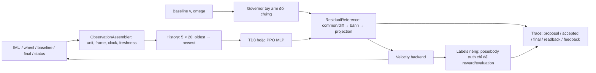

# Nino — triển khai History, Governor, TD3/PPO và GUI

Ngày: 04/11/2026. Đây là cập nhật phần mềm; cutoff dữ liệu robot đã review vẫn là 02/11.

## 1. Đọc báo cáo và quyết định áp dụng

**[T — attachment]** Báo cáo nhận được mang tên *Deep-Research Framework: Scope,
Evidence, Synthesis, and Reproducible Deliverables*. Đây chủ yếu là framework
nghiên cứu tổng quát, có ví dụ Nino. Nó không cung cấp gain, reward, history
length, ngân sách TD3 hay cấu hình motor đã được kiểm chứng cho robot.
Bản nguyên văn: [báo cáo nhận được](external_reviews/2026-11-04_deep_research_framework.txt).
SHA256: `aa59ce6fc6990965d77b5c5ec480ea3c78a68bd21797bfbb8679fdda922475f4`.

**[S] Quyết định:** ưu tiên chứng minh một đường dữ liệu thực thi được, theo
đúng câu hỏi chặn P0 của báo cáo. Không chuyển rubric Q tổng quát trong báo cáo
thành rubric dữ liệu robot; không suy “TD3 hiệu quả” từ code hoặc optimizer.

**[Đ] Các giá trị 20 feature × 5 frame, 10 Hz, residual bound 0,04 m/s,
reward weights, first-order plant và network là lựa chọn kỹ thuật để kiểm
tích hợp. Chúng chưa được chọn bằng dữ liệu hiệu chuẩn Nino.** Thay ABI phải
validation/export lại; không dùng checkpoint torque/300D lịch sử.

## 2. Luồng đã xây

Các phần dùng chung nằm ở `nino_control`: feature schema, normalization,
history, frame conversion, giới hạn reference, governor core và portable actor.
Gym và ROS shadow gọi cùng `ResidualPipeline`.

- **Observation History:** lưu những snapshot quá khứ hợp lệ, gồm IMU,
  encoder, baseline/final reference, tuổi dữ liệu, proposal và phần residual
  thực được chấp nhận ở bước trước. Không chứa GT, contact, terrain, caster
  state hoặc pose oracle. Padding không tự làm history ready.
- **Governor:** đối chứng CRUISE/HOLD/RECOVER dựa core hiện có, có thể điều
  tiết baseline trước projection. Nó không đồng nghĩa projection giới hạn
  reference, cũng không đồng nghĩa TD3. Khi thiếu actuator target, kênh
  wheel-error bị tắt có nhãn; không tạo target giả. Proxy accel Z trừ g chỉ
  phù hợp fixture gần phẳng, chưa là gravity compensation cho robot nghiêng.
- **TD3:** SB3 actor–critic off-policy, action liên tục common/diff; replay
  lưu proposal trước projection. Đã có `.learn()`, checkpoint, replay buffer,
  JSONL trace và export actor NumPy. Không phải recurrent H-TD3.
- **PPO:** đối chứng cùng observation/action/reward/limits/backend, có
  `.learn()` và portable actor riêng. Không tái sử dụng checkpoint torque.
- **Projection:** giới hạn residual từng bánh, body/wheel speed, rate, tuổi
  lệnh, permission và stop/fault. Baseline zero không cho residual tự khởi
  động chuyển động. Fault tạo terminal failure; time limit là truncated.
  Đây không phải bảo đảm an toàn/certification.

Correction có ý nghĩa: previous accepted action nay là **chênh giữa reference
có policy và baseline đã projection từ cùng reference trước đó**. Ramp của
baseline không bị ghi nhầm là tác động policy khi authority = 0.

## 3. Backend và mức trưởng thành

| Thành phần | Đã thực hiện | Giới hạn claim |
|---|---|---|
| Core/history/projection | Mã chạy chung + test causality/fault/ABI | Chưa là lợi ích vật lý |
| Reduced-order velocity backend | Delay, smoother, target ramp, wheel lag/gain, pose/IMU | Tham số giả định, không hiệu chuẩn robot |
| TD3/PPO | Kiểm optimizer hữu hạn 128 transitions/algorithm/job; save/export/parity | Software smoke, một training seed; không đủ kết luận hội tụ/ưu thế |
| So sánh | B0, yaw feedback B1, Governor, TD3, PPO qua một evaluator | Baseline chưa tuned; default plant xác định, seed ID khác không tạo điều kiện vật lý độc lập |
| ROS fixture | DDS domain riêng 119, topic prefix ngẫu nhiên; callbacks → history → actor → trace | Sensor tổng hợp, không là phiên shadow robot thật |
| Gazebo fixture | Sàn box, DiffDrive native, joint/IMU/GT body, trace hữu hạn | Robot fixture riêng, support cầu không phải swivel caster; không motor PI/CyberGear, không vật cản |
| SysID | Đọc CSV + metadata, fit lag/gain/delay kết hợp, holdout toàn session | Chưa có input thật đủ điều kiện; không tự sửa gain/model/controller |
| Robot thật | Giữ collector/diagnostic có nút bấm và profile hiện tại | Chưa có calibration/body/slip reference, chưa chạy learned residual |

Kết quả thực thi hiện tại và đường dẫn artifact được tạo bởi các manifest,
không hardcode “đạt” trong GUI. Xem [kết quả kiểm](NINO_RESIDUAL_VERIFICATION_2026-11-04.md).

## 4. Dùng GUI

Mở ứng dụng **Nino Control Modes** như trước, chọn tab
**Xây project · History / TD3 / tiến độ**. Có sơ đồ phụ thuộc, bảng kết quả,
artifact, log, tiến trình, nút hủy và dòng “Bước tiếp”. Không cần copy command.

Thứ tự nút: **1 validation → 2 TD3 smoke → 3 PPO smoke → 4 comparison →
5 ROS fixture → 6 Gazebo fixture**. Mỗi lần bấm tạo artifact mới, giữ lần lỗi/
hủy; không tự retry, không gọi SSH. Hash/source thay đổi thì artifact cũ
không được dùng làm gate. Bước 7 SysID cần đăng ký dữ liệu và metadata trước.
Không chạy đồng thời job nghiên cứu local với workflow thu/authority của GUI.

Tab **Thu dữ liệu thật · từng bước** giữ luồng chuẩn bị → Agent/inventory →
ZERO → thu 60 s → **nút tiến riêng** → QC → quan sát → tải dữ liệu. Profile
vẫn 0,05 m/s, ramp 0,10 m/s², source 2 s rồi zero/disable. Không đổi nguồn
RC, gain/current, Collision Monitor hoặc các ledger pilot đã đóng.

Các artifact local mặc định: `~/nino_research/residual_build_v1/`.
Có thể đổi thư mục trong GUI. Mở dòng kết quả để xem metric và giới hạn.
Không có phần trăm “dự án hoàn thành” tính từ số test hoặc số dòng code.

## 5. Dữ liệu cần thu tiếp

| Claim | Dữ liệu tối thiểu | Đã có / còn thiếu |
|---|---|---|
| Sensor/sign | Raw IMU, motor_fb/status, scan, frame/stamp | Đã có cho claim hẹp; không thu lại cùng sign test vô hạn |
| Diagnostic command → reported wheel | Các tầng command có thật; raw mỗi bánh; status/enable; STOP; events; video đồng bộ bánh/thân/sàn | Có các phiên cũ và bất đồng “feedback tăng, thân không tiến”; cần diagnostic giải thích được |
| Command → wheel ID | ≥3 session trọn vẹn với excitation và protocol mới; một phần holdout khai báo trước; time/units/geometry/load/caster rõ | Chưa xác nhận có bộ đủ; không tái đặt nhãn pilot lỗi thành thành công |
| Body/stop/slip | Reference thân độc lập theo thời gian, uncertainty và đồng bộ; không lấy encoder odom làm GT | Chưa có. Video chỉ định lượng khi có hiệu chuẩn/góc nhìn/mốc phù hợp |
| Real shadow | Raw inputs thật + actor/ABI/hash/history/freshness, proposal, accepted alpha0, các tầng reference, target readback nếu có | Observer đã viết; chưa thực hiện trên Pi trong lần cập nhật này |
| H2/contact benefit | Timing actual wheel/body trước phase còn lại, traversal/failure/time/tracking/contact quality theo envelope | Chưa chứng minh; không suy từ publication sớm hay return cao |

SysID CSV: `session_id,time_s,final_v_m_s,final_yaw_rad_s,wheel_l_rad_s,wheel_r_rad_s`.
Metadata mẫu ở `src/nino_rl/config/residual_sysid.template.json`. Time phải
được khai báo common receipt clock; retained raw/header stamps vẫn cần giữ
trong bag. Không ép header clock và bag time bằng một offset chưa kiểm.
Delay fit gồm cả shaping/transport/motor, không là motor latency thuần.
Tool không export body GT, torque hoặc target từ `/cmd_vel`.

## 6. Outline thực hiện — sáu giai đoạn

| Giai đoạn | Artifact | Qua / dừng / unknown |
|---|---|---|
| 1. Software trace | ABI, validation, trace, tests, learner smoke/export | Qua nếu projection ảnh hưởng target/feedback fixture và fault/clock đúng; chưa xét lợi ích robot |
| 2. ROS + Gazebo integration | Diagnostic trace DDS; Gazebo native joint/IMU/GT trace | Qua cho fixture riêng; model discrepancy với Nino vẫn mở |
| 3. Một diagnostic thật có reference | Bag nguyên vẹn + video/events/metadata + review body/wheel | Có bất đồng thì unknown, giữ failure; tối đa một correction có căn cứ rồi quyết định protocol mới |
| 4. ID và baseline | Holdout toàn session; model candidate; B0/B1 tuning; operating envelope | Đủ độ phân giải/excitation mới fit; thiếu thì unknown. Không áp gain sim lên motor |
| 5. Training/evaluation nghiên cứu | Ngân sách mới, multi training seed, split session/layout/payload, ablation history/projection/governor, Pareto quality/time | Factory thresholds/minimum effect còn null; chốt trước final test. TD3 không hơn classical ổn định thì dừng learning |
| 6. Shadow thật → bounded residual | Pi timing dưới tải, frame/owner/RC/stop/backend contract; release artifact và authority riêng | Observer không có motor publisher. Hardware control cần triển khai/kiểm riêng; không biến checkpoint smoke thành release |

**Việc ngay tiếp theo:** diagnostic sàn sạch có video/reference để phân biệt
reported wheel feedback với chuyển động thân. GUI dẫn tới nút thu hiện có;
không tự cấp lại slot đã đóng hoặc tự tạo protocol ba lượt khi diagnostic
chưa giải thích được.

## 7. Reproducibility và các điểm chưa mở

Workflow lưu config/ABI/source fingerprint, job status, trace, checkpoint,
weights hash/parity, per-file SHA256 và state index; có flock tránh hai job
cùng root. GUI chỉ đánh dấu sau process đóng và kiểm manifest. Nguồn report,
scope/protocol/assumptions được giữ riêng, không sửa raw bag cũ.

- Train smoke chạy CPU hữu hạn; không tự mở Optuna, PPO lịch sử hoặc full RL.
- Chưa có predictor/action-conditioned risk model, recurrent policy, học online
  trên robot, sensor preview hay map memory mới. Báo cáo không cung cấp bằng
  chứng để tự chọn chúng làm yêu cầu triển khai hiện tại.
- Chưa định lượng compute/latency trên Pi hoặc load navigation. Phải đo p50/
  p95/max end-to-end age/inference/deadline/memory dưới tải dự kiến; chưa đặt
  số realtime bảo đảm.
- Chưa có software authority thay thế RC trên binary đang chạy. Agent không
  làm thay đổi arbitration firmware. Giữ vòng velocity bên trong motor theo
  backend đã review; không chồng PI xuất torque của sim lên velocity mode.

## 8. Tài liệu API đã đối chiếu

Tra cứu 04/11/2026, tài liệu chính thức: [SB3 TD3](https://stable-baselines3.readthedocs.io/en/master/modules/td3.html),
[custom environment/checker](https://stable-baselines3.readthedocs.io/en/master/guide/custom_env.html),
[Gymnasium Env API](https://gymnasium.farama.org/api/env/),
[Gazebo Transport Python](https://gazebosim.org/api/transport/13/python.html).
Các nguồn này hỗ trợ API tích hợp, không chứng minh lợi ích Nino hoặc tính mới.
World fixture tham khảo cấu trúc ví dụ `diff_drive.sdf` của Gazebo Sim 8
được cài tại máy, với hình học/khối lượng giả định ghi rõ trong source.
