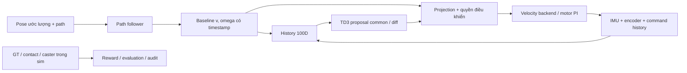

# Path guidance và velocity residual — contract chuẩn bị offline

04/11/2026. Code mới: `residual_guidance.py`, config
`residual_guidance_v1.yaml`, workflow `sim-guidance-contract`.
**Đã kiểm offline với ResidualPipeline thật, chưa nối Gazebo, ROS hoặc robot.**

## Phân vai

- **Follower:** chịu trách nhiệm đưa hướng/chuyển vị tương đối với path vào
  baseline. Tái dùng `flat_feedback.flat_motion_command` và `PathTracker`
  đã có; không nối pipeline PPO torque cũ vào residual velocity mới.
- **Residual:** bù tracking/chất lượng động học quanh reference. Actor vẫn
  20 feature × h5 = 100D, không thêm x/y/heading/GT/caster.
- **Projection/gate:** giới hạn common/diff theo bánh, kiểm owner/freshness/
  fault và ramp. Ràng buộc này có thể trì hoãn yaw correction ở đầu ramp;
  target thay đổi không chứng minh body đã thay đổi.
- **Evaluator:** đo path/velocity/stop bằng GT riêng trong sim; encoder
  odometry là estimate dùng điều khiển, không tự trở thành body ground truth.

## Interface đã xây

`PoseSample` chứa x/y/yaw, source stamp, receipt stamp, pose frame, source ID,
clock ID, epoch. Adapter chỉ chấp nhận cùng frame/source/clock/epoch đã khai
báo, dữ liệu finite và age trong cửa sổ đề xuất. Không đổi clock ngầm.
Header/receipt phải đã cùng control clock được khai báo; code chưa xác nhận
đồng bộ clocks trên Pi hoặc giữa các host.

- Source thường: `wheel_imu_odometry` hoặc `fused_localization`. Tên source
  là khai báo interface, không là bằng chứng estimator đã chạy/hiệu chuẩn.
- `sim_truth_oracle` bị từ chối mặc định. Cho phép riêng thì contract/hash và
  output mang `oracle=true`; không được gọi là baseline deployable.
- Duplicate pose không gia hạn freshness. Reversal, future/stale, frame/
  clock mismatch hoặc vượt corridor/overshoot → invalid/fault; explicit reset
  mới phục hồi. Không tự forward recovery hoặc dùng pose cũ vô thời hạn.
- `apply_guidance` thay baseline v/omega và hai feature reference, giữ nguyên
  measured wheel/final command/actuator readback. Invalid pose gỡ permission
  và đặt fault dù IMU/encoder đang fresh; không che stale pose bằng command
  được đóng timestamp mới. Gate của ResidualPipeline vẫn latch stop.
- Goal reference zero dùng ramp hiện hành, chưa đồng nghĩa body dừng. Owner
  stop/denied loại permission; không dùng dừng recorder làm dừng robot.

Config v1 chỉ cho **một segment thẳng**. Turn/loop cần adapter ordered-route
riêng, không tuyên bố đã có general navigation. Các giới hạn 0,2 m/s,
lookahead 0,45 m, yaw 0,5 rad/s, pose age 0,2 s, corridor 0,4 m là đề xuất
offline/sim, không là envelope/safety đã chấp nhận trên hardware.

## Đã kiểm gì?

Năm scripted-pose fixtures, mỗi case 35 tick:

| Case | Điều kiện cần thấy | Kết quả |
|---|---|---|
| Trái path | Yaw correction âm sau ramp | Đạt offline |
| Phải path | Yaw correction dương sau ramp | Đạt offline |
| Heading âm | Yaw correction dương | Đạt offline |
| Gần goal | Reference zero | Đạt offline |
| Pose stale, sensor vẫn fresh | Reference zero + gate latch | Đạt offline |

Unit tests còn kiểm duplicate không renew lease, clock/frame/epoch/source,
oracle tách riêng và ABI không đổi. Đây không là năm lượt robot hoặc năm
lượt Gazebo. Pose trong fixture được script, không là estimator được xác minh.

**Giới hạn checkpoint:** ABI 100D không đổi không có nghĩa phân phối input/
task/baseline tương thích. Checkpoint v2 chỉ dùng diagnostic đóng băng, không
tự resume/deploy dưới guidance mới. Thí nghiệm v3 cần ghi baseline identity,
guidance hash, estimator identity, task/reward và source/config cùng checkpoint.

## Bước sim kế tiếp — đề xuất, chưa chạy

1. Nối một estimator wheel+IMU causal vào adapter, với geometry danh nghĩa
   và initial pose khai báo từ scenario. Không đọc GT để sửa state estimator;
   không gọi estimate là body reference độc lập. Log source/header/receipt,
   estimate và GT riêng để lượng hóa drift.
2. Kiểm **B0 có guidance, residual zero** trên clear floor trước, với initial
   heading errors đã định trước và cùng ramp/limits/stop. So constant-straight
   baseline hiện tại. Chốt số điều kiện/lặp, metric và deadline trong v3 trước
   chạy; chỉ khi baseline/reference hợp lệ mới tiếp tục obstacle screen.
3. V3 tách reward velocity/yaw tracking quanh baseline khỏi path metrics do
   follower đảm nhiệm. Xem xét zero-initialized actor cuối để khởi đầu đúng
   baseline; đây là đề xuất, chưa được áp vào v2 hoặc train mới. Sau gate
   software/physical/classical mới mở training budget riêng; không yêu cầu
   real data trước các bước sim, không thêm PPO/history ablation ngay.

Điểm dừng: guidance/estimator không giữ được reference contract hoặc yaw
authority không đủ dưới ramp → sửa đúng một nguyên nhân có bằng chứng, giữ
artifact cũ. Không loại spike, hạ coverage, đổi objective sau kết quả hoặc
thêm mẫu để ép learned benefit.
