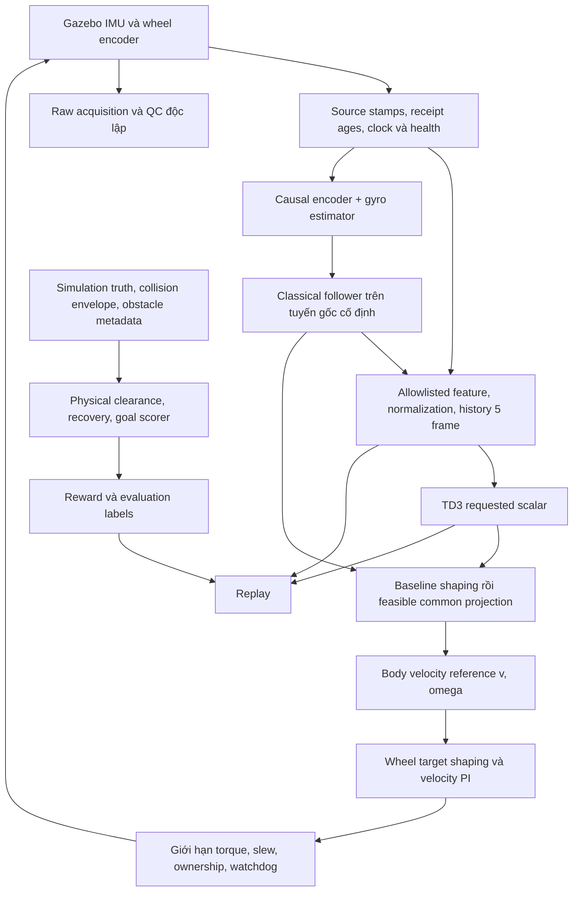

# Audit và sửa luồng TD3, vượt gờ và phục hồi quỹ đạo Nino

Ngày 15/11/2026. Mục tiêu là sửa sai lệch có thể tái hiện trước khi đầu tư train thêm. Báo cáo này áp dụng workspace `/home/tuanmac/ninorobot`, branch `Collecting-datas`, HEAD đầu phiên `aabd4faa9fb8ed8cef6f078fba464eb4a886182c`. Người dùng đã chọn workspace hiện tại, giữ tiến độ TD3 Goal100. Không chuyển sang branch hoặc remote trong attachment.

## 1. Quyết định hiện tại

- Giữ engine Goal100, checkpoint và dữ liệu lịch sử. Sửa QC dùng chung. Source qualification cũ không tự được kế thừa sau sửa source.
- Sửa sensor của PPO cũ tại nơi tạo state và reward. Missing/stale LiDAR dừng và từ chối bước. IMU mất mẫu không biến thành bằng chứng ít rung.
- Thêm engine **opt-in** `nino_recovery_history100_accepted_common_v2`. Giữ actor 100D/1D, thêm scorer recovery và projection mới. Không chuyển ngầm checkpoint cũ sang engine mới.
- Chưa mở train dài. Smoke phần mềm TD3 đạt 32 transition, 16 critic updates, 8 actor updates, kiểm đủ 32 dòng replay. Đây là fixture lý tưởng, không phải Gazebo contact hoặc lợi ích controller.
- Hai startup Gazebo sàn sạch đã đóng. Cả hai bị start-alignment gate chặn trước task motion. Lượt sau một correction còn endpoint error bound khoảng **9,005 mm**, lớn hơn ngân sách **8 mm**. Không giảm gate hoặc tự chạy lượt thứ ba.
- Việc tiếp theo là review contract khởi tạo và settling. Chưa có dữ liệu chuyển động mới để so classical với TD3 recovery.

Phân loại bằng chứng trong báo cáo là **source**, **fixture**, **Gazebo startup**, **dữ liệu lịch sử** và **đề xuất chưa kiểm chứng**. Số test không phải số lượt vượt gờ.

## 2. Phạm vi kiểm tra và bảo toàn tiến độ

Đã định vị bằng graphify rồi đọc producer/consumer thực. Các owner chính gồm `ros_env`, `ros_interface`, `control_v2`, `core`, `routes`, `flat_feedback`, `flat_curriculum`, `task_geometry`, assisted/causal odometry, trainer PPO, policy node, governor, engine Goal100, TD3 builder, replay/deferred reset, backend/lifecycle và cấu hình liên quan. Chi tiết source/hash ở các audit trong artifact đi kèm.

Trước task workspace đã có 91 modified, 1029 deleted và 131 untracked entries. Không đảo các thay đổi đó. Snapshot RL/control trước sửa nằm trong `source_before.zip`; description launch có addendum ghi rõ cách khôi phục bằng cách đảo đúng patch spawn của task; không xóa run hoặc repin ledger lịch sử. Graph chỉ dùng để tìm code, không chứng minh hành vi.

Các audit nguồn nằm tại `/home/tuanmac/Documents/Codex/2026-10-27/stm32-n-i-v-i-pi/artifacts/rl_obstacle_recovery_repair_2026-11-15/`. `decisions.tsv`, `DESIGN.md`, `INDEPENDENT_REVIEW.md` và `CORRECTION_01.md` giữ quyết định và giới hạn.

## 3. Pipeline nào đang tồn tại?

| Nhánh | Source thực | Trạng thái và giới hạn |
|---|---|---|
| PPO legacy | `train.py`, `ros_env.py`, `policy_node.py` | Có PPO trainer và PPO inference. `wheel_torque` dùng baseline thẳng với yaw 0; các mode/path follower khác đã tồn tại. Không dùng policy node này để load TD3. |
| TD3 Goal100 | `goal_training_studio.py`, `unknown_step_*`, Studio API v3 | TD3 SB3 có thật. 20 feature × 5 frame, 10 Hz; requested scalar action, residual common ±0,02 m/s. Bank cũ là clear floor hoặc một gờ cứng, không có sustained recovery curriculum. |
| Recovery v2 mới | `recovery_contract/task/environment/bank/curriculum/runner.py` | Tách physical clearance, sustained recovery và goal stop. CLI có prepare, software-smoke, classical baseline có giới hạn. Chưa có release train dài hoặc real deployment. |
| Reactive governor | `governor_core.py`, ROS wrapper và evaluator riêng | State machine riêng. Goal100 adapter tạo `ResidualPipeline(... governor=False)`; không mô tả governor là đang phối hợp TD3 trong engine đó. |
| Real torque/SAC | Nhánh real riêng, tài liệu/hardware provenance trước đó | Không đồng nhất backend này với velocity-reference TD3 trong Gazebo. Task này không SSH, flash hoặc phát lệnh lên robot thật. |

### Luồng dữ liệu



Không có cạnh từ GT/obstacle metadata sang actor hoặc follower. Identity/manifest lưu geometry để audit, không phải observation.

## 4. Lỗi và sửa theo bằng chứng

Các line có thể thay đổi khi sửa tiếp; symbol/file là owner ổn định. Các reproduction trước sửa và snapshot được giữ trong artifact.

| ID / mức | File và symbol | Reproduction / nguyên nhân | Tác động | Sửa và test | Mức xác minh |
|---|---|---|---|---|---|
| QC-01 / cao | `unknown_step_runner.py:138`, `raw_qc` | Episode 0 không có IMU, episode 1 đủ kênh; QC pooled vẫn pass. | Chứng nhận sai raw dataset. Không chứng minh lịch sử thật đã mất IMU. | Mỗi episode phải đủ kênh, cadence, timestamp; AND kết quả. Kiểm head/tail khi có native end boundary. `test_goal_raw_qc.py`. | Fixture trước 4 fail/2 pass; sau regression pass. |
| SENSOR-01 / cao | `core.py:120`, `lidar_sectors`; `ros_env.py:955` | Empty/NaN scan thành maximum range; stale scan bị xóa rồi tiếp tục. | Missing bị hiểu như vùng trống. | Invalid sector trả conservative zero; required scan phải valid/fresh cả trước action và sau bước. Zero control rồi raise, không replay row. `test_sensor_integrity`, `test_control_v2`. | Fixture và production-method tests. Chưa live PPO rollout. |
| SENSOR-02 / cao | `control_v2.py`, `ImuWindow` | Empty window trở thành full-duration zero; partial energy bị scale vào measurement; future packet có thể giải thích quá khứ. | Reward/rung bị thiên lệch; coverage giả. | Actual bracketed ZOH support giữ riêng; diagnostic estimate nested; strict learner reject thiếu support. Delayed/duplicate không xóa peak, clock reset phải explicit. | Regression mất mẫu/jitter/peak/reset. |
| SENSOR-03 / vừa | `ros_interface.py`, callbacks và `sensors_ready` | Receipt set từng có message đủ để ready; duplicate có thể renew freshness. | Actor dùng source cũ hoặc invalid payload. | Check receipt age, source age, scan payload; duplicate/reordered packets không cập nhật state/freshness. Invalid IMU làm mất readiness. | Gọi production methods với message fixtures. |
| ROUTE-01 / cao cho legacy đa hướng | `control_v2.py:99`, `ChallengeTracker` | Cùng scene xoay E/N/W/S cho clear 1/0/0/0 do world +X. | Sai clearance bonus khi đổi hướng. | Đóng băng entry-side frame; phải thoát phía đối diện và ngoài expanded region, one-shot. Test bốn hướng, góc xiên, đường cong cục bộ và backout. | Fixture. Không phải full-caster clearance certificate. |
| START-01 / cao | `unknown_step_runtime.py`, historical start/stop contract | Dữ liệu slot 15 khởi tạo x thật −37,748 mm, estimator 0; ideal relative odometry vẫn có thể stop ngoài goal. | Timeout không nhất thiết do TD3 hoặc slip. | Nhánh mới dùng cùng declared spawn pose cho estimator; check residual translation + yaw-distance bound trước motion. Không sửa gốc goal theo truth. | Reproduction offline và Gazebo gate đã chặn. |
| ACTION-01 / contract limitation | `residual_velocity.py`, `ResidualReference` | Scalar common có thể thành differential sau independent wheel slew. Fixture yaw delta khoảng −0,05753 rad/s. | Trái với ngữ nghĩa accepted-common mong muốn; chưa chứng minh gây mọi path failure. | Projection mới shape baseline trước rồi giao miền delta common khả thi cho hai bánh. Old projection giữ cho ABI cũ. Fuzz 1000 quyết định kiểm bound/slew/yaw. | Fixture; chưa physical benefit. |
| RECOVERY-01 / thiếu chức năng | `recovery_task.py`, `RecoveryScore` | Engine cũ chỉ clearance/corridor/goal, không có recovery hold. | Qua gờ không chứng minh bám lại tuyến. | Lifecycle riêng; hold/hysteresis trong cross-track, heading, yaw, tilt, signed speed và lateral speed. Physical envelope gồm caster sweep danh nghĩa. | Pure domain tests. |
| REVIEW-01 / cao | `RecoveryScore` | RECOVERED từng còn latched sau backout/lost tracking. | False recovery. | Re-arm RECOVERY và đòi hold mới; bonus chỉ một lần. | Reviewer độc lập tái hiện; regression đã thêm. |
| REVIEW-02 / vừa | `RecoveryReward` / inherited env intervention | Reference latch trùng recovery vẫn có bonus trên failure. | Reward không tôn trọng failure precedence. | Event bonus bằng zero trên failed terminal, kể cả reference intervention. | Reviewer fixture và regression. |
| REVIEW-03 / cao | `recovery_runner.require_bank`, source identity | Có thể sửa obstacle labels/reward khi chỉ world/config file hash được kiểm. Một số live guidance source chưa pin. | Đổi scorer hoặc baseline mà vẫn mang identity cũ. | Check full preparation manifest, embedded config, implementation/config closure và factory assets; identity chứa runtime guidance/protocol. | Tamper regression và source audit. |
| REVIEW-04 / cao | `RecoveryScore` speed gate | Backward body speed norm bằng forward request vẫn đạt recovery. | False recovery dù progress âm. | Signed route-forward và lateral finite differences từ source poses cùng norm gate. | Reviewer fixture và regression. |

### Điều không nên sửa khi chưa có lỗi

- `PathTracker` có dấu lateral đúng trong fixture bốn hướng. `OrderedPathTracker` không creep cursor khi projection xa, không nhảy sang nearby return leg trong các fixture đã chạy. Giữ code này.
- `FlatCourseCurriculum` cũ có state độc lập và rolling gate hợp lệ. Nó không tự trở thành curriculum bốn family mới.
- TD3 lưu **requested normalized scalar** trong replay là hợp lệ vì projection thuộc environment dynamics. Executed reference/torque phải là diagnostics riêng. Không thay action critic bằng torque.
- Không tìm thấy lỗi twin-target minimum, delayed actor update, target smoothing hoặc timeout bootstrapping ở SB3 đường đang dùng. Equal actor/critic learning rate được validator kiểm; không có lỗi silently ignoring một critic LR hợp lệ khác.
- Estimator-stop latch không cho residual tạo chuyển động từ zero baseline là giới hạn thiết kế đã khai báo. Không bỏ latch chỉ để đạt goal trong task khởi tạo sai.

## 5. Contract dữ liệu theo field

| Field / nguồn | Đơn vị / frame | Clock và validity | Consumer / giới hạn |
|---|---|---|---|
| IMU gyro xyz, accel xyz | rad/s, m/s²; sensor/body frame theo adapter | Header source stamp, receipt monotonic riêng; finite, increasing, fresh | History, causal yaw estimator; gravity compensation bằng orientation chỉ trong owner tương ứng. Không coi accel Z raw là vertical impact đã bỏ gravity. |
| Wheel feedback left/right | rad/s, joint names đã pin | Source joint stamp; freshness và source gap riêng | Feature và nominal kinematics. Không phải body velocity/GT. |
| Horizontal LaserScan legacy | m, scan frame | Empty, invalid, stale, valid +inf no-return là khác nhau | Required PPO safety/observation boundary. TD3 Goal100 history hiện không chứa terrain/LiDAR preview. |
| Baseline v/omega | m/s, rad/s, body reference | Causal estimator pose + declared route, command stamp/age | Classical follower và actor baseline feature. Không có obstacle coordinate. |
| History | 20 fixed-scale feature × 5; oldest→newest | 10 Hz, 0,4 s observed span; duplicate/reversal/gap reject/refill | Actor/critic 100D. Padding không làm history ready. Không tự tăng history length. |
| Requested TD3 action | Scalar [-1,1], common wheel-linear residual ±0,02 m/s | Một action cho pending observation | Replay action; không là torque. Exploration noise chỉ trong sim training. |
| Projected/accepted references | Wheel-linear m/s và body v/omega | Sau baseline shaping/common feasibility; STOP ownership vẫn authoritative | Gửi backend. Không gọi đó là motor execution ACK. Warmup/zero baseline không cho actor tự khởi động. |
| Drive requested body ACK / wheel targets / torque | m/s, rad/s, Nm theo field gốc | Header drive source; phải match command boundary | Giữ requested, internal target, measured wheel và applied simulation torque riêng. Chưa suy field torque này là torque đo thật. |
| PhysicalSample | Pose world x/y/z/roll/pitch/yaw, speed norm/yaw, wheel/status | Source truth stamp và decision stamp riêng; maximum age task 40 ms | Scorer/reward/eval only. No actor input. |
| Route-relative physical diagnostics | s, e_y m; e_psi rad; forward/lateral FD m/s | Wrapped yaw, source-pose finite difference | Recovery labels và audit. FD ở decision grid không là high-bandwidth body velocity measurement. |
| Estimated tracking diagnostic | e_y/e_psi và estimator stamp | Causal wheel/gyro estimate | Đối chiếu truth riêng trong info; không dùng fused/encoder odom làm independent truth. |
| IMU integral | az²·s, normalized fourth-power·s, observed peak m/s² | Bracketed ZOH support, max gap mặc định 40 ms và actual duration; nested estimate riêng | Strict training cần ≥80% support mặc định đề xuất. Không phải continuous impact waveform/force/cargo damage. |
| Raw QC | Counts, per-channel gaps, endpoint support | Source epoch theo từng episode; end boundary từ native trace nếu có | Boundary unavailable được ghi rõ; chỉ interior cadence không chứng minh full-window coverage. Intentional raw pruning không được fresh-QC pass. |
| Manifest/identity | SHA256, config, runtime guidance, schema, source | Prepared immutable inputs và unique attempt output | Refuse changed input/checkpoint. Không repin lịch sử để vượt gate. |

Wheel controller sim vẫn PI velocity → bounded torque. Contract lịch sử có torque cap 4 Nm, effort slew 10 Nm/s, wheel target acceleration 12 rad/s². Đây là sim settings, không là cấu hình motor thật được chấp nhận.

## 6. Recovery, reward và bốn family

### Recovery mới

`APPROACH → CROSSING → RECOVERY → RECOVERED`. Mỗi obstacle có state riêng. RECOVERED quay lại RECOVERY nếu mất clear hoặc vượt exit bands. Phải hold lại, không được nhận thêm bonus. Một valid final task cần tất cả obstacle đang recovered, toàn robot đã clear, physical goal đúng và sustained physical stop. Rollover/envelope, outer path violation, stall, owner/drive failure và finite task timeout giữ thành terminal failure. Invalid/missing measurement raise và quarantine thay vì tạo replay failure giả. Backend terminal không phân loại được vẫn UNKNOWN.

Clearance dùng support của conservative full-robot box với body roll/pitch/yaw. Đây là **geometric crossing**, không là loaded-contact/force certificate. Pothole nằm giữa hai vệt bánh có thể được clear mà không có drive contact. Loaded caster/drive contact vẫn cần audit raw riêng.

Các threshold mới là đề xuất nghiên cứu sim. Outer path limit 0,20 m khác recovery inner 0,04 m. Việc đó tạo cửa sổ cho bám lại; không nới threshold của báo cáo Goal100 cũ. Hold 0,5 s, hysteresis multiplier 1,5, recovery deadline 5 s chưa phải yêu cầu nhà máy.

### Reward

Giữ progress từ giảm khoảng cách goal, cross-track, wrapped heading, time, accepted action và action-change của task cũ. Thêm one-shot sustained-recovery bonus 0,2 và cost tilt/yaw chuẩn hóa ×dt, weight 0,01. Clearance bonus mặc định **0**. Event bonus không trả trên failed terminal.

Không thêm đồng thời nhiều term progress trùng nhau. Accepted residual cost không được gọi là energy/effort đo thật. Chưa thêm impact-integral reward vào TD3 recovery vì chưa qua physical measurement gate. Các weight chỉ là baseline đề xuất; chưa có bằng chứng tối ưu hoặc superiority.

| Family | Geometry/code có | Curriculum và qualification |
|---|---|---|
| clean | Không obstacle; declared spawn XY/yaw thay đổi nhỏ, estimator dùng cùng khai báo | Đánh giá tracking/stop. Settled start uncertainty vẫn bị gate. Chưa thêm external force disturbance. |
| short_obstacle | Rigid cylinder radius 2–3 mm, góc ±0,35 rad; count 1→3 | Count tăng sau full valid success/recovery, không chỉ clearance. Chưa phải dây mềm. |
| pothole | Depth 3–6 mm, lateral −0,18..+0,18 m, radius 6–9 cm; continuous negative floor mesh | Không có supporting box dưới hõm. `physics_qualified=false`; geometry test không xác nhận caster/bracket dynamics hoặc feasible envelope. |
| mixed | Trộn thứ tự rigid bump/pothole và sampled positions, tách split | Runner yêu cầu component stage-0 baseline evidence trước khi mở mixed baseline. Chưa có evidence đó. |

Sampler giữ actual seed, split, count, góc, kích thước, pose và world/mesh hashes. Bank hiện tạo 36 layout cho development/validation/test và ba stage. Reserved splits chưa được chạy nên chưa là generalization evidence.

`FamilyCurriculum` có RNG, rolling window, stage, earlier-stage replay, episode IDs và JSON restore riêng. Gate đề xuất cần ≥10 episode, fraction ≥0,8 và full route/recovery success. Reject duplicate result. Fixed-stage evaluation không tăng stage. Software fixture lưu state các family; **runner hiện chưa có multi-episode scientific training campaign gắn curriculum này**. Không quảng cáo đã train bốn family hoặc exact resumed scientific campaign.

## 7. Kết quả kiểm chứng thực sự

### Baseline và regressions

Baseline audit ban đầu đạt 126 test. Sáu regression QC mới trước fix có 4 fail/2 pass. Bộ regression tổng hợp sau sửa bao gồm sensor, routes, curriculum, projection, lifecycle/replay, schema và production callback tests. **Kết quả cuối là 251 pass, 0 fail/error.** Kết quả nằm trong `regression_results.xml` và `verification_summary.json` của artifact.

Reviewer `/root/review_recovery_repair` dùng context riêng và model family khả dụng. Sáu finding có fixture đã được xử lý. Không có cross-family judge; không mô tả hai lần cùng family là đa mô hình độc lập. Root tự kiểm regression sau sửa.

### TD3 software smoke

32 steps / 32 replay rows, 16 critic updates, 8 actor updates; finite parameters, actor L1 change khoảng 2,13277. L1 chỉ chứng minh optimizer có cập nhật, không đo chất lượng policy. Requested action/observation/next observation/reward/done được đối chiếu. Model/replay fixture không được load lên Gazebo/robot như checkpoint đã qualify.

Một invocation bị global simulator lock từ chối trước khi tạo attempt. Đã giữ thông tin trong decision log. Sau khi preparation kết thúc mới chạy smoke; không có hai simulator cùng world.

### Gazebo startup

| Attempt | Kết quả | Bằng chứng |
|---|---|---|
| readiness_02, clean stage0 | Trước correction, absolute settled start error 10,6688 mm >8 mm | All drive request ACK zero, 0 task transition. `gazebo_readiness.json`. |
| readiness_03, cùng sampled spawn | Sau một correction, residual translation 8,92782 mm, yaw error 0,000019325 rad; distance-coupled endpoint bound 9,00522 mm >8 mm | All drive request ACK zero, 0 task transition. `gazebo_corrected_readiness.json`. |

Hai lượt xác nhận launch, sensor, source boundary và gate chạy được. Không có rollout classical hoàn chỉnh, vượt gờ, recovery success rate hoặc learned physical benefit từ hai lượt này. Không chạy lại thêm. Source pin của preparation là snapshot từng attempt; các integrity correction tiếp theo không được repin vào những preparation đã đóng.

### Dữ liệu lịch sử để tránh quy nhầm nguyên nhân

Audit riêng `td3_residual_recovery_review_2026-11-15/verification.json` đọc 3648 retained native decisions của 23 valid slot cũ. 547 quyết định có common→differential coupling trong projection cũ. Đây là so projection cùng previous reference, không phải counterfactual rollout.

Slot 15 có final estimator-minus-physical X khoảng 41,8725 mm, trong đó initial offset khoảng 37,7478 mm và additional X error khoảng 4,1247 mm. Không gọi toàn bộ 41,9 mm là slip. Không tự loại failure hoặc đổi outcome lịch sử theo scorer mới.

### Những metric đã có và chưa có kết quả

| Metric yêu cầu | Contract hiện tại |
|---|---|
| Crossing/recovery success | Per-obstacle counts và current recovery states đã có; rate toàn campaign chưa đo. |
| Recovery time/distance | Có source-time/distance khi đạt hold; unresolved là null, không zero. Re-entry cần hold lại, bonus không lặp. |
| Post cross-track RMSE/P95/max, heading RMSE | Có trong scorer; native decision-grid P95 và source-time weighted RMSE. Chưa có moving Gazebo values mới. |
| Rollover/stall/task timeout/outer tracking failure | Có classified outcome. Missing sensor là invalid/unknown, không nhập vào success denominator. |
| Collision rate/contact severity | Chưa có reliable collision classifier cho mọi obstacle regime. Unknown; geometry clear không thay thế. |
| Impact/angular statistics và coverage | Legacy actual IMU support đã sửa; raw cho offline audit có. Chưa qualify TD3 recovery impact metric. |
| Slip/actuator saturation | Raw truth/wheel/drive giữ riêng. Chưa chạy moving rollout mới để báo cáo; encoder odom không là GT. |
| Duration/full physical route success | Scorer và finite horizon có; hai startup mới không có task-duration/success result. |

## 8. Train/evaluate/deploy parity và migration

1. PPO observation dimension không đổi, nhưng sensor semantics và training contract đổi. `training_contract` pin `nino_sensor_support_v2`; resume cũ bị từ chối. PPO training không được chọn diagnostic IMU coverage để học reward.
2. Recovery v2 giữ 100D/1D nhưng đổi projection/task/reward/baseline initialization. **Cùng tensor shape không tương thích checkpoint.** Identity pin full settings, declared pose, runtime guidance/protocol và source/config closure. Không nối replay/checkpoint Goal100 vào recovery v2.
3. Goal100 replay semantics được giữ. Finite task timeout là terminal theo contract; cutoff ngoài task là truncated/right-censored. `DeferredResetVecEnv` lưu terminal transition trước khi reset simulator tiếp.
4. Các artifact cũ giữ nguyên source hashes. Source trước sửa có archive. Không sửa ledger để qualification cũ xanh lại. Frozen prerequisite bị chặn sau source change là hành vi đúng.
5. Portable live deployment recovery v2 chưa được tích hợp. Không dùng PPO-only `policy_node.py` load TD3. No hardware authorization, no safety certification, no zero-shot transfer claim.
6. Global simulator lock giữ single run. UUID partition không tự tạo independent ROS domain; backend dùng domain 129. Không mở parallel training workers khi chưa có domain/process/resource contract riêng.

## 9. Sim-to-real và randomization

Legacy `traction_scale` nhân residual torque. Nó là **actuator-authority randomization**, không đổi wheel-ground friction. Code diagnostics/config comment giờ nêu rõ nghĩa này. Không thay tên key âm thầm làm hỏng config lịch sử.

Recovery bank hiện giữ floor friction nominal 1,0. Vary obstacle geometry thật trong SDF/negative mesh; chưa randomize mass, motor constants/delay, caster friction, contact stiffness hoặc broad sensor uncertainty. Muốn physical DR phải sửa đúng physics parameter, pin readback và có uncertainty measurement hoặc đề xuất thí nghiệm riêng. Không randomize rộng để che model mismatch.

Hardware đã có IMU/encoder/LiDAR theo các phiên trước. Robot thật chưa chứng minh cùng command contract, gains hoặc latency của backend sim. Không lặp lại IMU sign/inventory đã đủ dữ liệu chỉ để chạy thêm checklist. Trước deployment cần backend mode/ownership/stop xác minh, effective geometry, reference thân xe độc lập phù hợp và commanded→wheel→body response. Không có camera thì mốc/thước đầu-cuối chỉ đo displacement, không chứng minh instantaneous slip/body latency.

## 10. Commands và điểm dừng

Chạy ở `/home/tuanmac/ninorobot`, dùng `.venv` và source ROS Jazzy/overlay khi cần integration. Tất cả output phải là thư mục mới; command không tự retry slot đã đóng.

### Software smoke có giới hạn

```bash
rtk env PYTHONPATH=src/nino_rl:src/nino_control PYTHONDONTWRITEBYTECODE=1 .venv/bin/python -B -m nino_rl.recovery_runner --help
rtk env PYTHONPATH=src/nino_rl:src/nino_control PYTHONDONTWRITEBYTECODE=1 .venv/bin/python -B -m nino_rl.recovery_runner software-smoke --output /tmp/nino_recovery_software_review
```

Software smoke dùng 32 transition theo YAML, không có arbitrary timesteps để vô tình mở train dài. Checkpoint chỉ là fixture.

### Reproduce regression mới

```bash
rtk env PYTHONPATH=src/nino_rl:src/nino_control PYTHONDONTWRITEBYTECODE=1 .venv/bin/python -B -m pytest -q -p no:cacheprovider src/nino_rl/test/test_sensor_integrity.py src/nino_rl/test/test_goal_raw_qc.py src/nino_rl/test/test_recovery_v2.py
```

### Prepare và classical evaluation, chỉ sau review khởi tạo

```bash
rtk bash -c 'source /opt/ros/jazzy/setup.bash
source /home/tuanmac/ninorobot/install/setup.bash
rtk env PYTHONPATH=src/nino_rl:src/nino_control:$PYTHONPATH PYTHONDONTWRITEBYTECODE=1 .venv/bin/python -B -m nino_rl.recovery_runner prepare --output /home/tuanmac/nino_research/recovery_v2_next_reviewed'
```

Khi một protocol khởi tạo mới có căn cứ đã được review, cùng wrapper ROS có thể gọi `baseline --family clean --stage 0 --output ...`. Mỗi job tối đa một launch, 400 transitions, 600 s wall deadline, không hardware. **Không chạy lại readiness_02/readiness_03**. Stage clean chưa pass thì chưa tự mở short-obstacle, pothole hoặc mixed. Mixed còn cần component baseline hashes hợp lệ.

Scientific training/evaluation command cho recovery v2 chưa được release. Không dùng lệnh Goal100 cũ để vượt gate rồi gọi đó là train recovery mới.

## 11. Outline còn lại và stop rules

| Thứ tự | Việc / artifact | Qua / dừng / unknown |
|---|---|---|
| 1 | Review reset/settling và uncertainty budget từ hai startup đã giữ. Tách known requested spawn khỏi physical settled pose và yaw bias. Chọn một thay đổi có căn cứ nếu cần. | Không hạ 8 mm chỉ vì đã fail. Nếu uncertainty 5+5 mm chưa có căn cứ, lập contract thay thế riêng và ghi hậu quả đối với physical goal claim. Chưa chạy thêm trong audit này. |
| 2 | Một classical clean-floor moving qualification mới sau bước 1. Kiểm source coverage, goal/stop/tracking và estimator drift. | Measurement lỗi là unknown; physical failure giữ nguyên. Classical chưa đạt thì không train. |
| 3 | Một gờ cứng thấp, matched classical/residual-zero; audit caster/drive loaded phases và post-clearance metrics. | Đạt operating envelope nhỏ mới chuẩn bị TD3 Gazebo smoke. Không dùng short smoke reward để promote. |
| 4 | Gắn FamilyCurriculum vào bounded multi-episode training runner, lưu model/replay/curriculum và learner RNG/cursor. | Hiện RNG curriculum restore đã có; full learner/Gazebo exact continuation chưa có. Không tuyên bố deterministic reset seed của Gym là Gazebo seed. |
| 5 | TD3 nhiều learner seed và held-out layouts; ablation recovery reward, DR từng yếu tố riêng. So classical cùng info/action projection và điều kiện. | Freeze estimand/task/time/tracking constraints trước kết quả. Không đổi LR/history/reward/action scale cùng lúc, không loại spike/failure hoặc tăng sample size tùy kết quả. |
| 6 | Chỉ sau đó qualify pothole contact/clearance, mở mixed và cân nhắc hardware shadow. | Negative geometry và software tests chưa chứng minh physically feasible. Deployment cần evidence riêng. |

**Một việc nên làm ngay** là review nguyên nhân settled pose lệch khai báo từ hai startup đã lưu, rồi chốt contract khởi tạo thay thế có thể bảo vệ bằng error budget. Artifact cần nhận là một reset/initialization decision với threshold justification và điều kiện fail cụ thể. Chỉ khi classical moving qualification đạt contract đó mới thay khuyến nghị sang TD3 Gazebo smoke hoặc train dài.

## 12. Knowledge graph và provenance

Đã chạy `rtk graphify update .`, graph có 14.680 nodes và 33.524 edges. Extractor báo 770 file không có extractor và partial parsing của `ros_env.py`. Python `ast.parse` của các source đã sửa và test compile/call actual `step` đều qua. Graph không bao phủ toàn bộ repository và không thay thế execution evidence.

Các nguyên tắc thực sự dùng là Fix Root Causes để sửa predicate tại nơi tạo state/reward; Model the Domain để tách physical recovery khỏi actor history; Sequence Work into Verifiable Units và Prove It Works để giữ failing fixture, passing regression và bounded startup evidence. Decision trail giữ tại artifact, không commit hoặc tạo PR trong task này.
