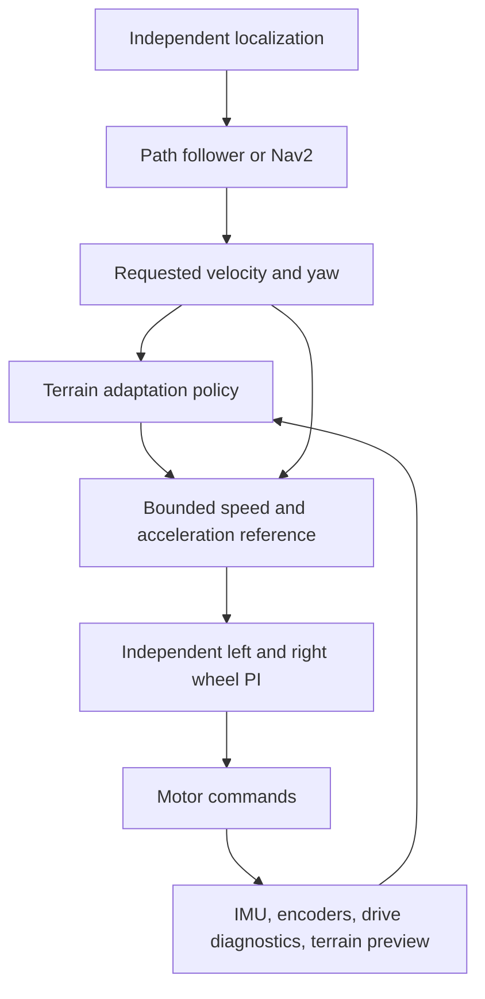

# Research-backed redesign for Nino RL

Research and repository review: **10 October 2026**.

**Hardware clarification, 11 October:** the physical robot has horizontal LiDAR, IMU and encoders only. Downward preview and the simulated multi-channel wall LiDAR cannot be deployment inputs. The first proposed learning task therefore becomes a reactive speed supervisor using sensor/command history. The preview research below remains relevant to diagnostics or a later hardware upgrade. See the [completed foundation evidence](rl_foundations_2026-10-11/REPORT.md) and [hardware-specific pilot plan](rl_foundations_2026-10-11/NEXT_PILOT.md). Neither scripted anticipation nor the new PI screens establish a learned PPO improvement.

## Recommendation

Develop a **terrain-aware speed and acceleration supervisor above calibrated wheel PI control**, then consider independently learned wheel-reference corrections if the first design demonstrates a benefit. Train against varied, physically feasible terrain and commands, with realistic actuator and sensor behavior.

The immediate engineering priorities are **rough contact feasibility, terrain-preview correctness, and actual dynamics randomization**. Another broad Optuna study does not address those gaps.

This document separates published results, verified repository behavior, and proposed experiments. Paper results are author-reported, not independently reproduced here. The selection covers ten relevant papers rather than claiming an exhaustive literature review. Quadruped and manipulation results inform methods; they do not establish what Nino's passive casters can traverse.

## 1. What the existing evidence actually establishes

The [completed comparison](FEEDBACK_RECOVERY_AND_N1_BRAKING_2026-10-10.md) reports:

| Flat, matching 24 scenarios | Latest targeted PPO | PI |
|---|---:|---:|
| Physical arrival | 24/24 | 24/24 |
| Completion time | 17.942 s | 17.521 s |
| Physical path RMSE | 0.03404 m | 0.03311 m |
| RMS vertical acceleration | 3.15325 m/s² | 2.93177 m/s² |
| RMS slip | 0.203381 | 0.184167 |

The larger slip weight did not produce the required quality gain. At the second cable, speed scaling remained approximately 0.98 and requested yaw correction increased. This is evidence about one trained candidate, not proof that slip penalties can never work.

For rough E1, trial 8 arrived in 20/20 scenarios and took 38.91 s. PI at speed scale 0.70 took 38.715 s and had nearly identical vibration. There is no demonstrated large comfort advantage independent of speed. The critic correction improved numerical fit but increased slip relative to trial 8.

N1 v20 reduced corner overshoot but achieved 0/3 arrivals. Two runs stalled around **(2.53, 0.63) m**, with rotating wheels and almost no translation; reverse recovery failed. Contact obstruction or traction loss is plausible, but the contacting component is **unconfirmed**. Lower RMSE on these short failed paths is not a successful controller.

Sources: [rough validation](ROUGH_TRIAL8_VALIDATION_2026-10-10.md), [saved cable response](targeted_cable_response_2026-10-10/REPORT.md), and the completed comparison above. These are saved simulation results; no new simulations were performed for this research review.

## 2. Published methods worth borrowing

### A. Directly relevant wheeled-robot studies

| Paper and primary source | Reported evidence and method | Application and limitation for Nino |
|---|---|---|
| **OTTR: Off-Road Trajectory Tracking using Reinforcement Learning** — Nagariya et al., 2021. [Paper](https://arxiv.org/html/2110.02332v1) | PPO learns trajectory tracking in a simple differential-drive simulator. Supervised adaptation uses 30 minutes of real driving data. The authors report 30% and 50% reductions in cross-track error versus ILQR on Warthog and Moose. | Closely related drive kinematics; shows a practical path from simulation to measured robot behavior. These are large outdoor vehicles with GPS-based trajectory measurements, not Nino's small casters or a vibration/slip benchmark. Do not copy their speeds or interpret the percentages as expected Nino gains. |
| **A Sim-to-Real Pipeline for Deep Reinforcement Learning for Autonomous Robot Navigation in Cluttered Rough Terrain** — Hu et al., 2021. [Author-hosted paper](https://www.chrisagia.com/papers/Sim2RealDRLNav-RAL-2021.pdf) | Gazebo-trained navigation transfers to a Jaguar 4×4 robot using elevation maps, pose estimation, motion disturbances and closed-loop wheel control. Reported success: 86.67% over 60 physical trials, versus 90% in simulation. | Supports separating navigation decisions, independently measured motion, and wheel regulation. Their mapping uses 3D LiDAR/stereo sensing and terrain reconstructed from the real environment. Map mismatch and approach angle still caused failures. It does not establish arbitrary-map generalization or Nino's exact-path capability. |
| **Pay Attention to How You Drive: Safe and Adaptive Model-Based Reinforcement Learning for Off-Road Driving** — Wang et al., 2023. [Paper](https://arxiv.org/html/2310.08674v1) | A history-conditioned dynamics model and system-identification transformer feed risk-aware MPPI. The paper reports approximately 41% lap-time improvement over a non-adaptive baseline and real-robot experiments. | An alternative when correcting command-to-motion response is the main problem. Their robot has four-wheel steering and suspension, with onboard GPU computation. The model assumes static system dynamics during an execution; the paper identifies changing dynamics as a limitation. This is not a drop-in PPO replacement or a PI comparison. |

### B. Transferable sim-to-real engineering methods

| Paper and primary source | Reported evidence and method | What to borrow |
|---|---|---|
| **Learning Agile and Dynamic Motor Skills for Legged Robots** — Hwangbo et al., 2019. [Paper](https://arxiv.org/html/1901.08652v1) | ANYmal policies transfer from simulation to hardware using rigid-body simulation and an actuator network fitted to measured command/state/torque histories. | Model the complete motor-control response, including delay and limits. Nino may need only a simple identified model initially; a neural actuator model is useful if simpler models leave structured error. |
| **RMA: Rapid Motor Adaptation for Legged Robots** — Kumar et al., 2021. [Paper](https://arxiv.org/html/2107.04034v1) | A simulation-trained base policy uses an environmental latent. A separate history-based adaptation module predicts that latent during deployment. Physical A1 tests include unfamiliar surfaces and payload changes. | Teach a compact history encoder to infer changes in traction or actuator response. This is learned adaptation from varied dynamics, not simply adding an IMU channel. Its leg control and traversability differ fundamentally from passive casters. |
| **Learning Robust Perceptive Locomotion for Quadrupedal Robots in the Wild** — Miki et al., 2022. [Paper](https://arxiv.org/html/2201.08117v1) | A privileged teacher is distilled into a recurrent student using noisy terrain observations. Sensor confidence gates exteroceptive information. The student is deployed on ANYmal with real terrain mapping. | Combine reliable proprioception with explicitly uncertain preview; train with degraded preview. A small scan summary does not provide the same information as their robot-centric elevation map. |
| **Learning to Walk in Minutes Using Massively Parallel Deep Reinforcement Learning** — Rudin et al., 2021/2022 version. [Paper](https://arxiv.org/html/2109.11978v3) | Procedural terrain, command sampling and difficulty curriculum support ANYmal hardware transfer. The uneven-terrain run uses 4,096 robots, 98,304 transitions/update and 1,500 updates on an RTX A6000, taking under 20 minutes. | Borrow diverse commands, terrain families, replay and efficient sampling. That budget is approximately **147.5 million transitions**, not a 20k-step pilot. Neither those hyperparameters nor the reported time automatically transfer to Nino. |
| **Sim-to-Real Transfer of Robotic Control with Dynamics Randomization** — Peng et al., 2018. [Paper](https://arxiv.org/html/1710.06537v1) | Simulation-only policies transfer to a real object-pushing task. Randomization includes masses, damping, controller gains, action timing and observation noise. | Randomize real physical and timing mechanisms. Residual torque scaling alone is not contact-friction randomization. This is manipulation evidence, not evidence of rough-terrain wheel performance. |
| **Residual Reinforcement Learning for Robot Control** — Johannink et al., 2019. [Paper](https://arxiv.org/html/1812.03201v1) | Conventional control plus learned residuals improves real block insertion; the misaligned-block test reports 15/20 successes versus 2/20 for the conventional controller. The learner uses TD3. | Preserve a functioning controller while learning bounded corrections for a demonstrated deficiency. The paper does not guarantee stability of any residual or justify Nino's existing additive torque authority. |
| **How to Train Your Robot with Deep Reinforcement Learning: Lessons We've Learned** — Ibarz et al., 2021. [Paper](https://arxiv.org/html/2102.02915v1) | A synthesis of physical robot-learning experience discusses exploration, demonstrations, reward design, data diversity and train/test separation. | Use feasible demonstrations, meaningful data coverage and genuinely different evaluation conditions. It is a methodological review, not an additional Nino-like experimental success. |

The relevant lesson across these sources is a complete training/deployment setup. Choosing PPO, SAC or a larger network alone is insufficient.

## 3. Concrete gaps found in this repository

### 3.1 Dynamics randomization does not currently model changing traction

In [ros_env.py](../src/nino_rl/nino_rl/ros_env.py), `_sample_randomization()` samples a `traction` multiplier, and `step()` multiplies **the learned residual torque** by it. The speed/yaw-reference mode subsequently sets that torque to zero. Neither operation changes wheel-ground friction, caster friction, mass or center of mass.

The latest flat pilot and rough N1 candidate configurations set `domain_randomization.enabled: false`. YAML ranges existing in a file do not establish that those variations were applied.

**Proposed correction:** separate and name actuator-strength variation, contact-friction variation, sensor variation and geometry variation. Apply each to the actual simulator mechanism and record the effective values. Verify that changing friction changes a controlled wheel/ground experiment, even with zero RL residual. Use measured bounds when hardware data becomes available.

### 3.2 Terrain preview can confound body tilt with ground shape

[ros_interface.py](../src/nino_rl/nino_rl/ros_interface.py), `_terrain_scan_callback()`:

- Projects ranges using a fixed sensor height and pitch, without time-aligned roll/pitch compensation.
- Keeps one strongest signed height per side and the nearest feature distance. The selected left/right heights need not belong to the feature at that distance.
- If every range is unusable, the empty sample list becomes zero left/right relief with a refreshed timestamp; `terrain_preview()` reports valid input. An empty scan and observed flat ground are therefore indistinguishable to the actor.

**Proposed correction:** transform valid scan points using calibrated extrinsics and timestamp-aligned attitude into a gravity-aligned local frame. Keep spatially associated height/slope samples along both wheel tracks, with observed coverage, age and confidence. Treat no usable returns as missing preview. Account for mount geometry and IMU alignment before comparing with a ground-height reference.

This is a verified code-path gap; its contribution to the observed failures has not yet been quantified. A single fan scan also has intrinsic coverage limits: do not label an unobserved pothole as observed flat ground.

### 3.3 The actor has history, but important command/response signals are missing

[policies.py](../src/nino_rl/nino_rl/policies.py) already contains a temporal convolution over history. Five frames at 10 Hz span roughly **0.4 seconds** between oldest and newest samples. [control_v2.py](../src/nino_rl/nino_rl/control_v2.py) includes IMU signals, estimated motion, wheel speeds, previous actions and preview; it explicitly removes truth-derived slip from the actor.

The assembled actor frame does not explicitly include the applied torque commands, post-limiter wheel references, PI integral/limiter state, or integrated IMU vibration features used by evaluation. Thus the actor can see its requested correction and sensor response without a complete account of what the drive adapter executed.

**Proposed correction:** expose timestamped, bounded drive diagnostics and measured IMU window features. Test whether a small longer-history model improves prediction of actual velocity changes before adopting a larger recurrent model. An adaptation encoder only becomes meaningful when training contains identifiable changes in dynamics.

`/wheel_torque_applied` is the adapter's applied **command**, not an independent torque/current measurement. Real actuator identification must retain that distinction.

### 3.4 The reward and reported ride metric differ

The current impact term integrates a clipped **fourth power** of normalized vertical acceleration; episode vibration reports RMS from its **second-power** integral. The slip penalty also saturates above a normalized threshold. These are different objectives. Neither is inherently wrong, but increasing their weights need not improve the reported metrics.

**Proposed correction:** choose the desired physical metric explicitly, normalize its integrated cost using a fixed calibration dataset, and log its per-phase contribution. Keep impact peaks as a separate criterion if they matter. Preserve the existing independent physical evaluation gates. Do not alter clipping or normalization during a trial to make an old comparison appear favorable.

### 3.5 The control problem mixes navigation, comfort and torque intervention

Flat already uses speed/yaw references rather than torque residuals; it still underperforms PI on quality. Rough uses speed plus common/differential torque corrections. Those corrections can interact with wheel PI, torque limits and passive caster dynamics.

The driver is configured for a fast wheel PI loop, while the actor runs at 10 Hz. A wheel crosses the diameter of a 10 mm-radius cable in approximately 50 ms at 0.4 m/s; this simplified geometric timescale is shorter than the actor's 100 ms action interval. Actual contact duration is more complicated. Preview-based anticipation and the inner controller therefore matter; raising policy frequency alone is not a demonstrated fix.

## 4. Proposed architecture and learning task

### First task: anticipatory speed and acceleration control

The policy learns **when and how gently to slow before a disturbance and recover speed afterward**. Path steering remains with the validated path follower. Preserve heading authority during slowing; do not blindly retain the current multiplication of both linear and angular velocity by the same speed scale. Declare and validate how the new supervisor handles path curvature and turning.

Use a bounded target-speed adjustment with explicit acceleration/jerk limits. The first contract has no freely learned yaw residual. This isolates whether terrain-conditioned longitudinal control can help without introducing another steering interaction.

Train short traversals with external velocity requests, multiple approach speeds and headings, varying disturbance positions, and recoverable initial errors. Include level-ground cruising and braking. Keep requested command information independent of the policy's own adjustment, so a stopped policy cannot redefine its target as successful tracking.

### Later task: independent wheel-reference corrections

If a remaining deficiency requires differential control, let a subsequent policy adjust bounded left/right **velocity references**, tracked by calibrated PI. The nominal differential-drive mapping is:

`wheel_left = (v - track_width * yaw_rate / 2) / wheel_radius`

`wheel_right = (v + track_width * yaw_rate / 2) / wheel_radius`

Independent wheel control already exists in the driver. A policy can influence each wheel through these references without assuming that an additive torque will be faithfully executed. Velocity-reference learning is a proposal, not a proven superior action space; evaluate it against the earlier supervisor and PI before adoption.

### Initial reward contract

Use a compact, logged objective with physically interpretable terms:

`reward = -dt * (command_tracking_cost + vibration_cost + slip_cost + action_rate_cost)`

Add declared failure costs for rollover, unrecoverable stall and invalid control state. Choose the scales using fixed reference measurements. Arrival, route order and mission timing remain independently scored in route evaluation.

Command tracking refers to the external requested motion, not a target chosen after the policy slowed itself. Allow a declared tracking/comfort tradeoff during obstacles, then require recovery. Quality metrics should include both whole-run values and crossing-window values so a longer trip cannot hide contact peaks by averaging over additional quiet time.

Training-only truth can measure reward and provide an asymmetric critic; the deployed actor receives measured/estimated inputs. A privileged teacher is a later option if realistic-input learning is inadequate. Do not deploy a teacher that needs unavailable ground truth.

The current SB3 policy uses separate actor/critic feature extractors on the same observation contract. That is not an asymmetric privileged critic. Adding one requires a deliberate environment/policy interface change, not just a YAML switch.

During training, PPO changes the actor and critic weights from collected transitions. During ordinary deployment, actor weights remain fixed: feedback and history change its output. An RMA-style adaptation module changes its inferred context from recent measurements; this need not mean updating network weights on the robot.

A changed observation/action contract cannot load an old actor wholesale. Use an explicit validated mapping or distillation; otherwise initialize the new actor around the conventional controller. Use a fresh critic/optimizer for changed contracts. Preserve old checkpoints and studies as baselines.

## 5. Curriculum and generalization

The following is a proposed schedule, not an already implemented configuration:

| Stage | Training distribution | Evidence needed to advance |
|---|---|---|
| 0: response identification | Flat ground, braking, gentle turns, one isolated disturbance | Command/encoder/physical-motion response is understood; preview matches geometry |
| 1: basic skill | Feasible shallow bowls, mounds and cables; varied external speed requests and approach directions | Reliable tracking and physical traversal; a useful anticipatory behavior versus PI |
| 2: robustness | Several layouts, bounded friction/motor/mass variation, sensor delay/noise; replay stage 1 | Gains survive validation layouts and dynamics; old skills retained |
| 3: route integration | E1 plus feasible turning paths, then original N1/S1 benchmarks | Strict route tracking, arrival, timing and quality gates pass |
| 4: deployment transfer | Measured real actuator/sensor behavior and separate physical holdouts | Benefit on supervised real trials within a declared operating envelope |

Use independently seeded pre-generated meshes if changing terrain requires restarting Gazebo; regeneration every episode is not mandatory. Visual and collision geometry must stay identical for every mesh. Sample terrain difficulty by wheel/caster clearance, slopes, bowl curvature and demonstrated reachability, not appearance alone.

Changing mass/COM and friction per episode is different from creating spatial friction patches along a route. Sensor delay/bias/dropouts also have different temporal behavior. Model those distinctions and log effective distributions. Keep transport/action-timing failures visible; randomized sensor delay must not excuse unaccounted physics steps or false timestamps.

A fixed straight route can remain an initial benchmark, but an initial skill should see varied body commands and disturbance offsets. Multiple drawn routes on one mesh are useful coverage; they do not establish transfer to unseen geometry.

Maintain separate **training, development-validation and final-test** terrain/dynamics sets. Reusing seeds repeatedly makes them development data. Reserve a final set that does not select rewards, controllers or Optuna trials. Train multiple independent seeds before claiming repeatability.

## 6. The first experiments should be decisive

### Rough: contact and traversability

Record drive-wheel, caster-wheel, caster-fork and chassis contacts near the repeated N1 stall, along with physical pose, wheel speeds and applied commands. Inspect terrain normals and clearances. Try a bounded diagnostic traversal using a known feasible approach.

Possible outcomes:

- **Invalid collision geometry:** repair the model to match measured hardware and create a new experiment contract.
- **Physically infeasible turn:** change the planned approach or hardware operating envelope. Keep the old sharp-corner route as a separately labeled stress test.
- **Feasible but poorly controlled:** use measured actuator response to design braking and turn anticipation, then test the new learning task.

PI success is a useful readiness test, but it is not a mathematical requirement for RL to improve a task. Establish reachability independently through safe scripted/manual/reference control when PI fails. Never convert an actually unreachable condition into an easier scoring threshold.

Nino currently has 62.5 mm-radius drive wheels and 16 mm-radius passive casters. It cannot lift a caught caster or change its suspension geometry as a quadruped can. The source of the stall must be measured before attributing it to learning capacity.

### Flat: test whether anticipation has useful authority

On an isolated cable, compare existing PI with one bounded preview-based braking/acceleration schedule. Use the same geometry and physical scoring. This is a test of available control authority, not another reward search.

If no feasible speed/acceleration schedule improves the desired quality without failing timing/tracking, reconsider the actuator/control objective before training that supervisor. A failed scripted schedule does not prove no learned solution exists, but it prevents assuming that the chosen action can easily deliver the desired gain.

Then train the supervisor on multiple cable positions and approach speeds. Compare with:

1. Existing full-speed PI.
2. PI adjusted to match achieved duration.
3. The deterministic preview schedule.
4. The learned supervisor.

Retain current arrival, timing, tracking and quality gates for the original two-cable benchmark. For the new varied task, declare corresponding thresholds before execution. Count failures as failures, not excluded low-cost trajectories. Record per-obstacle peak and integrated measures.

**Stopping rule:** one mechanism test and one bounded training pilot per hypothesis. If the predicted physical behavior does not appear, diagnose that mechanism before another weight change. A 20,480-step run can screen learning behavior; it cannot establish broad adaptation or sim-to-real success. Budget a larger learning run only after the data distribution and behavior justify it.

The proposed supervisor is more than a repetition of the old speed-only ablation: it changes preview correctness, the command/terrain distribution, acceleration authority and the learning objective. Compare it with that ablation where contracts permit; do not credit a renamed action space with an improvement that has not been measured.

## 7. Training throughput and implementation choices

Keep Gazebo as the ROS integration and contact-validation environment. A faster simulator is useful only if it reproduces Nino's caster contacts and command response well enough for the intended task.

The [authors' legged_gym repository](https://github.com/leggedrobotics/legged_gym) includes actuator modeling, friction/mass variation and sensor noise, and directs new development toward Isaac Lab. The [versioned Isaac Lab installation guide](https://isaac-sim.github.io/IsaacLab/v2.3.2/source/setup/installation/index.html) documents separate simulator/Python requirements. Do not install it into the project's ROS/SB3 virtual environment without a deliberately isolated setup.

The current execution environment reports an RTX 4080 with approximately 16 GB VRAM and 62 GiB RAM. This establishes available workspace resources, not the specification of the ThinkPad shown in historical terminal logs. A modest parallel-training feasibility benchmark is reasonable here; a verified environment import, contact fidelity and measured throughput are still required.

Start with a small parallel task and measure transitions/second, memory, actuator/contact agreement and reward coverage. Consider Isaac Lab or another validated vectorized physics environment only after that benchmark. Do not import quadruped batch sizes or promise its training times.

A low-cost kinematic simulator can train a path-following or learned dynamics component, as OTTR illustrates. It cannot validate vibration or pothole/caster contact. Use the appropriate fidelity for each learning objective.

For a continuing command-tracking skill, external episode cutoffs require correct truncation/bootstrap handling. Nino's current mission deadline is deliberately treated as terminal task failure; that is not automatically a bug. Preserve the distinction in a new task. If actor frequency changes, rescale reward integration and discounting to physical time and validate sensor/action synchronization.

## 8. What sim-to-real requires for this robot

1. **Measure the physical robot:** complete mass/inertia/COM, caster geometry and clearance, loaded wheel radius, wheel separation, motor/current limits and sensor transforms.
2. **Collect controlled response data:** speed changes, braking, low-speed turns and feasible obstacle crossings. Synchronize requested commands, applied commands, encoders, IMU and independent translation/yaw measurements.
3. **Identify and validate dynamics:** begin with delay, gain, saturation, wheel/caster friction and response models. Fit a learned model only when simpler models leave important error. Validate on withheld runs.
4. **Train with measured uncertainty:** use bounded parameter variations and realistic noisy/delayed preview. IMU integration alone does not provide drift-free translation during wheel slip.
5. **Use deployable localization:** the current corridor estimator relies on known wall geometry. A different real environment needs an appropriate map/SLAM/LiDAR or other independent motion source. Replacing it changes the estimator contract.
6. **Deploy in shadow mode, then supervised control:** verify feature units, timestamps, limits and inference latency first; then evaluate on low-risk, physically feasible scenarios with a stop mechanism.
7. **Adapt with measured data where necessary:** supervised command/motion adaptation is one supported route; it does not require uncontrolled online exploration.
8. **Compare on physical holdouts:** same payload, obstacle, surface and mission for classical and learned controllers. Publish both successful and failed trials.

The [existing deployment guide](RASPBERRY_PI_DEPLOYMENT.md) describes interfaces and packaging. It does not establish that current policies have passed physical-robot tests.

## 9. How PID/PI, Nav2 and RL fit together

| Component | Job | Role in this proposal |
|---|---|---|
| Wheel PI/PID | Follow each wheel's velocity target | Retain and calibrate; independent wheel regulation |
| Path follower / Nav2 controller | Convert a path and estimated pose into local motion requests | Baseline route tracking and feasible turn planning |
| Terrain policy | Anticipate disturbances and adapt bounded motion references from sensors | Must show quality improvement at comparable duration and tracking |
| Learned dynamics + MPC/MPPI | Predict response and optimize future controls | Alternative research branch if model error dominates |
| Optuna | Select parameters for a specified, comparable objective | Use after task feasibility and useful learning behavior are demonstrated |

For example, [Nav2's Jazzy Regulated Pure Pursuit documentation](https://api.nav2.org/nav2-jazzy/html/md_nav2_regulated_pure_pursuit_controller_README.html) describes curvature- and collision-based speed regulation. It is an appropriate path-following comparator. It does not directly solve wheel contact, caster obstruction or terrain vibration.

The research contribution would be a measurable terrain adaptation advantage over these baselines, with honest localization and generalization tests. Calling a system RL or adding IMU does not establish that advantage.

## 10. Ordered implementation backlog

| Priority | Deliverable | Main files / boundary | Acceptance evidence |
|---|---|---|---|
| 1 | N1 contact/clearance diagnostic and feasibility envelope | Robot collision model, rough world, diagnostic logging | Identify contact/traction cause or explicitly retain uncertainty; demonstrate a feasible traversal |
| 2 | Tilt-aware preview with meaningful validity | `ros_interface.py`, sensor transforms, preview representation | Known flat plane, slope, mound, depression and empty-scan behavior match geometry under attitude changes |
| 3 | Identified drive-response model and richer diagnostics | `effort_drive.py`, actuator model, observation assembly | Prediction and tracking error on withheld commands; applied-command/physical-motion distinction retained |
| 4 | Separate supervisor task and fixed metric contract | `control_v2.py`, `policies.py`, environment/config | PI-compatible zero-correction behavior; bounded actions; useful preview scheduling mechanism |
| 5 | Feasible terrain/command bank and physical randomization | Terrain generator, reset/profile application | Effective variation logged and mechanically verified; separate holdouts |
| 6 | One bounded learning pilot and baseline comparison | Training/evaluation runners, new contract | Expected anticipatory behavior plus existing physical gates; stop on a failed hypothesis |
| 7 | Repeatability, longer training, focused tuning and hardware transfer | New studies and versioned deployment package | Independent training seeds, unseen conditions and measured physical benefit |

**Decision:** apply priorities 1–4 before another broad tuning campaign. This research produced a concrete redesign and identified code-level gaps; it has not implemented the redesign or demonstrated a new controller gain.
