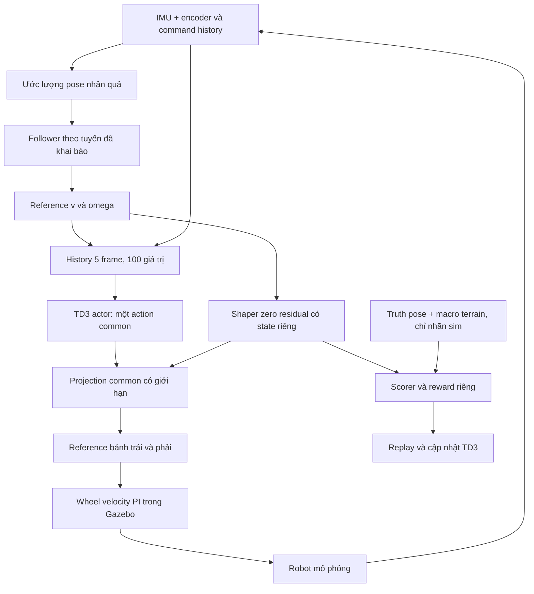

# Nino RL: bám đường, giữ tốc độ và thêm dốc vừa phải

> Cập nhật 16/11/2026. Bounded trainer đã được nối. Sau sửa clock/verifier, B0 sàn sạch/gờ thấp/dốc 3° đạt trong Gazebo; pothole timeout. TD3 Gazebo bị chặn ở bước đầu vì drive gap 52 ms, chưa có replay/optimizer update. Xem [readiness hiện tại](RECOVERY_SIM_READINESS_2026-11-16.md). Các câu “chưa nối/chưa chạy” bên dưới là trạng thái lịch sử ngày 15/11.

Ngày 15/11/2026. Review và sửa trên workspace Nino hiện tại. Các con số cấu hình dưới đây là đề xuất nghiên cứu trong mô phỏng. Chưa là yêu cầu nhà máy hoặc giới hạn robot thật.

## 1. Kết luận

Đề tài phù hợp với pipeline follower cổ điển + residual tốc độ. Tuy nhiên, trước lượt sửa này, task recovery chưa đo đủ mục tiêu giữ tốc độ, projection có lỗi tích lũy residual, và chưa có dốc. Không nên dùng số bước train Goal100 cũ để khẳng định đã giải quyết task mới.

Đã sửa contract thành `nino_recovery_history100_accepted_common_v3`, dùng [recovery_v3.yaml](../src/nino_rl/config/recovery_v3.yaml). Đã kiểm 288 test, smoke TD3 32 transition, và tạo bank 45 layout. Trong đó có 9 layout dốc qua ba split và ba stage. Chưa chạy lượt chuyển động Gazebo v3, chưa có kết quả leo dốc, chưa train dài, chưa điều khiển phần cứng.

Vòng train Gazebo nhiều episode, scheduler family/curriculum và engine GUI cho recovery v3 vẫn chưa được nối. Runner hiện chỉ có `prepare`, `software-smoke`, `baseline`. GUI Goal100 vẫn là task lịch sử. Chọn GUI đó không train task dốc mới.

## 2. Luồng điều khiển và phạm vi policy



Actor giữ 20 feature mỗi frame, 5 frame ở 10 Hz. Khoảng thời gian giữa frame đầu và cuối là 0,4 s. Input gồm reference, wheel feedback, gyro, accel có gravity, command trước, accepted residual trước và tuổi dữ liệu. Không có vị trí vật cản, family, truth pose, contact, macro grade hoặc phase scorer trong observation.

Action là một scalar chuẩn hóa trong [-1,1], đề nghị hiệu chỉnh common tối đa 0,02 m/s. Hai bánh nhận cùng delta sau projection. TD3 không điều khiển trực tiếp torque, current, PWM hoặc yaw. Follower giữ quyền điều chỉnh hướng, PI vận tốc biến reference bánh thành torque mô phỏng. Nếu thiếu torque, cơ khí bị kẹt hoặc cần yaw authority, tăng reward weight không tạo ra quyền điều khiển đó.

Governor không nằm trong pipeline recovery v3 này. Không bật thêm state machine rồi coi đó là hiệu quả TD3 nếu chưa có ablation và identity riêng.

## 3. Lỗi có bằng chứng và sửa ở đâu

| Vấn đề | Bằng chứng trước sửa | Thay đổi | Kiểm chứng |
| --- | --- | --- | --- |
| Residual tích lũy vào baseline | Giữ baseline +0,2 m/s, lặp scalar -1 có thể kéo accepted tới -0,4 m/s. Baseline dùng lại state đã chứa action trước. | `AcceptedCommonReference` có shaper baseline độc lập; delta common được giao với speed/slew từ accepted trước. | Test đỏ trước sửa. Sau sửa, với baseline cố định +0,2 và action -1, accepted hội tụ +0,18 m/s, không tích lũy. |
| Speed target thuộc actor | Recovery so body speed với accepted reference mà actor vừa thay đổi. | `MotionTarget` lấy từ shaper zero residual, không từ accepted action. | Cùng chuyển động vật lý, đổi accepted reference không đổi speed score. |
| Reward thiếu giữ tốc độ | Progress/time/tracking/action có reward nhưng không có target-speed cost. | Thêm `target_speed`, chuẩn hóa theo 0,05 m/s và tích phân theo thời gian nguồn. | Tracking đúng có cost 0; chậm 0,1 m/s trong 0,1 s có cost -0,04 với trọng số đề xuất. |
| Phạt pitch cần thiết để leo | Absolute pitch vừa vào stability cost vừa vào recovery band. | Tilt tương đối với chord macro terrain; vẫn giữ absolute tip/fall gate. | Fixture lên và xuống dốc đúng tư thế không có tilt error; thêm roll vẫn bị phạt. |
| Chưa có collision dốc | Bank chỉ có cáp cứng và hõm âm. | Một `ConnectedRamp`, sàn mesh liền, đủ đoạn lên/đỉnh/xuống và apron phẳng. | Đọc STL/SDF thật, ray giao tam giác, normals, joins và height. |
| Tam giác suy biến khi ghép lưới | Các tọa độ gần trùng nhau trở thành cùng float32 trong STL. | Gộp tọa độ theo độ chính xác serialization trước khi sinh tam giác. | Test dốc có pothole kiểm finite normals và diện tích dương. |
| `cruise_m_s` bị bỏ qua | Runtime recovery kế thừa cruise và follower speed, không đọc trường YAML này. | Nối giá trị vào cả backend và navigation follower. | Fixture đổi 0,2 thành 0,15 xác nhận cả hai nơi nhận đúng. |
| Đến đích chưa đủ quality | Arrival có thể đạt mà chưa chứng minh giữ tốc độ. | Success/curriculum phải đạt motion quality riêng, ngoài clearance/recovery/quiet stop. | Motion quality kém ở goal tạo `motion_quality_violation`; quiet stop không làm loãng moving-speed RMSE. |

Các source chính là `recovery_contract.py`, `recovery_motion.py`, `recovery_task.py`, `recovery_environment.py`, `recovery_terrain.py`, `recovery_bank.py`, `recovery_runner.py` và `recovery_curriculum.py` trong `src/nino_rl/nino_rl`.

Một thay đổi dấu baseline chủ động có thể giữ accepted theo chiều cũ trong thời gian ngắn để tuân slew. Trace có `direction_transition_due_to_slew`. Test kiểm hội tụ có giới hạn. Cam kết không tích lũy thành lùi áp dụng với baseline tiến cố định, không phải đổi chiều tức thời.

## 4. Nghĩa chính xác của speed stable

Target là reference được shape độc lập trên reference follower của trajectory hiện tại. Nó độc lập với phép cộng residual, nhưng không phải một trajectory phản thực độc lập, vì policy có thể làm thay đổi pose mà follower quan sát sau đó.

Speed dùng để chấm là sai phân pose nguồn theo cửa sổ quyết định, chiếu lên tiếp tuyến macro terrain có dấu. Đây là vận tốc trung bình theo cửa sổ khoảng 100 ms, không phải body velocity sensor độc lập hoặc đỉnh rung tần số cao. Di chuyển lùi không thể thỏa target tiến. Nhảy thẳng đứng trên sàn phẳng không được tính là tiến.

Trên dốc, reference tuyến tính là tốc độ dọc mặt lăn. Progress và cross-track vẫn ở mặt phẳng XY. Scorer đổi hệ tọa độ khi tính speed; không so trực tiếp tốc độ ngang với tốc độ dọc dốc. Chord macro qua envelope chỉ là tư thế nền để chấm reward. Nó không chứng minh các bánh đang chịu tải hoặc chassis không chạm đất. Hõm không được trừ đi như một tư thế lý tưởng.

Các metric cần giữ riêng:

- Tỷ lệ đến đích, vượt hết interval và hồi phục; failure/invalid/censored riêng.
- Moving target-speed RMSE, toàn phiên target-speed RMSE và thời gian đang có target.
- Cross-track/heading RMSE, max cross-track và lỗi sau clear.
- Recovery time/distance, thời gian hoàn thành, quiet stop liên tục.
- Requested action, proposed delta, accepted delta, clipping/slew và reference thực gửi.
- IMU/contact/raw coverage khi câu hỏi đòi hỏi. Tilt cost không phải rung hay tải gây hỏng hàng hóa.

Ngưỡng v3 đề xuất là speed RMSE tối đa 0,05 m/s trong motion, cross-track RMSE 0,04 m, heading RMSE 0,10 rad. Hard corridor là 0,20 m. Recovery yêu cầu giữ band 0,5 s, deadline 5 s. Đây là contract nghiên cứu có thể review; chưa chứng minh chúng đủ cho nhà máy.

## 5. Dốc và các loại địa hình

| Family | Nội dung hiện có | Stage | Giới hạn |
| --- | --- | --- | --- |
| clean | Sàn phẳng, perturbation pose ban đầu nhỏ | 0..2 | Chưa là đa dạng route hoặc tải. |
| short_obstacle | Capsule/cylinder cứng, đường kính khoảng 4..6 mm, góc thay đổi | Số item 1..3 | Không mô phỏng dây mềm/quấn bánh. |
| pothole | Hõm âm sâu 3..6 mm, bán kính 60..90 mm, lệch ngang | Số item 1..3 | Physics/contact chưa qualify. |
| mixed | Cáp cứng và hõm | 2..3 item | Chỉ mở baseline khi component evidence đạt dưới cùng source. |
| slope | Dốc liền, toàn bề ngang, không vật cản chồng lên blend | Độ dốc tối đa 3°/4°/5° | Chưa có kết quả chạy qua hoặc leo giữ vị trí. |

Dốc bắt đầu X=1,0 m. Đoạn lên và xuống dài 0,6 m mỗi đoạn, plateau dài 0,3 m, kết thúc X=2,5 m trên tuyến 4 m. Smooth blends chiếm 25% mỗi đầu của đoạn lên/xuống. Độ cao tương ứng khoảng 23,6/31,5/39,4 mm. Mesh spacing ở dốc là 5 mm. Cả sàn được thay, không giữ box/plane bên dưới. Cả ramp là một interval; tới plateau chưa được tính vượt xong.

Bank có development/validation/test tách seed, mỗi split một layout cho mỗi family/stage. 45 layout này là bank kiểm cơ chế nhỏ. Chưa là tập train đủ đa dạng. Tọa độ cáp hiện còn quanh các vị trí cố định với jitter nhỏ; vị trí dốc cũng cố định. Không được dùng bank này để tuyên bố tổng quát hóa vật cản chưa biết. Trước campaign phải có sampler train thay đổi vị trí có ràng buộc khoảng hồi phục, cùng bank held-out đóng băng. Không đưa sampler metadata vào actor.

Chưa có family cho mọi loại obstacle, rãnh dọc/ngang, dốc ngang hoặc rẽ trên dốc. Không hồi sinh rough course đã bỏ. Kết quả dốc vừa phải này không áp sang các regime đó.

Estimator wheel/gyro hiện vẫn là planar approximation. Với 5° và tổng chiều dài ngang 1,2 m ở hai đoạn nghiêng, phần sai khác arc so với ngang có bound hình học khoảng 4,6 mm. Đây không phải bound tổng sai số odometry, slip, bias hoặc goal. Không dùng ground-truth slope để sửa guidance. Độ dốc lớn hơn hoặc yêu cầu goal chặt hơn cần attitude estimate nhân quả hoặc reference độc lập.

## 6. Reward và tune có kiểm soát

`task_reward` và `recovery_reward` đều nằm rõ trong YAML v3 và được dùng khi tạo env. Reward gồm progress, cross-track, heading, time, accepted action/change, terminal outcome, bonus hồi phục trả một lần, stability theo nền và target speed.

TD3 giữ twin critics, delayed actor update và target smoothing. Tài liệu SB3 định nghĩa `learning_starts`, `policy_delay`, action noise và một `learning_rate` chung; không tự suy actor/critic có LR riêng trong builder hiện tại. Đây là cấu trúc thuật toán, không phải bằng chứng TD3 thắng trên Nino. [SB3 TD3](https://stable-baselines3.readthedocs.io/en/master/modules/td3.html), [Fujimoto et al., ICML 2018](https://proceedings.mlr.press/v80/fujimoto18a.html), tra cứu 15/11/2026.

| Thứ tự | Có thể chỉnh | Cách chỉnh và điều kiện dừng |
| --- | --- | --- |
| 1 | Physics, actuator lag, geometry, estimator/start | B0 phải có measurement hợp lệ và vượt component. Không dùng reward để chữa thiếu lực hoặc sai reset. |
| 2 | `cruise_m_s`, quality bands, horizon | Chốt một objective nghiên cứu trước kết quả. Không đổi gate để cứu candidate sau khi fail. |
| 3 | Reward scales/weights | Trên cùng corpus, in từng cost theo phase. Chỉ so speed_weight 0,05 với 0,1, hoặc stability_weight 0 với 0,01 trong một ablation riêng. Giữ các nhóm còn lại. Đây là proposal, chưa chạy. |
| 4 | Exploration | Xem histogram action requested/accepted và saturation. Sigma 0,1 ở scalar ±0,02 m/s chỉ tương đương khoảng 0,002 m/s trước projection. Nếu action gần như bị xóa, chưa có căn cứ tune LR. |
| 5 | TD3 learning rate | Khi pipeline và action coverage đạt, so chung actor/critic 1e-4 với 3e-4, cùng budget và learner seeds. Giữ gamma 0,99, tau 0,005, policy_delay 2 cho thí nghiệm đó. |
| 6 | History/action authority | H5 và bound ±0,02 đang được enforce bằng code. H1/H8 hoặc differential/torque action cần ABI mới, tests và qualification mới; không chỉ sửa YAML rồi resume. |

Research profile hiện là đề xuất batch 256, learning_starts 10.000 và mạng [256,256]. Common Studio có override replay xuống 100.000 so với 1.000.000 trong YAML gốc. Trainer recovery tương lai phải lưu effective profile thật, không dựa vào tên profile. Smoke hiện dùng mạng [32,32], batch 32, warmup 16, buffer 2048. Không dùng kết quả smoke để chọn bộ research hyperparameter.

Mỗi candidate phải tạo output mới, config/source identity mới. Không resume model/replay Goal100 hoặc recovery v2 như cùng task. Tách train/validation/test theo layout và whole run; không chia random frame history. So với B0 zero residual cùng backend, tuned classical, và đối chứng chậm/time-matched nếu policy giảm tốc. Chỉ chọn bằng arrival + tracking + speed + recovery + thời gian và coverage, không chọn reward cao nhất.

Nếu baseline đã thỏa task và TD3 không tạo lợi ích lặp lại trong ràng buộc đã chốt, giữ classical cho envelope đó. Không tăng authority, đổi reward, đổi history và tăng budget cùng lúc để tiếp tục tìm kết quả thuận lợi.

## 7. Việc tiếp theo và điểm dừng

1. Review offset khởi tạo từ dữ liệu readiness cũ trước khi chạy lại. Lượt 03 từng có endpoint bound khoảng 9,005 mm, vượt gate 8 mm sau một correction. Hai lượt cũ đóng. Không mở lại slot hoặc hạ gate để pass. Cần một protocol khởi tạo mới có căn cứ từ spawn/settling/estimator và goal budget trước lượt motion v3.
2. Khi readiness mới đạt, kiểm B0 trên clean và từng component nhỏ, gồm slope 3°. Chỉ xem 4°/5° sau khi mức trước qua. Measurement invalid dừng; failure vật lý giữ nguyên để chọn sửa cơ khí/backend hoặc thu hẹp envelope. Mixed phải có component evidence đúng nguồn. Chưa chạy các lượt này trong task hiện tại.
3. Sau qualification, nối episode driver thật với `sample_stage`/`record`, request budget, terminal-before-reset, raw QC, checkpoint/replay/curriculum identity. Sau đó smoke TD3 Gazebo ngắn, rồi mới đề xuất campaign nhiều seed. GUI phải đăng ký engine recovery v3 riêng và hiển thị qualification. Hiện phần nối này chưa tồn tại.

Ba mục trên là thứ tự phụ thuộc. Không chạy train dài hoặc yêu cầu thu thật để thay cho việc kiểm nhánh sim còn thiếu. Thay đổi dốc/physics/observation/reward là thí nghiệm riêng có identity mới.

## 8. Kết quả kiểm chứng trong lượt này

- 288/288 regression test đạt, gồm nhánh cũ chịu ảnh hưởng, projection, speed/grade, geometry, sensor/QC và deferred reset.
- Software TD3 smoke 32 bước, replay 32 hàng đối chiếu observation/action/next observation/reward/done, 16 critic update, 8 actor update. Actor parameter thay đổi và finite. Đây là fixture wheel integrator, không có contact physics.
- Tạo 45 world/layout, 9 world dốc. Hash, manifest, source pins, world và mesh được đọc kiểm lại bằng `require_bank`.
- Chưa có Gazebo moving rollout, chưa train dài, không hardware action.
- Reviewer ở context khác kiểm source/test; cùng họ model GPT khả dụng, không có đánh giá chéo họ model. Root tự kiểm lại thay đổi và xử lý finding đổi chiều/slew.

Artifact kiểm chứng ở `/home/tuanmac/Documents/Codex/2026-10-27/stm32-n-i-v-i-pi/artifacts/terrain_speed_slope_alignment_2026-11-15/`. Bank và smoke ở `/home/tuanmac/nino_research/recovery_v3_alignment_20261115_02/`. Đây là evidence mới; các report cũ giữ vai trò lịch sử.

## 9. Commands kiểm lại offline

Các lệnh dưới chạy với working directory `/home/tuanmac/ninorobot`.

```bash
rtk env PYTHONPATH=src/nino_rl:src/nino_control PYTHONDONTWRITEBYTECODE=1 .venv/bin/python -B -m pytest -q -p no:cacheprovider src/nino_rl/test/test_recovery_motion.py src/nino_rl/test/test_recovery_terrain.py src/nino_rl/test/test_recovery_v2.py
rtk env PYTHONPATH=src/nino_rl:src/nino_control PYTHONDONTWRITEBYTECODE=1 .venv/bin/python -B -m nino_rl.recovery_runner --help
```

Không dùng lại output root đã có để chạy bù. Các lệnh `prepare`/`software-smoke` cần root mới. `baseline` sẽ khởi chạy Gazebo và chỉ dùng sau protocol readiness mới. Hiện không có lệnh `train` cho recovery v3, vì vòng campaign chưa được nối.
