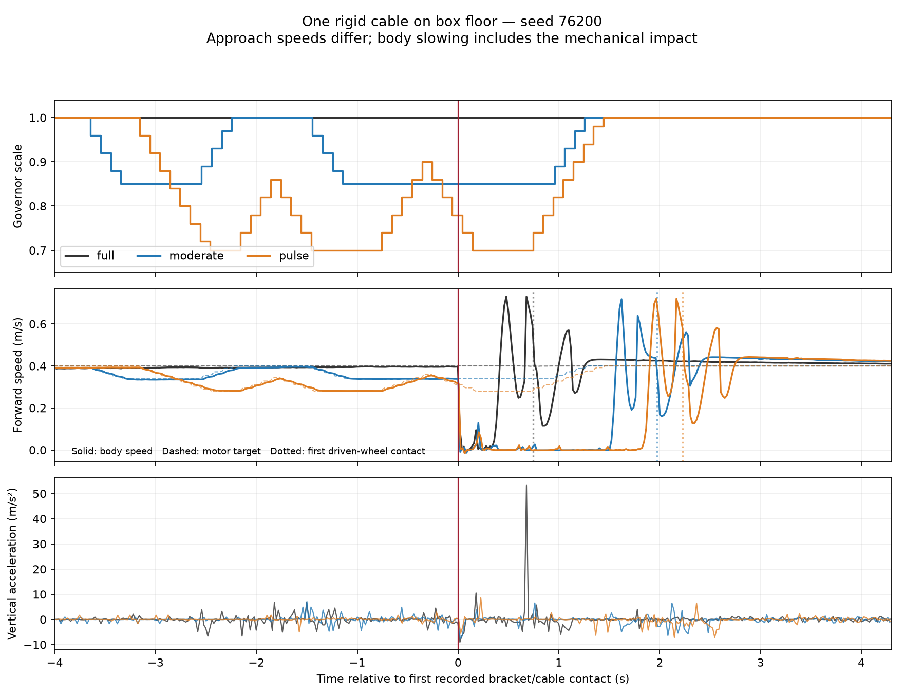

# Một cáp trên sàn hộp: so ba profile — 16/10/2026

## Kết luận

**Ba profile đều vượt cáp, đến đích vật lý và dừng ổn định. Hai profile giảm
tốc giảm rung nhưng tăng slip và mất thêm thời gian.** Chúng đã kích hoạt
trước khi gặp cáp, nên phép thử này chưa chứng minh lợi ích điều khiển sau
first contact hoặc khả năng dự đoán next contact.

Giữ kết quả để chẩn đoán detector và trade-off. Chưa bắt đầu predictor, PPO
hoặc Optuna; không tăng reward penalty từ những số này.

## 1. Thiết lập và những gì giữ cố định

- World mới: `factory_floor_cable_box_contact_lab.sdf`, một cylinder cứng
  C1 tại x=2.90 m, y=0; bán kính 0.011 m, chiều dài 4 m, góc 0°.
- Chỉ collision sàn đổi từ mesh sang hộp 10×7×0.1 m, mặt trên z=0. Cáp,
  visual, ma sát, walls và goal được giữ nguyên từ world một cáp cũ.
- Fixed E1, seed **76200**, mỗi profile một cold start. Không randomize
  geometry/dynamics và không restore cùng snapshot. Đây là screen nhỏ,
  chưa phải đánh giá repeatability hoặc generalization.
- Robot/caster damping 0.001, wheel PI, estimator và strict physical scoring
  giữ nguyên. Physics 1 ms, control interval 0.1 s, zero learned residual.
- Hash world, URDF và governor core giống nhau ở cả ba lượt. Resolved config
  giống nhau sau khi bỏ phần governor của từng profile.
- Governor chỉ dùng IMU/encoder/drive feedback và lịch sử lệnh. Contact,
  ground truth và tọa độ cáp chỉ dùng **phân tích offline**.

| Profile | Điều khiển tốc độ |
|---|---|
| Full | Scale 1.00; path follower vẫn giảm tốc ở đích như bình thường |
| Moderate | Trigger cảm biến, giảm về 0.85; hold/recover theo hysteresis hiện có |
| Pulse | Trigger cảm biến, giảm về 0.70, pulse tối thiểu 1 s rồi phục hồi |

Cả ba giữ ramp 0.4 scale/s, cùng detector và các giới hạn hiện có.

## 2. Kết quả toàn tuyến

Physical RMSE/arrival lấy từ ground truth độc lập. Slip là tỷ lệ trượt
longitudinal của dự án trong mô phỏng, chưa là phép đo slip thật đã hiệu chuẩn.

| Profile | Physical arrival | Thời gian (s) | Physical RMSE (cm) | Vertical RMS (m/s²) | Slip RMS | Dừng 2 s |
|---|---|---:|---:|---:|---:|---|
| Full | Có | 16.70 | 0.493 | 2.210 | 0.08578 | Đạt |
| Moderate | Có | 18.10 | 0.572 | 1.036 | 0.13839 | Đạt |
| Pulse | Có | 18.70 | 0.546 | 0.880 | 0.13285 | Đạt |

Sai số đích vật lý: **0.18324 / 0.18412 / 0.19209 m**, trong ngưỡng 0.20 m
giữ nguyên. Không có rollover, timeout hoặc measurement abort ở screen này.
Không được quy cải thiện này thành thành tích RL vì không có policy học nào
được train/chạy ở đây.

### Phân biệt một lỗi báo cáo với physical failure

Runner được khởi động bằng bản cũ còn dùng diagnostic **pitch/roll <5° trên
sàn sạch** cho cả lượt vượt cáp; vì thế raw `summary.json` có `passed=false`.
Native `episodes.csv` vẫn ghi physical success ở cả ba lượt. GT max pitch
lần lượt **12.97 / 10.18 / 12.55°**, chưa chạm rollover limit **35°** đã dùng.

Đã sửa phân loại của runner: low-tilt khi đang chạy chỉ áp dụng clear floor;
cable dùng native physical success và stop window. Diagnostic stop sau
arrival vẫn giữ ngưỡng 5°/0.01 m/s như trước. Không đổi native scoring,
rollover limit, reward, trajectory hoặc kết quả raw. Phân loại tách riêng ở
`motion_assessment.json`; có regression tests giữ physical failures/missing
stop data là không đạt.

## 3. Contact timing và điều kiện tiếp cận

Trong cả ba lượt, thứ tự **được ghi nhận** là:

**Bracket caster → bánh caster → bánh chủ động.**

Đây là thứ tự của mô hình hiện tại, chưa xác nhận clearance fork/cáp trên
robot thật. Cylinder cứng cũng không mô tả dây mềm hoặc entanglement.

| Profile | Vận tốc thân trước contact (m/s) | Trigger trước contact | First → bánh caster (s) | First → bánh chủ động (s) | Scale về 1 sau first (s) |
|---|---:|---:|---:|---:|---:|
| Full | 0.396 | 0 | 0.170 | 0.745 | Luôn 1 |
| Moderate | 0.339 | 2 | 0.204 | 1.973 | 1.256 |
| Pulse | 0.342 | 3 | 0.215 | 2.228 | 1.442 |

Hai profile giảm tốc **đã tiếp cận chậm hơn** và không có event mới sau first
contact trong lượt này. Chúng phục hồi scale 1 trước contact bánh chủ động;
không có căn cứ gọi đây là chuỗi phản ứng first-contact-to-next-contact được
điều khiển tốt.

Vận tốc thân giảm ≥10% khoảng 0.02 s sau first contact ở **cả Full**, dù Full
không giảm motor target. Đây là phản ứng cơ học khi va chạm, không là bằng
chứng motor đã thực thi một quyết định phanh. IMU/GT lấy mẫu khoảng 50 Hz;
không diễn giải các khoảng này thành latency actuator chính xác tới ms.

Với ramp hiện tại, 1.00→0.85 cần tối thiểu 0.375 s, 1.00→0.70 cần 0.75 s,
chưa tính sampling/response. Khoảng tới bánh caster 0.17 s của Full quá ngắn
để đạt các target đó; khoảng tới bánh chủ động dài hơn nhưng **chưa được
kiểm chứng bằng một can thiệp sau-contact có điều kiện tiếp cận bằng nhau**.



## 4. Chất lượng trong đoạn vượt cáp

Cửa sổ 2 s cố định sau first contact không bao phủ cùng phần chuỗi contact
ở các tốc độ khác nhau. Giữ kết quả 2 s gốc trong JSON, đồng thời bổ sung
phân tích khám phá theo cùng clearance: từ first+0.05 s đến khi GT body x
đạt **3.40 m = tâm cáp+0.50 m**. Quy tắc này chỉ là nhãn offline cho fixed
E1; không đưa tọa độ vào governor và không thay physical scoring.

| Profile | Thời lượng cửa sổ clearance (s) | Vertical RMS trong cửa sổ (m/s²) | Tích phân slip²/quãng đường (s/m) |
|---|---:|---:|---:|
| Full | 2.148 | 5.497 | 0.11782 |
| Moderate | 3.291 | 1.623 | 0.30204 |
| Pulse | 3.615 | 1.653 | 0.37202 |

Metric thường gọi "slip energy/m" ở đây là tích phân tỷ lệ trượt bình phương
theo thời gian chia quãng đường; **không phải năng lượng Joule**. Local
metric dùng joint/GT samples dày hơn whole-episode metric; không so trực tiếp
giá trị RMS của hai cách lấy mẫu như thể cùng một thống kê.
Quãng đường trong ba cửa sổ khoảng 0.758–0.768 m.

Moderate/Pulse có metric slip này cao hơn Full khoảng **2.56× / 3.16×**.
Đồ thị cho thấy thân robot gần đứng lại lâu hơn sau va chạm dù motor target
vẫn tiến. Đây là trade-off bất lợi cần giữ trong báo cáo, không chỉ báo giảm
rung. Chưa có time-matched PI, repeated trials hoặc khoảng tin cậy.

## 5. Detector đang kích hoạt vì gì?

Tất cả năm event của Moderate/Pulse xảy ra **trước contact cáp được ghi đầu
tiên**. Ở từng event, nhánh IMU đứng đã đủ vượt ngưỡng: filtered vertical
khoảng 1.55–4.93 m/s² so với threshold 1.5; wheel tracking error chỉ khoảng
0.004–0.009 m/s, thấp hơn threshold đang dùng.

Phần lớn các event nhỏ có interval RMS khoảng 0.78–1.05 m/s² nhưng peak
khoảng 1.67–1.81 m/s². Một event Moderate có RMS≈4.50 và peak≈7.09 m/s² trên
sàn trước cáp; chỉ đổi sang RMS chưa tự chứng minh sẽ loại được mọi event.
Đây là chẩn đoán từ trace, không phải một detector correction đã được thử.

## 6. Bước tiếp theo được hỗ trợ bởi dữ liệu

**Trước khi chọn reward/hyperparameter, cần có phép so can thiệp sau-contact
với điều kiện tiếp cận bằng nhau.** Một screen oracle riêng có thể giữ cùng
approach đến first contact đã ghi rồi mới chạy ba speed profiles, nhằm kiểm
tra H2. Oracle chỉ dùng cho thí nghiệm mô phỏng, không được gọi là governor
triển khai được hoặc cấp contact ground truth cho policy thật.

Song song với phân tích đã lưu, detector cần được kiểm tra trên negative
controls của sàn hộp: phân biệt peak IMU nền/chuyển động do lệnh với contact
cáp. Không chỉ tăng threshold vì nhìn thấy các event này. Chỉ chạy controller
candidate mới sau khi chọn một correction có bằng chứng và contract riêng.

Screen oracle hoặc detector candidate **chưa được chạy trong lượt này**.
Map mixed/pothole/groove vẫn giữ nguyên. Cả ba phiên thí nghiệm đã đóng.

## 7. File và tái chạy

- World: `src/nino_description/worlds/factory_floor_cable_box_contact_lab.sdf`.
- Config gốc: `src/nino_rl/config/factory_floor_single_cable_box_pi_check.yaml`.
- Raw: `rl_runs/governor_single_cable_box_2026-10-16/`.
- Audit/CSV/figure nhỏ: `docs/governor_single_cable_box_2026-10-16/`.
- Phân tích: `src/nino_rl/scripts/audit_single_cable_screen.py`.
- Tests liên quan: **23 passed**; build `nino_description`/`nino_rl` đạt.
- Các logger đã đóng đủ dữ liệu. Lỗi segfault khi shutdown Contact system
  vẫn được giữ trong log; không tính nó thành failure khi vượt cáp.

Trong terminal đã source ROS/workspace/venv, với ROS domain/partition riêng:

```bash
python src/nino_rl/scripts/run_clear_floor_repeat.py \
  --variant cable_box --seeds 76200 --profiles full moderate pulse \
  --output rl_runs/single_cable_box_recheck

python src/nino_rl/scripts/audit_single_cable_screen.py \
  --screen rl_runs/single_cable_box_recheck \
  --output rl_runs/single_cable_box_recheck/contact_analysis.json \
  --plot rl_runs/single_cable_box_recheck/timing_comparison.png
```
