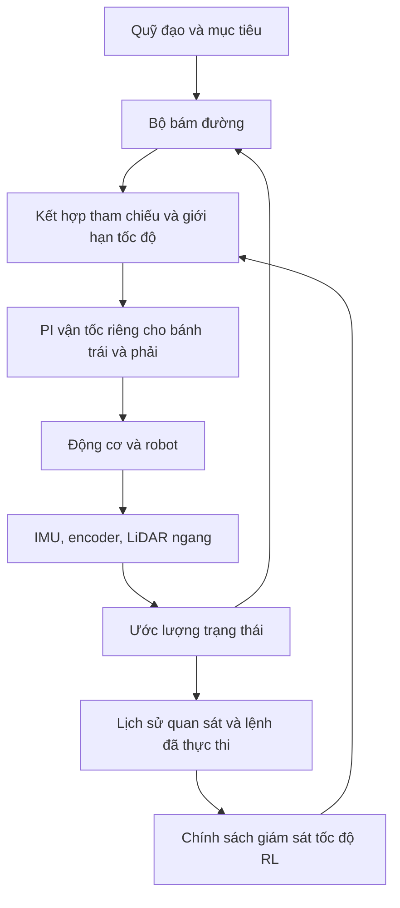

# TỔNG QUAN DỰ ÁN RL NINO

> **Cập nhật phạm vi ngày 13/10/2026:** dự án đã chuyển trọng tâm sang điều khiển
> tốc độ phản ứng bằng IMU/encoder khi vượt vật cản thấp trên sàn phẳng. Rough và
> combined-policy switching được tạm gác; dữ liệu cũ được giữ nguyên. Báo cáo dưới
> đây là ảnh chụp trạng thái ngày 12/10, không phải kế hoạch huấn luyện mới.
> Xem [hướng nghiên cứu hiện tại](FLAT_PROPRIOCEPTIVE_RESEARCH_2026-10-13.md).

## Nghiên cứu điều khiển thích nghi tốc độ cho robot di động qua địa hình gồ ghề và cáp trên sàn

**Ngày biên soạn:** 12/10/2026.  
**Phạm vi:** mô tả dự án, mục tiêu, kiến trúc, thuật toán, phương pháp đánh giá, kết quả đã lưu và hướng triển khai trên robot thật. Báo cáo không chạy thêm mô phỏng hoặc huấn luyện. Số liệu hiện trạng lấy từ các thử nghiệm hoàn thành ngày 12/10/2026; kết luận chỉ áp dụng trong điều kiện đã thử.

## 1. Tóm tắt dự án

Dự án RL Nino nghiên cứu cách một robot di động có thể **bám quỹ đạo, đi đến đích và tự điều chỉnh tốc độ khi mặt đất gây rung, nghiêng hoặc trượt bánh**. Robot được mô phỏng bằng Gazebo, kết nối qua ROS 2 và huấn luyện bằng học tăng cường, với thuật toán PPO.

Hướng hiện tại kết hợp hai tầng điều khiển:

- Bộ bám đường và PI vận tốc điều khiển chuyển động cơ bản, đồng thời điều khiển riêng từng động cơ bánh trái và bánh phải.
- Chính sách học được điều chỉnh tốc độ theo trạng thái robot, nhằm giảm tác động của địa hình rồi phục hồi tốc độ khi điều kiện cho phép.

Hai môi trường nghiên cứu chính là **rough course**, gồm các hõm và gò liên tiếp, và **flat cable course**, gồm sàn phẳng có cáp robot phải vượt qua. Chúng được tách để xác định rõ khả năng, lỗi và lợi ích của từng cơ chế trước khi thử trên bản đồ kết hợp.

**Kết luận hiện tại:** dự án đã xây dựng được nền tảng mô phỏng, điều khiển, ghi dữ liệu và đánh giá có thể kiểm tra. PPO rough mới đã biểu hiện giảm tốc rồi phục hồi trên bộ thử nhỏ. Tuy nhiên, chưa có chính sách hiện tại vượt đầy đủ tiêu chuẩn so sánh đã đặt ra; hiệu quả trên robot thật chưa được chứng minh.

## 2. Bài toán và lý do thực hiện

Một robot có thể theo đường tốt trên sàn phẳng nhưng gặp khó khăn khi một bánh rơi vào hõm, caster chạm cáp hoặc thân xe bị nghiêng. Khi đó:

- Vận tốc bánh và vận tốc thân xe có thể khác nhau do trượt.
- Encoder có thể tích lũy quãng đường sai khi bánh quay nhưng thân xe ít dịch chuyển.
- Gia tốc đứng và vận tốc góc tăng, gây rung và biến động tiếp xúc.
- Phanh hoặc tăng tốc không phù hợp có thể làm chất lượng chuyển động xấu hơn.
- Giảm tốc suốt hành trình có thể làm robot êm hơn nhưng tăng thời gian hoàn thành.

Dự án đặt câu hỏi: **có thể học cách giảm tốc đúng lúc, đủ mức và đủ lâu, rồi phục hồi hợp lý để cải thiện chất lượng chuyển động mà vẫn giữ khả năng đến đích và bám đường hay không?**

Đây là bài toán điều khiển thích nghi chuyển động. Mục tiêu nghiên cứu hiện tại không bao gồm tự hiểu mọi loại địa hình hoặc tự tìm đường trong mọi môi trường chưa biết.

## 3. Mục tiêu

### 3.1. Mục tiêu tổng thể

Phát triển và kiểm chứng một bộ giám sát tốc độ dựa trên học máy, kết hợp với điều khiển động cơ cổ điển, cho robot di động đi qua địa hình có nhiễu.

### 3.2. Mục tiêu cụ thể

1. **Đến đích thật:** vị trí vật lý phải đáp ứng điều kiện đến đích; không dựa riêng vào odometry ước lượng.
2. **Bám quỹ đạo:** giữ sai số đường đi, hướng và các đoạn rẽ trong giới hạn của từng bài thử.
3. **Thích nghi theo trạng thái:** nhận biết biến động từ IMU, encoder và lịch sử lệnh để điều chỉnh tốc độ.
4. **Giảm rung và trượt:** đo được lợi ích toàn hành trình và ở vùng nhiễu.
5. **Giữ hiệu suất:** phục hồi tốc độ sau nhiễu, tránh đổi chất lượng chuyển động lấy thời gian quá lớn.
6. **Tổng quát hóa:** kiểm tra trên seed, tuyến, địa hình và điều kiện vật lý chưa dùng để huấn luyện.
7. **Hướng tới robot thật:** dùng giao diện và thông tin có thể đo được trên phần cứng.

Các mục tiêu 6–7 là hướng phát triển cần kiểm chứng thêm. Thành công trên một tuyến mô phỏng chưa đủ để kết luận đã đạt chúng.

## 4. Robot và nền tảng phần mềm

### 4.1. Robot Nino

Nino là robot truyền động vi sai, gồm hai bánh chủ động và hai caster thụ động. Hai bánh chủ động có thể được điều khiển độc lập để tạo chuyển động tiến và quay. Đây là robot có caster đỡ thân, không phải robot hai bánh tự cân bằng.

Phần cứng được người dùng xác nhận có:

| Thành phần | Vai trò |
|---|---|
| IMU | Đo gia tốc và vận tốc góc, cung cấp thông tin về rung và chuyển động thân xe |
| Encoder bánh chủ động | Đo chuyển động bánh và phản hồi cho PI vận tốc |
| LiDAR ngang 2D | Đo môi trường ngang; hỗ trợ kiểm tra vật cản và định vị khi điều kiện phù hợp |
| Hai động cơ bánh chủ động | Tạo lực kéo và điều khiển hướng |
| Hai caster | Đỡ robot; trạng thái tiếp xúc và lực cản ảnh hưởng đến vượt cáp |

Robot thật **không có cảm biến nhìn xuống địa hình**. Vì vậy, các đầu vào preview địa hình của những thử nghiệm cũ không thể mặc định đưa vào triển khai thật. LiDAR ngang không cung cấp phép đo ổ gà/cáp phía trước đáng tin cậy cho mục đích này.

### 4.2. Thành phần phần mềm

| Thành phần | Chức năng trong dự án |
|---|---|
| ROS 2 Jazzy | Kết nối cảm biến, điều khiển, định vị và môi trường huấn luyện |
| Gazebo Harmonic | Mô phỏng chuyển động, địa hình, tiếp xúc và cảm biến |
| `nino_description` | Mô hình robot, world và tài nguyên mô phỏng |
| `nino_control` | Điều khiển vận tốc bánh bằng PI và gửi lệnh mô-men có giới hạn |
| `nino_rl` | Môi trường RL, huấn luyện, đánh giá và các công cụ chẩn đoán |
| Stable-Baselines3/PyTorch | Thực hiện PPO và mô hình mạng nơ-ron |
| Optuna | Tìm kiếm tham số theo một mục tiêu đánh giá cố định |
| TensorBoard/Laya | Theo dõi dữ liệu, thống kê và hỗ trợ xác định vấn đề |

Việc tương thích giao diện với Nav2 không có nghĩa mọi bài thử hiện tại đều sử dụng Nav2. Các pilot được mô tả ở đây dùng bộ tham chiếu/bám tuyến và wheel PI theo contract riêng.

## 5. Kiến trúc điều khiển

Sơ đồ thể hiện hướng điều khiển hiện tại, đặc biệt ở rough. Quyền điều khiển đã thay đổi qua các phiên bản; checkpoint cũ thêm mô-men không có cùng ý nghĩa hành động với policy tốc độ mới.

### 5.1. Vai trò của PI và RL

PI xử lý sai lệch giữa vận tốc bánh mong muốn và vận tốc encoder đo được. Bộ bám đường tính tham chiếu chuyển động dựa trên quỹ đạo và vị trí ước lượng. RL học điều chỉnh tham chiếu tốc độ theo trạng thái.

Trong rough hiện tại, PPO không tự xuất hai mô-men bánh độc lập. Nó điều chỉnh hệ số tốc độ; bộ bám đường giữ quyền điều khiển hướng và hai vòng PI vẫn điều khiển riêng hai bánh.

Các phép thử thực tế đang so sánh **PI và bộ bám đường** với **PI và bộ bám đường có thêm cơ chế điều chỉnh tốc độ**. Tên PI là chính xác vì bộ điều khiển vận tốc đang dùng thành phần P và I, chưa phải phép so sánh với PID đầy đủ có thành phần D.

### 5.2. Định vị và đánh giá độc lập

Profile rough dùng IMU, encoder và LiDAR ngang với hình học tường đã biết để hỗ trợ odometry. Đây là một giả thiết môi trường cần xét khi chuyển sang nơi khác.

Vị trí vật lý Gazebo được dùng để đánh giá đến đích và bám đường độc lập với định vị. Một số reward cũng dùng thông tin vật lý trong huấn luyện. Trong pilot rough hardware-only, ground truth không được đưa vào actor hoặc bộ định vị như một cảm biến đặc quyền.

## 6. Hai course nghiên cứu

| Đặc điểm | Rough course | Flat cable course |
|---|---|---|
| Địa hình | Hõm, gò và biến đổi cao độ liên tiếp | Sàn phẳng có cáp |
| Tuyến đang tập trung | E1, từ `(0, 0)` đến `(10.5, 0)` | Từ `(0, 0)` đến `(6.45, 0)` |
| Điều kiện hiện tại | Map cố định, profile `half_relief` | Stage hai cáp, tâm khoảng 2.45 m và 4.45 m |
| Hành vi cần học | Giảm tốc theo nhiễu, giữ phù hợp, phục hồi khi yên | Điều chỉnh ngắn quanh vượt cáp, phục hồi mà không tạo tác động xấu |
| Vấn đề chính hiện tại | Độ sâu/thời gian phanh và slip so với reactive PI | Tiếp xúc caster/cáp và tính lặp lại của lợi ích vượt cáp |

### 6.1. Rough: học chuỗi phản ứng

Policy rough hiện tại nhận 5 frame lịch sử, mỗi frame 72 giá trị, tổng cộng 360 đầu vào. Quan sát gồm thông tin cảm biến, thống kê IMU theo khoảng thời gian, trạng thái nhiễu và lệnh đã thực thi.

Ba hành động rời rạc là:

- **BRAKE:** giảm hệ số tốc độ.
- **HOLD:** giữ hệ số đang thực thi.
- **RECOVER:** tăng hệ số về tốc độ bình thường.

Hệ số nằm trong 0.55–1.00, tốc độ thay đổi tối đa 0.4 đơn vị/giây. Với chu kỳ điều khiển 0.1 giây, một bước BRAKE/RECOVER thay đổi hệ số 0.04 khi chưa chạm giới hạn. Vì vậy, chất lượng phụ thuộc vào cả chuỗi hành động, không chỉ một quyết định đơn lẻ.

Hướng mở rộng là bổ sung tuyến rẽ N1/S1 với replay E1, sau khi PI trên các tuyến đó được xác nhận phù hợp với profile sử dụng. Các curriculum cũ có nhiều tuyến và bank terrain là tài nguyên phát triển; chúng không chứng minh policy hiện tại đã học xong mọi tuyến.

### 6.2. Flat: xác nhận lợi ích vượt cáp

Các phiên bản flat đã thử torque residual, tốc độ/yaw và scale-only. Hiện trọng tâm là xác nhận một hành vi phanh/phục hồi có lợi và mô hình tiếp xúc đủ ổn định trước pilot mới.

Lịch tham chiếu đang dùng bắt đầu phanh tại vị trí ước lượng x=3.90 m, hướng tới hệ số 0.70 và bắt đầu phục hồi tại x=4.60 m. Lịch này biết vị trí cáp theo course. Khi triển khai, khả năng dự đoán trước phải dựa trên bản đồ đã biết hoặc cảm biến bổ sung; IMU/encoder chỉ hỗ trợ phản ứng sau khi nhiễu xuất hiện.

## 7. Thuật toán học và công cụ tối ưu

### 7.1. PPO

PPO thu thập các bước tương tác gồm quan sát, hành động, reward và trạng thái kết thúc. Actor học lựa chọn hành động; critic học dự đoán giá trị kỳ vọng để hỗ trợ cập nhật actor. Việc giới hạn cập nhật giúp kiểm soát thay đổi policy, nhưng không bảo đảm tự tìm được hành vi tốt trong mọi setup.

Reward kết hợp mục tiêu đến đích/tiến triển, thời gian, bám đường và chất lượng chuyển động. Hệ số khác nhau giữa các contract, nên raw return của hai contract khác nhau không phải thước đo so sánh trực tiếp.

### 7.2. Behavior cloning và neo hành vi

Rough đã sử dụng behavior cloning: học có giám sát từ quan sát/hành động của bộ reactive controller đã thử. Actor này sau đó khởi tạo PPO, với critic và optimizer mới. Một loss phụ giúp giữ hành vi ở pha holding/recovery; gradient được kiểm soát để không lấn át cập nhật actor PPO.

Kết quả audit cho thấy policy có thể thay đổi trên những lịch sử mà chính nó tạo ra, dù giữ được hành vi trên dữ liệu mẫu ban đầu. Correction được chọn tiếp theo là trộn dữ liệu demonstration cố định với lịch sử **training rollout** có nhãn từ teacher nhân quả. Đây là đề xuất chưa chạy pilot; các seed đánh giá đã dùng để chẩn đoán không được đưa vào huấn luyện.

### 7.3. Optuna, TensorBoard và Laya

Optuna có thể tìm learning rate, entropy, thông số cập nhật PPO và một số reward weight. Điều kiện là giao diện hành động, môi trường, budget, cách khởi tạo và mục tiêu đánh giá phải nhất quán giữa trial. Optuna hiện được giữ lại vì rough chưa đạt quality gate và flat chưa có crossing benefit đủ lặp lại.

TensorBoard hiển thị metric đã ghi. Laya hỗ trợ theo dõi và gợi ý vấn đề từ dữ liệu; trong workflow hiện tại nó không tự điều khiển động cơ, sửa reward hoặc đổi stage.

## 8. Phương pháp đánh giá

Một ứng viên phải được kiểm tra bằng các chỉ số có ý nghĩa vật lý:

| Chỉ số | Ý nghĩa |
|---|---|
| Physical arrival | Thân robot thật sự vào vùng đích và đáp ứng điều kiện bài thử |
| Physical path RMSE | Sai lệch đường đi so với quỹ đạo tham chiếu |
| Thời gian hoàn thành | Chi phí thời gian của giảm tốc và phục hồi |
| Gia tốc đứng RMS/peak | Chỉ báo rung và tác động lên thân xe |
| Wheel-slip metric | Chỉ số trượt của dự án; chưa phải phép đo trượt đã hiệu chuẩn trên robot thật |
| Chất lượng trong cửa sổ nhiễu | Kiểm tra đúng vùng cần thích nghi, ngoài trung bình toàn hành trình |
| Phản hồi motor và contact | Xác định lệnh đã thực thi, độ trễ và vấn đề tiếp xúc |

Đối chứng gồm PI toàn tốc, PI khớp thời gian và reactive PI khi phù hợp. PI khớp thời gian giúp kiểm tra lợi ích ngoài tác động của việc đi chậm. Reactive PI đặt chuẩn cho một cơ chế thích nghi đơn giản đã có ích.

Failed arrival vẫn được giữ trong kết quả. Dữ liệu crossing thiếu phải ghi không khả dụng, không mặc định bằng 0. Cùng seed giúp chuẩn hóa scenario nhưng không làm tiếp xúc mô phỏng hoàn toàn tất định.

Ở flat, tiêu chuẩn đánh giá rộng đã đặt là 24/24 physical arrivals, thời gian trung bình ≤18.5 giây, physical RMSE ≤1.05 lần matching PI, và ít nhất 10% cải thiện rung hoặc slip mà không làm metric còn lại xấu hơn. Những screen ít episode chỉ giúp chọn correction, chưa thay thế phép xác nhận rộng.

## 9. Kết quả và mức độ đạt mục tiêu hiện tại

### 9.1. Rough: pilot revision 57

Pilot 20,480 bước và các batch đánh giá đã hoàn thành. Bốn controller dùng fixed E1 và seed 17400–17404.

| Controller | Đến đích | Thời gian (s) | Physical RMSE (cm) | Rung RMS (m/s²) | Slip RMS |
|---|---:|---:|---:|---:|---:|
| PPO có BC anchor | 5/5 | 28.44 | 1.616 | 1.279 | 0.01770 |
| PI toàn tốc | 5/5 | 26.98 | 1.671 | 1.298 | 0.01656 |
| PI khớp thời gian | 5/5 | 28.40 | 1.634 | 1.275 | 0.01898 |
| Reactive PI | 5/5 | 28.78 | 1.703 | 1.262 | 0.01629 |

PPO đạt gate đến đích/bám đường và thể hiện giảm tốc rồi phục hồi ở cả năm episode. So với PI khớp thời gian, slip RMS toàn hành trình giảm khoảng 6.7%, slip energy/metre trong cửa sổ nhiễu giảm 22.7%.

Tuy nhiên, so với reactive PI, slip energy/metre trong cửa sổ nhiễu **tăng 16.3%**, vượt giới hạn suy giảm 10%. Vì vậy pilot chưa đủ điều kiện nâng cấp. Năm seed là dữ liệu pilot, chưa chứng minh tính lặp lại qua nhiều seed huấn luyện hoặc tổng quát hóa.

Audit seed 17400, 17401 và 17404 tìm thấy 40 quyết định HOLD sớm trong 184 frame holding; phanh thường kết thúc ở hệ số 0.76–0.80 thay vì mức gần 0.72 của categorical teacher. Tuy nhiên, cũng có vùng excess slip khi cả PPO và PI đều chạy hệ số 1.0. Lỗi chuỗi hành động không giải thích toàn bộ chênh lệch tiếp xúc/trượt.

### 9.2. Flat: screen lặp có reset độc lập

Bốn lần cold start seed 65004, bước vật lý 1 ms, gồm PI toàn tốc và lịch phục hồi tại 4.60 m, mỗi phương án lặp hai lần. Tất cả đến đích vật lý, nhưng lịch giảm tốc chưa vượt quality gate tại crossing trong cả hai lần lặp.

Audit phát hiện caster quay trên sàn sạch chỉ khoảng 49–57% vận tốc lăn tham chiếu. Candidate giảm damping trục quay bánh caster từ 0.01 xuống 0.001 N·m·s/rad đã được chuẩn bị riêng, giữ swivel damping và các thành phần khác. Candidate chưa chạy mô phỏng và chưa được xác nhận; mô hình robot chính chưa bị thay đổi bởi candidate này.

### 9.3. Những tiến bộ có thể kết luận

- Đánh giá đã phân biệt pose ước lượng với arrival vật lý.
- Timing, phản hồi lệnh, sensor history và contact trace được kiểm tra rõ hơn.
- Rough đã chuyển sang đầu vào phù hợp bộ cảm biến thật và học được chuỗi slowdown/recovery trong pilot nhỏ.
- Các nguyên nhân do estimator, controller, vật lý và học máy được tách để chọn correction có căn cứ.

**Chưa thể kết luận:** PPO hiện tốt hơn PI về toàn bộ yêu cầu, map mới bất kỳ sẽ đạt cùng hiệu quả, hoặc checkpoint đã sẵn sàng đưa xuống robot thật. Tiến bộ của estimator/PI/mô phỏng cũng không được tính toàn bộ thành tiến bộ của RL.

## 10. Hướng ứng dụng và sim-to-real

Ứng dụng dự kiến là robot trong nhà hoặc hành lang có bề mặt không đều, ngưỡng thấp và cáp, nơi cần giữ quỹ đạo đồng thời kiểm soát rung và trượt. Với nhiệm vụ vận chuyển, chuyển động êm hơn có thể hữu ích cho hàng hóa/cảm biến; dự án chưa đo độ an toàn hàng hóa, năng lượng hoặc độ bền thiết bị nên chưa có kết luận ở các mặt đó.

Lộ trình chuyển sang robot thật:

1. Hoàn thiện driver động cơ và topic cảm biến; xác nhận PI bám vận tốc trên phần cứng.
2. Đo đáp ứng động cơ, độ trễ, caster, khối lượng và giới hạn vận hành để hiệu chỉnh mô phỏng.
3. Huấn luyện/kiểm tra trong các biến thiên vật lý và nhiễu cảm biến thực tế, với tập kiểm tra tách biệt.
4. Chuẩn bị inference node tái tạo đúng observation history, normalization, action mapping và speed ramp bằng thời gian thật.
5. Thử từ sàn sạch đến nhiễu nhỏ, với lệnh có giới hạn và phương án dừng; so sánh với PI bằng đo đạc độc lập.

Định vị rough hiện có giả thiết tường hình chữ nhật đã biết. Sang môi trường khác cần bộ định vị phù hợp, không thể mặc định giữ nguyên độ chính xác. Guide Raspberry Pi cũ mô tả policy cần preview nhìn xuống; cần cập nhật trước khi dùng cho supervisor hardware-only mới.

## 11. Bản đồ kết hợp và kế hoạch phát triển

Sau khi từng kỹ năng được xác nhận, có thể thử rough và flat trong một world, với bộ giám sát chọn policy theo khu vực hoặc trạng thái được khai báo. Hai checkpoint không tự ghép bằng cách cộng/trộn trọng số. Cần kiểm tra tính tương thích của observation/action và sự liên tục của lệnh tại vùng chuyển tiếp.

| Thứ tự | Công việc | Điều kiện để đi tiếp |
|---|---|---|
| 1 — Rough | Thử correction sampling BC có căn cứ từ trace | Chuỗi phanh/giữ/phục hồi đúng hơn, giữ arrival và quality gate |
| 1 — Flat | Kiểm tra candidate damping bằng screen đối chứng cố định | Tiếp xúc/rolling hợp lý hơn và lợi ích crossing lặp lại |
| 2 | Pilot ngắn có một thay đổi rõ ràng | Học được hành vi mong muốn, không chỉ tăng return |
| 3 | Focused Optuna với objective cố định | Setup đủ ổn định để khác biệt giữa trial có ý nghĩa |
| 4 | Xác nhận best candidate | Seed huấn luyện độc lập, scenario và profile chưa gặp |
| 5 | Curriculum/combined course | Các tuyến và vùng chuyển tiếp vẫn đạt physical gates |
| 6 | Robot thật | Driver, đo đạc, inference và thử nghiệm thực tế được xác nhận |

Checkpoint và dữ liệu cũ được giữ để đối chiếu. Khi đổi contract, việc tiếp tục optimizer cũ có thể không phù hợp; phải chọn khởi tạo actor tương thích hoặc khởi tạo mới, với critic/optimizer mới khi cần.

## 12. Kết luận

**RL Nino là dự án nghiên cứu điều khiển thích nghi tốc độ cho robot truyền động vi sai, kết hợp phản hồi cảm biến, PI động cơ và học tăng cường.** Giá trị cần chứng minh là điều chỉnh chuyển động đúng lúc để giảm rung/trượt, đồng thời giữ đến đích, bám đường và thời gian hoàn thành.

Dự án đã vượt qua giai đoạn chỉ ghi tỷ lệ thành công để xây dựng một quy trình đo và chẩn đoán rõ hơn. Rough có tín hiệu học hành vi thực sự nhưng vẫn kém reactive PI ở một tiêu chí slip; flat còn cần ổn định cơ chế vượt cáp. Đây là các kết quả nghiên cứu cần báo cáo trung thực, đồng thời xác định cụ thể công việc còn lại trước Optuna, curriculum và triển khai thật.

## Tài liệu và dữ liệu nguồn trong dự án

- [Kết quả rough revision 57 và trạng thái flat](ROUGH_PHASE_ANCHOR_RESULT_2026-10-12.md).
- [Audit chuỗi hành động rough và correction được chọn](rough_phase_anchor_sequence_audit_2026-10-12/REPORT.md).
- [Audit contact/impact và caster flat](flat_peak_contacts_2026-10-12/REPORT.md).
- [Tiêu chuẩn flat và thử lặp seed huấn luyện](FLAT_SEED_REPEAT_2026-10-10.md).
- [Hướng thiết kế sim-to-real](RL_SIM_TO_REAL_REDESIGN_2026-10-10.md).
- [Báo cáo tiến độ ngày 11/10/2026](BAO_CAO_TIEN_DO_RL_NINO_2026-10-11.md).
- [Giao diện mô phỏng/phần cứng](HARDWARE_REFERENCE.md).
- [Guide Raspberry Pi cho policy cũ](RASPBERRY_PI_DEPLOYMENT.md).
- Rough: `rl_runs/rough_phase_anchor_pilot_v2/comparison.json`.
- Flat: `rl_runs/flat_corrected_repeat_v1/analysis.json` và `contract.json`.
- Candidate flat: `rl_runs/flat_caster_damping_candidate_v1/candidate.json`.

**Chú thích:** actor là mạng lựa chọn hành động; critic là mạng dự đoán giá trị; seed là hạt giống sinh ngẫu nhiên; pilot là thử nghiệm huấn luyện nhỏ; contract là bộ điều kiện cố định của thử nghiệm; BC là behavior cloning, học có giám sát từ hành vi mẫu.
