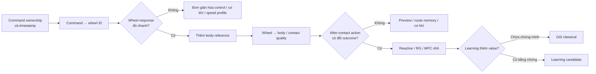
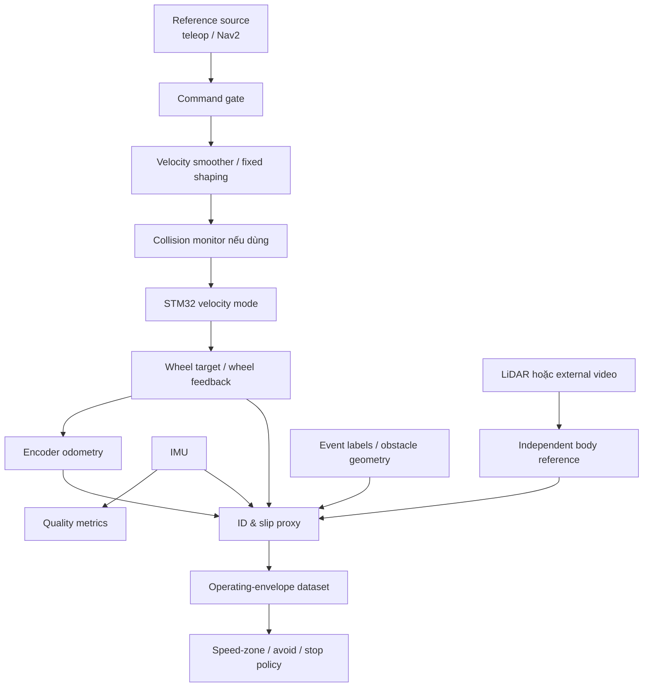
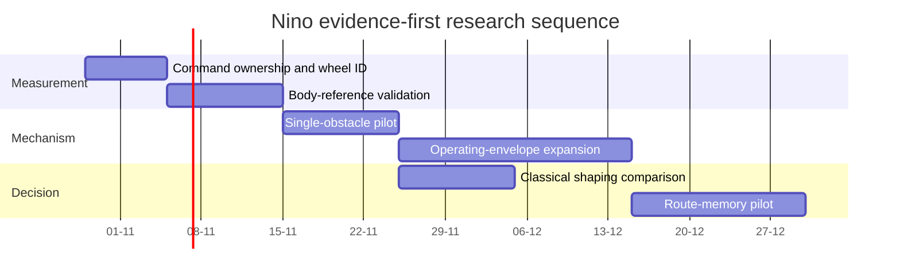

# Báo cáo phản biện độc lập và kế hoạch nghiên cứu cho dự án Nino

## Tóm tắt điều hành

Tài liệu đính kèm cho thấy Nino không còn ở giai đoạn “ý tưởng”, nhưng cũng chưa ở giai đoạn có thể kết luận về controller thích nghi hay sim-to-real. Hệ thống đã có một nền tảng tương đối tốt cho **đo lường có provenance**: robot vi sai thật, Raspberry Pi 5 chạy ROS 2 Jazzy, STM32/micro-ROS, IMU, encoder, LiDAR, raw recorder, kiểm hash/integrity, mô phỏng Gazebo Harmonic, controller cổ điển, governor và workflow RL. Đồng thời, một số audit đã đủ để đóng: inventory sensor, đối chiếu raw/bridge, dấu gyro Z, trục IMU thô, TF IMU +90°, và phần lớn kiểm tra integrity của pipeline mô phỏng cũ. Những kết quả này không nên bị mở lại trừ khi một phép thử mới phụ thuộc trực tiếp vào chúng. fileciteturn0file0

**[N] Bằng chứng Nino:** vấn đề khoa học lớn nhất hiện nay không phải “PPO chưa đủ tốt”, mà là chưa biết chắc **command thực tế → wheel response → body response** trên phần cứng, chưa có body reference độc lập để định lượng slip/chuyển động thân, và chưa có operating envelope thật cho các loại gờ/dây/rãnh khác nhau. Chưa có dataset motor-driven teleop đã kiểm chứng để nhận dạng chuỗi này. Trong mô phỏng, reactive governor đã cho hiệu ứng trung bình rất nhỏ và không ổn định theo block; phần lớn slip² xuất hiện rất sớm sau contact, còn recovery contribution gần như bằng không trong survey hiện có. fileciteturn0file0

**[S] Suy luận:** do đó, information gain cao nhất hiện tại đến từ **một protocol phần cứng sàn sạch rất nhỏ để nhận dạng motion contract**, chứ không phải chạy thêm PPO, predictor, Optuna hay một batch governor mới. Suy luận này sẽ bị bác bỏ nếu log phần cứng mới cho thấy command/target/wheel/body response đã được nhận dạng độc lập, lặp lại và đủ timestamp để suy delay/ramp; tài liệu hiện có nói ngược lại.

**[Đ] Đề xuất ưu tiên:** phát triển hướng **Motion Contract + Operating Envelope + Quality Map tối giản**. Giai đoạn đầu xác lập velocity-mode hardware contract và các giới hạn thực; sau đó xây operating envelope theo từng mechanism; cuối cùng, nếu dữ liệu lặp tuyến có giá trị dự báo, dùng route memory để chọn speed zone/avoid/stop ở lần đi sau. Hướng dự phòng là **cải thiện cơ khí/caster hoặc thêm sensing validation tối thiểu**, nếu thí nghiệm chỉ ra rằng caster/clearance/load distribution quyết định outcome hơn control timing.

Không khuyến nghị triển khai learned governor ngay. Không khuyến nghị external wheel-velocity PI khi firmware motor đang ở velocity mode: nghiên cứu về robot vi sai có caster và tài liệu của Nav2 đều phù hợp với kiến trúc dùng low-level velocity controller bên dưới và shaping/reference ở tầng command; chồng một vòng velocity PI ngoài mà chưa nhận dạng vòng trong sẽ làm mơ hồ authority và dynamics. citeturn312257search7turn749051search0

Về tính mới, khoảng trống đáng bảo vệ không phải “robot biết giảm tốc khi gặp gờ”. Reference governors, MPC slip-aware, traversability maps, vibration-aware path planning, self-supervised terrain perception và route memory đều đã tồn tại. citeturn217547search5turn217547search8turn707986search2turn834092search0 Cơ hội của Nino nằm hẹp hơn: **đo cơ chế contact–caster–drive trên một AMR vi sai nhỏ trong nhà, xác định pha nào còn có control authority, rồi dùng evidence đó để chọn giữa xử lý sau-contact, speed profile từ memory, hoặc thay đổi cơ khí**. Đây là claim có thể kiểm chứng và cũng có thể bị bác bỏ bằng thực nghiệm.

## Trạng thái dự án, mức trưởng thành và bản đồ nút thắt

### Đánh giá mức trưởng thành

| Thành phần | Bằng chứng hiện có | Mức trưởng thành | Quyết định |
|---|---|---|---|
| Raw acquisition IMU/motor/LiDAR | **[N]** Bag thật, hash/integrity, raw/bridge đối chiếu, rate quan sát đã biết | Khá tốt cho inventory/ID | **Giữ; dừng audit chung** |
| IMU axes / yaw sign | **[N]** Ba tư thế + kiểm yaw trái/phải; TF yaw +90° đã áp | Đủ cho thí nghiệm kế tiếp, chưa phải metrology-grade calibration | **Dừng audit trục** |
| Wheel geometry | **[N]** radius/separation khai báo, nhưng chưa là effective geometry | Chưa đủ cho body-level claim | **Hiệu chuẩn khi nó thay đổi quyết định** |
| Command ownership | **[N]** source firmware mô tả ROS/RC/mode/watchdog; graph snapshots chưa khóa toàn runtime | Đủ để thiết kế test, chưa đủ để nói control path đã xác nhận | **Ưu tiên xác minh động** |
| Command→wheel dynamics | **[N]** chưa có motor-driven dataset đã kiểm chứng | Nút chặn trực tiếp | **Ưu tiên số một** |
| Wheel→body / slip | **[N]** encoder odom không độc lập; chưa có body GT/reference | Nút thắt khoa học | **Ưu tiên sau wheel ID** |
| Caster/contact mechanism thật | **[N]** mới chủ yếu từ sim; geometry thật gần đúng | Rủi ro lớn | **Đo khi bắt đầu crossing** |
| Reactive governor | **[N]** hiệu ứng aggregate nhỏ, CI rộng, block đổi dấu | Chưa đủ để promote | **Đóng băng như baseline** |
| PPO/BC | **[N]** pilot thua reactive PI về slip²/m; ít seed | Không có bằng chứng ưu tiên | **Tạm dừng** |
| Predictor / MPC | Chưa có hardware authority evidence | Chưa có premise | **Tạm dừng triển khai; giữ như ứng viên** |
| Navigation | Sensor pipeline có nhưng monitor/TF/scan contract chưa đóng | Có giá trị ứng dụng, không cần cho wheel ID | **Không để chặn experiment ID** |
| Sim v7 | **[N]** correction được test bằng fixture, chưa chạy Gazebo | Có giá trị nếu cần evidence sim mới | **Không ưu tiên trước hardware ID** |
| Laya/TensorBoard/Optuna | Tooling | Không phải controller | **Giữ khi cần, không coi là research branch** |

**[T] Kết quả bên ngoài:** caster không phải thành phần vô hại. Các mô hình động học/đa vật thể cổ điển đã chỉ ra caster và wheel–ground contact có thể làm lệch motion khỏi mô hình kinematic đơn giản, trong khi nghiên cứu 2024 trên AMR cho thấy loại caster có thể thay đổi deviation trong turning. citeturn312257search3turn312257search8 Một nghiên cứu cơ khí 2024 còn cho thấy thay đổi cơ cấu caster có thể cải thiện khả năng vượt step đáng kể, nhưng performance toàn robot vẫn bị giới hạn bởi traction và bố trí tải trên bánh chủ động. citeturn707986search0 Vì vậy, giả thuyết “controller sẽ sửa được mọi gờ” không nên là mặc định.

**[T] Kết quả bên ngoài:** với Navigation, Nav2 đã có Velocity Smoother để áp giới hạn tốc độ/gia tốc và Collision Monitor để slowdown/limit/stop dựa trên cảm biến; tài liệu Nav2 còn nhấn mạnh stopping zone phải dùng reaction time và base-driver latency **đo trên robot**. citeturn749051search0turn749051search1 Điều này hỗ trợ cách đặt bài toán Nino thành “motion contract + envelope + speed policy” trước khi tự xây một governor phức tạp.

### Operating envelope nên tách theo cơ chế

| Regime | Outcome cho phép | Đại lượng phải biết | Baseline đầu tiên |
|---|---|---|---|
| Sàn sạch | Đi qua ở speed profile chuẩn | tracking, stop distance, jerk/IMU, wheel/body lag | velocity smoother / fixed ramp |
| Gờ cứng cố định | vượt / giảm tốc / tránh | height, angle, caster-first/drive-first, body vibration, wheel error | fixed speed zones |
| Dây mềm/lỏng | tránh hoặc crawl; vượt chỉ khi test riêng | entanglement, deformation, wheel/caster interaction | **không dùng rigid-cable sim làm surrogate** |
| Rãnh ngang | vượt/giảm tốc/dừng | wheel radius, caster radius, clearance, exit impact | fixed speed |
| Rãnh dọc | tránh hoặc controlled crossing | lateral stability/caster steering | navigation avoidance |
| Hõm | vượt/giảm tốc | depth/length, pitch/body vertical response | fixed speed |
| Vật cản chưa biết | tránh/slow/stop | sensor detectability, stopping distance | Collision Monitor/Nav2 |
| Đoạn tuyến đã đi qua | speed-zone / reroute / maintenance flag | repeatability + stored outcome | route memory lookup |

**[S] Suy luận:** một “adaptive obstacle severity” duy nhất sẽ làm mất thông tin cơ chế. Dây mềm có failure mode quấn/kéo; gờ cứng có impulse/contact sequence; rãnh dọc có lateral/caster effect; route đã đi qua cho phép preview. Một scalar severity chỉ hợp lý sau khi chứng minh nó bảo toàn ranking action giữa các regime. Bằng chứng bác bỏ: nếu cùng một feature set và policy tạo ranking ổn định cho mọi mechanism trên held-out sessions/layouts.

### Ưu tiên vấn đề

Chuỗi quyết định nên là:

Đây cũng là lý do không nên chạy sim v7 trước hardware protocol: v7 trả lời reliability của một pipeline mô phỏng; nó không trả lời wheel actuator response thật, vốn đang là premise của H2.

## Đối chiếu công trình gần nhất và cơ hội tính mới

### Phương pháp tìm

Tìm kiếm được thực hiện đến **28/10/2026**, ưu tiên IEEE, bài journal/conference gốc, tài liệu chính thức ROS/Nav2/Gazebo, trang dự án tác giả và repository. Các nhóm từ khóa chính gồm `"differential drive caster dynamics obstacle"`, `"wheel slip mobile robot IMU encoder"`, `"reference governor mobile robot"`, `"MPC wheel slip"`, `"vibration aware navigation"`, `"experience based navigation terrain"`, `"traversability self supervised wheeled robot"`, `"ROS 2 timestamp QoS"` và các biến thể 2024–2026. Một số nguồn chỉ truy cập abstract/metadata; bảng ghi rõ giới hạn.

### Literature matrix

| Nguồn | Platform / sensing | Điều đã giải quyết | Khác Nino / giới hạn áp dụng |
|---|---|---|---|
| Gentile et al., caster dynamics | DD robot + 2 caster; analytical | caster/wheel contact ảnh hưởng trajectory | Mô hình cũ, không low obstacle quality control citeturn312257search3 |
| Wu et al. 2018 | DDMR + caster | multibody caster steering; phân biệt velocity/current-loop interface | Không nghiên cứu bump crossing outcome citeturn312257search7 |
| IEEE 2024 caster ID | DD + caster | friction/parameter identification | Abstract-only trong lượt tìm; không có Nino contact timing citeturn312257search4 |
| ACC 2014 slip control | differential drive + caster; real robot | torque saturation để tránh slip | Cần traction/friction model; khác velocity-mode Nino citeturn312257search5 |
| Lee et al. 2024 | mobile robot + novel caster | cơ khí tăng khả năng vượt step; real experiments | Thay caster, obstacle lớn hơn nhiều Nino; rất liên quan cơ chế citeturn707986search0 |
| Kibar et al. 2024 | AMR caster variants | caster type ảnh hưởng deviation | Chủ yếu simulation/turning, không crossing quality citeturn707986search10 |
| Reference Governor 2014/2023 | mobile robot | reshape set-point dưới constraints | Không nhắm contact/caster phase cụ thể citeturn217547search4turn217547search5 |
| Slip-aware MPC 2016 | skid-steer real + sim | MPC cải thiện path following dưới slip | Xe/cơ chế khác; slip là persistent terrain effect citeturn217547search8 |
| Robust MPC 2024 | WMR under slip/obstacles | robust vs stable MPC; real testing | Không chứng minh advantage cho 100–200 ms contact transient Nino citeturn217547search7 |
| Nourizadeh et al. 2023 | IMU + encoder | learned slip estimation không cần soil prior | Outdoor; slip ground-truth/definition khác Nino wheel-error proxy citeturn217547search6 |
| BADGR 2021 | outdoor robot, self-supervised | physical affordance/bumpiness learned from real data | Data scale lớn; camera-driven; không cần counterfactual post-contact control citeturn749051search4 |
| ViNG / experience navigation | real robot + visual experience | reuse past route experience/topological memory | visual-goal navigation, không quality map contact-specific citeturn749051academia6 |
| Vibration-aware planning 2025 | mobile robot | vibration cost map + RL path planning | Gần route-quality idea; không tập trung low obstacle/caster timing citeturn707986search2 |
| Online SSL traversability 2026 | wheeled robot; slip+IMU+wheel speed | physical-interaction-derived traversability | Outdoor/unstructured; mạnh về perception, không low indoor defect taxonomy citeturn834092search0 |
| Slip-resistant planning/control 2026 | WMR | integrated planning/control dưới slip | Rất gần về high-level goal nhưng khác failure regime; cần đọc full text sâu hơn trước claim novelty citeturn834092search4 |
| Capability-aware traversability 2026 | wheeled + legged platforms | robot-specific terrain traversability representation | Outdoor/perception-heavy; củng cố việc conditioning theo embodiment citeturn834092search7 |
| Gazebo Harmonic official | contact/IMU/LiDAR sensor support | simulator có sensor/contact infrastructure | Contact sensor support ≠ fidelity của rigid cable/caster model citeturn312257search0 |
| Nav2 official | smoother/collision monitor | command shaping, slowdown, stopping envelope | Không tự giải quyết post-contact quality, nhưng là baseline mạnh citeturn749051search0turn749051search2 |

### Novelty matrix cho bốn hướng

| Hướng | Claim có thể phát biểu | Công trình sát nhất | Phần đã được làm trước | Khác biệt Nino có thể bảo vệ | Bằng chứng có thể bác bỏ | Tự tin |
|---|---|---|---|---|---|---|
| **A. Motion-contract + mechanism-specific operating envelope** | “Định lượng authority và quality envelope của AMR vi sai hai caster qua khuyết tật sàn nhỏ, tách theo contact mechanism” | caster dynamics; caster mechanism; slip-control citeturn312257search3turn707986search0turn312257search5 | caster dynamics, step climbing, slip control đã có | emphasis vào low-profile indoor defects + timing + causal phase partition | tìm thấy paper đã benchmark cùng class robot/caster/low defects với cùng measurements | **Vừa** |
| **B. Route-memory quality map** | “Dùng physical outcome từ lần đi trước để chọn speed/avoidance cho lần sau trên tuyến nhà máy” | BADGR, ViNG, vibration-aware planning citeturn749051search4turn749051academia6turn707986search2 | experience navigation và vibration maps đã có | dùng low-cost IMU/encoder/LiDAR trên AMR indoor, explicit mechanism/uncertainty | fixed speed zones/hand map đạt ngang bằng | **Thấp–vừa cho thuật toán; cao cho ứng dụng** |
| **C. Phase-aware classical/reference governor** | “Chỉ can thiệp ở phase mà hardware authority còn hiệu lực” | reference governor, MPC slip-aware citeturn217547search5turn217547search8 | RG/MPC đã rất established | novelty chỉ còn nếu timing/contact mechanism được dùng để chứng minh action window mới | fixed ramp/speed profile bằng hoặc tốt hơn | **Thấp–vừa** |
| **D. Caster/clearance/sensing redesign** | “Một thay đổi cơ khí/sensing nhỏ cải thiện envelope hơn software adaptation” | novel caster 2024, caster deviation 2024 citeturn707986search0turn707986search10 | caster redesign đã có | Nino-specific design rule/data, không nên claim thuật toán mới | controller-only đạt cùng Pareto benefit | **Thấp cho novelty thuật toán; cao cho engineering** |

**Kết luận novelty:** hướng A là hướng dễ bảo vệ nhất nếu định vị nó như **measurement/benchmark + mechanism diagnosis**, không phải claim “controller mới”. Hướng B có giá trị sản phẩm rõ nhưng novelty thấp nếu chỉ là lưu một speed zone trên map; novelty tăng nếu outcome được gắn với uncertainty, direction và mechanism, rồi kiểm tra generalization qua session/load. Hướng C chỉ đáng tiếp tục sau H2. Hướng D đáng chuyển sang nếu response data cho thấy impact diễn ra trước khi control có authority.

## Quyết định từng nhánh và kế hoạch nghiên cứu ưu tiên

### Quyết định branch-by-branch

| Nhánh | Quyết định | Lý do |
|---|---|---|
| Reactive governor | **Giữ làm baseline, không promote** | **[N]** benefit nhỏ/đổi dấu theo block; chưa có hardware evidence |
| PPO/BC | **Tạm dừng** | **[N]** pilot không thắng classical; action authority thật chưa biết |
| Predictor | **Tạm dừng** | Prediction không tạo ích lợi nếu action horizon không có authority |
| MPC / reference governor | **Giữ như phương án sau H2** | **[T]** mature framework; hợp constraints, nhưng không nên triển khai trước system ID citeturn217547search5turn217547search8 |
| Optuna | **Dùng sau khi objective/gates ổn định** | Tuning không sửa được objective mơ hồ |
| Observation history | **Không tăng mặc định** | Chỉ thêm nếu incremental predictive information > baseline |
| Sim map/curriculum | **Giữ, thu hẹp fidelity theo quyết định** | Không randomize rộng trước khi biết mismatch nào quan trọng |
| Navigation | **Tiếp tục nhưng tách khỏi wheel-ID milestone** | Nav2 có baseline slowdown/smoothing sẵn; navigation không cần chặn motion ID citeturn749051search0turn749051search2 |
| Acquisition | **Ưu tiên duy trì** | Đây là tài sản mạnh nhất hiện tại |
| Laya/TensorBoard | **Tooling phụ** | Không phải contribution/control component |
| Sim-to-real | **Chưa mở rộng** | Hãy đo actuator/caster/geometry uncertainty trước |

### Hướng ưu tiên và hướng dự phòng

**Ưu tiên: Motion Contract → Mechanism-Specific Operating Envelope → Route Quality Memory tối giản.**

Giá trị ứng dụng cao vì trực tiếp cho biết robot chạy nhanh đến đâu trên sàn sạch, khi nào phải giảm tốc, tránh hay dừng. Tận dụng gần như toàn bộ hardware/code hiện có. Cơ chế có thể chứng minh bằng dữ liệu. Effort thấp hơn learning stack. Rủi ro sim-to-real thấp vì proof chính ở hardware. Khả năng công bố ở mức vừa nếu dataset/protocol và phase analysis thực sự phân biệt được caster/contact regimes.

**Dự phòng: caster/clearance/load distribution hoặc sensing validation.** Trigger chuyển hướng là: sau khi wheel/body instrumentation đủ, cùng một fixed speed/ramp vẫn cho impact outcome quyết định chủ yếu bởi geometry/caster order và control action sau contact không tạo effect thực tế. Khi đó các artifact system-ID, timestamp audit, body reference và operating-envelope dataset vẫn tái sử dụng nguyên vẹn.

### Outline tối đa sáu giai đoạn

| Đầu vào đã có | Việc cụ thể | Artifact | Dữ liệu | Baseline / metric | Gate |
|---|---|---|---|---|---|
| Raw sensor stack, command source review | **GĐ A:** khóa command ownership và record source/final command | motion-contract manifest | command + wheel fb + status + IMU | delay, ramp, tracking | Nếu không xác định source/final → dừng motion experiment |
| Velocity mode firmware | **GĐ B:** clean-floor command→wheel ID | ID report + plots + model uncertainty | step/ramp/stop trials | first-order/deadtime vs raw response | Nếu response không repeatable → sửa measurement tối đa một lần |
| LiDAR/video/reference tạm | **GĐ C:** wheel→body validation | effective geometry + body-reference report | wheel, body velocity/pose, IMU | wheel odom vs independent motion | Nếu body reference không đủ → vẫn cho wheel-level claim, body claim = unknown |
| Fixtures low defects | **GĐ D:** mechanism-specific envelope | envelope dataset + Pareto curves | contact labels, outcome, body quality | fixed speed/ramp | nếu failure dominated by mechanics → chuyển D |
| Repeat-route map | **GĐ E:** quality memory baseline | map/layer + speed-zone planner | repeated route outcomes | hand-coded zones, no-memory | nếu memory không ổn định cross-session → dừng learning |
| Validated envelope | **GĐ F:** demo/navigation integration | demo + reproducible evaluation | full-session task data | throughput/tracking/quality | chỉ deploy adaptation nếu Pareto improvement |

### Dòng dữ liệu đề xuất

## Ba thí nghiệm tiếp theo có information gain cao nhất

### Thí nghiệm clean-floor command→wheel response

**Câu hỏi duy nhất:** khi gửi velocity command qua đúng production path, bánh thật phản ứng với delay/ramp/bandwidth nào và có lặp lại không?

**Vì sao dữ liệu cũ chưa trả lời:** các phiên hiện có là inventory, pose/gyro hand-motion và sensor logging; chưa có motor-driven command-response dataset. fileciteturn0file0

**[Đ] Thiết kế pilot:** dùng một tốc độ tiến thấp, một tốc độ vừa và zero-stop; mỗi profile tối thiểu 5 run độc lập theo block, đảo thứ tự profile nếu an toàn. Số 5 chỉ để phát hiện gross inconsistency, không phải sample size cho generalization. Không cần navigation. Không cần obstacle.

| Kênh | Required | Đơn vị / clock | Mục đích |
|---|---|---|---|
| source command | Có | m/s, rad/s; receipt + monotonic nếu có | intent |
| final `/cmd_vel` vào STM32 | Có | m/s, rad/s; receipt time | command contract |
| target sau ramp/limit | Chỉ nếu firmware thực sự expose | rad/s | phân biệt requested/executed |
| left/right feedback | Có | rad/s + source/header | actuator response |
| status/mode/freshness | Có | bit/state | validity |
| IMU | Có | m/s², rad/s | detect gross body reaction |
| body reference | Không bắt buộc cho claim này | — | không cần để nhận dạng wheel-level |
| event labels | Có | monotonic | start/stop/operator events |

Primary estimand: median/mean per-run command-to-90%-wheel delay và stop response, giữ từng bánh riêng. Secondary: overshoot, asymmetry, run-to-run variability. Không gọi `Twist` receipt time là execution time. ROS 2 phân biệt ROS/System/Steady time; hardware timeout nên dùng monotonic/steady time nội bộ, trong khi network timestamps cần source semantics rõ ràng. citeturn381703search0

**Go:** response lặp lại và time alignment đủ để estimate delay/ramp. **Stop:** mode/status không đúng hoặc command ownership không xác định. **Unknown:** timestamp không cho tách command transport khỏi actuation. Tối đa một correction measurement-path có căn cứ; sau đó phải kết luận unknown thay vì tiếp tục sửa vô hạn.

### Thí nghiệm independent body reference trên sàn sạch

**Câu hỏi duy nhất:** encoder odometry với geometry hiện tại sai bao nhiêu đối với chuyển động thân ở straight/turn/stop?

Không cần camera vĩnh viễn. Ba lựa chọn hợp lý là LiDAR scan matching onboard, camera/video ngoại vi có calibration và synchronized markers, hoặc một hệ thống tracking tạm. LiDAR–IMU–wheel fusion là một hướng phổ biến, nhưng khi dùng làm validator phải bảo đảm reference không chia sẻ lỗi encoder theo cách làm mất independence; các nghiên cứu gần đây cũng cho thấy vibration có thể làm LIO suy giảm nếu scan distortion không được xử lý. citeturn707986search3turn707986search7

Primary: translational distance/velocity error và yaw error theo run. Secondary: effective wheel radius/separation estimates và residual structure. IMU linear acceleration không được dùng trực tiếp như ground truth vì gravity, rotation và lever arm phải được xử lý.

**Go:** reference có uncertainty nhỏ hơn effect cần phân biệt. **Stop:** reference mất track theo vibration/motion. **Unknown:** chỉ có encoder+IMU không đủ để claim absolute slip/body velocity.

### Thí nghiệm obstacle crossing tối thiểu

Chỉ chạy sau hai gate trên.

**Câu hỏi duy nhất:** với **một** gờ cứng đã định geometry, fixed speed trước contact có tạo Pareto trade-off lặp lại giữa travel time và quality, và after-contact command change còn đủ sớm để đổi outcome không?

Không dùng dây mềm ở lần đầu vì rigid-sim không mô hình được entanglement/deformation. Không trộn 6 mm capsule với 22 mm obstacle lịch sử.

Arms tối thiểu: fixed low speed, fixed nominal speed, một predefined slowdown profile. 6–10 crossing/run cho mỗi arm là **pilot recommendation** để ước lượng variability và detect large mechanism effect, không phải power calculation. Block theo direction/load/session; unit độc lập là một crossing sau reset/approach được xác định trước, không phải sample frame.

Primary outcome nên là **một metric body-level** đã có independent reference, hoặc IMU vibration metric nếu effect target là quality chứ không slip. Slip proxy từ wheel error chỉ là secondary cho đến khi được validated. Arrival/crossing success là constraint, không phải proof of benefit.

**Go classical:** fixed shaping tạo Pareto improvement lặp lại. **Go H2:** after-contact arm làm thay đổi wheel/body trước exit phase và outcome tốt hơn. **No-go governor:** response đến sau phần outcome chính hoặc không cải thiện hơn fixed profile. **Mechanics pivot:** contact sequence/clearance quyết định failure bất chấp controller.

## Dữ liệu, ethics, tooling, ngân sách và quản trị dự án

### Data collection instrument template

| Trường | Nội dung bắt buộc |
|---|---|
| Session ID | UUID, ngày, operator |
| Hardware state | robot revision, battery state nếu đo được, load, wheel/caster condition |
| Software provenance | git commit/package version/config hash |
| Firmware evidence | binary/hash nếu biết; nếu không biết ghi **unknown** |
| Command contract | source, final layer, mode, owner, timeout |
| Geometry | wheel/caster/obstacle dimensions + uncertainty |
| Clock table | source stamp, receipt/bag time, monotonic event clock |
| Run unit | start/end rule, reset rule, intervention rule |
| Failure coding | success/stall/stop/operator abort/data invalid/unknown |
| Missingness | topic/field missing ≠ zero |
| Reference system | sensor, calibration, estimated uncertainty |
| Outcome | primary + secondary metric definition frozen trước analysis |
| Deviations | protocol deviations giữ nguyên, không xóa run |

Về ethics/safety, đây là robot vật lý có khả năng gây va chạm. Nút đỏ, RC/ROS ownership, watchdog và zero/disable semantics phải được xác nhận ở mức đủ cho thí nghiệm trước motion; learned risk score hay Collision Monitor không phải safety certification. Tài liệu Nav2 tự mô tả Collision Monitor như lớp an toàn phần mềm nhưng không phải hệ thống hard-real-time được chứng nhận. citeturn749051search2 Dữ liệu video, nếu dùng trong nhà máy, cần policy riêng cho người/biển số/màn hình/quy trình nội bộ.

### Trade-off tạm thời khi chưa có factory requirement

Không tối ưu một weighted sum tùy ý. Dùng constrained Pareto:

\[
\min \{\text{time},\ \text{vibration},\ \text{slip proxy},\ \text{tracking error}\}
\]

subject to crossing success, stop safety, command integrity và actuator envelope. “Minimum practically important effect” chỉ là **[Đ] đề xuất**, phải được stakeholder chấp nhận trước confirmatory test.

Các yêu cầu còn thiếu để chuyển sang production gồm payload range, allowable vertical vibration/impact metric, allowed slip, minimum throughput, acceptable added time, failure-rate target, floor-maintenance policy và whether known defects should be crossed or avoided.

### Ngân sách tương đối

Không có BOM/phòng lab/vendor location được cung cấp nên đây chỉ là planning envelope, bất định cao.

| Mức | Giả thiết | Khoản chính | Mức ước lượng |
|---|---|---|---|
| **Thấp** | dùng robot/cảm biến hiện có, validator bằng video hoặc LiDAR | fixtures gờ/rãnh, markers, storage, calibration aids | khoảng **US$100–500** |
| **Vừa** | thêm camera global-shutter/depth hoặc encoder/tachometer/reference tốt hơn | sensor, mount, sync hardware, fixtures định lượng | khoảng **US$500–2,500** |
| **Cao** | external motion capture/force instrumentation hoặc caster prototype nhiều revision | mocap/rental, load/force sensing, machining | **US$2,500–15,000+** |

Đây không phải ngân sách được chấp nhận; giá có thể thay đổi mạnh theo thiết bị sẵn có và thị trường.

### Năm công cụ/nền tảng nghiên cứu

| Nền tảng | Vai trò | Chi phí điển hình | Ưu điểm | Nhược điểm |
|---|---|---|---|---|
| **ROS 2 Jazzy + rosbag2** | acquisition/replay/runtime | OSS | native với Nino, reproducibility | timestamp semantics phải tự quản |
| **Gazebo Harmonic** | physics/contact simulation | OSS | IMU/LiDAR/contact support chính thức citeturn312257search0 | rigid contact không thay thực nghiệm dây mềm |
| **Nav2** | baseline smoothing/collision/navigation | OSS | baseline production-oriented, configurable citeturn749051search0turn749051search2 | không phải contact-quality optimizer |
| **Jupyter/Python + statsmodels/scipy** | ID, uncertainty, analysis | OSS | transparent offline analysis | dễ tạo post-hoc metric nếu governance kém |
| **Git/GitHub + DVC hoặc manifest hash** | provenance/code/data contracts | OSS–paid tùy hosting | versioning + reproducibility | dataset lớn cần storage policy |

### Timeline nghiên cứu theo gate, không theo deadline giả

Các duration trong sơ đồ là **[Đ] placeholder lập kế hoạch**, không phải cam kết thời gian; gate mới là thứ tự ràng buộc thực.

## Rủi ro, gaps và điều kiện thay đổi khuyến nghị

Rủi ro lớn nhất là **measurement validity**: nếu command, wheel và body không cùng timeline đáng tin, mọi predictor/controller comparison sẽ dễ bị timing artifact. ROS 2 cung cấp nhiều clock abstraction và QoS semantics; source timestamp và receipt timestamp không thể hoán đổi mà không ghi rõ assumption. citeturn381703search0turn381703search2

Rủi ro thứ hai là **proxy confusion**. Wheel tracking error không đồng nghĩa slip; IMU peak không đồng nghĩa load/force; encoder odometry không phải ground truth; `effort` field hay requested torque không phải measured torque. Nghiên cứu slip hiện đại thường cần explicit relationship giữa wheel motion và body/terrain reference, và các công trình encoder–IMU gần đây cũng coi encoder reliability là một quantity cần đánh giá chứ không mặc định đúng. citeturn217547search6turn834092search10

Rủi ro thứ ba là **causal ambiguity**. Các paired seeds cũ không snapshot cùng physical state; contact order/caster angle/load khác nhau có thể đảo dấu effect. Một future experiment phải block theo session/obstacle/direction/load và giữ failures. Không random-split frame nếu train model từ temporal windows.

Rủi ro thứ tư là **mechanism mismatch sim-to-real**. Gazebo hỗ trợ contact sensors, nhưng support API không chứng minh contact law, caster friction, soft-cable deformation hay actuator model đúng với Nino. citeturn312257search0 Domain randomization chỉ nên trải trên uncertainty đã đo; nếu caster damping hoặc actuator ramp sai cơ chế thì randomization rộng chỉ che mismatch.

Rủi ro thứ năm là **novelty erosion**. Đến 2025–2026 đã có vibration-aware path planning, online self-supervised traversability, capability-aware traversability và slip-resistant integrated control. citeturn707986search2turn834092search0turn834092search7turn834092search4 Vì vậy claim Nino phải được viết về **cơ chế, operating envelope, intervention window và evidence**, không về “adaptive terrain-aware robot” nói chung.

Rủi ro thứ sáu là **over-engineering**. Một speed-zone map cố định có thể thắng predictor/RL nếu defect cố định trong nhà máy. Đây không phải thất bại nghiên cứu: nếu hand-coded zone hoặc Nav2 speed constraints đạt cùng Pareto front với ít complexity hơn, đó là kết luận đúng và có giá trị ứng dụng.

### Điều chưa thể kết luận

Chưa thể nói governor có tác dụng trên robot thật. Chưa thể nói PPO không bao giờ hữu ích; chỉ có thể nói hiện chưa có premise để ưu tiên nó. Chưa thể nói slip² proxy mô phỏng tương quan với slip thật hoặc damage. Chưa thể nói rigid 6 mm cable simulation đại diện dây mềm. Chưa thể nói odometry geometry hiện tại đúng ở dynamic load. Chưa thể nói current/torque capability thật từ config sim. Chưa thể nói v7 sẽ loss-free trong Gazebo. Chưa thể nói factory cần vượt gờ thay vì tránh hoặc maintenance.

**Một việc nên làm ngay:** thực hiện **clean-floor command→wheel response protocol qua đúng production command chain**, không obstacle, không PPO, không governor, không navigation requirement. Artifact cần nhận là một bag + manifest/provenance + bảng per-run command/wheel timestamps + response report cho từng bánh. Nếu thí nghiệm cho thấy wheel response rất nhanh, lặp lại và còn margin lớn so với contact/exit horizon, khuyến nghị sẽ chuyển sang thí nghiệm H2 body-level sớm hơn; nếu response chậm, không lặp lại hoặc command path không xác định, nên ưu tiên fixed speed/preview/cơ khí thay vì after-contact adaptation.