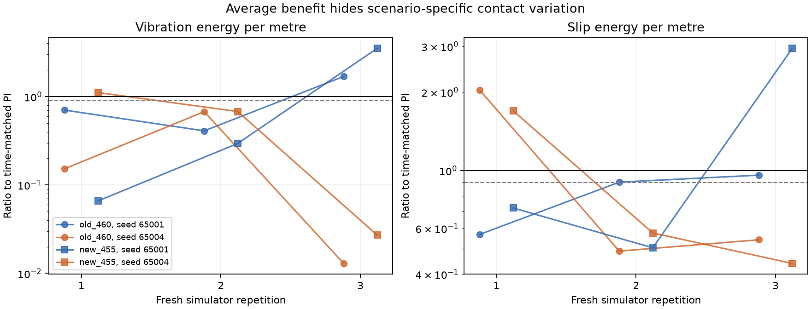

# Flat cable contact and impact repeatability

Seeds 65001/65004, three fresh simulator starts per profile; seed order alternates. No PPO pilot or Optuna started. Robot contacts logged at 2 ms physics resolution.

| Profile | Arrival | Time s | Physical RMSE m | Vibration RMS | Slip RMS | Cable-window energy/m | Cable-window energy range |
|---|---:|---:|---:|---:|---:|---:|---:|
| full | 6/6 | 17.67 | 0.0279 | 2.564 | 0.207 | 122.62 | 4.39–348.60 |
| old_460 | 6/6 | 18.32 | 0.0276 | 1.623 | 0.176 | 58.34 | 2.63–141.90 |
| new_455 | 6/6 | 18.35 | 0.0317 | 1.859 | 0.173 | 52.04 | 2.33–135.33 |
| matched | 6/6 | 18.23 | 0.0294 | 2.905 | 0.202 | 124.61 | 7.92–203.39 |

Reproducible local crossing benefit: `{"old_460": true, "new_455": true}`.
All repeat promotion gates: `{"old_460": false, "new_455": false}`.

Local benefit above refers to two-seed batch means in each repetition, not every individual scenario. Individual worsening remains in paired results; no flat pilot is qualified.

## Largest second-cable impact action in each repeat

| Repeat/profile | Seed | x m | Scale | Action energy | Chassis contact | Caster brackets | Drive wheels |
|---|---:|---:|---:|---:|---:|---:|---:|
| 1/full | 65001 | 4.524 | 1.000 | 1.34 | False | False | True |
| 1/full | 65004 | 4.540 | 1.000 | 207.61 | False | False | True |
| 1/old_460 | 65001 | 4.509 | 0.700 | 139.25 | False | False | True |
| 1/old_460 | 65004 | 4.504 | 0.700 | 2.14 | False | False | True |
| 1/new_455 | 65001 | 4.196 | 0.700 | 11.34 | False | True | False |
| 1/new_455 | 65004 | 4.197 | 0.700 | 33.02 | False | True | False |
| 1/matched | 65001 | 4.508 | 0.961 | 195.59 | False | False | True |
| 1/matched | 65004 | 4.410 | 0.961 | 24.32 | False | False | True |
| 2/full | 65004 | 4.196 | 1.000 | 39.02 | False | True | False |
| 2/full | 65001 | 4.197 | 1.000 | 40.87 | False | True | False |
| 2/old_460 | 65004 | 4.197 | 0.700 | 24.68 | False | True | False |
| 2/old_460 | 65001 | 4.510 | 0.700 | 2.03 | False | False | True |
| 2/new_455 | 65004 | 4.198 | 0.700 | 12.25 | False | True | False |
| 2/new_455 | 65001 | 4.192 | 0.700 | 1.01 | False | True | False |
| 2/matched | 65004 | 4.412 | 0.961 | 32.36 | False | False | True |
| 2/matched | 65001 | 4.498 | 0.961 | 3.28 | False | False | True |
| 3/full | 65001 | 4.296 | 1.000 | 55.52 | False | False | False |
| 3/full | 65004 | 4.200 | 1.000 | 4.20 | False | True | False |
| 3/old_460 | 65001 | 4.502 | 0.700 | 27.12 | False | False | True |
| 3/old_460 | 65004 | 4.505 | 0.700 | 1.89 | False | False | True |
| 3/new_455 | 65001 | 4.514 | 0.700 | 134.04 | False | False | True |
| 3/new_455 | 65004 | 4.504 | 0.700 | 2.62 | False | False | True |
| 3/matched | 65001 | 4.197 | 0.961 | 33.29 | False | True | False |
| 3/matched | 65004 | 4.418 | 0.961 | 102.24 | False | False | True |

## Geometry and interpretation

- Nominal fork clearance: 9.03 mm. Caster radius: 16 mm. Second cable top: 20 mm.
- Bracket contact is geometrically plausible during a crossing; do not assume every spike is a reward or speed-recovery defect.
- Contact depth and wrench are solver outputs. Deep caster/cable penetration and wheel contact gaps warrant numerical contact convergence checks before treating vibration changes as reliable control gains.
- First-cable data are also saved: full and both schedules request full speed there. Their variation cannot be attributed to later braking.

Details: analysis.json includes contact gaps, penetration, solver wrench magnitudes, caster orientation and motor response during the strongest impact.

Three repeats of two scenarios do not estimate unseen-course generalization.
Contact logging is a common additional instrumentation condition in all repeats.
Temporal overlap with contact is association, not proof of causal mechanism.
Wrench magnitudes are raw solver contact outputs, not calibrated physical force measurements.
Original 24-arrival promotion requirement remains; these six repeated runs are only a repeatability screen.
