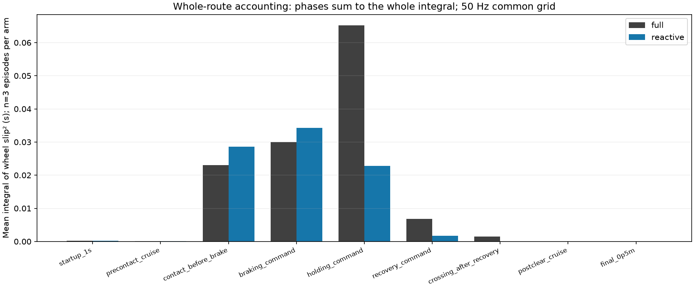
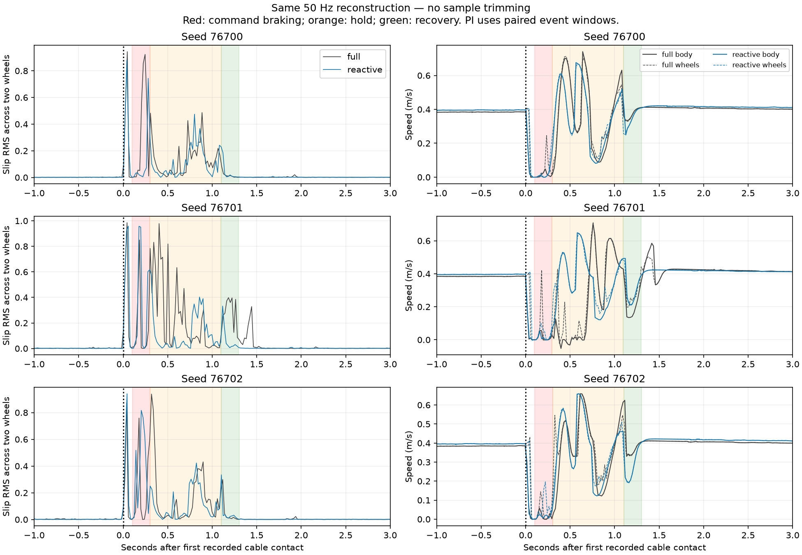

# Audit offline slip toàn tuyến theo pha — 16/10/2026

## 1. Kết luận và quyết định

**Chưa có căn cứ sửa recovery, ramp hoặc tăng penalty slip.** Khi dùng cùng
công thức và cùng cách lấy mẫu cho PI/governor, mức tăng RMS native **7,32%**
không tái hiện. Trên lưới đồng bộ 50 Hz đã chọn, governor có RMS toàn tuyến
thấp hơn ở **3/3 cặp**, trung bình **−15,72%**; tích phân slip² giảm **30,94%**.

Tuy nhiên, **không chuyển con số này thành kết luận governor đã cải thiện
slip vật lý 15,72%**. Dịch lưới 50 Hz đi 10 ms làm mức giảm RMS trung bình
còn **4,83%**, và một cặp đổi chiều. Metric native vẫn được giữ nguyên.
Audit xác nhận kết luận phụ thuộc sampling/đồng bộ; chưa xác định hết nguyên
nhân chênh lệch với snapshot native và chưa chứng minh độ chính xác vật lý.

Theo phân pha, phần tăng trung bình nằm ở **tiếp xúc đầu/trước phanh và
đoạn lệnh phanh**, được bù bởi phần giảm lớn hơn trong holding. Recovery
không phải nguồn tăng chính trên batch này; không được quy nó là lỗi chỉ
từ hai aggregate cũ. Khoảng **99,78% (PI) / 99,67% (governor)** tích phân
slip nằm trong vùng x=2,40–3,40 m, không nằm ở cruise sau cáp hay gần đích.

**Lần sửa tiếp nên ưu tiên chuẩn hóa reporting/đồng bộ slip:** ghi chính
timestamp joint và GT của snapshot dùng tính metric, rồi thống nhất báo cáo
toàn tuyến/crossing bằng cùng nguồn mẫu và quy tắc tích phân. Giữ candidate
0,90 / 1,0 s đã khóa; chưa đổi điều khiển hoặc mở thêm tuning từ audit này.

## 2. Phạm vi và phương pháp

- Chỉ đọc **6 episode validation** đã lưu: seeds **76700–76702**, mỗi seed
  PI `full` cruise 0,388 m/s và governor `reactive` cruise 0,400 m/s,
  target scale 0,90, maximum hold 1,0 s. Không đọc development để chọn lại.
- Không chạy simulation, không sửa PI/robot/contact/detector/ramp/reward,
  không sửa Optuna score, selection, candidate hoặc arrival/stop criteria.
  Giữ nguyên native outcomes. Batch gốc có 6/6 arrival và stop 2 s; audit
  này không chấm lại stopping và **không gộp 2 s sau arrival vào slip route**.
- Route: từ `governor_input_time_s` đầu tiên đến `sim_time_s` cuối cùng.
  Dùng header simulation timestamps, không dùng thời gian receipt/wall clock.
- Ground truth khoảng 50 Hz; joint khoảng 500 Hz. Dedupe cùng timestamp,
  giữ dòng cuối. Nội suy tuyến tính **vận tốc cảm biến trước khi tính slip**
  lên lưới 20 ms, origin là thời điểm control input đầu mỗi episode. Cả hai
  controller dùng đúng một pipeline, không ép vào cùng absolute sim time.
- Không extrapolate. Không nội suy qua gap GT >40 ms hoặc joint >10 ms;
  metric yêu cầu coverage ≥98%. Trong dữ liệu này GT max gap 20 ms, joint
  max gap 4–8 ms, không có JSON lỗi. Coverage primary toàn tuyến/từng pha
  đạt gần **100%**. Có 0–1 duplicate joint stamp/case, không có duplicate GT.
- Giữ công thức dự án: `wheel = 0.0625 * joint_velocity`,
  `ground_L/R = vx ∓ 0.34273666/2 * yaw_rate`,
  `s_L/R = clip((wheel-ground)/max(|wheel|, |ground|, 0.10), -5, 5)`.
  Tính `q = (s_L²+s_R²)/2`. Đây là **longitudinal slip ratio theo convention
  GT của dự án**, không phải encoder tracking error và không phải phép đo
  slip tuyệt đối đã hiệu chuẩn cho robot thật.
- Tích phân `q` bằng trapezoid, cắt segment đúng tại ranh giới pha để tổng
  các pha bằng toàn tuyến. `RMS = sqrt(∫q dt / covered_time)`;
  `slip²/m = ∫q dt / distance`, đơn vị s/m. Quãng đường lấy trên chính
  các segment GT đồng bộ, không dùng encoder. Pha đi <1 cm không báo /m.
- Bảng dưới lấy **trung bình metric mỗi episode**, n=3/controller; không
  coi hàng nghìn sensor frame là hàng nghìn thử nghiệm độc lập. RMS pooled
  theo duration được ghi riêng, không trộn với mean RMS.

## 3. Toàn tuyến: cùng sampling, cùng normalization

| Chỉ số trung bình | PI | Governor | Thay đổi |
|---|---:|---:|---:|
| Thời gian route (s) | 17,200 | 16,700 | −2,91% |
| Native slip RMS đã lưu, giữ nguyên | 0,09037 | 0,09699 | **+7,32%** |
| Slip RMS tái tính trên lưới chung 50 Hz | 0,08490 | 0,07156 | **−15,72%** |
| ∫slip² dt trên cùng lưới (s) | 0,12698 | 0,08769 | **−30,94%** |
| ∫slip² dt / distance toàn tuyến (s/m) | 0,02028 | 0,01402 | **−30,88%** |
| Local first+50 ms → clearance, cùng lưới (s/m) | 0,14096 | 0,08785 | −37,68% |

RMS pooled theo duration: **0,08592 → 0,07246**. Cả RMS, tích phân và /m
đều giảm trên lưới primary, nên khác biệt ở đây **không chỉ do mẫu số thời
gian ngắn hơn**. Không so trực tiếp RMS với slip²/m như cùng một metric.
Local metric mới không ghi đè số 0,13356 → 0,08592 của study gốc.

| Seed | Native RMS PI → governor | RMS chung 50 Hz PI → governor | ∫slip² dt PI → governor (s) |
|---|---:|---:|---:|
| 76700 | 0,06309 → 0,08465 | 0,07501 → 0,05707 | 0,09622 → 0,05439 |
| 76701 | 0,13768 → 0,11494 | 0,10302 → 0,08499 | 0,18362 → 0,12062 |
| 76702 | 0,07035 → 0,09137 | 0,07667 → 0,07261 | 0,10110 → 0,08806 |

## 4. Slip nằm ở pha nào?

Ranh giới dùng **lệnh governor**, không khẳng định motor/thân xe đổi tốc độ
tức thì. Sau first recorded cable contact khoảng 0,100 s bắt đầu lệnh phanh;
0,200 s tiếp theo scale lệnh hạ đến 0,90; giữ tại target 0,800 s; recovery
0,200 s rồi lệnh cruise trở lại. Maximum hold 1 s gồm cả 0,2 s hạ scale.

PI không có các hành động này: cửa sổ phanh/giữ/recovery của **governor cùng
seed** được dịch theo thời điểm first contact của PI. Clearance và final
approach dùng mốc riêng mỗi run. Đây là so sánh **cửa sổ event tương ứng**,
không phải hai controller có cùng contact state hoặc restore cùng snapshot.

| Pha/cửa sổ | PI ∫slip² dt (s) | Governor ∫slip² dt (s) | Governor − PI |
|---|---:|---:|---:|
| Khởi động 1 s | 0,000226 | 0,000242 | +0,000016 |
| Cruise trước contact, sau startup | 0,000113 | 0,000067 | −0,000045 |
| Contact → trước lệnh phanh | 0,023083 | 0,028574 | **+0,005492** |
| Cửa sổ lệnh phanh | 0,030006 | 0,034219 | **+0,004214** |
| Cửa sổ giữ target | 0,065221 | 0,022784 | **−0,042437** |
| Cửa sổ recovery | 0,006817 | 0,001773 | −0,005044 |
| Đã recovery, chưa clearance | 0,001488 | 0,000004 | −0,001483 |
| Cruise sau clearance | 0,000007 | 0,000004 | −0,000003 |
| Đoạn cuối x≥5,95 m → arrival | 0,000020 | 0,000020 | ≈0 |
| **Toàn tuyến** | **0,126979** | **0,087688** | **−0,039291** |

Tổng pha khớp tích phân toàn tuyến với tolerance số học 1e−8. Boundary
x=5,95 m là vùng phân tích cuối 0,5 m tới goal x=6,45 m, **không phải tuyên
bố đã phát hiện thời điểm bắt đầu phanh dừng**. Robot đạt arrival trước
đúng tọa độ goal theo tiêu chuẩn có sẵn.

Diễn giải có giới hạn:

- Holding có tích phân thấp hơn ở **3/3 cặp primary**; phần giảm trung bình
  lớn nhất nằm tại đó. Kết quả trung bình cùng chiều ở lưới dịch 10 ms và
  phương pháp nearest-GT cũ, nhưng chưa chứng minh nguyên nhân contact.
- Tiếp xúc đầu/trước phanh và braking cao hơn ở 76701/76702, thấp hơn ở
  76700. Không có cùng initial physical state; approach 0,400 và 0,388 m/s
  khác nhau. **Không quy slip trước lệnh phanh cho tác dụng phanh governor**.
- Recovery tăng ở 76700 nhưng giảm ở 76701/76702. Vì thế không nói
  recovery tốt trong mọi case, cũng chưa có bằng chứng nó là lỗi hệ thống.
- Cả hai tay thử gần như toàn bộ slip ở vùng x=2,40–3,40 m. Kiểm tra theo
  vùng không gian độc lập tránh nhầm kết quả do PI/governor tiến qua cáp
  ở thời điểm khác nhau. `spatial_means` và CSV chứa đầy đủ số liệu.





## 5. Sampling và chênh lệch với native

| Pipeline, áp dụng giống nhau cho hai controller | Mean RMS PI | Mean RMS governor | Thay đổi |
|---|---:|---:|---:|
| Native snapshot đã lưu | 0,09037 | 0,09699 | +7,32% |
| Raw đồng bộ tại control endpoints ≈10 Hz, sample RMS | 0,08611 | 0,07469 | −13,26% |
| Primary 50 Hz, RMS tích phân | 0,08490 | 0,07156 | −15,72% |
| 50 Hz dịch origin +10 ms, RMS tích phân | 0,07684 | 0,07312 | **−4,83%** |
| Diagnostic joint timestamps + nearest GT≤25 ms | 0,08409 | 0,07229 | −14,03% |

Trên lưới primary, mức giảm RMS từng cặp khoảng **23,92% / 17,51% / 5,29%**.
Trên lưới dịch 10 ms, seed 76700 đổi thành governor cao hơn PI khoảng
**14,0%**; hai seed còn lại thấp hơn. Ngay cả dấu của một cặp cũng không
bền theo origin. Các diagnostic lưới 10 Hz với năm offsets cho mức giảm
mean RMS khoảng **5,1–25,9%**. Đây là độ nhạy của tái tính, **không là confidence
interval**, phép lọc anti-alias, hay khả năng khôi phục true slip ở tần số cao.

Nearest-GT giữ cách ghép cũ làm diagnostic, nhưng dedupe stamps và dùng
tích phân cắt ranh giới mới; không gọi đó là tái hiện bit-for-bit study.
Không nội suy GT 50 Hz thành “ground truth vật lý 500 Hz”. Không cắt outlier.

**Không kết luận chỉ đổi 10→50 Hz đã sửa hết nguyên nhân:** ngay tại các
control endpoints, raw đồng bộ cũng không khớp native. Vận tốc thân lưu
trong control trace khác vận tốc raw nội suy tại endpoint: RMS sai khác
0,0034–0,0123 m/s, max 0,0284–0,0896 m/s tùy case. Điều này cho thấy
`snapshot cuối bước` và `mọi sensor đồng bộ đúng timestamp endpoint` không
phải cùng phép đo. Control trace chưa lưu timestamp/giá trị joint của đúng
snapshot tính native, nên không thể phân giải chính xác mọi chênh lệch.
Hybrid diagnostic trong JSON là phân tích bổ sung, không phải native mới.

Ba cặp quá ít để khẳng định generalization hoặc lợi ích toàn môi trường.
Nay đã dùng validation để chẩn đoán, không retune trên bank này rồi gọi nó
là independent test. Không tuyên bố impact/contact impulse tốt hơn hoặc
sim-to-real thành công từ audit slip này.

## 6. Artifact và tái chạy

- [Số liệu đầy đủ, native outcomes và sensitivity](result.json).
- [CSV mọi pha và vùng không gian](phase_metrics.csv).
- Sáu CSV `seed_*_50hz.csv` là chuỗi đã đồng bộ; missing không được gán 0.
- [Snapshot script](audit_governor_phase_slip.py) và [hash input/source](provenance.json).
- Code workspace: `src/nino_rl/scripts/audit_governor_phase_slip.py`.
- Test: `src/nino_rl/test/test_governor_phase_slip.py`: **4/4 pass**, kiểm tra
  bảo toàn tích phân/quãng đường qua boundary, không nối gap/extrapolate,
  formula trùng core khi quay/tốc độ thấp, missing phải unavailable.
- Hai hình đã được mở kiểm tra. Cảnh báo Axes3D không ảnh hưởng hình 2D.

```bash
cd ~/ninorobot
source .venv/bin/activate
python src/nino_rl/scripts/audit_governor_phase_slip.py \
  --stage rl_runs/classical_governor_crossing_tune_2026-10-16/validation \
  --output docs/governor_phase_slip_2026-10-16
python -m pytest -q src/nino_rl/test/test_governor_phase_slip.py
```

Chỉ ghi lại output audit; không đụng raw runs hoặc artifact study cũ.
