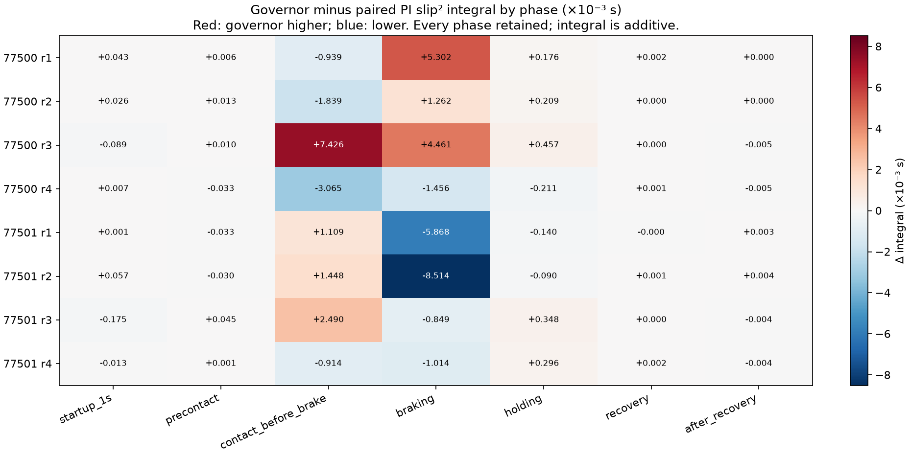

# Offline phase audit — all eight frozen survey pairs

Original sampling, scores, spikes and failures retained. No simulation or tuning.

PI windows use the paired governor's offsets from each run's own first contact; they are not identical physical exposures.

## Additive phase differences

Values below are governor minus PI slip² integral, ×10⁻³ s. Rates/RMS are in the CSV/JSON, not added together.

| Seed / repeat | Startup | Precontact | Contact before brake | Braking | Holding | Recovery | After recovery | Route |
|---|---:|---:|---:|---:|---:|---:|---:|---:|
| 77500 / 1 | +0.0432 | +0.0063 | -0.9393 | +5.3024 | +0.1761 | +0.0017 | +0.0000 | +4.5904 |
| 77500 / 2 | +0.0257 | +0.0126 | -1.8389 | +1.2622 | +0.2088 | +0.0004 | +0.0002 | -0.3290 |
| 77500 / 3 | -0.0892 | +0.0103 | +7.4256 | +4.4610 | +0.4572 | +0.0001 | -0.0048 | +12.2601 |
| 77500 / 4 | +0.0070 | -0.0329 | -3.0654 | -1.4556 | -0.2109 | +0.0006 | -0.0045 | -4.7617 |
| 77501 / 1 | +0.0006 | -0.0331 | +1.1089 | -5.8675 | -0.1404 | -0.0003 | +0.0034 | -4.9284 |
| 77501 / 2 | +0.0566 | -0.0297 | +1.4479 | -8.5137 | -0.0905 | +0.0007 | +0.0041 | -7.1247 |
| 77501 / 3 | -0.1754 | +0.0446 | +2.4896 | -0.8491 | +0.3485 | +0.0002 | -0.0035 | +1.8549 |
| 77501 / 4 | -0.0132 | +0.0012 | -0.9144 | -1.0142 | +0.2957 | +0.0016 | -0.0040 | -1.6473 |

## Full response plots

- [77500 / repeat 1](pair_77500_r1.png)
- [77500 / repeat 2](pair_77500_r2.png)
- [77500 / repeat 3](pair_77500_r3.png)
- [77500 / repeat 4](pair_77500_r4.png)
- [77501 / repeat 1](pair_77501_r1.png)
- [77501 / repeat 2](pair_77501_r2.png)
- [77501 / repeat 3](pair_77501_r3.png)
- [77501 / repeat 4](pair_77501_r4.png)

## Integrity

Attempts: 16; pairs: 8; failures retained: 0.
Native, whole-route, crossing, fixed post-contact and complete-sequence metrics replayed: True.

Every original GT sample has an exported context row; all original IMU/contact samples and manifold events remain available. No outlier rejection.

Torque fields are commands. 50 Hz limiter publications do not expose every 500 Hz motor-loop update. Missing/stale contact support stays unavailable.

Interpretation and decision: [Vietnamese report](../GOVERNOR_SURVEY_PHASE_AUDIT_2026-10-20.md).
