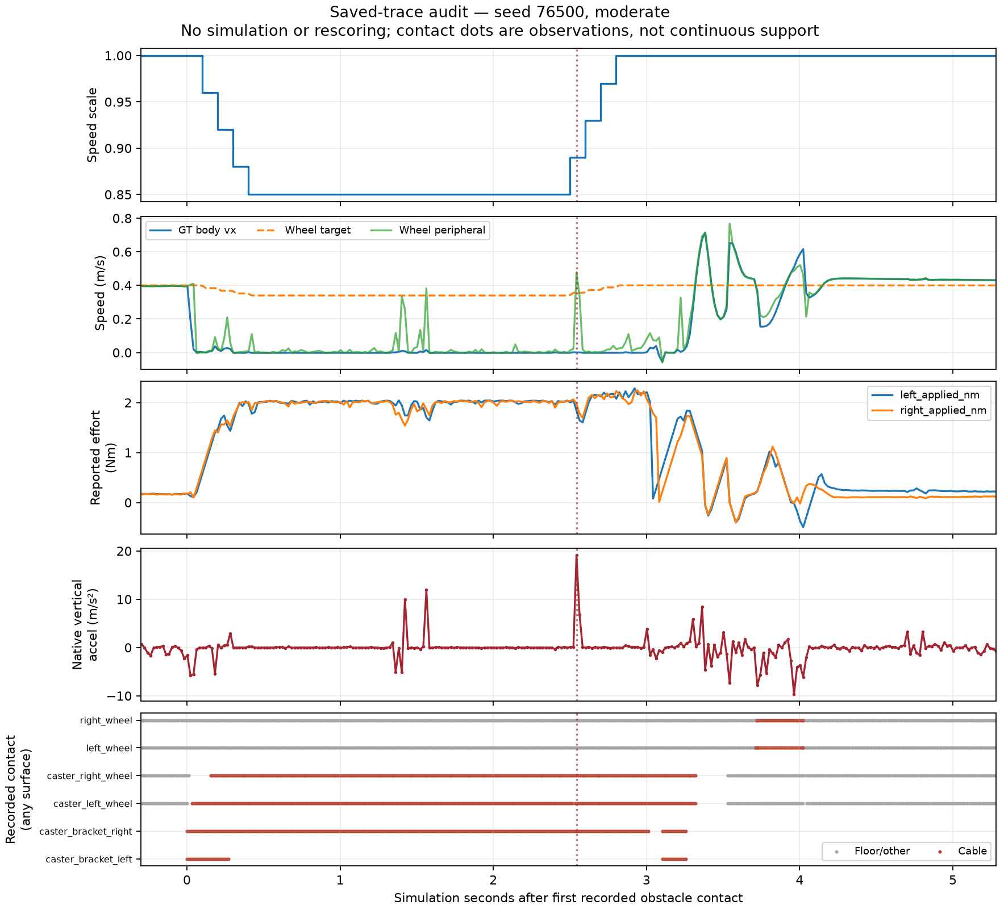
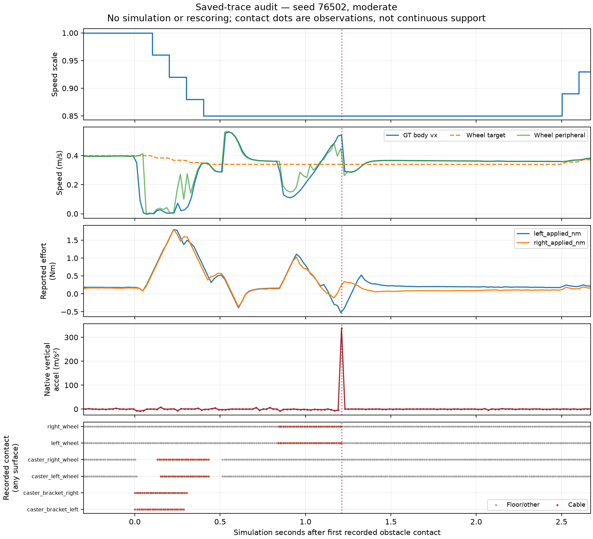

# Audit offline trước tuning governor — 16/10/2026

## Phạm vi và kết luận

Đã đọc lại đủ 10 raw episodes của time-comparison, tập trung governor
76500/76501/76502 và PI 76503. Không chạy simulation, không sửa native score,
không loại outlier hoặc đổi physical failure thành success.

**Dữ liệu đủ cho một screen thời gian/slip/tiến triển trong sim; chưa đủ
để tune hoặc tuyên bố giảm peak impact vật lý.** Quyết định dùng Optuna nhỏ
cho crossing nằm trong [contract mới](../CLASSICAL_GOVERNOR_TUNING_2026-10-16.md).
Không thay mục tiêu hoặc score của các batch cũ.

## 1. Crossing kéo dài là hành vi chuyển động được ghi nhận

Seed 76500 governor:

- Event +0.099 s; scale về 0.85 sau khoảng 0.4 s, RECOVER +2.499 s, cruise
  +2.799 s. First driven-wheel contact +3.713 s, completion 19.5 s.
- Trong cửa sổ crossing, thân có `|vx|<0.04 m/s, |yaw_rate|<0.05 rad/s`
  tổng **2.96 s**. Cùng điều kiện đó và wheel peripheral speed<0.04 m/s:
  **2.66 s**, so với PI cùng seed **0.16 s**.
- Các khoảng thân gần đứng nhưng bánh quay >0.20 m/s chỉ **0.06 s**.
  Không gọi toàn bộ crossing kéo dài là bánh quay trơn khi thân đứng.
- Reference bánh vẫn khoảng 0.34 m/s; effort được báo quanh 2 Nm trong
  nhiều đoạn, maximum 2.287 Nm. Không stale cmd hoặc target đảo chiều.
- Contact bracket phải với cáp được ghi trong nhiều thời điểm đến khoảng
  +3 s. Sau recovery mới thoát crossing không chứng minh recovery là nguyên
  nhân duy nhất: state contact/caster không restore identically, controller
  PI và geometry tương tác phi tuyến.

Các threshold speed ở trên là diagnostic để mô tả trace, không thay thế
native stall/arrival rule. `limited` flag của driver gộp torque/rate/speed
limiter, **không tự là bằng chứng motor đạt giới hạn torque phần cứng**.

Điều được dữ liệu hỗ trợ để khảo sát: giảm nhẹ hơn và cắt maximum hold sớm
hơn. Không có bằng chứng để tăng torque, sửa PI, thay collision hoặc bật
stall recovery bằng GT. Detector và ramp phải giữ nguyên trong screen đó.



## 2. Spike hiện diện trong raw sensor, không do quaternion hỏng

| Episode | Peak (m/s²) | Thời điểm sau contact | Pha governor | RMS 50 Hz | RMS even/odd 25 Hz diagnostic |
|---|---:|---:|---|---:|---:|
| Governor 76501 | 134.210 | 1.710 s | HOLD, scale 0.85 | 11.261 | 1.103 / 15.999 |
| Governor 76502 | 338.615 | 1.211 s | HOLD, scale 0.85 | 30.852 | 43.760 / 2.149 |
| PI 76503 | 200.051 | 0.594 s | CRUISE, scale 1 | 19.607 | 4.353 / 27.516 |

Raw acceleration xyz tại ba peak lần lượt khoảng:

- `[22.88, 89.59, 144.04]`;
- `[38.57, -5.92, 348.40]`;
- `[-66.55, -1.06, 209.79]` m/s².

Quaternion norm gần đúng 1 trong cả ba, nên không quy spike thành phép rotate
từ quaternion invalid. Các peak xảy ra sau event trong governor, và PI cũng
có spike lớn. Không coi temporal association đó là causal governor harm.

Recorded drive-wheel cable/floor contact chuyển trạng thái gần các peak;
caster floor support cũng thay đổi. Wrench logger không ghi mọi physics tick:
không có force lớn trong một sample gần peak **không chứng minh không có
impulse**. Không cộng các per-manifold point forces thành net body force.

Hai pha decimation bên trên là **unfiltered downsampling 50→25 Hz**, nhằm
chứng minh sensitivity ở độ phân giải thô hơn. Chúng không chứng minh aliasing
tại 50 Hz, không tái dựng high-frequency acceleration và không thay native
RMS/peak. Native score giữ tất cả spike. Độ tập trung một mẫu 97–99% cùng
biến thiên baseline khiến RMS/peak là objective rủi ro cho budget nhỏ.



## 3. Gate và công việc tiếp

| Thành phần dữ liệu | Đủ cho việc gì? | Chưa đủ cho việc gì? |
|---|---|---|
| Native arrival/stop, pose, elapsed time | Chấm crossing và thời gian sim | Chứng nhận hoạt động robot thật |
| Drive/joint/GT slip metric | Screen slip²/m, progress, command execution | Absolute slip từ IMU/encoder phần cứng |
| PI timing/command freshness | Giữ PI, không sửa speculative scheduling | Bảo đảm mọi actuator latency thực |
| IMU 50 Hz/contact downsample | Báo tín hiệu đã đo, phase association | True peak/impulse, cơ chế numerical đã xác định |

Cho phép **screen crossing-feasibility** mới, objective time/slip với tracking
penalty và physical gates. Không cho phép gọi kết quả đó là tối ưu impact,
H1 predictor, RL hay sim-to-real. RMS/peak/P95 vẫn báo cạnh objective để người
đọc thấy trade-off; không âm thầm promote candidate có impact chưa hiểu rõ.

Tuning chỉ ba candidate, dev/validation tách riêng, không tăng budget sau khi
xem validation. Nếu thất bại, không thêm trial hoặc sửa physics để tìm winner.

## Tái lập

```bash
cd ~/ninorobot
source .venv/bin/activate
export PYTHONPATH=src/nino_control:src/nino_rl:$PYTHONPATH
python src/nino_rl/scripts/audit_governor_tuning_readiness.py \
  --screen rl_runs/governor_time_comparison_2026-10-16 \
  --crossing-result docs/governor_time_comparison_2026-10-16/result.json \
  --output docs/governor_tuning_readiness_2026-10-16
```

[JSON đầy đủ](result.json) giữ nearest drive/GT, IMU neighbors, contact identity,
reported forces/normals/depths và phase timeline. Các threshold/covariate
không lọc episode khỏi score. Hai regression tests xác nhận native peak không
bị thay bằng decimation và missing window không được gán impact=0.
