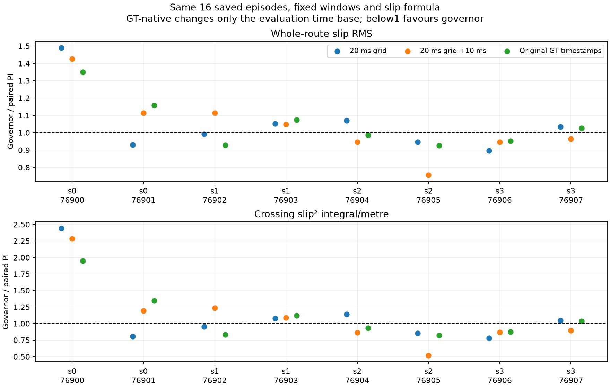

# Audit slip trên timestamp GT gốc — 16/10/2026

## Kết luận

**Governor vẫn có mean slip cao hơn PI khi dùng timestamp GT gốc.** Trên
16 episode xác nhận đã lưu, RMS slip toàn tuyến **+3,86%**, crossing
slip²/m **+4,89%**. Giới hạn ba cách tính về cùng phần thời gian ở hai biên
gần như không thay đổi kết quả. Vì vậy không thể giải thích toàn bộ bất lợi
của candidate bằng việc chọn origin của grid.

Việc chọn grid ảnh hưởng kết luận từng cặp: so với GT gốc, hai cặp đổi chiều
khi dùng grid primary, hai cặp khác đổi chiều khi dùng grid +10 ms. Loại bỏ
origin tùy ý khỏi phương pháp diagnostic không đồng nghĩa đã khôi phục true
slip hoặc giải quyết mọi giới hạn của GT 50 Hz.

**Không đổi controller, native metrics, scores/decision study hoặc chạy
simulation.** Đây là diagnostic bổ sung, không phải chấm lại để chọn candidate.

## 1. Phương pháp đã thực hiện

- Đọc đủ **16/16 episode**, seeds 76900–76907, PI và governor. Giữ nguyên
  toàn bộ outcome và các giá trị gốc trong `source_outcome`; không lọc theo
  success hoặc loại cặp bất lợi.
- Dùng **nguyên timestamp, vận tốc và pose GT** từ `/ground_truth/odom`.
  Dedupe stamp giữ dòng cuối như pipeline trước; sau đó không nội suy GT
  sang grid mới. Chu kỳ GT thực tế khoảng **20 ms** ở cả 16 lượt.
- Chỉ nội suy tuyến tính vận tốc joint tại timestamp GT. Không extrapolate,
  không nối gap joint >10 ms. Tỷ lệ GT stamps có joint trùng stamp chính xác
  khoảng **85,1–93,9%** tùy episode; phần còn lại nội suy hoặc unavailable.
- Cùng công thức wheel radius/track, denominator floor 0,10 m/s, clipping,
  coverage≥98%, tích phân trapezoid và distance normalization của audit cũ.
  Không đổi định nghĩa slip để làm kết quả thuận lợi hơn.
- Giữ nguyên route window và crossing window của batch: route từ first
  control input đến final action end; crossing từ contact+50 ms đến mặt
  phẳng clearance theo góc cáp. Không gộp post-arrival stop 2 s vào route.
- Giữ các GT samples đã lưu ở hai phía boundary để cắt segment tích phân
  đúng tại boundary. **Chỉ tích phân slip² theo giả thiết tuyến tính giữa
  các mẫu**, không tạo measurement GT mới tại boundary.
- Tính lại cả primary và shifted từ raw bằng code cũ, rồi yêu cầu **exact
  equality với mọi trường metric đã khóa** trước khi so sánh GT-native.
  Cả 16 lượt tái hiện chính xác hai pipeline trước.
- Báo thêm trên **common edge support** của cả ba phương pháp. Kiểm tra này
  xử lý khác biệt ở biên; không che các gap nội bộ nếu có.

Protocol riêng được ghi trước khi tính: [protocol_before_calculation.json](protocol_before_calculation.json).
Code: `src/nino_rl/scripts/audit_gt_timestamp_slip.py`. Code chỉ đọc dữ liệu
và ghi output audit mới; không được import vào đường điều khiển online.

## 2. Mean theo episode, n=8/controller

| Chỉ số GT-native | PI | Governor | Governor so với PI |
|---|---:|---:|---:|
| RMS slip toàn tuyến | 0,08346 | 0,08668 | **+3,86%** |
| ∫slip² dt toàn tuyến (s) | 0,12119 | 0,12667 | +4,52% |
| ∫slip² dt / distance toàn tuyến (s/m) | 0,01934 | 0,02022 | +4,56% |
| Crossing RMS slip | 0,21578 | 0,22096 | +2,40% |
| Crossing ∫slip² dt / distance (s/m) | 0,13902 | 0,14582 | **+4,89%** |

Các mean là mean metric từng episode, không coi sensor samples là các thử
nghiệm độc lập. Các giá trị này không thay thế native RMS hoặc score Optuna.
Thời gian, tracking, vibration và arrival không được tính lại trong audit này;
[báo cáo batch gốc](../FROZEN_GOVERNOR_CONFIRMATION_2026-10-16.md) giữ nguyên.

### So sánh ảnh hưởng chọn time base

| Phương pháp | Mean whole RMS PI → governor | Chênh lệch | Mean crossing slip²/m PI → governor | Chênh lệch |
|---|---:|---:|---:|---:|
| Grid primary | 0,08188 → 0,08466 | +3,40% | 0,13439 → 0,13908 | +3,49% |
| Grid +10 ms | 0,08188 → 0,08381 | +2,35% | 0,13361 → 0,13726 | +2,73% |
| **GT timestamp gốc** | **0,08346 → 0,08668** | **+3,86%** | **0,13902 → 0,14582** | **+4,89%** |

Trên common edge support, chênh whole RMS của GT-native là **+3,859%** thay
vì +3,858%; crossing vẫn **+4,889%**. Các khác biệt chính không đến từ vài
millisecond coverage khác nhau ở đầu/cuối route.

Coverage GT-native crossing **100% ở 16/16 lượt**. Whole-route gần 100%,
thấp nhất **99,762%**: governor seed76906 thiếu alignment hợp lệ tại một
GT stamp khoảng **3,946 s trước contact**, do joint gap vượt giới hạn. Hai
segment kề điểm đó bị loại khỏi coverage, không được gán slip=0 hoặc nối
qua gap. Điều này không làm thiếu dữ liệu crossing của cặp đó.

## 3. Cặp nào thay đổi kết luận?

Ratio <1 có lợi cho governor.

| Seed | Whole RMS ratio primary / shifted / GT gốc | Crossing slip²/m ratio primary / shifted / GT gốc |
|---|---:|---:|
| 76900 | 1,490 / 1,426 / **1,350** | 2,443 / 2,284 / **1,949** |
| 76901 | 0,931 / 1,115 / **1,158** | 0,806 / 1,195 / **1,347** |
| 76902 | 0,992 / 1,113 / **0,929** | 0,951 / 1,234 / **0,834** |
| 76903 | 1,053 / 1,049 / **1,075** | 1,077 / 1,092 / **1,120** |
| 76904 | 1,069 / 0,947 / **0,987** | 1,141 / 0,861 / **0,930** |
| 76905 | 0,947 / 0,756 / **0,927** | 0,852 / 0,517 / **0,821** |
| 76906 | 0,897 / 0,946 / **0,952** | 0,780 / 0,869 / **0,876** |
| 76907 | 1,035 / 0,964 / **1,027** | 1,045 / 0,897 / **1,038** |

- GT gốc khác phía thắng/thua so với primary ở **76901, 76904**.
- GT gốc khác phía thắng/thua so với shifted ở **76902, 76907**.
- **76900 và 76903 đều bất lợi**, 76905 và 76906 đều có lợi, theo cả ba
  cách tính. Cặp bất lợi nhất 76900 vẫn bất lợi rõ với GT-native; không thể
  bỏ kết quả đó vì sampling sensitivity.
- GT-native cho **4/8 cặp** cải thiện cả hai metric trên; chưa phải lợi ích
  lặp lại ở mọi contact state.



### Mean từng scenario theo GT gốc

| Scenario | Whole RMS governor/PI | Crossing slip²/m governor/PI |
|---|---:|---:|
| s0 — x=2,50 m, −10° | **1,255** | **1,649** |
| s1 — x=2,50 m, +10° | 0,997 | 0,957 |
| s2 — x=3,30 m, −10° | 0,956 | 0,871 |
| s3 — x=3,30 m, +10° | 0,991 | 0,964 |

Ba scenario có mean tốt hơn theo diagnostic mới, nhưng bất lợi ở s0 lớn
hơn và global mean vẫn kém. Không dùng phương pháp chọn sau kết quả để
đổi gate 1/4 của protocol gốc thành “đã pass 3/4”, không loại s0.

## 4. Diễn giải và quyết định

**Đã xác nhận:** bước đưa GT qua một grid trung gian có thể đổi tỷ lệ và
thứ hạng từng cặp. Với công thức slip phi tuyến, nội suy velocity rồi tính
slip không bắt buộc cho cùng tích phân với tính slip tại GT samples gốc.
Kiểm tra common edge support và coverage crossing đầy đủ giúp loại phần
khác biệt coverage ở biên khỏi giải thích chính trong batch này.

**Chưa xác nhận:** GT-native là true slip chính xác, contact/caster là nguyên
nhân duy nhất, hoặc độ trễ callback gây mọi bất lợi. GT vẫn chỉ 50 Hz;
joint có dropout/interpolation; biến thiên contact giữa cold starts vẫn
còn. Không suy ra kết quả robot thật hoặc tác động ngoài các scenario đã thử.

**Giữ decision gốc, không sửa tham số hoặc mở study.** Audit này đủ để nói
không nên tiếp tục đổi grid nhằm tìm một kết quả có lợi cho candidate.
Nếu tiếp theo chuẩn bị tuning cổ điển, có thể chốt một **contract reporting
mới dùng timestamp GT gốc**, giữ sensitivity và native riêng, rồi dùng bank
development khác. Không cần ép candidate hiện tại thắng PI trước mọi tuning;
nhưng phải khai báo đúng objective mô phỏng và không dùng bank đã chẩn đoán
này để chọn tham số rồi gọi là independent test.

## 5. Artifact và verification

- [Toàn bộ kết quả và outcomes gốc](result.json).
- [CSV metric từng window](window_metrics.csv).
- 16 CSV `seed_*_gt_timestamps.csv` ghi GT raw values, joint interpolated
  values, support stamps và slip²; có cờ nhận biết sample ngoài route.
- [Input/source hashes](provenance.json), source snapshots ở `sources/`.
- **4/4 tests mới đạt**: giữ nguyên GT impulse/timestamps, từ chối joint
  gap/extrapolation, tích phân boundary mà không tạo GT samples, common
  edge support. Có exact regression cả hai grid trên mọi metric của 16 case.
- Không có simulation/training/Optuna mới; controller và reporting module
  đang dùng đều không đổi. Hash guard kiểm tra **883 file được khóa** gồm
  artifacts, config và scores cũ. [Preservation check](preservation_check.json).

Tái tạo audit vào thư mục mới:

```bash
cd ~/ninorobot
source .venv/bin/activate
python src/nino_rl/scripts/audit_gt_timestamp_slip.py \
  --episodes rl_runs/governor_frozen_confirmation_2026-10-16/confirmation_episodes.json \
  --output /tmp/nino_gt_timestamp_slip_recheck
PYTHONPATH=src/nino_rl python -m pytest -q src/nino_rl/test/test_gt_timestamp_slip.py
```
