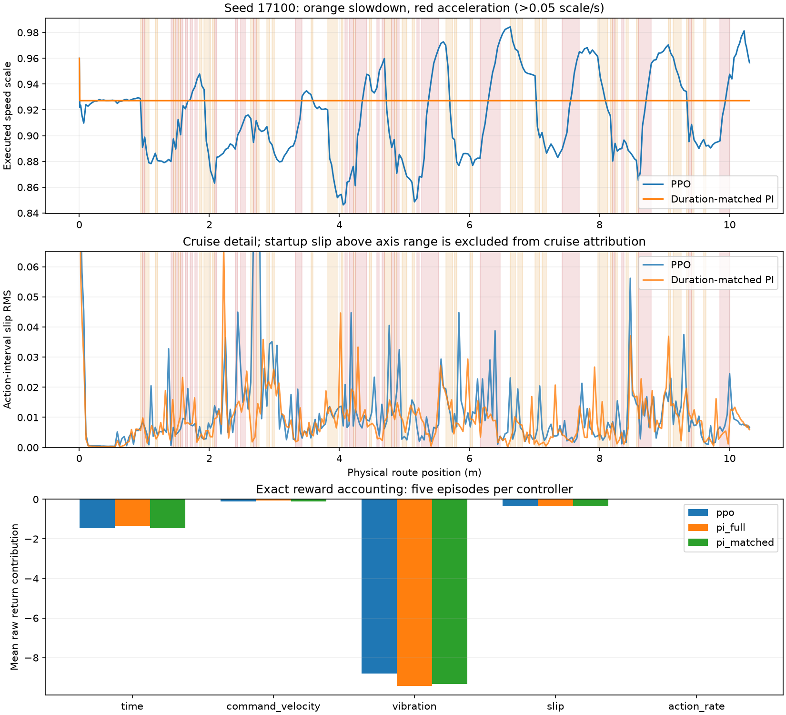

# Rough observable PPO: saved-trace and reward audit

Completed offline on 2026-10-11. No Gazebo, training, tuning, or new evaluations were started.

## Evidence and verification

Five paired E1 reset seeds (17100–17104), one training seed (17000), fixed nominal half-relief terrain. All frozen input hashes pass. Exact captured actor inputs, ensuing actions and rewards match the control traces. For all 15 controller episodes, component sums reconstruct raw returns, and integrated IMU/slip traces reconstruct their reward costs. Holding velocity costs are exactly zero; actor-visible phase and timer match the phase used by the reward.

## 1. Where the extra slip occurs

Modes use executed policy speed-scale rate, not the detector phase: slowdown below −0.05 scale/s, acceleration above +0.05 scale/s, otherwise persistent reduced speed below 0.95 or steady cruise. Startup (first second) and final approach (physical goal distance <0.5 m) are separate. Changing the rate boundary to 0.02 or 0.10 scale/s retains higher pooled slip during acceleration than persistent reduced-speed driving.

| Mode | Mean duration per episode | Pooled slip RMS | Mean excess slip integral in disturbance windows vs PI at the same positions |
|---|---:|---:|---:|
| startup_or_approach | 2.32 s | 0.03225 | -0.0000336 |
| slowdown | 5.28 s | 0.01661 | +0.0001774 |
| acceleration | 6.02 s | 0.01625 | +0.0005646 |
| persistent_reduced | 10.84 s | 0.01264 | -0.0003778 |
| steady_cruise | 4.64 s | 0.01355 | +0.0000944 |

Acceleration has positive excess slip in 4/5 scenarios; persistent reduced-speed intervals have less slip in 4/5. Seed 17100 contributes the largest excess, during both slowdown and acceleration. The detector labels an average 6.24 seconds as recovering, but 5.06 of those seconds are not actual acceleration at the stated threshold.

These are associations. Phase intervals encounter different terrain; matched-position PI comparisons reduce this confound but do not establish causality. The metric is the existing bounded wheel-versus-body velocity ratio, with a 0.10 m/s denominator floor. It is a longitudinal slip proxy, not direct wheel/contact measurement. Spatial attribution uses 0.1-second action intervals. The mode excess-integral table is not a replacement for the original per-metre quality gate.

## 2. Why quiet cruising stays low

Quiet means ready/cooldown with no detector threshold exceeded; it does not mean the ride has zero vibration. The table below also excludes startup and final approach, so its means differ slightly from the original gate averages.

| Seed | Quiet executed scale | Quiet actor target scale | Ramp-limited quiet actions |
|---|---:|---:|---:|
| 17100 | 0.9340 | 0.9340 | 0% |
| 17101 | 0.9356 | 0.9356 | 0% |
| 17102 | 0.9339 | 0.9339 | 0% |
| 17103 | 0.9892 | 0.9892 | 0% |
| 17104 | 0.9377 | 0.9377 | 0% |

The low scale is requested by the saved deterministic actor, not held down by the reference ramp. There are 7–8 disturbance events per episode: bounded rearming works. The four low-cruise episodes still observe mean interval IMU RMS of approximately 0.74–0.95 m/s² during quiet cruise. Comfort cost remains active there, while cruise-tracking cost is weak. Reward balance is a supported explanation, not proof that optimization has converged or that IMU alone causes the output.

## 3. What the reward currently favors

| Mean raw reward contribution | PPO | Full-speed PI | Duration-matched PI |
|---|---:|---:|---:|
| time | -1.4550 | -1.3490 | -1.4500 |
| command_velocity | -0.1107 | -0.0665 | -0.1063 |
| vibration | -8.7934 | -9.4190 | -9.3234 |
| slip | -0.3218 | -0.3387 | -0.3478 |
| lateral | -0.6582 | -0.6053 | -0.6069 |
| heading | -0.1219 | -0.1016 | -0.1130 |
| action_rate | -0.0010 | 0.0000 | -0.0001 |
| Total return | 19.1526 | 18.7378 | 18.6571 |

PPO gains about 0.626 raw reward from vibration relative to full-speed PI. Its additional time cost is only 0.106 and additional velocity-tracking cost only 0.044. It earns the highest total return although it fails the intended recovery/quality gates. No episode exceeds 31 seconds, so lateness contributes zero. At ideal 0.4 m/s reference tracking, constant scale 0.936 costs only 0.001024 reward/s for velocity tracking with sigma 0.4 m/s. Observed trace rewards substantiate a mismatch between the training incentive and the desired recovery behavior.

## One selected correction

Change **only `reward_v2.longitudinal_weights.velocity_sigma_m_s`: 0.4 → 0.1 m/s**. This increases the existing non-holding velocity-tracking penalty by 16× and retains exactly zero velocity penalty during holding. Keep all other reward weights, observations, gSDE, speed range, 0.4 scale/s ramp, PI yaw, estimator, terrain, physical arrival and quality gates fixed.

Exact rescoring of the same recorded trajectories (no altered actions or physics):

| Velocity sigma | PPO return | Full-speed PI return | Matched PI return |
|---|---:|---:|---:|
| 0.4 m/s | 19.1526 | 18.7378 | 18.6571 |
| 0.2 m/s | 18.8206 | 18.5383 | 18.3383 |
| 0.1 m/s | 17.4927 | 17.7401 | 17.0627 |

The recorded PPO/full-speed-PI ranking reverses below sigma ≈0.124 m/s; 0.2 m/s is insufficient to reverse it. The proposed 0.1 is a bounded pilot candidate based on incentive accounting, not an optimized value or demonstrated new performance. A stronger physical-speed penalty can increase acceleration-related slip or favor constant full speed; retaining the existing ramp and strict ride-quality gates is essential.

The override file is a proposal, not a standalone training configuration. If a pilot is authorized, use a new frozen reward contract, the same original fresh actor initialization and training seed 17000, fresh critic/optimizer, and the same 20,480-step budget. Using the newly trained actor instead would confound this single-change comparison. Existing five seeds are now diagnostic; a subsequent confirmation must use new seeds. Keep Optuna held.

## Reproduce

```bash
cd ~/ninorobot
.venv/bin/python src/nino_rl/scripts/audit_rough_observable_pilot.py
```

Artifacts: `audit.json` (input hashes and detailed per-seed accounting), `candidate_reward_override.yaml` (single proposed change), and `slip_and_reward.png`.


