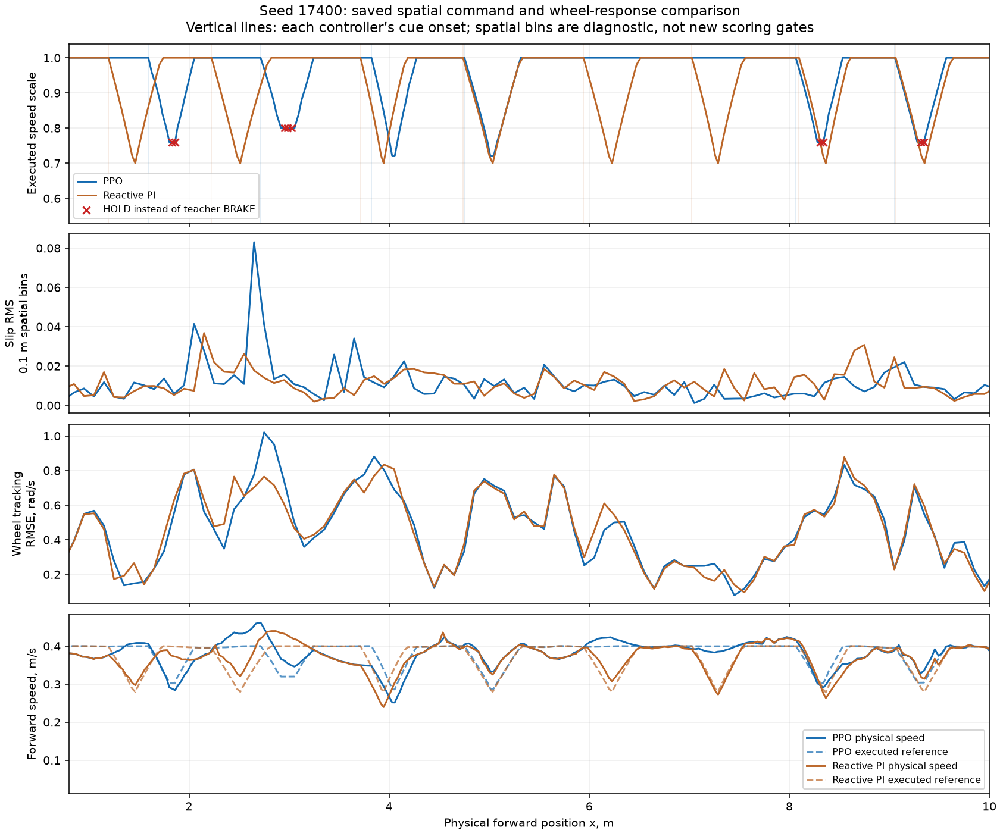
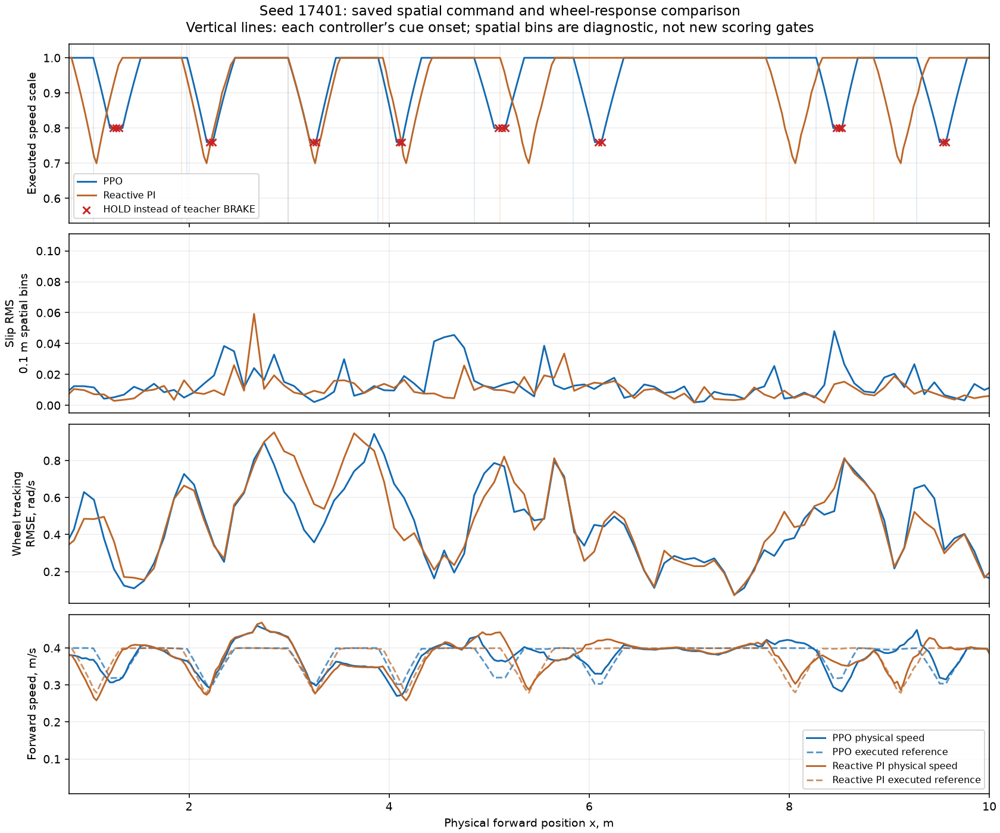
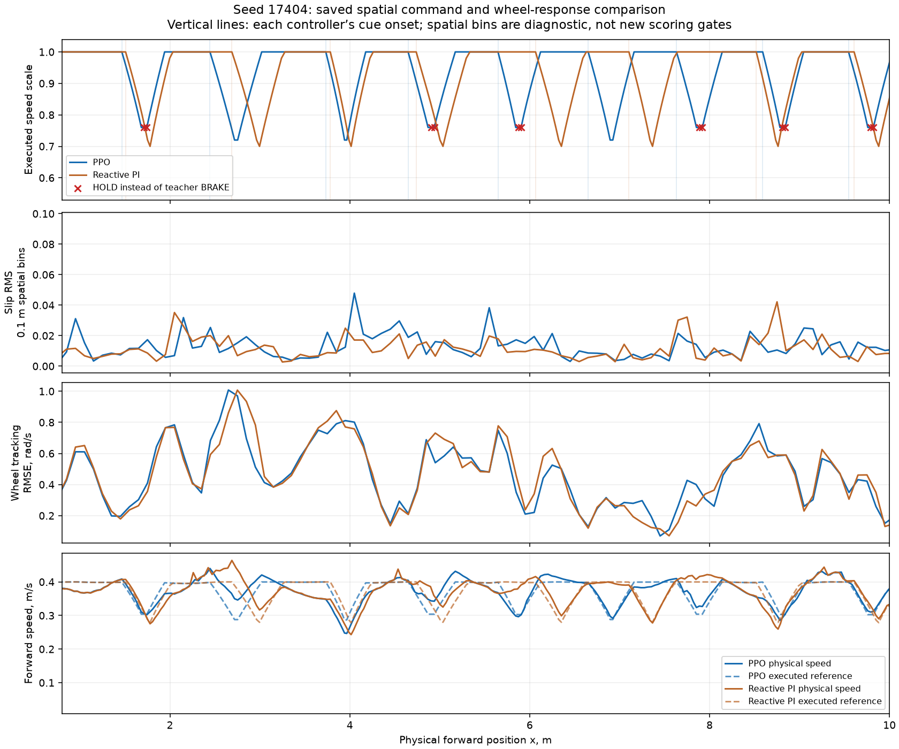

# Rough revision-57 saved sequence audit

Final checkpoint preserved byte-for-byte. Saved-data analysis only; no new simulation/training.

| Seed | Controller | Cue events | Mean braking s/event | Mean minimum holding scale | HOLD instead of BRAKE | Delayed recovery HOLD |
|---|---|---:|---:|---:|---:|---:|
| 17400 | PPO | 6 | 0.617 | 0.753 | 9 | 1 |
| 17400 | Reactive PI | 8 | 0.800 | 0.700 | n/a | n/a |
| 17401 | PPO | 8 | 0.563 | 0.775 | 19 | 1 |
| 17401 | Reactive PI | 7 | 0.800 | 0.700 | n/a | n/a |
| 17404 | PPO | 9 | 0.633 | 0.747 | 12 | 0 |
| 17404 | Reactive PI | 8 | 0.800 | 0.700 | n/a | n/a |

## Nearby cue-event comparison

Physical event IDs are not assumed to correspond. Only mutual-nearest onset pairs within 0.30 m are shown.

| Seed | PPO/reactive event | Onset gap m | Minimum scale PPO/PI | Braking s PPO/PI | Recovery to full s PPO/PI |
|---|---|---:|---|---|---|
| 17400 | 3/3 | 0.110 | 0.72/0.70 | 0.70/0.80 | 0.70/0.80 |
| 17400 | 4/4 | 0.015 | 0.72/0.70 | 0.70/0.80 | 0.70/0.80 |
| 17400 | 5/7 | 0.032 | 0.76/0.70 | 0.60/0.80 | 0.60/0.80 |
| 17400 | 6/8 | 0.008 | 0.76/0.70 | 0.60/0.80 | 0.60/0.80 |
| 17401 | 1/1 | 0.218 | 0.80/0.70 | 0.50/0.80 | 0.60/0.80 |
| 17401 | 2/2 | 0.054 | 0.76/0.70 | 0.60/0.80 | 0.60/0.80 |
| 17401 | 3/3 | 0.002 | 0.76/0.70 | 0.60/0.80 | 0.60/0.80 |
| 17401 | 4/4 | 0.047 | 0.76/0.70 | 0.60/0.80 | 0.60/0.80 |
| 17401 | 5/5 | 0.259 | 0.80/0.70 | 0.50/0.80 | 0.50/0.80 |
| 17404 | 1/1 | 0.042 | 0.76/0.70 | 0.60/0.80 | 0.60/0.80 |
| 17404 | 2/2 | 0.244 | 0.72/0.70 | 0.70/0.80 | 0.70/0.80 |
| 17404 | 3/3 | 0.050 | 0.72/0.70 | 0.70/0.80 | 0.70/0.80 |
| 17404 | 4/4 | 0.090 | 0.76/0.70 | 0.60/0.80 | 0.60/0.80 |
| 17404 | 8/7 | 0.071 | 0.76/0.70 | 0.60/0.80 | 0.60/0.80 |
| 17404 | 9/8 | 0.061 | 0.76/0.70 | 0.60/0.80 | 0.60/0.80 |

## Largest excess-slip spatial regions

These are diagnostic 0.30 m regions, not revised evaluation gates.

| Seed | Physical x m | Slip integral excess | Mean scale PPO/PI | Wheel error rad/s PPO/PI | PPO executed modes | Reactive executed modes |
|---|---|---:|---|---|---|---|
| 17400 | 2.6–2.9 | +0.001806 | 0.928/0.945 | 0.924/0.727 | {'braking': 0.45616123776634854, 'cruise': 0.2557482156334271} | {'cruise': 0.17693109280264047, 'recovery': 0.5424790776280333} |
| 17400 | 1.8–2.1 | +0.000493 | 0.883/1.000 | 0.711/0.743 | {'braking': 0.010944483407942579, 'cruise': 0.1316710478693671, 'holding': 0.20000000000000284, 'recovery': 0.6000000000000085} | {'cruise': 0.819313779369941} |
| 17400 | 3.4–3.7 | +0.000487 | 1.000/1.000 | 0.657/0.671 | {'cruise': 0.8375598314414715} | {'cruise': 0.8391955046887425} |
| 17401 | 4.4–4.7 | +0.001385 | 1.000/1.000 | 0.232/0.245 | {'cruise': 0.7387206002577975} | {'cruise': 0.6526963899800429, 'recovery': 0.09711032160970064} |
| 17401 | 8.3–8.6 | +0.000949 | 0.846/1.000 | 0.635/0.689 | {'braking': 0.41930391021726743, 'holding': 0.29999999999998295, 'recovery': 0.24830274772035188} | {'cruise': 0.7213587156109423, 'recovery': 0.10431910122450809} |
| 17401 | 2.2–2.5 | +0.000605 | 0.890/0.906 | 0.393/0.399 | {'cruise': 0.09529553826807562, 'holding': 0.12413420439939, 'recovery': 0.6000000000000085} | {'cruise': 0.09171404216715406, 'recovery': 0.7122761542187572} |
| 17404 | 4.0–4.3 | +0.000771 | 0.941/0.880 | 0.664/0.650 | {'cruise': 0.3321793888510324, 'recovery': 0.5664019169519853} | {'braking': 0.05994092040506034, 'cruise': 0.10528299392752008, 'recovery': 0.7999999999999545} |
| 17404 | 5.3–5.6 | +0.000294 | 1.000/1.000 | 0.515/0.504 | {'cruise': 0.7683240542266985} | {'cruise': 0.683924829781284, 'recovery': 0.08641910322243136} |
| 17404 | 4.3–4.6 | +0.000288 | 1.000/1.000 | 0.244/0.222 | {'cruise': 0.7491645219646831} | {'cruise': 0.7492085739725091} |

## Selected single correction

Replace half of each eligible class sample with training-rollout observations labeled by the unchanged causal teacher; retain half frozen demonstrations and fall back to frozen samples when a class is absent.

Keep the BC coefficient/gradient cap, balanced classes, rewards, physical setup, observations and ramp fixed. Only the BC observation sampling pool changes. Use training-rollout histories; never add the inspected evaluation histories to training. A future pilot needs a new contract and the original BC actor with a fresh critic/optimizer. This audit starts none.

This is supported by actor replay and sequence defects, not proof that all slip differences arise from those errors. No general penalty increase, slower recovery ramp, hard teacher override or relaxed scoring is selected.

- Physical-profile/route/seed conditions match, but contact/sensor stochasticity and cue events differ.
- Event pairs are mutual nearest physical onsets within 0.30 m; unmatched events stay in the full-course scoring.
- Spatial energy allocation assumes uniform interval energy along each short displacement; not raw per-sample slip.
- Phase exposures differ; pooled phase differences do not prove causal attribution.
- Offline original-BC replay does not predict a counterfactual physical trajectory.
- No new pilot or Optuna launched; the original failed promotion gate remains unchanged.

Details and all source hashes: [analysis.json](analysis.json).

## Evidence and counterevidence

PPO has 40 premature HOLD decisions during 184 holding frames on these three seeds; the original BC actor has six on exactly the same tensors. Two additional PPO HOLD decisions delay recovery by one 100 ms action; both controllers otherwise recover at the same configured ramp. Shorter PPO recovery is primarily a consequence of starting recovery from a shallower slowdown, not a faster ramp.

The largest seed-17401 excess-slip region (x=4.4–4.7 m) has mean scale 1.0 for both controllers and comparable wheel tracking error. Seed 17400’s largest region has PPO braking while reactive PI is recovering. Consequently, neither a blanket recovery-ramp change nor a claim that premature HOLD explains every slip difference is supported. The selected training-data correction targets a directly verified sequence defect, with physical quality still requiring the unchanged gates.

The original nearest categorical teacher targets 0.72 as the stable approximation of continuous reactive PI’s 0.70. That unavoidable 0.02 quantization difference is distinct from premature HOLD at 0.76–0.80.

Executed wheel response is present for every action interval; no expired command or missing wheel-state flag was found in the selected traces. In seed 17400’s x=2.6–2.9 m region, PPO wheel tracking RMSE is 0.924 rad/s versus 0.727 for reactive PI. In seed 17404’s x=4.0–4.3 m recovery region, PPO’s mean executed scale is 0.941 versus 0.880 for reactive PI; the scale ramps remain identical. These examples justify inspecting sequence depth and physical timing without attributing all slip to motor tracking.

## Saved spatial plots

